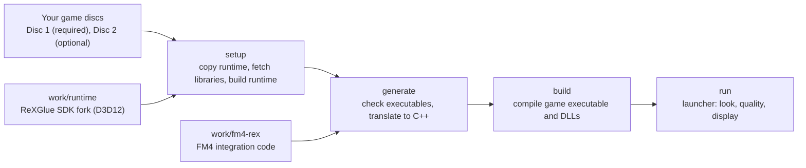

# Motorsport DX

Motorsport DX runs **Forza Motorsport 4** (Xbox 360), recompiled for Windows x64 from the player's own discs. It is an experimental recompilation built on the ReXGlue SDK with runtime and GPU patches derived from ReXGlue and Xenia. The project provides integration code and a setup, generate, build, and run workflow that works from **game data you own**. ReXGlue translates the Xbox 360 executable into C++ locally, and the toolchain builds it into an executable and DLLs for PC. Xbox services and graphics are handled by the SDK runtime.

The repository does not include the game, original assets, recompiled code, or a ready-to-run binary. Cloning is not enough: prepare the game data and build prerequisites first.

Motorsport DX is not affiliated with or endorsed by Microsoft, Xbox Game Studios or Turn 10 Studios. Forza Motorsport and Xbox are trademarks of the Microsoft group of companies. The project was called FM4-PC until 25 October 2026. Its GUI launcher is `MotorsportDX.exe` since 26 October 2026 (`fm4_launcher.exe` before); the game's own program files (`fm4_rex.exe` and its DLLs), the `FM4_*` variables, the folders and the repository keep their FM4 names as internal names ([why](docs/analysis/preview.md#4-internal-names)).

## Status

- **Latest verification:** 30 October 2026. The automated e2e harness runs Quick Race, photo mode and career races through to the reward on the latest build, and a World Tour run of 19 events in one process ran for two hours without a failure. Level 1 of the native renderer (no shader compiles during play) passed its final gate on 29 October 2026. A fresh clone set up, generated and built the game from the USA discs on the development computer on 25 October 2026.
- **Tested hardware:** the development laptop (Intel Core Ultra 7 255HX, RTX 5070 Ti Laptop GPU) and, from exports, a ROG Xbox Ally X (Radeon 890M), where the project owner plays Quick Race, career, photo mode and replays; the latest build has not run there yet. No other GPU has been tried.
- **Status:** an experimental build, not yet a full port with all features and verified stability. What is known not to work or not tested is in [known issues](docs/known-issues.md); how to report a problem is in [bug reports](docs/bug-reports.md).
- **Details:** [current status](docs/status/current.md) and [history](docs/status/history.md).

## Supported game version

- **Forza Motorsport 4 Japan/Asia** (Play Disc media ID `633772A0`) or **USA** (media ID `26FF1101`). The three executables are checked by SHA-256 in [`pipeline.py`](outputs/FM4-build/pipeline.py), and all three must come from one of these releases. Both releases have the same game code and assets; only the executable headers differ (see [release comparison](docs/analysis/releases.md)). Other regions, other revisions, modified executables, and title updates are rejected.
- **Disc 1 is required**, extracted, and it must contain all game assets.
- **Disc 2 is optional.** It is not needed for basic startup, but it is required to import its additional car content.
- **Downloadable content is optional.** FM4 car and track packs you own are imported from their content packages with `-Content`.
- You extract the discs yourself. The scripts do not download game data.

Full details are in the [setup guide](docs/setup.md).

## How the pieces fit together



## Quick start

Prerequisites (Windows x64, Git, Python 3.11+ x64, the Visual Studio 2022 C++ tools, and LLVM 20.x) are listed in [docs/setup.md](docs/setup.md). The scripts check them but do not install them.

Run the following in PowerShell. Replace the example paths with the locations on your computer.

### 1. Clone the repository

```powershell
git clone https://github.com/MotorsportDX/MotorsportDX.git
Set-Location MotorsportDX
```

### 2. Choose directories and check the toolchain

Windows does not run PowerShell scripts by default. After you have reviewed `Build.ps1`, allow scripts for this PowerShell window only (no system setting changes), then set the directories:

```powershell
Set-ExecutionPolicy -Scope Process -ExecutionPolicy Bypass

$common = @{
    BuildRoot = 'D:\FM4-build'
    LLVMRoot  = 'C:\Program Files\LLVM'
    Python    = 'C:\Python311\python.exe'
    Jobs      = 4
}

.\outputs\FM4-build\Build.ps1 -Action doctor @common
```

`Build.ps1` sets up the Visual Studio x64 environment automatically. `LLVMRoot` is the LLVM installation directory, the one that contains a `bin` folder. `Python` is the path of a Python 3.11 or newer (x64); `py -0p` lists the installed ones. Raise `Jobs` towards the number of CPU threads to build faster: with 8 jobs, `all` took about 16 minutes on the development laptop.

### 3. Set up, generate, and build

```powershell
$discs = @{
    Disc1 = 'D:\Games\FM4\Disc 1'
    Disc2 = 'D:\Games\FM4\Disc 2'
}

.\outputs\FM4-build\Build.ps1 -Action all @common @discs
```

Remove the `Disc2` entry if you want to use only the Disc 1 content. Add `Content = 'D:\Games\FM4\DLC'` to import downloadable content packages from a folder; see [Downloadable content](docs/setup.md#downloadable-content). The `all` action runs three stages: setup (copies the runtime, fetches third-party libraries, and builds the runtime), generate (checks your executables and generates the C++ source from your discs), and build (compiles the executable, modules, and DLLs). Each stage can also be run on its own with `-Action setup`, `-Action generate`, or `-Action build`. Use the same `BuildRoot` for every stage. `all` does not start the game.

Generated source, binaries, and logs stay in `BuildRoot`. Do not commit or upload that directory.

## Running the game

```powershell
.\outputs\FM4-build\Build.ps1 -Action run @common
```

By default the game runs in full screen on the primary monitor (`-Display native`), at `high` quality, with the `aces` look (`pc` is its earlier name). That look adds the project's post-processing, car paint clearcoat, screen-space ambient occlusion, TAA, a lighter cockpit interior and cockpit window glass; `gt`, `neutral`, `gt7` (after Gran Turismo 7) and `fm2023` (after Forza Motorsport 2023) have the same mods with another tone curve or grade. The default render path is the native path: races in one pass with 2x MSAA at the screen's own resolution and aspect (Hor+ on ultrawide screens, Vert+ on 16:10), or at 1x with integrated GPUs only. `-Rtv` runs RTV, the earlier default, kept as a fallback without new features: a 16:9 picture at a whole multiple of 720p, with races in one tile without MSAA. `-Look original` returns the FM4 look with TAA only, and `-Look "original,taa=0"` the unmodified picture. Quick Race holds a steady 60 fps on the development computer. Frequently used options include `-FrameRate 120` (30 to 240), `-Quality low|medium|high|extrahigh|ultra`, `-Supersample`, and `-Info`, which shows a settings overlay that F2 toggles. Pads, the keyboard and racing wheels have their own options (`-Pad`, `-Keyboard`, `-Wheel`; the wheel is off by default until it is tested on real hardware). The launcher reads the disc locations saved during `generate`. Discs are read from their input locations, and the game directory is not written to. Old saves are not copied automatically. Run options, look knobs, the controls of pads, keyboards and wheels, and data directories are described in [docs/running.md](docs/running.md).

`build` also builds a GUI launcher, `BuildRoot\game-build\MotorsportDX.exe`, which offers the same options, profiles, look sliders, key bindings, the racing wheel's settings and test, and Disc and content checks, with pad, mouse and touch controls, and starts the game without Python or Visual Studio. It runs the shader pass after an install or an update, so the game compiles no shaders during play. To play on another computer, export the build and copy the folder there:

```powershell
.\outputs\FM4-build\Build.ps1 -Action export @common -Out 'E:\FM4-portable'
```

The other computer needs the Visual C++ 2015-2022 x64 redistributable, a Direct3D 12 GPU, and your extracted discs. See [GUI launcher](docs/running.md#gui-launcher) and [Export](docs/running.md#export-to-another-computer).

## Testing

The end-to-end harness, [`e2e.py`](outputs/FM4-build/e2e/e2e.py), runs the game from `BuildRoot` with a diagnostic controller, records captures and per-second performance traces, and writes `summary.json`. Its scenarios cover Quick Race, photo save and load, career races, career races through to the reward, and a World Tour season in one process with memory and handle telemetry for soak tests. They follow fixed timelines and check the screen with Windows OCR. [`matrix.py`](outputs/FM4-build/e2e/matrix.py) runs them as tiered gates (smoke, perf, full, career and cold) on a copy of the build. The harness needs no network access. See the [e2e overview](docs/e2e/README.md) for usage, gates, and scenarios.

## Known limitations

- **Limited compatibility:** only Windows x64 and the Japan/Asia and USA releases whose hashes are checked. Other regions and title updates are not supported.
- **Graphics not fully accurate:** parity with the Xbox picture (shadows, colour, reflections, noise and object edges) has not been compared, and the sun glare's strength follows the MSAA level unless the look's `sun` knob evens it out. Combinations of MSAA and resolution scale need wider testing.
- **Shaders on a fresh install:** the GUI launcher's shader pass prepares the shaders before the first session; photos taken with an empty shader cache have not been retested.
- **Runtime incomplete:** some Xbox services are still stubs. The instruction tests do not prove that the kernel, audio, timing, or synchronization is correct.
- **Gameplay coverage incomplete:** not every car, track, and mode, sessions over two hours, audio, Kinect, multiplayer, online, and most cars of downloadable content have been validated. One DLC car on a DLC track is covered by the `dlc` e2e scenario. Save migration between builds or computers, other GPUs, and performance are not guaranteed. "Not verified" does not mean "broken".
- **Test driver:** the harness drives cars with FM4's own AI, through the rebuilt `engageaionstart` developer option. This is a test tool, not a player feature. Some FM4 menus ignore the first press, so the scenarios press until the expected screen is read.

The next validation priorities are the latest build on the ROG Xbox Ally X, a real racing wheel and a clean setup on a second computer, then audio, split screen, Rivals, Hot Lap, the career's later divisions and more GPUs, which need testers who own the game, and a soak that revisits tracks after the first two-hour soak ([career season soak](docs/analysis/career-season-soak.md)). The full list is in [current status](docs/status/current.md), and the preview checklist in the [preview plan](docs/analysis/preview.md).

## Documentation

| Document | Contents |
| --- | --- |
| [AGENTS.md](AGENTS.md) | Rules for AI agents working in this repository: language, documentation layout, and repository rules |
| [docs/setup.md](docs/setup.md) | Prerequisites, setup, generate, build, BuildRoot layout, and troubleshooting |
| [docs/running.md](docs/running.md) | The launchers, run options, display and render path, looks, pads, keyboards and wheels, the shader cache and data directories |
| [docs/known-issues.md](docs/known-issues.md) | For players: the tested hardware, what works, known problems and what is not tested yet |
| [docs/bug-reports.md](docs/bug-reports.md) | For players: what to write in a bug report, which logs and traces to send, and how to collect them |
| [docs/status/current.md](docs/status/current.md) | Current state, what is verified on the latest build, open gaps, and next validation |
| [docs/status/history.md](docs/status/history.md) | Dated history, superseded settings and decisions; the earlier verified results are in [results history](docs/status/history-results.md) and [performance history](docs/status/history-performance.md) |
| [docs/e2e/README.md](docs/e2e/README.md) | End-to-end harness overview, usage, gates, and scenarios; with its [architecture](docs/e2e/architecture.md), [trace variables](docs/e2e/traces.md), [experiment switches](docs/e2e/experiments.md) and [frozen frames](docs/e2e/frozen-frames.md) |
| [docs/analysis/README.md](docs/analysis/README.md) | Index of the research and design notes (the native port, post passes, looks, input, game content), each marked active, done or superseded |
| [docs/sources-and-licensing.md](docs/sources-and-licensing.md) | Repository contents, the third-party components and their licenses, what may be distributed, the history check, and the pre-commit check |

## Licensing and attribution

Motorsport DX's own code is licensed under the [BSD 3-Clause License](LICENSE). The ReXGlue SDK fork in `work/runtime` (BSD-3-Clause, with Xenia-derived portions) keeps its upstream notices, and the third-party code keeps its own licenses (below). The license gives no rights to FM4 game content. Only the source is distributed: the game's executables and DLLs that `build` makes, an export, and any game data stay with the player who built them ([distribution](docs/sources-and-licensing.md#distribution)). See [docs/sources-and-licensing.md](docs/sources-and-licensing.md).

## Credits

### Acknowledgements

Motorsport DX would not exist without the people and projects below.

- **The ReXGlue SDK** ([rexglue/rexglue-sdk](https://github.com/rexglue/rexglue-sdk)), the recompiler and runtime that this project forks. Its README credits [Tom (crack)](https://github.com/tomcl7), the project founder; [Loreaxe](https://github.com/Loreaxe) (Linux), [mystixor](https://github.com/Mystixor) (Windows), [Carlos Estrague (mrcmunir)](https://github.com/mrcmunir) (Linux and ARM64), [sanjay900](https://github.com/sanjay900) (Linux and SDL) and [Roxxsen](https://github.com/Roxxsen) (CI/CD) as contributors; [Graine25](https://github.com/Graine25) and [Toby](https://github.com/TbyDtch) for project support; and everyone in the ReXGlue community.
- **Xenia** ([xenia.jp](https://xenia.jp), [xenia-project/xenia](https://github.com/xenia-project/xenia)): Ben Vanik and the Xenia project contributors, whose Xbox 360 emulation (the kernel, the GPU and the audio) laid the ground that ReXGlue and this runtime stand on. [Xenia Canary](https://github.com/xenia-canary/xenia-canary): the optional FM4 shadow workaround follows its game patches, and the vector dot products follow its arithmetic.
- **XenonRecomp** ([hedge-dev/XenonRecomp](https://github.com/hedge-dev/XenonRecomp)), by hedge-dev and contributors, which pioneered the modern approach to Xbox 360 static recompilation. ReXGlue's README says that much of its code analysis and instruction translation is based on XenonRecomp's work.
- **rexdex's recompiler** ([rexdex/recompiler](https://github.com/rexdex/recompiler)), the original Xbox 360 static recompiler, which ReXGlue names as an inspiration.
- **XenosRecomp** and **Unleashed Recompiled** ([hedge-dev/XenosRecomp](https://github.com/hedge-dev/XenosRecomp), [hedge-dev/UnleashedRecomp](https://github.com/hedge-dev/UnleashedRecomp)), whose shader recompiler and port of a game at the Direct3D level showed the way for this project's shader mods and its native render path. They were read for ideas; this project uses no code of them.
- The Xbox 360 homebrew, modding and reverse-engineering communities, whose research is the shared knowledge that projects like this build on.
- The tools that build it: LLVM and Clang, CMake and Ninja, Python, Git, Microsoft's Visual Studio build tools, the Windows SDK with its shader compiler (FXC), and the DirectX Shader Compiler.
- Turn 10 Studios, who made Forza Motorsport 4.

The same thanks are in [CREDITS.txt](outputs/FM4-build/CREDITS.txt), which `build` and `export` put beside `MotorsportDX.exe`, and on the GUI launcher's About page.

### Third-party code

The third-party code in the program files, with its license. The license texts are in the [third-party notices](outputs/FM4-source-control/third-party-notices/README.txt), which every export carries; the versions, and the binary each one ends up in, are in [third-party components](docs/sources-and-licensing.md#third-party-components).

- [ReXGlue SDK](https://github.com/rexglue/rexglue-sdk), Copyright (c) 2026 Tom Clay, BSD-3-Clause: the recompiler and the runtime that `work/runtime` forks.
- [Xenia](https://xenia.jp), Copyright (c) 2022 Ben Vanik and Xenia project contributors, BSD-3-Clause: the Xbox 360 kernel, GPU and audio emulation that ReXGlue derives from, including the resolve shaders.
- [XenonRecomp](https://github.com/hedge-dev/XenonRecomp), Copyright (c) 2025 hedge-dev and contributors, MIT: the PPC context, function wrappers and SIMD patterns that ReXGlue's runtime marks as based on it.
- [SDL 3](https://github.com/libsdl-org/SDL), Copyright (C) 1997-2026 Sam Lantinga, zlib license: the window, input and audio layer, built from source with a patch for GameInput API v3.
- The GameInput API v3 header and loader from Microsoft's [Microsoft.GameInput](https://www.nuget.org/packages/Microsoft.GameInput) package, Copyright (c) Microsoft Corporation, MIT license: built into SDL's GameInput driver for the pad driver choice `gameinput`.
- The [DirectX Shader Compiler](https://github.com/microsoft/DirectXShaderCompiler) v1.9.2609, Copyright (c) Microsoft Corporation, under Microsoft's license terms with LLVM's NCSA license and MIT: it compiles the native path's DXIL shaders with `native_shader_dxil`. Setup or the GUI launcher fetches it on the user's computer; the project never ships it.
- [Dear ImGui](https://github.com/ocornut/imgui), Omar Cornut, MIT: the settings overlay and the GUI launcher.
- [FFmpeg](https://ffmpeg.org) (Xenia's fork), LGPL 2.1 or later: XMA and WMA audio decoding. [libmspack](https://github.com/kyz/libmspack), Stuart Caie, LGPL 2.1: the LZX decompression of the executables.
- [{fmt}](https://github.com/fmtlib/fmt) (Victor Zverovich), [spdlog](https://github.com/gabime/spdlog) (Gabi Melman), [toml++](https://github.com/marzer/tomlplusplus) (Mark Gillard), [SIMD Everywhere](https://github.com/simd-everywhere/simde) (Evan Nemerson), [o1heap](https://github.com/pavel-kirienko/o1heap) (Pavel Kirienko), [inja](https://github.com/pantor/inja) (Lars Berscheid) and [JSON for Modern C++](https://github.com/nlohmann/json) (Niels Lohmann), MIT; [xxHash](https://github.com/Cyan4973/xxHash) (Yann Collet), BSD-2-Clause; [CLI11](https://github.com/CLIUtils/CLI11) (University of Cincinnati), BSD-3-Clause; [UTF8-CPP](https://github.com/nemtrif/utfcpp) (Nemanja Trifunovic), Boost Software License.
- The small libraries that ReXGlue vendors from Xenia: aes_128, DES, TinySHA1, Stephan Brumme's SHA-256, the Rijndael reference code, [stb_image](https://github.com/nothings/stb), disruptorplus, the RenderDoc API header, the DirectX Shader Compiler API headers, AMD's DXBC checksum (derived from the RSA Data Security, Inc. MD5 Message-Digest Algorithm) and the ProggyTiny font.
- AMD FidelityFX: Contrast Adaptive Sharpening and FidelityFX Super Resolution 1 in the presenter (from Xenia), and FidelityFX Super Resolution 3.1 from the [AMD FidelityFX SDK](https://github.com/GPUOpen-LibrariesAndSDKs/FidelityFX-SDK), Copyright (C) 2024 Advanced Micro Devices, Inc., MIT, built from source into the runtime when it is built with `-Fsr on`, with Microsoft's `d3dx12.h` (MIT).
- The GT7 tone mapping operator from Polyphony Digital's sample implementation (`gt7_tone_mapping.cpp`, SIGGRAPH 2025), Copyright (c) 2025 Polyphony Digital Inc., MIT: ported to HLSL in the look mods as the tone curve of the `gt7` look.
- The recompiler uses the GNU binutils PowerPC disassembler (GPL 2.0 or later) at build time; it is not part of the game's binaries.

## Pre-commit check

Before committing, check the staged content:

```powershell
& 'C:\Python311\python.exe' .\outputs\FM4-source-control\check-staged-content.py
```

The check guards against accidental additions. It does not replace a review of where the content came from.
