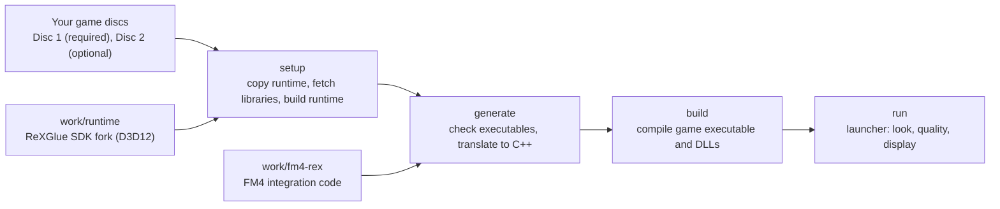

# FM4-PC

Experimental recompilation of **Forza Motorsport 4 for Windows x64**, built on the ReXGlue SDK with runtime and GPU patches derived from ReXGlue and Xenia. The project provides integration code and a setup, generate, build, and run workflow that works from **game data you own**. ReXGlue translates the Xbox 360 executable into C++ locally, and the toolchain builds it into an executable and DLLs for PC. Xbox services and graphics are handled by the SDK runtime.

The repository does not include the game, original assets, recompiled code, or a ready-to-run binary. Cloning is not enough: prepare the game data and build prerequisites first.

## Status

- **Latest verification:** 16 October 2026, by the automated e2e harness on the current build. Setup, generate, and build from a clean copy of the Git files were checked on 13 and 14 October 2026. The USA release was checked on 18 October 2026 with a clean setup, generate, and build from its discs and a smoke gate.
- **Status:** Builds from a clean source tree and runs Quick Race, photo mode, and career races through to the reward on the latest build (tested automatically). It is not yet a full port with all features and verified stability.
- **Details:** [current status](docs/status/current.md) and [history](docs/status/history.md).

## Supported game version

- **Forza Motorsport 4 Japan/Asia** (Play Disc media ID `633772A0`) or **USA** (media ID `26FF1101`). The three executables are checked by SHA-256 in [`pipeline.py`](outputs/FM4-build/pipeline.py), and all three must come from one of these releases. Both releases have the same game code and assets; only the executable headers differ (see [release comparison](docs/analysis/releases.md)). Other regions, other revisions, modified executables, and title updates are rejected.
- **Disc 1 is required**, extracted, and it must contain all game assets.
- **Disc 2 is optional.** It is not needed for basic startup, but it is required to import its additional car content.
- **Downloadable content is optional.** FM4 car and track packs you own are imported from their content packages with `-Content`.
- You extract the discs yourself. The scripts do not download game data.

Full details are in the [setup guide](docs/setup.md).

## How the pieces fit together



## Quick start

Prerequisites (Windows x64, Git, Python 3.11+ x64, the Visual Studio 2022 C++ tools, and LLVM 20.x) are listed in [docs/setup.md](docs/setup.md). The scripts check them but do not install them.

Run the following in PowerShell. Replace the example paths with the locations on your computer.

### 1. Clone the repository

```powershell
git clone https://github.com/dfebri446/FM4-PC.git
Set-Location FM4-PC
```

### 2. Choose directories and check the toolchain

```powershell
$common = @{
    BuildRoot = 'D:\FM4-build'
    LLVMRoot  = 'C:\Program Files\LLVM'
    Python    = 'C:\Python311\python.exe'
    Jobs      = 4
}

.\outputs\FM4-build\Build.ps1 -Action doctor @common
```

`Build.ps1` sets up the Visual Studio x64 environment automatically. `LLVMRoot` is the LLVM installation directory, the one that contains a `bin` folder.

### 3. Set up, generate, and build

```powershell
$discs = @{
    Disc1 = 'D:\Games\FM4\Disc 1'
    Disc2 = 'D:\Games\FM4\Disc 2'
}

.\outputs\FM4-build\Build.ps1 -Action all @common @discs
```

Remove the `Disc2` entry if you want to use only the Disc 1 content. Add `Content = 'D:\Games\FM4\DLC'` to import downloadable content packages from a folder; see [Downloadable content](docs/setup.md#downloadable-content). The `all` action runs three stages: setup (copies the runtime, fetches third-party libraries, and builds the runtime), generate (checks your executables and generates the C++ source from your discs), and build (compiles the executable, modules, and DLLs). Each stage can also be run on its own with `-Action setup`, `-Action generate`, or `-Action build`. Use the same `BuildRoot` for every stage. `all` does not start the game.

Generated source, binaries, and logs stay in `BuildRoot`. Do not commit or upload that directory.

## Running the game

```powershell
.\outputs\FM4-build\Build.ps1 -Action run @common
```

By default the game runs in full screen on the primary monitor (`-Display native`), at `high` quality, with the `aces` look (`pc` is its earlier name). That look adds the project's post-processing, car paint clearcoat, screen-space ambient occlusion, TAA, a lighter cockpit interior and cockpit window glass; `gt` and `neutral` have the same mods with another tone curve. With TAA, races render one tile without MSAA. `-Look original` returns the FM4 look with TAA only, and `-Look "original,taa=0"` the unmodified picture. Quick Race holds a steady 60 fps on the development computer. Frequently used options include `-FrameRate 120` (30 to 240), `-Quality xbox|high|ultra`, `-Supersample`, and `-Info`, which shows a settings overlay that F2 toggles. The launcher reads the disc locations saved during `generate`. Discs are read from their input locations, and the game directory is not written to. Old saves are not copied automatically. Run options, look knobs, keyboard and controller controls, and data directories are described in [docs/running.md](docs/running.md).

`build` also builds a GUI launcher, `BuildRoot\game-build\fm4_launcher.exe`, which offers the same options, profiles, look sliders, key bindings, and Disc and content checks, and starts the game without Python or Visual Studio. To play on another computer, export the build and copy the folder there:

```powershell
.\outputs\FM4-build\Build.ps1 -Action export @common -Out 'E:\FM4-portable'
```

The other computer needs the Visual C++ 2015-2022 x64 redistributable, a Direct3D 12 GPU, and your extracted discs. See [GUI launcher](docs/running.md#gui-launcher) and [Export](docs/running.md#export-to-another-computer).

## Testing

The end-to-end harness, [`e2e.py`](outputs/FM4-build/e2e/e2e.py), runs the game from `BuildRoot` with a diagnostic controller, records captures and per-second performance traces, and writes `summary.json`. Its scenarios cover Quick Race, photo save and load, career races, and career races through to the reward. They follow fixed timelines and check the screen with Windows OCR. [`matrix.py`](outputs/FM4-build/e2e/matrix.py) runs them as tiered gates (smoke, perf, full, and career) on a copy of the build. The harness needs no network access. See the [e2e overview](docs/e2e/README.md) for usage, gates, and scenarios.

## Known limitations

- **Limited compatibility:** only Windows x64 and the Japan/Asia and USA releases whose hashes are checked. Other regions and title updates are not supported.
- **Graphics not fully accurate:** the sun glare strength changes with the MSAA level on both render target paths (parity with the Xbox glare is not a goal). The empirical sun occlusion correction (factor 2) of the ROV path (`-Rov`) was removed on 18 October 2026, so `-Rov` stays an uncorrected reference. Noise, reflections, object edges, and combinations of MSAA and resolution scale need wider testing.
- **Synchronous shaders:** shader sync is on by default to avoid skipped draws that once caused black photos. An empty shader cache only adds load hitches, not race fps loss, but photos taken with an empty cache have not been retested.
- **Runtime incomplete:** some Xbox services are still stubs. The instruction tests do not prove that the kernel, audio, timing, or synchronization is correct.
- **Gameplay coverage incomplete:** not every car, track, and mode, long sessions, audio, Kinect, multiplayer, online, and most cars of downloadable content have been validated. One DLC car on a DLC track is covered by the `dlc` e2e scenario. Save migration between builds or computers, other GPUs, and performance are not guaranteed. "Not verified" does not mean "broken".
- **Test driver:** the harness drives cars with FM4's own AI, through the rebuilt `engageaionstart` developer option. This is a test tool, not a player feature. Some FM4 menus ignore the first press, so the scenarios press until the expected screen is read.

The next validation priorities are a second computer, Disc 2 car races on the latest build, photo overwrite and photos with an empty shader cache, and Autovista. The full list is in [current status](docs/status/current.md).

## Documentation

| Document | Contents |
| --- | --- |
| [AGENTS.md](AGENTS.md) | Rules for AI agents working in this repository: language, documentation layout, and repository rules |
| [docs/setup.md](docs/setup.md) | Prerequisites, setup, generate, build, BuildRoot layout, and troubleshooting |
| [docs/running.md](docs/running.md) | Launcher run, options, look knobs, the controller options, controls, and data directories |
| [docs/status/current.md](docs/status/current.md) | Current state, what is verified on the latest build, open gaps, and next validation |
| [docs/status/history.md](docs/status/history.md) | Dated history, past results, and dated test runs |
| [docs/e2e/README.md](docs/e2e/README.md) | End-to-end harness overview, usage, gates, and scenarios |
| [docs/e2e/architecture.md](docs/e2e/architecture.md) | How the e2e harness and its game-side hooks are built, platform and backend dependencies, and a porting checklist |
| [docs/e2e/traces.md](docs/e2e/traces.md) | Debug trace environment variables |
| [docs/e2e/experiments.md](docs/e2e/experiments.md) | A/B overrides and shader override diagnostics |
| [docs/analysis/post-pass-framework.md](docs/analysis/post-pass-framework.md) | The runtime's post pass framework: screen passes from HLSL files and a manifest, injection points, history, object motion |
| [docs/analysis/gtao-design.md](docs/analysis/gtao-design.md) | Design of the GTAO ambient occlusion pass, from frame graph observations |
| [docs/analysis/motion-vectors.md](docs/analysis/motion-vectors.md) | Per-pixel motion vectors for TAA and upscalers: the game's motion blur reprojection, its stencil object IDs, and the host-built per-car pass |
| [docs/analysis/hdr-output.md](docs/analysis/hdr-output.md) | Design note for HDR10 output: where the frame loses its range, the measured highlight range, options and the recommended design |
| [docs/analysis/cp-draw-offload.md](docs/analysis/cp-draw-offload.md) | Feasibility of moving draw work off the command processor thread: where the time goes, per-draw workers, a PM4 front end and back end split, cheaper per-draw savings, measurements and recommendation |
| [docs/analysis/d3d-hle.md](docs/analysis/d3d-hle.md) | Emulating the GPU at the D3D API level instead of PM4 and EDRAM: the title's D3D layer, resolves and surfaces, where executed draws come from, three designs, and the chosen native port's architecture and stages |
| [docs/analysis/d3d-hle-n3.md](docs/analysis/d3d-hle-n3.md) | Stage N3 of the native port (section 16 of the design): resolves and readbacks on demand, resolves from the host render targets, sized targets and one-pass MSAA |
| [docs/analysis/d3d-hle-n4.md](docs/analysis/d3d-hle-n4.md) | Stage N4 of the native port (section 17 of the design): taking CPU time off the render thread, with deferred constant buffers and the draw back end on the replay side |
| [docs/analysis/d3d-hle-n5.md](docs/analysis/d3d-hle-n5.md) | Stage N5 of the native port (section 18 of the design): the panel's own resolution and aspect on the native path |
| [docs/analysis/fsr-plan.md](docs/analysis/fsr-plan.md) | Plan for AMD FSR 3.1 beside TAA: version and license, the build (stage 0, linked behind `REX_FSR`), native anti-aliasing at the scene_color point (stage 1, the look's `aa=fsr`), upscaling on N5's scales, validation and stages |
| [docs/analysis/taa.md](docs/analysis/taa.md) | TAA at the existing render scale, in every look preset: current state, injection points, jitter, the scene camera, tiling, the resolve, knobs, validation and history |
| [docs/analysis/texture-replacement.md](docs/analysis/texture-replacement.md) | Texture dumps and replacements keyed by a content hash: the hash, the DDS formats, and what is not covered |
| [docs/analysis/b4-shader-research.md](docs/analysis/b4-shader-research.md) | Research on the editable shader path (HLSL through FXC, with overrides per hash) |
| [docs/analysis/shader-mod-iteration.md](docs/analysis/shader-mod-iteration.md) | Iterating on shader mods: the DXBC cache, hot reload and live look knobs |
| [docs/analysis/visual-style.md](docs/analysis/visual-style.md) | Research on the origin of FM4's visual style |
| [docs/analysis/cockpit-brightness.md](docs/analysis/cockpit-brightness.md) | Why the cockpit interior is so dark on sunny tracks (the game's interior lighting, not RTV or the look), and knob candidates |
| [docs/analysis/releases.md](docs/analysis/releases.md) | How the Japan/Asia and USA releases differ, and why one build serves both |
| [docs/analysis/title-updates.md](docs/analysis/title-updates.md) | What the title updates contain and change, the runtime's patch support, and what supporting one would take |
| [docs/analysis/dlc-structure.md](docs/analysis/dlc-structure.md) | How FM4 content packages are laid out, mounted and licensed, and what a new mod package would need |
| [docs/analysis/modern-gamepads.md](docs/analysis/modern-gamepads.md) | Modern pads (Xbox Series and Elite, DualSense, DualShock 4, the ROG Xbox Ally X): SDL's Windows drivers per pad, the title's own deadzones and rumble, input latency, and the stage 2 options with their verification |
| [docs/analysis/keyboard-controls.md](docs/analysis/keyboard-controls.md) | Driving on a keyboard: today's digital keys and the title's deadzones, FM4's own controls, a time-based steering and pedal model, the live deadzone compensation, a racing layout, tests and options (stage 1 design) |
| [docs/analysis/rain-feasibility.md](docs/analysis/rain-feasibility.md) | Whether the physics still has a wet grip modifier (it does not read one), and how a hook or a surface file overlay could lower grip for a wet race |
| [docs/analysis/material-atlas.md](docs/analysis/material-atlas.md) | Summary of the material atlas: names and registers of the game's constant tables |
| [docs/analysis/look-mod-coverage.md](docs/analysis/look-mod-coverage.md) | Which final combine, motion blur and car paint hashes each track and mode uses, and which have no look mod |
| [docs/analysis/photo-autovista-replay.md](docs/analysis/photo-autovista-replay.md) | How photo mode, Autovista and replays render, what the gates cover, and the plan for them (M5) |
| [docs/analysis/direct-race-launch.md](docs/analysis/direct-race-launch.md) | How GO RACE starts a Quick Race, what a launch without the menus would need, and an estimate (not built); the e2e fast route through the menus that was built instead |
| [docs/sources-and-licensing.md](docs/sources-and-licensing.md) | Repository contents, attribution, licenses, and the pre-commit check |

## Licensing and attribution

The repository contains reviewed integration code and a ReXGlue SDK fork (BSD-3-Clause, with Xenia-derived portions), and it keeps the upstream notices. The project does not assign a blanket license of its own, and it provides no rights to FM4 game content. See [docs/sources-and-licensing.md](docs/sources-and-licensing.md).

## Credits

AMD FidelityFX Super Resolution 3.1 (FSR 3.1), from the [AMD FidelityFX SDK](https://github.com/GPUOpen-LibrariesAndSDKs/FidelityFX-SDK), Copyright (C) 2024 Advanced Micro Devices, Inc., MIT license; built from source into the runtime when it is built with `-Fsr on`. See the [third-party notices](outputs/FM4-source-control/third-party-notices/README.txt).

## Pre-commit check

Before committing, check the staged content:

```powershell
& 'C:\Python311\python.exe' .\outputs\FM4-source-control\check-staged-content.py
```

The check guards against accidental additions. It does not replace a review of where the content came from.
