# HDR output

Design note for HDR10 output (20 October 2026): where the frame loses its range today, how much range the game's data actually holds, the options, and the recommended design. Nothing is built yet except a diagnostic switch of the look mods (`FM4_LOOK_HDR_PROBE`, off by default) that measured the range.

This note contains no game code, shaders or ucode. Hashes, registers and formats are observations only.

## Summary

- **The frame is SDR from the final combine on.** The scene is rendered in 7e3 (a float format on the host), but it reaches the final combine through a `k_2_10_10_10` resolve in gamma 2, clamped to 0...1. The final combine maps it with the track's filmic curve, a 3D grading LUT and a color matrix that saturates, and writes gamma 2 into a 10-bit unorm target. The HUD, the resolve to the front buffer, the game's gamma ramp and an 8-bit swap chain (`B8G8R8A8_UNORM`, no color space set) follow.
- **The range in the data is modest.** In race frames on the Bernese Alps (`photo` scenario, 1x) the scene clips at the resolve at 3.9 stops above middle gray (up to 5.0 when the auto exposure is high), the curve reaches white at 3.6 stops, and bloom can add at most one stop. Scene pixels at the resolve clip are rare (0.13% or less). Typically 0.3% of the pixels or fewer are at or above the curve's white; with a higher exposure and the camera toward the sky, up to 7.8%. The SDR curve spends about 2 stops (from about +1.5 to +3.6) in its shoulder. HDR output can therefore give highlights up to about 2.6 times paper white from the scene and about 5.3 times with bloom (530 to 1,060 nits at a paper white of 200 nits; more when the auto exposure is high), mainly as a less compressed shoulder: sky, sun glints, bright paint and snow.
- **Recommendation: keep the guest frame SDR and add the highlights at the swap.** The final combine look mod computes the HDR value and writes only the part above SDR into a side texture; the EDRAM target stays byte-identical, so the HUD, the side mirrors, the photo save, the CPU readbacks, the e2e captures and the ROV path are unchanged. At the swap a compose pass takes the front buffer after the game's gamma ramp, decodes it to linear at paper white, adds the side texture where the HUD did not draw, and encodes PQ in BT.2020 into an `R10G10B10A2_UNORM` swap chain with `DXGI_COLOR_SPACE_RGB_FULL_G2084_NONE_P2020`. About two weeks in four stages; the first stage (the HDR10 swap chain with SDR at paper white) is useful alone and proves the output path.

## 1. The frame path today

Confirmed from the code, the ucode dump of the race final combine, an existing draw list trace (`mvA`, 18 October 2026) and the probe run of section 2.

```mermaid
flowchart LR
    scene["Scene tiles<br/>k_2_10_10_10_FLOAT (7e3)<br/>host R16G16B16A16_FLOAT"] -->|"resolve<br/>clamp 0...1, gamma 2"| sc["scene_color<br/>k_2_10_10_10"]
    sc --> chain["Motion blur, bloom<br/>k_2_10_10_10<br/>exposure 32x32 k_32_FLOAT"]
    chain --> fc["Final combine<br/>filmic, LUT, matrix (sat)<br/>sqrt: gamma 2<br/>k_2_10_10_10"]
    fc --> hud["HUD, side mirrors<br/>k_2_10_10_10_AS_10_10_10_10"]
    hud -->|resolve| fb["Front buffer<br/>k_2_10_10_10"]
    fb --> ramp["apply_gamma_pwl<br/>game's ramp<br/>guest output R10G10B10A2"]
    ramp --> paint["Presenter paint<br/>bilinear, CAS, FSR, area"]
    paint --> sw["Swap chain<br/>B8G8R8A8_UNORM"]
```

| Step | Format and place | Evidence | Range |
|---|---|---|---|
| Scene tiles | `k_2_10_10_10_FLOAT` (7e3, 0 to 31.875); on the RTV path `R16G16B16A16_FLOAT` | `GetColorResourceDXGIFormat` in [render_target_cache.cpp](../../work/runtime/src/graphics/d3d12/render_target_cache.cpp); `RB_COLOR_INFO` in `mvA`: the 7e3 formats (3 and 12), exponent bias 0 on every color target of the traced frame | HDR |
| Scene resolve | `k_2_10_10_10`, gamma 2 | [post pass framework](post-pass-framework.md#where-the-passes-run); the final combine squares it | **clamped to 1** (linear) |
| Post chain | bloom and its downsamples, resolved as `k_2_10_10_10`, the auto exposure from a 32x32 `k_32_FLOAT` target (`CAF3881F7C4CDCAA`) | [visual style](visual-style.md), [B4 research](b4-shader-research.md) | bloom also 0...1 |
| Final combine | one draw into EDRAM base 0, `k_2_10_10_10` (`R10G10B10A2_UNORM` on the host), single-sampled | ucode of `E97AA211B556A9B3` (below); `mvA` | **SDR**: curve, saturating matrix, 10-bit unorm |
| HUD | about 180 draws into the same EDRAM as `k_2_10_10_10_AS_10_10_10_10`; on the RTV path a second host target, copied from the first at the first HUD draw | [post pass framework](post-pass-framework.md#the-final-point-and-upscalers) | SDR, blended in gamma 2 |
| Front buffer | a resolve of that target in `k_2_10_10_10` | `mvA` | SDR |
| Swap | `IssueSwap` picks the PWL ramp for a `k_2_10_10_10` front buffer and runs `apply_gamma_pwl` (or the FXAA luma variant into `R16G16B16A16_UNORM`) into the guest output, `R10G10B10A2_UNORM` | [command_processor.cpp](../../work/runtime/src/graphics/d3d12/command_processor.cpp) (`use_pwl_gamma_ramp`), [d3d12_presenter.h](../../work/runtime/include/rex/ui/d3d12/d3d12_presenter.h) (`kGuestOutputFormat`) | SDR, game's ramp applied |
| Presenter | the paint effects (bilinear, CAS, FSR, area downscale) into the back buffer `B8G8R8A8_UNORM` (`kSwapChainFormat`), no `SetColorSpace1` call (sRGB by default); `present_dither` is off, so 10 bits are truncated to 8 | [d3d12_presenter.cpp](../../work/runtime/src/ui/d3d12/d3d12_presenter.cpp), [presenter.cpp](../../work/runtime/src/ui/presenter.cpp) | **8 bits** |
| Captures | `CaptureGuestOutput` copies the guest output to RGBA8 for the e2e harness | [e2e architecture](../e2e/architecture.md#frame-captures-fm4_capture_dir) | SDR |
| Photo save | resolves of the final image into a 1280x720 `k_8_8_8_8` buffer and a 416x240 thumbnail, read by the game's JPEG encoder from guest memory | [photo mode](photo-autovista-replay.md) | SDR, must stay so |

**The final combine** (`E97AA211B556A9B3`, the race; the vignette, DOF and watermark variants follow the same pattern, [B4 research](b4-shader-research.md#b4-step-4-tone-curves-16-october-2026)): x = (scene² + bloom²) × 2^w, with w the exposure in interpolator 1 W; t = F(x) / F(white), the filmic curve normalized by F at white (interpolator 1 Z); the LUT at t × scale + offset; a 3x3 color matrix with `dp4_sat`, which clamps to 0...1; and the square root, gamma 2. So x is scene-referred and available inside the shader; the range is lost at three places in it: the curve's shoulder, the matrix's saturation and the unorm target.

**Where an HDR signal is lost, in order:** the scene resolve (clamp at 1, but rarely reached, see section 2), the final combine (shoulder, saturation, unorm), and the presenter (8 bits, no HDR color space). Everything after the final combine is SDR by construction.

**The game's gamma ramp** (measured, section 2): the game writes a PWL ramp that the runtime applies at the swap. It differs by mode. In race frames, gamma-2 codes n/16 map to 0, 4, 18, 37, 55, 73, 90, 108, 125, 141, 158, 174, 191, 207, 223, 239 and 255 of 255: nearly linear with the dark end pulled down (1/16 to 4 instead of 16). In the garage frame white maps to 227 of 255 (0.89) with the same toe. The ramp is part of the look and must be applied in HDR too, before the conversion to linear.

## 2. The measured range

`FM4_LOOK_HDR_PROBE=1` (a define of [fm4-look.hlsli](../../work/fm4-rex/look/fm4-look.hlsli), 0 by default) makes the four final combines write a diagnostic image instead of the scene, encoded so that an 8-bit capture can be decoded after the game's ramp:

- a calibration strip of 17 gray steps (n / 16, the left 5% of the scene coordinate), which also measures the ramp;
- three constants as gray (the next 5%): the stops of the resolve clip (a scene value of 1, without bloom), the stops of the curve's white, and log2 of the exposure, each as (stops + 8) / 16;
- the rest: R the brightest channel of x in stops, G 1 where the scene fetch is at 1 (the resolve clip), B 1 where x is at 98% of the curve's white or more.

"Stops" are log2 of x over the x that the game's curve maps to middle gray (0.18 before the LUT). The mods compile for all 140 contracts of the Alps dump with and without the define, and only the five final combine contracts change.

Run `hdrprobe`: BuildRoot `I:\FM4-build-usa` (main `6659663` plus the probe), `e2e.py --scenario photo` at 240 Hz and 1x, look `saturation=1` (the mods loaded at the original look) with `shader_mod_defines=FM4_LOOK_HDR_PROBE=1.0`, Quick Race on the Bernese Alps with the AI driver; exit 0. The race frames are rotated 180 degrees in the scene coordinate; HUD pixels (pure white, or not a probe color) are left out, which leaves 71 to 90% of each frame.

| Frames | Exposure (log2) | Resolve clip | Curve white | Stops p50 / p99 / p99.9 | At the resolve clip | At or above white |
|---|---|---|---|---|---|---|
| Garage before the race (28) | +0.21 | +3.00 | +3.79 | +0.86 / +1.53 / +2.40 | 0.00% | 0.00% |
| Race, typical (47-51, 57-61, 64, 65, 67-81, 83-86; 31 frames) | +0.31 | +3.88 | +3.59 | -3.6 to +1.1 / +2.8 to +3.1 / +2.9 to +4.0 | 0.00 to 0.13% | 0.00 to 0.26% |
| Race, higher exposure (52-56, 62, 63, 66, 82; 9 frames) | +0.7 to +1.5 | +4.2 to +5.0 | +3.59 | -3.9 to +1.8 / +2.5 to +3.7 / +3.1 to +4.3 | 0.00 to 0.07% | 0.0 to 7.8% |
| After the photo save (114) | +0.25 | +3.88 | +3.56 | -0.19 / +2.94 / +3.38 | 0.00% | 0.00% |

Photo mode itself (frames 88 to 113) was not decoded: its menu bar covers the calibration strip.

What this shows:

- **The resolve clamp is not the limit.** Scene pixels at 1 are at most 0.13% of a race frame, so the scene shaders keep their output below the clamp almost everywhere: lifting the clamp (an unclamped scene copy from the 7e3 target) would add little.
- **The curve is the limit.** The race sky sits at +2.7 to +2.9 stops, in the shoulder, where the SDR curve gives 0.86 to 0.97 (gamma 2, [B4 research](b4-shader-research.md#b4-step-4-tone-curves-16-october-2026)). With a higher exposure (frames 62 and 63, a camera toward the sky behind the car) 4.6 to 7.8% of the frame is at or above white, flat in SDR.
- **Headroom.** With middle gray kept at 0.18 of paper white, x at the resolve clip is 0.18 × 2^3.88 = 2.6 times paper white, and with full bloom (scene² + bloom² up to 2) 5.3 times; at the highest exposure seen (clip at +5.0 stops) 5.8 and 11.5 times. That is the most an HDR curve can show from this data without inventing highlights.

## 3. Options

### (a) The final combine writes HDR into its EDRAM target, HUD at paper white

The look mod writes PQ (or gamma 2 scaled for headroom) into the `k_2_10_10_10` target, and the HUD is mapped to paper white.

- Precision: 10-bit PQ is HDR10's own precision, so the target itself would do; a scaled gamma 2 (say x / 4) loses two bits of SDR precision.
- HUD: about 180 draws of several shaders blend in the target's encoding. Each would need a mod that maps its colors to paper white in PQ, and alpha blending in PQ gives different translucency from gamma 2.
- Everything that reads the target becomes PQ: the side mirrors drawn over it, the menus (`FinalCombine_NoPostEffects` writes linear F(x) / F(white)), the photo save (`k_8_8_8_8` read by the JPEG encoder: saved photos would be PQ), the e2e captures and their OCR checks, and the `final` point passes (TAA, windshield).
- Not acceptable: it breaks the photo save and the HUD unless both are special-cased, and the SDR path is no longer the same frame.

### (b) FP16 scRGB swap chain

`R16G16B16A16_FLOAT` with `DXGI_COLOR_SPACE_RGB_FULL_G10_NONE_P709`. This is a choice for the presenter only; it creates no HDR data. The overlay and blending are linear, and Windows converts for the display. Against it: twice the back buffer bandwidth, and the paint effects (FSR EASU and RCAS, CAS) expect a perceptual encoding, so the chain would need an encode before and a decode after them. HDR10 (PQ, `R10G10B10A2_UNORM`) keeps the paint chain as it is (PQ is perceptual, the formats are already 10-bit) and is what TVs take. Keep scRGB as a fallback only if a driver does not offer the PQ color space.

### (c) A post pass at the final point that re-expands

A pass reads `final_color` (pre-HUD, SDR) and inverts the curve. It needs no new runtime feature for the expansion itself, but it cannot see past the SDR output: after the LUT and the saturating matrix the curve is not invertible per channel (the LUT is a track's grading cube), and everything at white (up to 7.8% of a frame in section 2) is flat. It is an inverse tone map (like Windows Auto HDR), with the HUD and the final point's output still SDR. Useful as a quick preview, not as the design.

### (d) Recommended: SDR guest frame, HDR side texture, compose at the swap

1. **Final combine mod (HDR value).** At the LUT fetch hook the mod already recovers x per channel from the LUT coordinate (`fm4_filmic_inverse`, used by the `tonemap` knob); this works in all four final combines, including the DOF composite. The output hook has the game's graded SDR color s. The HDR color is s scaled by the ratio of an HDR curve to the SDR curve on the luminance of x ("upgrading" the tone map, which keeps the LUT's grading and hue): the HDR curve equals the SDR curve up to about +1 stop and continues to the display peak instead of to white. The mod writes s to the target as today and the excess (HDR minus SDR, linear, in units of paper white) into a side texture.
2. **Side texture.** A post pass texture at the final size, `R16G16B16A16_FLOAT` (or `R11G11B10_FLOAT`), cleared to 0 every frame, so menus and frames without a final combine have no excess.
3. **Pre-HUD copy.** A pass at the final point copies `final_color` (after TAA and the windshield pass) into a texture A.
4. **Compose at the swap.** After the HUD and the resolve, a compute pass reads the front buffer F, A and the excess E: k = 1 where F equals A (no HUD), falling to 0 within a few 10-bit codes of difference; out = linear(ramp(F)) × paper white + k × E × paper white; then BT.709 to BT.2020 and PQ into an HDR guest output texture. The game's ramp is applied first, so black level and the garage's 0.89 white stay; linear() decodes with a gamma of 2.2 by default (what an SDR monitor shows today).
5. **Presenter.** An `R10G10B10A2_UNORM` swap chain with `SetColorSpace1(DXGI_COLOR_SPACE_RGB_FULL_G2084_NONE_P2020)` when `IDXGIOutput6::GetDesc1` reports an HDR color space; the paint effects run on the PQ guest output into it; the overlay (`D3D12ImmediateDrawer`, built for `kSwapChainFormat`) gets a PSO for the 10-bit format and converts its sRGB colors to PQ at paper white. The SDR guest output stays and is what `CaptureGuestOutput` reads.

How it answers the questions of option (a):

| Concern | With (d) |
|---|---|
| Precision before the HUD | the SDR part stays 10-bit gamma 2 (as today); the excess is float; the output is 10-bit PQ, finer than today's 8-bit output |
| HUD | drawn and blended by the game as today, shown at paper white; no highlight is added under it (k = 0) |
| Side mirrors | drawn over `final_color` after the final point, so F differs from A there: SDR at paper white |
| Game's gamma ramp | applied to F before the decode, so mode-dependent ramps carry over |
| Photo save, readbacks, captures | the EDRAM content is unchanged: SDR |
| SDR path when off | no mod define, no pass, no compose, `B8G8R8A8` swap chain: byte-identical |
| ROV path | stays the uncorrected reference; HDR is RTV only, like the final point |

## 4. What exists already

- **Look mods** ([fm4-look.hlsli](../../work/fm4-rex/look/fm4-look.hlsli), [B4 research](b4-shader-research.md)): hooks on all four final combines and the no-post-effects variant; x per channel from the LUT coordinate (`fm4_tonemap_lut_coord`, `fm4_filmic_inverse`); F at white and the exposure from the inputs; the `tonemap` knob's curves (GT, ACES, neutral) anchored at middle gray, which an HDR curve can follow; live knobs through `shader_mod_defines` ([shader mod iteration](shader-mod-iteration.md)). Missing: a way for a mod to write anything but its render target.
- **Post pass framework** ([post pass framework](post-pass-framework.md)): the final point with `final_color` before the HUD, textures at the final size, per-frame clears, `if` conditions, and `xe_post_texture` for mods to read pass textures. Missing: a mod-writable texture, and a point at the swap (after the HUD and the front buffer resolve) whose output the presenter shows.
- **Presenter**: the paint chain already works on 10-bit textures (`kGuestOutputFormat`, `kGuestOutputIntermediateFormat`); only the back buffer, its color space and the dither variants assume 8 bits.

## 5. Required pieces and effort

| Stage | Piece | Effort |
|---|---|---|
| 1 | Presenter HDR10: `hdr_output` cvar (off by default), swap chain format and color space, `IDXGIOutput6` detection with an SDR fallback, peak and paper white (`hdr_paper_white`, default 200 nits; peak from `MaxLuminance` or `hdr_peak`), HDR metadata optional; the swap pass writes SDR at paper white in PQ; the overlay in PQ; captures still SDR. Gives correct SDR-in-HDR without the washed-out look of Windows' own SDR mapping | 3 days |
| 2 | Runtime: a mod-writable post pass texture (a bindless UAV slot next to `kPostPassViewsStart`, `xe_post_store(slot, pixel, value)` in [shader_override.hlsli](../../work/runtime/src/graphics/d3d12/shader_override.hlsli), cleared per frame), and a swap point for passes with the front buffer as input and the HDR guest output as output | 3 days |
| 3 | Look mod: the HDR curve and the excess output in the final combines (`FM4_LOOK_HDR`, with the peak over paper white as a live define); the manifest: the excess texture, the pre-HUD copy, the compose pass | 2 days |
| 4 | Interplay: TAA at the final point changes `final_color` after the combine, so the excess must go through the same TAA history or highlights shimmer; FXAA (`swap_post_effect=fxaa` without TAA) runs after the ramp, so the compose must come before it or FXAA must run on the HDR output | 2 days |

About two weeks with verification. Stage 1 alone is shippable.

## 6. Risks

- **HUD edges.** The weight k comes from F against A; anti-aliased HUD edges and translucent panels change F slightly, so a highlight under them is cut or kept by the threshold. Halos are possible at the edge of the speedometer over a bright sky.
- **Temporal stability.** The excess is computed per frame from the jittered scene; without TAA on it, sun glints flicker in HDR more than in SDR.
- **Exposure.** The auto exposure is set for SDR. Highlights only gain brightness; mid tones stay. A sudden exposure change shows larger jumps at the peak.
- **Unmodded final combines.** The four watermark variants and the photo motion blur variants were never seen in a run ([look mod coverage](look-mod-coverage.md)); any final combine without the HDR output simply has no excess (SDR at paper white).
- **Display and driver.** The PQ color space needs Windows HDR on; without it the presenter falls back to SDR. Windowed HDR depends on the compositor; borderless flip model is the target.
- **Two outputs.** The e2e harness keeps checking the SDR guest output, so an HDR-only bug in the compose or paint stage is invisible to the gates unless the HDR capture below is added.

## 7. Verification plan

- **SDR byte-identical when off.** `override_fxc.py --stub ... --define FM4_LOOK_HDR=...` reports which contracts change (only the final combines; without the define the DXBC must equal today's). In the game, the static part of photo mode with `hdr_output` off against the build before the change: bit-identical captures, as for the B4 mods. Then a `smoke` gate against a baseline of the same BuildRoot.
- **HDR capture.** A capture of the HDR guest output (10-bit PQ codes) as a 16-bit PPM next to the SDR one (`FM4_CAPTURE_HDR=1`), and a script that decodes it to nits: middle gray at 0.18 of paper white within 1%, HUD pixels equal to the SDR value at paper white, no pixel above the peak, and a nit histogram and false-color map of the highlights per frame. Windows' own HDR screenshot (Win+Alt+PrtScn, JXR) checks what the compositor shows.
- **Probe as a reference.** `FM4_LOOK_HDR_PROBE` on the same scenario shows which pixels should gain range; the HDR capture's highlights must sit on those pixels (sky, glints) and nowhere under the HUD.
- **Photo save.** `photo` and `photo_view` with HDR on: the save succeeds and the encoder input (`FM4_PHOTO_ENCODER_TRACE`) is the SDR image.
- **Performance.** The `perf` tier with HDR on against off; the compose is one full-screen compute pass (expected well under 0.2 ms at 2x).
- **On a display.** The project owner's look on an HDR monitor at 2x, frozen frames into the sun and in the cockpit, with the A/B of HDR on and off.

## Related

- [Post pass framework](post-pass-framework.md): the final point, textures and the manifest.
- [B4 shader research](b4-shader-research.md): the final combines, their constants and the tone curves.
- [Visual style](visual-style.md): the frame graph and the track settings that set exposure and the curve.
- [Photo mode, Autovista and replays](photo-autovista-replay.md): the photo save that must stay SDR.
- [TAA](taa.md): the final point pass that HDR must cooperate with.
