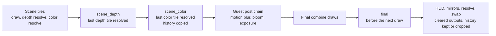

# Post pass framework

The runtime's post pass framework runs screen passes inside the guest frame. A pass is an entry point of an HLSL file plus a few lines in a manifest, instead of bespoke C++ in the command processor. The framework gives the passes the scene depth, its stencil and the scene color, the previous frame's scene color and depth, the scene camera, the reprojection of each moving object into the previous frame, and the outputs of earlier passes, and it exposes chosen outputs to the shader mods. GTAO, the motion vectors, TAA and the cockpit glass run on it (see [gtao-design.md](gtao-design.md), [motion-vectors.md](motion-vectors.md), [taa.md](taa.md) and [windshield.md](windshield.md)).

It is the common base for screen passes: GTAO, the motion vectors and [TAA](taa.md) run on it, and rain screen effects, screen-space reflections and temporal upscalers would too. For TAA it gained the jitter of the scene draws, pass-owned history textures, frame conditions (`XE_SCENE`) and a write-back at the scene_color point. The motion of an object comes from the world matrices of the draws that write its ID into the stencil (`[motion]`), the way FM4's own motion blur reprojects each car.

For the current state see [status/current.md](../status/current.md).

## Summary

- **Switch**: `post_pass_path=<directory>` holds `passes.toml` and the HLSL files it names. Empty: off, and the runtime does none of this. The launcher sets it to a copy of [work/fm4-rex/passes](../../work/fm4-rex/passes) whenever the look's `ao` knob is above 0 (every look but `original`) or its `taa` knob is on (`pc`), or with `--ao`.
- **Injection points**: `scene_depth` (the guest has resolved the last tile of its scene depth), `scene_color` (the last tile of its scene color), and `final` (after the final combine draws, before the HUD). A point whose passes are all switched off by their `if` does nothing.
- **Inputs**: `scene_depth`, `scene_stencil`, `scene_color`, `previous_color`, `previous_depth`, `final_color`, and the textures of earlier passes. **Outputs**: textures of the manifest, at the scene's size or a scale of it, any of 18 formats; `final_color` can be drawn into; a texture with `write_back = true` replaces the scene that the game's post chain samples.
- **Motion**: `[motion]` names the vertex shaders of the objects and where their world matrix is; per object slot (from the stencil reference of their draws) the passes get the reprojection into the previous frame's view and the object's origin (`xe_motion_*`), and an interior covered by a depth mask gets a slot of its own. FM4's `motion_vectors` pass writes the per-pixel motion and a mask from it.
- **Passes**: compute (`cs_5_1`) or pixel (`ps_5_1`, a triangle over the render targets), compiled with FXC at the start against the embedded library [post_pass.hlsli](../../work/runtime/src/graphics/d3d12/post_pass.hlsli).
- **Jitter**: `[jitter]` moves the scene draws by a sub-pixel Halton (2, 3) offset per frame, for temporal passes such as [TAA](taa.md), in frames after one in which a consumer pass ran with a known camera view (without one, every frame is a history cut and a jitter could not accumulate), and only while the scene camera moves and the frames come fast enough (`min_motion`, `min_frame_rate`); the passes get the offset (`xe_scene_jitter`), and their view positions and the motion vectors are unjittered.
- **Mods**: a texture with `slot = N` is bound for the shader mods at bindless view `kPostPassViewsStart + N`; mods read it with `xe_post_texture(N, uv)`. In FM4's manifest slot 0 is the occlusion, which `xe_post_ao(uv)` reads, slot 1 the motion vectors and slot 2 their mask. An entry of the native shader contract reads them by name instead (`srv = ["post:<name>"]`, `xe_srv_<name>(uv)`; [shader contract, 7](shader-contract.md#7-increment-3-declared-resources)). The other way, a pixel shader mod marks its fragment in the manifest's `reactive_mark` texture with `xe_post_mark_reactive(input.xe_position, value)` (a UAV at bindless view `kPostPassReactiveMarkUAV`, `u0` in space 4), which FSR's reactive mask takes.
- **Reuse**: the shader overrides' FXC loader, DXBC cache (`shader_override_cache_path`), defines (`shader_mod_defines`, `shader_mod_set`, `shader_mod_defines.txt`) and hot reload (`shader_mod_hot_reload`).
- **Path**: RTV with bindless resources only. The ROV path has neither shader mods nor post passes, by design.

## Where the passes run



**scene_depth.** FM4 resolves its scene depth per tile into one texture (1280x720 of `k_24_8_FLOAT` at 1x). Depth resolves at least `min_width` guest pixels wide are merged per frame into one group of contiguous tiles; when the group covers all 32x32 tiles of the texture, the point runs inside that `IssueCopy`. A tile resolved again (the motion blur frame) stays in the group. The scene camera must have been captured on that depth buffer in the frame, and only the first scene of a frame runs (split screen's second view is left out). This is the point where GTAO ran before the framework, unchanged.

**scene_color.** The color resolves of the same frame with the size of the scene depth are merged the same way (bytes per pixel from the destination format). When they cover the texture, the point runs after the last color resolve, and the history is copied there. Passes here read both `scene_depth` and `scene_color`, complete. In FM4 this is the end of the scene tiles, before motion blur and bloom. FM4 resolves its 7e3 scene into a `k_2_10_10_10` texture, so `scene_color` (and `previous_color`) reads as 10-bit unorm in gamma 2, as the final combine reads it (it squares the value).

**final.** The manifest lists the final combine pixel shaders (`final_pixel_shaders`). The first draw with one of them in a frame arms the point and records the guest viewport (the frame in its render target, 1280x720 in FM4). The point runs before the next draw with another pixel shader, or before the next resolve, or at the swap, whichever comes first. In FM4 that is the first HUD draw. `final_color` is the host render target the final combine drew into (color target 0, after the render target cache's pending transfers): a pass reads it, and a pixel pass can draw into it before the HUD is drawn over it. Only a single-sampled render target qualifies; otherwise the point is skipped with a warning.

This is the point temporal upscalers and TAA need (pre-HUD color at render resolution); see [The final point and upscalers](#the-final-point-and-upscalers).

**Swap.** Textures with `clear = true` written in the frame are cleared to zero, so frames without a scene (menus) never read stale output. The history becomes the previous frame's, or is dropped.

## The manifest

`<post_pass_path>/passes.toml`, read at the start and on hot reload. FM4's is [work/fm4-rex/passes/passes.toml](../../work/fm4-rex/passes/passes.toml).

### [scene]

| Key | Meaning |
| --- | --- |
| `camera` | Vertex shaders that carry the scene camera: `<ucode hash>:rows:<WVP>:<WV>` (row vectors, 4 constants each), `<ucode hash>:rows:<WVP>:<WV>:<world>` (the same and the object's world matrix, also row vectors in 4 constants), or `<ucode hash>:world:<WVP>:<world>:<view inverse>` (column vectors, 4, 3 and 3 constants). The projection comes from a draw on the scene's depth buffer, the view (camera to world) from a draw of a layout that carries it: the view inverse of `world`, or world times the inverse of WV of `rows` with a world matrix. The list order is a priority: in a frame, a draw of a source earlier in the list replaces the matrices that a later source gave. The hash `*` makes an entry the fallback, last in priority, for every other vertex shader that reads all the constants of its layout (the bitmap of its float constants) and gives a rotation as its view; FM4 uses `*:world:128:140:243`, the layout of most environment shaders, for frames without a car or the road in view. Every source counts only on a draw whose viewport is at least `min_width` wide, whose projection has the viewport's aspect, and whose projection equals the frame's when that is known, which leaves out other cameras drawn on the scene's depth buffer such as the rear-view mirror's strip. |
| `min_width` | The narrowest depth resolve taken as the scene depth, in guest pixels (1024). |
| `final_pixel_shaders` | Ucode hashes of the final combine pixel shaders, for the final point. |

### [history]

`cut_distance` (view units), `cut_angle` (degrees) and `cut_focal` (relative change of the focal length) per frame: beyond any of them the camera has cut and the history is not valid for that frame. FM4: 5 m, 30 degrees, 0.1. An object that moves more than `cut_distance` in a frame has no motion of its own in that frame.

### [motion]

| Key | Meaning |
| --- | --- |
| `objects` | Vertex shaders of the objects: `<ucode hash>:rows:<first constant>` (the world matrix as row vectors in 4 constants) or `<ucode hash>:columns:<first constant>` (column vectors, 3 constants), at most 32. A draw counts when it is on the scene's depth buffer and replaces the stencil with its reference (stencil on, `REPLACE` on depth pass, write mask `FF`). The list order is a priority: per slot and frame, the first draw of the highest priority source gives the object's matrix. |
| `stencil_step`, `stencil_limit` | The slot of a stencil value s is round(s / `stencil_step`) below `stencil_limit`, else 0, the static world (at most slot 30; slot 31 is the interior's). FM4: 7 and 126, its motion blur's rule. |
| `interior`, `interior_depth` | Vertex shaders of an interior, in the format of `objects`: drawn with its object's stencil ID and then covered by a mask that writes the stored depth `interior_depth` (default 1.0). The first draw of the highest priority source in a frame gives the interior's matrix, in slot 31 (`xe_motion_is_interior(slot, d)`). With `interior`, every pixel at `interior_depth` is a mask: the interior if it carries the interior's object ID, else a pixel without known motion. FM4: the cockpit shell `4EE552137CA415E3`, depth 1.0. |

The table of the objects and the camera of the previous frame are kept at every swap of a frame with a scene. A slot holds its object's reprojection when the object drew in both frames with the same reference and did not jump (`cut_distance`), otherwise the static world's.

### [jitter]

Sub-pixel jitter of the scene draws for temporal passes ([TAA](taa.md#3-jitter)). Without the section nothing is jittered.

| Key | Meaning |
| --- | --- |
| `phases` | Length of the Halton (2, 3) sequence, 1 to 64 (default 8): phase n is (Halton(n + 1, 2) - 0.5, Halton(n + 1, 3) - 0.5) host pixels, between -0.5 and 0.5. |
| `if` | Conditions as a pass's `if`, checked at the swap for the next frame. |
| `consumer` | The pass, or a list of passes, whose run in a frame arms the jitter of the next frame (required): no frame is jittered unless a pass that undoes the jitter runs, in a frame whose camera view is known. FM4 lists the TAA resolve of both points and `fsr_upscale`. |
| `every_frame_if` | Conditions as `if`: while they hold, every frame after a consumer's run is jittered, without `min_motion`, `min_frame_rate` and `still` (FSR accumulates still pictures itself and expects the jitter in every frame). FM4: `FSR > 0`. |
| `exclude` | Vertex shader ucode hashes never jittered: screen-space draws inside the scene tiles. FM4 needs none. |
| `min_motion` | The scene camera's motion in host pixels per frame that arms the jitter: a number, or the name of a float param (live). The motion is the largest move between the previous frame and this one of the static world at clip W = `motion_distance`, seen through the center, the corners and the edge midpoints of the scene: the reprojection of the motion vectors with both frames' projections, so rotation, translation and a change of the focal length count. A frame without it (no view, a camera cut) counts as still. 0 or left out: a still camera is jittered too. FM4: `TAA_JITTER_MOTION`. |
| `motion_distance` | The clip W of that motion in view units (default 10; meters in FM4). |
| `motion_hold` | Frames the jitter stays armed after the last frame with that motion, 1 to 1,024 (default 8), so a camera near the threshold does not switch it every frame. |
| `min_frame_rate` | Frames per second at least, from the median of the last 8 swap intervals of the steady clock (a single long frame does not move it): a number or a float param. 0 or left out: any. FM4: `TAA_JITTER_RATE`. |

A draw is jittered when its depth buffer's EDRAM base is the scene depth's (the scene camera's test, once a scene depth was resolved), it tests depth or stencil, it is neither a rectangle list nor a clear drawn as a uniform draw, and its vertex shader is not excluded. The shadow maps, the environment cube, the mirrors, the post chain and the HUD have other depth buffers or no depth test. The command processor adds the offset to the draw's `ndc_offset` after `GetHostViewportInfo`: 2 j / extent in X and -2 j / extent in Y for the host viewport's extent, so every tile of a frame moves alike. The offset is in host pixels of the render target, the layout of the resolved scene textures (FM4's scene is rotated 180 degrees, so its final image moves by -j). The math is header only ([post_pass_jitter.h](../../work/runtime/include/rex/graphics/d3d12/post_pass_jitter.h)), as is the gate of `min_motion`, `motion_hold` and `min_frame_rate` (`CameraMotionPixels`, `JitterGate`), which `PostPasses::UpdateJitter` updates at every swap: the jitter of the next frame needs the consumer's run with a known view, the `if`, the camera's motion within the hold and the frame rate.

### [defines] and [params]

- **Defines** are compile-time: `NAME = value` in the manifest, overridden by `shader_mod_defines` (and `shader_mod_set`, `shader_mod_defines.txt`) by name. A changed value recompiles the passes at the next swap.
- **Params** are run-time constants of every pass (b1 after the pass header), at most 28. An integer value makes a `uint` param, any other a `float`. The inline table form adds `min` and `max` (clamped in float). `focal_length_of = "<float param>"` makes a param that is that length in host pixels at W = 1 (the param times the scene's horizontal focal length), computed on the CPU each frame. Params also come from the defines by name, and `shader_mod_set NAME=VALUE` changes them in the next frame without a recompile, with or without `shader_mod_live_knobs`.
- The names of both are registered with the shader overrides when the passes are created: they are not defines or live knobs of the mods, and `shader_mod_set` applies them at once. Names that a hot reload adds are read from the defines, but `shader_mod_set` treats them as mod defines until a restart.

### [textures.NAME]

| Key | Meaning |
| --- | --- |
| `format` | `R8_UNORM`, `R8G8_UNORM`, `R8G8B8A8_UNORM`, `R10G10B10A2_UNORM`, `R11G11B10_FLOAT`, `R16_UNORM`, `R16G16_UNORM`, `R16G16B16A16_UNORM`, `R16_FLOAT`, `R16G16_FLOAT`, `R16G16B16A16_FLOAT`, `R32_FLOAT`, `R32G32_FLOAT`, `R32G32B32A32_FLOAT`, `R8_UINT`, `R16_UINT`, `R32_UINT`, `R32G32_UINT`. |
| `mips` | Mip levels, 1 to 8, as many as the size allows. |
| `size`, `scale` | `scene` (the scene depth's host size, default), `final` (the final color's) or `output` (the scene at its output scale: the scene's size, or while upscaling from `native_scene_input_scale` the upscaler's output, [FSR plan, 11](fsr-plan.md#11-stage-3-upscaling-on-n5s-scales-25-october-2026)), times `scale` (above 0, at most 4). |
| `slot` | 0 to 7: exposed to the shader mods (`xe_post_texture`). |
| `clear` | Cleared to zero at the swap after every frame it was written in. |
| `history` | Two textures: the passes write this frame's (`name`) and read the previous frame's (`previous:name`); at the swap of a frame that wrote it the two trade places. No `slot` and no `clear` (see [History](#history)). |
| `write_back` | Written at the scene_color point, then copied into the texture cache's host texture of the scene, which the game's next fetches of the scene bind (see [The write-back](#the-write-back)). `R10G10B10A2_UNORM`, the scene's or the output size, one mip, no `scale` and no `history`. While upscaling, an output-sized write-back goes into a texture at the output scale, which the game's next fetches of the scene bind. |
| `reactive_mark` | The texture shader mods write with `xe_post_mark_reactive` (at most one; `R8_UNORM`, the scene's size, one mip, no `scale`, `history`, `slot`, `clear` or `write_back`). While an override or mod file calls the function (`ShaderOverrides::uses_reactive_mark`, scanned at load and on hot reload), the framework binds it at `kPostPassReactiveMarkUAV` and clears it at every swap, in `UNORDERED_ACCESS` for the game's draws and back to it after the scene_color point; otherwise the view stays null (the writes do nothing) and the texture is neither bound nor cleared, so it costs nothing. Passes read it like any texture. |

Textures are created when a pass first writes them, zeroed, and recreated when their size changes. Their contents persist across frames unless `clear` is set.

### [[passes]]

| Key | Meaning |
| --- | --- |
| `name` | Unique. |
| `point` | `scene_depth`, `scene_color` or `final`. |
| `type` | `compute` (default), `pixel`, or `fsr`: AMD FSR 3.1's upscaler ([FSR plan](fsr-plan.md), the runtime's [fsr.h](../../work/runtime/include/rex/graphics/d3d12/fsr.h)), no shader, at `scene_color` only, on textures of the manifest: `srv = [color, depth, motion vectors, reactive, composition]` (the last two optional) and `uav = [output]`; its sharpness comes from the param `FSR_SHARPNESS`, its debug view from `FSR_DEBUG`, its depth's near plane from the define `FSR_DEPTH_NEAR`. Its dispatches are recorded into the replayed command list through a callback (`DeferredCommandList::D3DCallback`), which binds its own descriptor heap, root signatures and pipelines; the replay binds the list's descriptor heaps again after it, and the command processor binds the guest's state again at the next draw (`InvalidateCommandListState`). A runtime built without FSR (`REX_FSR`), or one whose FSR context cannot be created, keeps the param `FSR` at 0 and logs a warning, so the manifest's TAA runs instead. |
| `shader`, `entry` | The HLSL file in the directory and its entry point (`main` by default). |
| `defines` | An inline table of defines for this pass, over those of the manifest. |
| `srv` | Inputs, bound to t0, t1, ... (at most 8): a texture (`name` for all mips, `name:N` for one, `previous:name` for the previous frame's copy of a history texture), or `scene_depth`, `scene_stencil`, `scene_color`, `previous_color`, `previous_depth`, `final_color`. `scene_stencil` is the stencil byte of the scene depth resolve: the same memory read as `k_8_8_8_8` through the texture cache, an `R8G8B8A8_UINT` view with the stencil in R (`Texture2D<uint>`), loaded only when a pass that reads it runs. |
| `uav` | Compute outputs, bound to u0, u1, ... (at most 8): `name` or `name:N` (one mip). |
| `rtv` | Pixel outputs, render targets 0-3: textures, or `final_color` (final point only). |
| `group` | Pixels per thread group, `[x, y]` (default `[8, 8]`): the dispatch is the size divided by it, rounded up. |
| `size` | The binding whose size is the pass size (`xe_pass_size`); by default the first output. |
| `if` | `NAME OP NUMBER`, joined by `&&`, over params and defines (`==`, `!=`, `<`, `<=`, `>`, `>=`), checked every frame. `XE_SCENE` is 1 in a frame whose scene points ran (a scene with a camera), else 0: a final point pass with `XE_SCENE > 0` skips the menus that draw the final combine without a scene. |
| `blend` | Pixel passes: `none` (default), `alpha`, `add` or `multiply`. |

The manifest is checked when it is loaded: unknown textures and inputs, a texture both read and written by one pass, `scene_color` at `scene_depth`, `final_color` outside the final point, a compute pass without UAVs or a pixel pass without render targets, an `fsr` pass outside `scene_color` or on inputs that are not textures of the manifest, two textures in one slot, a cleared texture that no pass writes, a `[jitter]` whose consumer is no pass, and a `min_motion` or `min_frame_rate` that is neither a number nor a float param are errors. Passes with the same shader, entry and defines share one binary.

## The library

[post_pass.hlsli](../../work/runtime/src/graphics/d3d12/post_pass.hlsli), embedded in `rexgpu-xenos.dll` as `xe_post_pass.hlsli`. Every pass is compiled as

```hlsl
#define XE_POST_PASS_PARAMS <the params as cbuffer fields>
#include "xe_post_pass.hlsli"
#include "<the pass file>"
```

with FXC `/O3` and the defines. The layouts are those of [post_pass_layout.h](../../work/runtime/include/rex/graphics/d3d12/post_pass_layout.h), which the WARP test includes too.

- **b0, the scene** (`xe_scene_*`, `xe_previous_*`, `xe_final_*`, `xe_motion_*`): the camera's depth unpack (`xe_scene_w(d)`, `xe_scene_view_position(pixel, w)`, `xe_scene_is_sky(w)`), the frame's jitter (`xe_scene_jitter`: the content at host position p is the unjittered scene at p - jitter; `xe_scene_view_position` gives the view position of what the pixel shows, and the previous frame's positions are unjittered), its phase and number of phases (`xe_scene_jitter_phase`, `xe_scene_jitter_phases`, 0 with a fixed offset), and on a still camera the frames in a row before this one in which a consumer ran on it with a valid history (`xe_scene_still_frames`), the scene size, guest pixels per host pixel and pixel origin, the focal length in host pixels, the frame and time, `xe_scene_view_to_world`, `xe_view_to_previous_view` and the previous frame's camera unpack (`xe_previous_host_position(view, w)` reprojects the static world, `xe_previous_view_host_position` any previous view position), the flags (`xe_history_valid()`, `xe_motion_valid()`, `xe_camera_still()`, `XE_SCENE_VIEW_KNOWN`), at the final point the final color's size and its UV scale within its render target, and the motion: `xe_motion_slot(stencil)`, `xe_motion_slot_own(slot)`, the interior (`xe_motion_interior_slot`, `xe_motion_interior_depth`, `xe_motion_is_interior(slot, d)`), and per slot `xe_motion_view_to_previous_view[slot]` (`xe_motion_previous_host_position(slot, view, w)`) and `xe_motion_object_origin[slot]` (the object's origin in view space, w 1 if drawn). A root CBV of 2,320 bytes, written once per point.
- **b1, the pass**: `xe_pass_size`, `xe_pass_inverse_size`, then the params. Root constants.
- **Samplers**: `xe_linear_clamp` (bilinear within one mip), `xe_point_clamp`, `xe_trilinear_clamp`.
- **Pixel passes**: `xe_post_pass_vs` draws one triangle; the pixel shader gets `XePostPassVertex` (`SV_Position` and `uv` 0-1 over the render targets).

## History

The scene color and depth are kept only when a pass reads `previous_color` or `previous_depth`, so GTAO alone costs nothing here. A pass keeps its own output across frames in a texture with `history = true`.

- At the scene_color point, while a pass that reads them is switched on by its `if` (a TAA turned off by its params costs no copy, and its next frame then has no history), the scene color and the scene depth textures (as the texture cache loaded them) are copied (`CopyResource`) into one of two history textures each, of the same description.
- At the swap, a frame that copied its history makes it the previous frame's, with its size. A frame without a complete scene (menus, loading) drops the history.
- History textures: at the swap, one written in the frame becomes the previous frame's (`previous:name`) and the other is written next; one not written in the frame has no previous frame's copy until it is written again (after its passes were switched off, for instance).
- The previous frame's camera and motion objects are kept at the swap of every frame with a scene, whether or not a pass reads the history textures.
- `xe_motion_valid()` is true in a frame when the previous frame had a scene, both frames know the camera's view, and the camera did not cut (`[history]`): `xe_view_to_previous_view`, the previous camera and the motion matrices hold. `xe_history_valid()` adds that the previous frame copied its scene history at the same scene size (if a pass reads it) and wrote every history texture at its present size (if the manifest has any).
- `xe_view_to_previous_view = inverse(previous view to world) * view to world`, so a view position of this frame maps to the previous frame's view position of the same world point; `post-pass-camera-tests.cpp` checks this.

## Iteration and diagnostics

- **Cache**: with `shader_override_cache_path`, pass binaries are cached like the mods (`pass_<name hash>_<key>.dxbc`), keyed on the source, entry, target, flags, defines, the library and the compiler, and checked against the content of every file included.
- **Hot reload**: with `shader_mod_hot_reload`, the manifest and every file compiled into a pass are checked every 250 ms at the swap. A change reloads the whole manifest; if it does not load or compile, the previous passes stay and the errors are logged. Replaced pipelines are released after the GPU has passed them, textures are recreated.
- `post_pass_ab_ms=<N>`: no passes in every other period of N ms of the steady clock (the outputs stay cleared), to compare on and off in one scene.
- `post_pass_variants="NAME=VALUE,NAME=VALUE;...;off"` with `post_pass_variant_ms=<N>`: param values cycled by the steady clock, to compare settings in one frozen frame.
- `post_pass_log_every=<N>`: the scene depth, the camera (with whether the view is known and which camera source gave it: `view known from source 1`, `from the fallback`), the history state, the motion objects (per slot the reference, the chosen source, the sources that drew and those whose matrix differs) and the params of every N-th scene (0: the first only). `post_pass_log_constants=<ps hash>:<constant>;...` logs pixel shader constants, to check the camera against the game's own depth linearization.
- `post_pass_jitter=auto|off|<phases>`: `auto` (the default) jitters as `[jitter]` says; `off` never; a number of phases jitters every frame after one with a scene, without a consumer and without the camera and frame rate gate, for checks of the jitter itself. `post_pass_jitter_offset=x,y` replaces the sequence with a fixed offset in host pixels whenever the jitter is on (a seam check). Frames skipped by `post_pass_ab_ms` or an `off` variant are not jittered. The `post_pass_log_every` log names the jitter of the frame, the camera's motion in host pixels and the frame rate the gate sees (`jitter off (camera 0.000 px, 30.0 fps)`), and `REX_DRAW_LIST_TRACE` the offset of each draw ([traces](../e2e/traces.md#draw-traces)).
- `post_pass_motion_check=<ps hash>:<first constant>:<slots>;...`: at every draw of that pixel shader (once per frame), its 4-constant matrices (rows 0, 1 and 3) next to the host's clip space reprojection of the same slots, previous projection * `xe_motion_view_to_previous_view[slot]` * inverse(projection). FM4: `4746CAD32EF168CF:0:17`, the motion blur ([motion vectors](motion-vectors.md#8-implementation-18-october-2026)).

## The final point and upscalers

FM4 draws its frame as: scene tiles; motion blur; bloom and exposure; the final combine; then the HUD and the side mirrors; then the resolve to the front buffer. A draw list trace of race frames (`REX_DRAW_LIST_TRACE`, 18 October 2026) shows the final combine (`B556A9B3` in the race) as one draw into EDRAM base 0 in `k_2_10_10_10`, single-sampled, and the about 180 HUD draws after it into the same EDRAM in `k_2_10_10_10_AS_10_10_10_10`. On the RTV path these are two host render targets: the render target cache copies the final combine's target into the HUD's at the first HUD draw. The final point sits before that draw, on the final combine's target, so a pass that draws into `final_color` is under the HUD.

What a temporal upscaler or TAA needs there, and what the framework gives:

- **Pre-HUD color at render resolution**: `final_color`, read as a texture or drawn into.
- **Depth**: `scene_depth` of the frame (complete; the final combine's own depth of field reads it too).
- **History**: `previous_color` and `previous_depth` are the pre-post-chain scene. A TAA in the final point keeps its own output across frames in a history texture (`history = true`, read as `previous:name`), and uses `xe_history_valid()` and the reprojection constants.
- **Motion vectors**: FM4's `motion_vectors` texture (slot 1), written at scene_depth: previous minus current position in host pixels of the scene textures, in their layout, zero without `xe_motion_valid()`. A pass can also reproject a position itself (`xe_motion_previous_host_position`).
- **Output**: a pixel pass with `rtv = ["final_color"]` writes the result back before the HUD. A pass cannot read and write `final_color` at once: copy it into a texture first.
- **Resolution**: the framework works at the render scale. An upscaler that renders below the output size needs the guest's render targets at a lower scale than the HUD, which the runtime does not support; within one scale, the point suits TAA and temporal supersampling.

[TAA](taa.md#2-injection-point) runs at this point by default, and at the scene_color point as an option through the write-back below.

HDR output needs two more pieces from the framework, a texture that shader mods can write and a point at the swap: see [HDR output](hdr-output.md#5-required-pieces-and-effort).

## The write-back

A pass at the scene_color point can replace the scene that the game's post chain samples: it writes a texture with `write_back = true`, and after the point (and after the copy of `previous_color`, which keeps the game's scene) the framework copies that texture into the texture cache's host texture of the scene (`D3D12TextureCache::WriteResolvedTexture`). That texture stays loaded, so the game's next fetches of the scene memory bind the copy until the next resolve to that memory or a CPU write replaces it; guest memory keeps the game's own scene (CPU readbacks such as the photo save read it). The scene must be `k_2_10_10_10` (or its `AS_16_16_16_16` view), which the `R10G10B10A2` texture copies into.

A texture fetch's key holds its packed mips: FM4 fetches the scene with them on, while a resolve target has them off. The copy goes into the texture of the resolve's key and into the one with the other `packed_mips` if the cache has it (one mip, the same data).

`post_pass_log_every` adds to each log line what the guest did with the last complete write-back: `write-back frame N, before it binds B reloads R other O`. B counts the texture bindings of guest draws that bound a written texture, R their reloads from guest memory (the next frame's resolve), and O the bindings of another texture of the scene memory (another key, followed by that key), which does not hold the write: O above 0 means the write-back misses a reader.

## FM4 specifics

- The scene textures are in the guest's resolved layout: FM4 draws its scene rotated 180 degrees within the tiles, so `scene_depth`, `scene_color` and the history are upside down and mirrored against the screen (the final combine samples them so). `final_color` is in screen orientation.
- `scene_color` is the `k_2_10_10_10` resolve of the 7e3 scene: 10-bit unorm in gamma 2.
- The cockpit interior has no depth of its own: FM4 draws it and then covers it with a mask at the stored depth 1.0 (a draw of 24 indices whose vertex shader hash ends in `2F76904F`, viewport Z scale 0 and offset 1, no color write), so its W reads as the near plane. GTAO leaves it out; the motion vectors give it the interior's own matrix at an assumed distance ([motion vectors](motion-vectors.md#9-the-gaps-in-the-game-19-october-2026)). Under the rear-view mirror panel of the hood and bumper cameras the scene depth reads just below that value, within 1% of the near plane's W, and the motion vectors leave it out. The car body on the bumper and hood cameras moves with the camera, so the static world's reprojection does not hold for it: its own motion slot does (`xe_motion_*`). The side mirrors and the HUD are drawn after the scene, over `final_color`.
- The scene stencil holds an object ID: 0 for the static scene, 7n for every draw of car n, 128 and 129 under shadows (see [motion vectors](motion-vectors.md#who-writes-the-stencil)).
- The garage and the showroom draw the car, so the car body camera source gives them a camera and their scene points run; a scene depth without any camera source in the frame logs one warning and runs no scene point.

## Limits

- One scene per frame; split screen's second view gets no passes.
- The final point needs a single-sampled final render target.
- The RTV path keeps a host occlusion query open between the guest's snapshots (the sun query). A pixel pass closes that segment before it draws and opens the next one after, so the guest never counts the pass's pixels.
- Pixel passes cannot write UAVs.
- The write-back needs a `k_2_10_10_10` scene (FM4's), which an `R10G10B10A2_UNORM` texture copies into.
- New param names added by a hot reload are not live through `shader_mod_set` until a restart.

## Verification

18 October 2026, BuildRoot `I:\FM4-build-pass` (Japan/Asia, 240 Hz, the AI driver, `--profile copy`). Builds: `pfbase` (main `ad2797a`, the GTAO of `post_ao.cpp`), `pfcand` (the framework), and a temporary dual build (not committed) that runs both side by side: the old `PostAo` writes its occlusion to view slot 7, and at every swap, before either clears, a compute pass compares it texel by texel with the framework's slot 0 and logs the counts.

**GTAO identical.**

- FXC: the framework's `gtao_prefilter`, `gtao_main` and `gtao_denoise` are instruction for instruction those of `post_ao.hlsl` (disassembly with the register and constant buffer names normalized); the final denoise differs only in register allocation and in reading debug view 2 from its own input.
- WARP: the occlusion of `fm4_post_ao_shader_tests` (main) and of `fm4_post_pass_shader_tests` (the passes from `passes.toml`) on the synthetic scene are byte-identical.
- In the game at 2x (2560x1440), dual build: 22,321 frames with the debug views 0-4 cycled (`post_ao_variants` and `post_pass_variants` on the same 8 s clock, `FM4_LOOK_AO_DEBUG=1`), and 18,241 frames with the `pc` look: no texel differs in any frame. The occluded texels match too (for example 1,306,041 in both on the first frame).
- Frozen frames (rewind) at 2x with `dual_swap_ms`, where slot 0 shows the old and the new occlusion in turn: 17 frozen on/off pairs with the `pc` look and 2 with the debug views, all byte-identical captures.
- The mods: `fm4_shader_mod_tests` gives the same 204 DXBC fingerprints with the new library (`XE_POST_VIEWS`) as with the old (`XE_POST_AO_VIEW`), so every mod, including those that read `xe_post_ao`, compiles to the same binary.

**GPU time.** `perf` tier (photo at 240 Hz, 1x, three runs each), `pfbase` then `pfcand`: 3 of 3 runs passed each, verdict WARN (guest idle wait and the final capture's black share, both run to run), no FAIL. Race GPU per frame 3.02, 3.24 and 2.91 ms on main against 3.04, 3.10 and 3.09 ms, at 2,347, 3,454 and 1,970 against 2,392, 2,920 and 2,763 draws per frame (closest pair: 3.02 against 3.04 ms). Race 206.8 against 187.5 fps, following the draws per frame (the AI's race differs; predicated draws per frame +8.7%). Photo mode 29.95 fps in both.

**New points and history** (a test manifest, not in the repository: a compute pass at `scene_color` that compares `scene_color` with `previous_color` reprojected through `scene_depth` and without reprojection, and two pixel passes at `final` that copy `final_color` into a texture and draw both results into `final_color`; 2x, Quick Race with the camera cycle):

- The history is valid from the second scene frame of the race on, with the view known in every frame (`post_pass_log_every`).
- On the world, the reprojected difference is near zero where the plain one is large on every moving edge, so `xe_view_to_previous_view` and the previous camera are right. The cockpit interior, the car body on the bumper camera and the mirror differ, as expected (see [FM4 specifics](#fm4-specifics)).
- The final point: the overlays drawn into `final_color` show under the HUD (the minimap and the speedometer draw over them), and the copy of `final_color` shows the scene and the rear-view mirror panel without the HUD's text and gauges.
- Hot reload (`shader_mod_hot_reload`, a copy of `work/fm4-rex/passes` edited during a race at 1x): `GTAO_SCALE=0.5` in `shader_mod_defines.txt` reached the passes in the next frame without a compile; `GTAO_QUALITY=3` recompiled them ("reloaded (defines changed)"); a comment added to `gtao.hlsl` reloaded them in 375 ms; a syntax error logged the FXC errors and kept the previous passes; the fix reloaded them. The race went on through every step.
- The first test run found two bugs, both fixed: the pixel passes were skipped because the guest's sun occlusion query is always open there (now closed and reopened around the pass), and the render target views and the clear view were taken from the bindless heap instead of the framework's own heaps (a crash with the pixel passes; the GTAO clear now uses the correct non-shader-visible view).

**Motion vectors** (18 and 19 October 2026, the same BuildRoot): the CPU and WARP tests of [motion vectors](motion-vectors.md#tests) pass in the build. In the game the host's camera and car matrices match the game's motion blur matrices within one pixel, the debug views are right in the chase, hood, bumper and cockpit cameras except for the rear-view mirror panel, and the passes cost 0.02 ms at 1x and 0.1 ms at 2x ([in the game](motion-vectors.md#in-the-game-18-and-19-october-2026)).

## Code

- [post_pass.h](../../work/runtime/include/rex/graphics/d3d12/post_pass.h), [post_pass.cpp](../../work/runtime/src/graphics/d3d12/post_pass.cpp): class `PostPasses`, created by the command processor when `post_pass_path` is set; hooks in `IssueDraw` (camera, final point), `IssueCopy` (before and after the resolve) and `IssueSwap`.
- [post_pass_camera.h](../../work/runtime/include/rex/graphics/d3d12/post_pass_camera.h): the camera math (projection from the constants, depth unpack, view to world, the world matrix of an object and the reprojection of the static world and of objects into the previous view, in double), header only.
- [post_pass_jitter.h](../../work/runtime/include/rex/graphics/d3d12/post_pass_jitter.h): the jitter's Halton phases, the rules for the draws it moves and its `ndc_offset`, header only; [command_processor.cpp](../../work/runtime/src/graphics/d3d12/command_processor.cpp) applies it in `IssueDraw` (`PostPasses::DrawJitter`).
- [post_pass_layout.h](../../work/runtime/include/rex/graphics/d3d12/post_pass_layout.h), [post_pass.hlsli](../../work/runtime/src/graphics/d3d12/post_pass.hlsli): root signature and constant layouts, and the library.
- [shader_override.cpp](../../work/runtime/src/graphics/d3d12/shader_override.cpp): `CompileProgram`, `GetDefine`, `SetPassNames`, the contract's `XE_POST_VIEWS`, and `xe_post_texture` in the override library.
- [render_target_cache.cpp](../../work/runtime/src/graphics/d3d12/render_target_cache.cpp): `TransitionLastColorRenderTarget` for the final point.
- Tests: `fm4_post_pass_camera_tests` ([post-pass-camera-tests.cpp](../../work/fm4-rex/tests/post-pass-camera-tests.cpp)), and `fm4_post_pass_shader_tests` ([post-pass-shader-tests.cpp](../../work/fm4-rex/tests/post-pass-shader-tests.cpp)), which runs the scene_depth passes of a manifest on WARP as the framework runs them (GTAO, and the motion vectors against a CPU reprojection with a stencil of object IDs, also jittered), runs the final point's passes over frames (pixel passes into a synthetic `final_color`, history textures swapped at each frame's end), and compiles the passes of the scene_color point.
