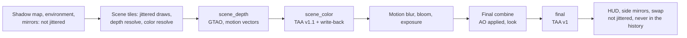

# TAA v1: implementation plan

Plan for temporal anti-aliasing (TAA) at the existing render scale, built on the [post pass framework](post-pass-framework.md) and the [motion vectors](motion-vectors.md). Written on 19 October 2026 against main `0a8bba5`, and approved by the project owner the same day, including the staged injection point, the reactive mask route and TAA as an opt-in until step 5. Step 1, the jitter, is built and checked in the game ([section 12](#12-progress)); the TAA pass itself is not written yet. Upscalers (DLSS, FSR) are out of scope; they need a separate scale for the scene tiles ([motion vectors, section 6](motion-vectors.md#injection-point)).

This note contains no game code, shaders or ucode. Hashes, registers and addresses are observations only.

## Summary

| Topic | Plan |
|---|---|
| Injection point | Staged. **v1 at the `final` point** (after the game's motion blur, bloom and final combine, before the HUD), which the framework supports today. **v1.1 at the `scene_color` point**, with the TAA output copied into the texture cache's host texture of the scene, which the game's post chain then samples. That write-back is also what the upscalers need later. |
| Jitter | Halton (2, 3), 8 phases, in host pixels, added to `ndc_offset` of the scene draws only: the scene depth EDRAM base, a depth or stencil test, no rectangle lists or clears, and a list of excluded vertex shaders. The post pass framework owns it (`[jitter]` in the manifest), applies it only after a frame in which the TAA pass ran, and hands it to the passes (`xe_scene_jitter`), so the motion vectors and view positions stay jitter-free. |
| MSAA | TAA does not depend on the tiling. v1 is validated on `-Quality high` (4x MSAA, three tiles) and on `-SingleTile` (one 720p tile without MSAA, and without its FXAA while TAA is on). Which one goes with TAA by default is decided from 2x crops and the GPU time. |
| Resolve | Linear color (the stored value squared), a jitter-aware 3x3 reconstruction of the current frame, a YCoCg variance clip, the history fetched with Catmull-Rom at the motion of the nearest neighbour, a depth disocclusion test, a luminance-weighted blend, history in `R16G16B16A16_FLOAT`, and sharpening after the resolve, never in the history. Reset whenever `xe_history_valid()` is false. |
| Masks | `motion_mask` R (no history: the current frame, un-jittered) and G (reactive: car glass, a higher blend and a tighter clip). Chosen by the project owner: no particle or interior mirror mask in v1 (option (d) of [motion vectors, section 9](motion-vectors.md#open)); later, shader mods that write a mask (option (c)) for the shaders that visibly ghost. |
| Knobs | Pass params `TAA`, `TAA_JITTER`, `TAA_SHARPEN` and tuning params, live through `shader_mod_set`; cvars that force the jitter off or to a fixed offset; the launcher knob `-Look "pc,taa=1"`. Opt-in first: the `pc` preset gets TAA only after the project owner has seen the crops and the cost. |
| Validation | CPU and WARP tests in every step; in the game, frozen cameras (rewind, the grid with the right stick held) at 2x with 1:1 crops, the ghosting cases, GPU time from the frame graph, the `perf` tier for `frame_ms_p99` and `hitch_50ms_per_min`, the `smoke` gate, and the Japan/Asia release on the same binary. Every game run waits for the project owner's OK. |
| Steps | Eight steps, each built and checked on its own ([section 9](#9-steps)). |

## 1. What exists and what is missing

In main (`0a8bba5`), from the [post pass framework](post-pass-framework.md) and the [motion vectors](motion-vectors.md#9-the-gaps-in-the-game-19-october-2026):

- `motion_vectors` (`R16G16_FLOAT`, slot 1): the previous minus the current host pixel position, in the layout of the scene textures (rotated 180 degrees against the screen), zero without `xe_motion_valid()`.
- `motion_mask` (`R8G8_UNORM`, slot 2): R where no motion is known (the rear-view mirror panel of the hood and bumper cameras, depth masks without an interior), G where the pixel is reactive (the world seen through car glass).
- The inputs `scene_depth`, `scene_stencil`, `scene_color`, `previous_color`, `previous_depth` and `final_color`.
- `xe_motion_valid()` (the previous frame had a scene with a known view and the camera did not cut: 5 m, 30 degrees, a focal length change of 0.1) and `xe_history_valid()` (also the framework's history copy at the same size).
- The final point: the single-sampled render target of the final combine, before the first HUD draw; a pixel pass can draw into `final_color`.
- Costs so far: GTAO about 0.2 ms at 1x and 0.7 to 0.8 ms at 2x; the motion vectors 0.024 ms at 1x and 0.11 ms at 2x.

Missing for TAA:

- **Jitter**: nothing offsets the scene today.
- **A history the pass owns**: the framework's limits say "No pass-owned double-buffered textures yet". A pass cannot read and write one texture, so TAA needs two textures that swap at the swap, with a validity flag.
- **Frame conditions**: a pass's `if` reads params and defines only, so a final point pass also runs in menus that draw the final combine without a scene.
- **Tests over frames**: `fm4_post_pass_shader_tests` runs the scene_depth passes on WARP and only compiles the passes of the other points.
- **For v1.1**: a write-back of a pass output where the game reads its scene.

## 2. Injection point

### 2.1 The final point (v1)

The input is `final_color`: the final combine's single-sampled render target (`R10G10B10A2_UNORM` on the host), the frame in its top left part (`xe_final_size`, `xe_final_uv_scale`), before the HUD and the side mirrors. Everything before it is in the input: the scene with the GTAO occlusion (the final combine mod applies it), the game's motion blur in the start sequence and replays, bloom, exposure, depth of field, and the look's tone curve and color.

Two passes:

1. `taa_resolve` (compute): reads `final_color`, `scene_depth`, `motion_vectors`, `motion_mask`, `previous_depth` and the previous history; writes this frame's history (linear, unsharpened).
2. `taa_output` (pixel): reads the new history, sharpens it, encodes it and draws it into `final_color` with no blending. The HUD is drawn over it.

A pass cannot read and write `final_color` at once, hence the two passes.

**Orientation.** `final_color` is in screen orientation; the scene textures are rotated 180 degrees. With `xe_final_size` equal to `xe_scene_size`, final pixel f is scene pixel `xe_scene_size - 1 - f`, and the motion and the jitter change sign. The final combine samples the scene one to one: in GTAO M2, the depth shown through the final combine at the scene's own coordinates lined up with the image at a shift of (0, 0) at 1x and 2x ([GTAO design](gtao-design.md#6-stages-and-verification)). The motion debug view draws the scene layout over the frame with the mapping above. Step 3 checks it on a frozen frame (`TAA_DEBUG=1`, the history alone, with the jitter off: it must not drift). If the sizes differ (no case is known), the pass keeps the frame as it is and resets the history.

**For it**:

- No change to the texture cache or guest memory: one pass file and two framework features.
- The HUD, the side mirrors and the HUD mirror are drawn after it. They are never in the history, so they cannot ghost and stay sharp.
- The occlusion, bloom, depth of field and motion blur are in the input, so TAA averages them too: GTAO's slightly jagged edges (one depth sample at MSAA) and its sub-pixel movement under the jitter come out smooth.
- The values are bounded (0 to 1 after the tone curve), so there are no HDR fireflies.

**Against it**:

- Bloom, exposure and depth of field are computed from the aliased, jittered scene. A sub-pixel highlight also flickers in the bloom, which TAA then averages; the bloom moves by less than half a pixel per frame.
- The `pc` look's sharpening (`sharpen=0.4`, `fm4_sharpen_scene` in the final combine) runs before TAA, on the jittered frame. While TAA runs at this point, the launcher moves the value into `TAA_SHARPEN` and sets `FM4_LOOK_SHARPEN` to 0, so the image is sharpened once, after the resolve.
- The output curve is display-referred; squaring it is an approximation of linear light (gamma 2).

**Cost** (estimate, from the GTAO and motion vector measurements at 2x on the development computer): `taa_resolve` reads about 12 values per pixel (the 3x3 color and depth from a groupshared tile, the motion and mask, five bilinear history taps, the previous depth), about 0.25 to 0.4 ms at 2x; `taa_output` about 0.05 to 0.1 ms; the framework's copy of the previous depth about 0.03 ms. In all 0.1 to 0.15 ms at 1x and 0.35 to 0.55 ms at 2x.

**Risk**: low. The final point is in use (the motion debug view); its unknowns are the size match in every mode (photo mode, replays, the start sequence) and the exact pixel mapping.

### 2.2 The scene_color point (v1.1)

TAA after the last color tile resolve, before the motion blur, bloom, exposure and the final combine, as [motion vectors, section 6](motion-vectors.md#injection-point) recommends. The input is `scene_color` (the `k_2_10_10_10` resolve of the 7e3 scene: 10-bit unorm in gamma 2, in the scene layout), and the output has to replace what the game samples next.

Write-back routes:

- **(a) Re-tile into the resolve memory**: a compute pass writes the guest layout (32x32 tiles, the endianness, the 2_10_10_10 packing) into shared memory, or into the scaled resolve buffer at 2x and 3x, and marks the range so the texture cache reloads it. It repeats what a resolve does, costs a store and a reload, and puts host-made pixels into guest memory, which CPU readbacks then see (the photo save would contain TAA). Rejected: the most work and the highest risk.
- **(b) Write into the texture cache's host texture** (preferred). `PostPasses::RequestExternal` already gets the texture cache's host texture of the scene (`RequestResolvedTexture`: `FindOrCreateTexture`, then `LoadTextureData`). The texture key holds the base format (`GetBaseFormat` in `BindingInfoFromFetchConstant`, [cache.cpp](../../work/runtime/src/graphics/pipeline/texture/cache.cpp)), so the game's fetches as `k_2_10_10_10` and as `k_2_10_10_10_AS_16_16_16_16` (the motion blur) share one host texture when the address, pitch, size and endianness match. A `CopyTextureRegion` of the TAA output (`R10G10B10A2_UNORM`, the same typeless family) into it after the scene_color passes leaves that texture loaded and up to date, so the next guest fetch binds the TAA output. The next resolve to that memory (the next frame, or the motion blur's resolve over the scene) invalidates it, and the texture cache reloads guest memory as it does today.
- **(c) A substitution in the texture cache**: an address range valid for one frame, mapped to a host resource, checked where the bindings are requested. The fallback if step 6 finds that the game fetches the scene with another key (a height of 736 against 720, another pitch).

What changes at this point:

- GTAO's occlusion is applied in the final combine, after TAA. Without TAA's averaging, the occlusion of the jittered depth moves by sub-pixels each frame, so v1.1 adds a temporal filter of the occlusion (`gtao_temporal`, at the scene_depth point: the occlusion reprojected with the motion vectors into a 16-bit history).
- The look's sharpening in the final combine follows TAA, which is where it belongs: `TAA_SHARPEN` is 0 at this point.
- The game's motion blur (start sequence, replays) samples the TAA output and resolves its result over it; the reload then holds the blurred TAA image.
- CPU readbacks of the scene memory (the photo save) read guest memory, which keeps the game's own image (offset by the jitter, less than half a pixel).
- Bloom, exposure and depth of field see the anti-aliased scene.

**Cost**: the same resolve at the scene size, the copy (4 bytes a pixel, 15 MB at 2x, about 0.03 ms) and the occlusion filter (about 0.05 ms at 2x). **Risk**: medium. The write-back depends on the texture cache's state between the copy and the game's fetch; a counter in the `post_pass_log_every` log (the guest fetches that bound the written texture, against reloads) makes a miss visible.

### 2.3 Comparison

| | final (v1) | scene_color (v1.1) |
|---|---|---|
| Framework work | jitter, pass history, frame conditions | the same, plus the write-back (b), or (c) |
| What TAA covers | everything before the HUD: scene, occlusion, bloom, depth of field, motion blur, grading | the scene; the occlusion needs its own filter; bloom, depth of field, motion blur and grading come after |
| HUD and side mirrors | after it, never in the history | after it, never in the history |
| Sharpening | `TAA_SHARPEN` after the resolve; the look's off | the look's, in the final combine after TAA |
| Color | display-referred, squared | gamma 2 scene, squared |
| GPU at 2x (estimate) | 0.35 to 0.55 ms | 0.4 to 0.6 ms |
| Risk | low | medium (texture cache state) |
| Upscalers | not usable: they need the scene before bloom | the point they need |

### 2.4 Decision

v1 runs at the final point. v1.1 moves TAA to scene_color once v1 is accepted, with an A/B of both points on the same frozen frames; the better one becomes the default. The write-back of v1.1 is needed for the upscalers anyway, so it is not wasted if the final point wins.

## 3. Jitter

### 3.1 The sequence

- Halton base 2 for x and base 3 for y, indices 1 to N, minus 0.5: offsets between -0.5 and 0.5 host pixels, never exactly half a pixel. N is `[jitter] phases`, 8 by default; 16 is allowed for tests.
- In host pixels at every render scale: at 2x a host pixel is half a guest pixel.
- The phase advances at the swap of every frame. Every draw and every tile of a frame uses the same offset.

### 3.2 Which draws

`PostPasses::OnDraw` (called before the viewport is set up) decides per draw, and the command processor adds the offset to `ndc_offset` after `GetHostViewportInfo` and its cache, before `UpdateSystemConstantValues`. A draw is jittered when all of these hold:

1. Its depth buffer's EDRAM base is the scene depth base (`depth_group_.edram_base`, the test of the scene camera), and that base is known. No jitter until the first scene depth is resolved.
2. Its depth or stencil test is on. Post chain draws with depth off are left out even if `RB_DEPTH_INFO` still names the scene base.
3. It is not a rectangle list and not a uniform draw (the clears of the render target cache).
4. Its vertex shader is not in `[jitter] exclude`: screen-space overlays drawn into the scene tiles, for example the quad of the rear-view mirror panel of the hood and bumper cameras and the sun occlusion sprite, if step 1 finds that they need it.
5. The jitter is armed: the `[jitter] if` holds, and the pass named by `[jitter] consumer` (`taa_resolve`) ran in the previous frame. So the garage, the showroom and menus with a scene depth but no camera, split screen (whose final image holds two views) and frames after TAA is switched off are never jittered without TAA.

That leaves the shadow maps (their own depth buffers), the environment cube, the rear-view mirror (its own depth buffer, EDRAM base 80) and the rear view of the hood and bumper cameras (its own EDRAM, base 64), the post chain, the final combine and the HUD unjittered. Step 1 checks this with a new `REX_DRAW_LIST_TRACE` column, the offset of each draw.

### 3.3 The offset

- Δndc_x = 2 j_x / extent_x and Δndc_y = -2 j_y / extent_y, with (j_x, j_y) in host pixels (x right, y down) and the extent the host viewport (`ViewportInfo::xy_extent`), in both branches of `GetHostViewportInfo` (clipping on and off). The translated vertex shaders apply `ndc_offset` after the guest's transform, so no shader changes.
- The host pixels are those of the render target, which is the layout of the resolved scene textures. FM4's 180 degree rotation is in its projection, so in the final image the scene moves by -j.
- Offsets below half a pixel keep every pixel center of a viewport-aligned quad covered. At 4x MSAA the outer samples of such a quad can fall outside it, which rule 3 and the seam check of step 1 cover.

### 3.4 Jitter-free motion vectors

- The scene camera and the motion objects come from vertex shader constants and the viewport registers, which the jitter does not touch: the matrices stay unjittered.
- `SceneConstants` gets `xe_scene_jitter` (two floats in host pixels, in place of `xe_motion_padding`): the content at host position p is the unjittered scene at p - `xe_scene_jitter`.
- `xe_scene_view_position(center, w)` subtracts it: the view position is that of what the pixel shows. GTAO and the motion vectors get exact positions.
- `xe_previous_view_host_position` keeps returning the previous frame's unjittered position: the history is unjittered.
- [motion.hlsl](../../work/fm4-rex/passes/motion.hlsl): motion = previous - (center - `xe_scene_jitter`), the motion between unjittered positions. With a frozen camera it is zero at every phase.
- The WARP test of step 1 renders its synthetic scene with jitter and compares the vectors with the unjittered ones.

### 3.5 Switching it

- Manifest `[jitter]`: `phases = 8`, `if = "TAA > 0 && TAA_JITTER > 0"`, `consumer = "taa_resolve"`, `exclude = [...]`.
- So `shader_mod_set TAA=0`, a `defines:` step and `post_pass_variants="TAA=0;TAA=1"` switch the jitter together with TAA. `TAA_JITTER=0` keeps TAA without jitter, to see what the jitter adds.
- Cvars: `post_pass_jitter` (`auto`: the manifest; `off`; or a number of phases, which also arms the jitter without the consumer, for step 1) and `post_pass_jitter_offset=x,y` (a fixed offset in every frame, for the seam check). There is no jitter without `post_pass_path`: not with `-Rov`, not with `-Look original`.

### 3.6 Other readers of the scene

- Depth of field, soft particles, GTAO and the game's motion blur read the depth of their own frame, which matches its color.
- **Sun glare**: the title's sun query counts the sprite's samples against the scene depth. With the jitter, a sun partly behind trees changes by a few edge samples per frame, and the glare could flicker. Step 1 compares the glare with the jitter on and off on a frozen frame; if it flickers, the sprite's vertex shader goes into `exclude`.
- **Mirror panel**: its pixels have no history (mask R). A jittered panel would wobble by up to half a pixel, so its quad goes into `exclude`, and the resolve un-jitters no-history pixels anyway ([section 5.5](#55-output-and-sharpening)).
- **Command processor**: a few compares per draw, and the system constants are marked dirty at the transitions between jittered and unjittered draws (shadow to scene to post chain). At 240 Hz the command processor sets the frame rate, so step 1 compares the race fps with the jitter on and off.

## 4. MSAA and tiling

| | `-Quality high` (default) | `-Quality xbox` | `-SingleTile` |
|---|---|---|---|
| Tiling | 0: three tiles, 4x MSAA | 1: two tiles, 2x MSAA | 2: one 720p tile, no MSAA |
| TAA input | edges anti-aliased in each frame; TAA handles shading and specular aliasing, alpha-tested foliage and fences, thin wires and temporal shimmer | as `high`, coarser edges | aliased and jittered: the usual TAA input, and what DLSS and FSR expect |
| Depth resolve | sample 0 of 4: depth, stencil, motion and mask at an edge belong to one sample, the color to the average | sample 0 of 2 | the pixel's own sample: color, depth, motion and mask agree |
| GTAO | as now: slightly jagged edges, smoothed by TAA at the final point | as `high` | exact depth per pixel; the same cost (one 1280x720 depth resolve per frame, verified in `mvD`) |
| Sharpness | softer: the 4-sample box plus the jitter's spread; needs more `TAA_SHARPEN` | between | sharper; more aliasing for the clip to absorb |
| GPU (race, 1x) | 2.8 ms ([running](../running.md#-quality)) | 2.3 ms | lower: 13 against 17.5 ms on `-Rov`; not measured on RTV |
| FXAA | none | none | the launcher's swap FXAA goes off while TAA is on: FXAA after TAA blurs the HUD and fights the history |

TAA needs no change for any of them. Step 4 validates `high` and `-SingleTile` at 2x (`xbox` for timing), and the pairing is decided in step 5 from the crops and the GPU time. The candidate is TAA with `-SingleTile`: one tile draws the scene once instead of in three tiles (the command processor sets the race frame rate at 240 Hz), and its color, depth, motion and mask agree per pixel. 4x MSAA with TAA is the fallback if the edges of `-SingleTile` stay visibly rougher, for instance in the frames after a history reset. Without TAA, `high` stays the default. The default tiling is already an open decision of the project owner ([status, next steps](../status/current.md#next-validation-steps)); TAA changes its trade-off, since the jagged edges of `-SingleTile` are what TAA is for, and `-SingleTile` is the tiling the upscalers will need.

## 5. The resolve

### 5.1 Color

- Decode: linear = stored². The scene is stored in gamma 2; at the final point gamma 2 stands in for the output curve.
- Neighbourhood statistics and the clip in YCoCg of the linear values.
- Blend weights scaled by 1 / (1 + luma) (Karis 2014), so bright sub-pixel highlights do not flicker.
- Encode: the square root.

### 5.2 Per pixel (`taa_resolve`)

1. Map the pixel to the scene pixel (final point only).
2. Load the 3x3 color and depth neighbourhood (a groupshared tile of 10x10 for 8x8 threads).
3. **Current sample**: the 3x3 colors weighted by a Blackman-Harris window of the distance between each neighbour's unjittered position (its center minus the jitter) and the pixel center. This un-jitters the current frame, so pixels without history do not wobble.
4. **Box**: the mean and standard deviation of the 3x3 in YCoCg; the box is mean ± γσ (`TAA_CLIP_GAMMA`, 1.0), intersected with the 3x3 minimum and maximum.
5. **Motion**: that of the 3x3 neighbour nearest the camera (the largest stored depth, since Z is inverted), so the edges of a moving car move with the car.
6. **History**: the previous history at the pixel center plus the motion, with a Catmull-Rom filter in five bilinear taps (`TAA_HISTORY_FILTER` 1; 0 is one bilinear tap).
7. **Disocclusion** (`TAA_DISOCCLUSION` 1): the previous scene depth at the history position, against the previous W of this surface from the reprojection. If the previous frame saw something clearly nearer there, the history belongs to another surface: reset.
8. **Clip** the history toward the center of the box in YCoCg (a clip, not a clamp per channel, so the color does not shift along the box edge).
9. **Blend factor** α, the weight of the current sample:
   - `TAA_BLEND` (0.1), raised to 1 / (n + 1) for a history of age n (kept in the history's alpha), so a reset converges in a few frames;
   - raised toward `TAA_BLEND_MOTION` (0.25) as the motion grows to `TAA_MOTION_PIXELS` (16 host pixels), against blur in fast motion;
   - mask G (reactive): at least `TAA_REACTIVE` (0.5), with γ 0.75;
   - mask R, a history position off the screen, a disocclusion, or no `xe_history_valid()`: 1, and the age restarts.
10. Write the history: the linear color and the age (capped at 32).

### 5.3 History

- `taa_history`: `R16G16B16A16_FLOAT`, linear, the age in alpha; the final size in v1 and the scene size in v1.1; two textures that the framework swaps (step 2). 8 bytes a pixel: 7.4 MB at 1x and 29.5 MB at 2x, twice.
- Not `R10G10B10A2` or `R11G11B10_FLOAT`: 10 bits, or a 6-bit mantissa, lose the small steps of a 0.1 blend (banding, and dark areas that never converge), and neither has room for the age.
- `previous_depth` comes from the framework, which copies the scene depth at the scene_color point once a pass reads it: `R32_FLOAT`, 3.7 MB at 1x.

### 5.4 Reset

- `xe_history_valid()` is false after a frame without a scene (menus, loading), after a camera cut beyond `[history]` (5 m, 30 degrees, a focal length change of 0.1), after a change of size, and (with step 2) when the history textures were not written in the previous frame, as after TAA is switched on. Then α is 1 and the age restarts.
- Camera switches within those limits (hood to bumper) reproject correctly; the disocclusion test and the clip handle what was hidden. A change of the field of view (the hood camera widens with speed) is in the reprojection.
- Frames without a scene at the final point (menus that draw the final combine): the passes do not run (a frame condition, step 2), the frame stays the game's, and the history is dropped.

### 5.5 Output and sharpening

- `taa_output` reads the new history in a plus pattern, applies a contrast-adaptive sharpening (`TAA_SHARPEN`, 0 to 1) in display-referred values, encodes and draws into `final_color`.
- The history never holds sharpened values, which would accumulate.
- Pixels with α at 1 (mask R, the frame after a cut) are the un-jittered reconstruction of step 3 of 5.2, so the mirror panel and the frames after a cut do not wobble.

### 5.6 Debug views (`TAA_DEBUG`)

1. The history alone, reprojected, without the current frame: on a frozen camera with `TAA_JITTER=0` it must stay still; a drift means the pixel mapping is off.
2. α as a color ramp: where the history is rejected.
3. How far the clip moved the history: candidates for ghosting and flicker.
4. Disocclusion and the masks.
5. The un-jittered current frame alone.

The views use no gray, which e2e counts as the clear color.

## 6. Reactive mask

The project owner chose option (d) of [motion vectors, section 9](motion-vectors.md#open) for v1, and option (c) later, on 19 October 2026, as the main session's discussion with them recommended:

- What FM4 draws on top of a surface while moving differently from it: tire smoke, dust and sparks; the picture in the cockpit's interior mirror; car glass, which is already reactive (mask G).
- Smoke and dust stay roughly where they were emitted, in world space, so the motion of the surface behind them is close, apart from parallax. Sparks last a few frames. The clip limits the history to the colors of the current neighbourhood, so the worst case is a short trail of low contrast.
- The interior mirror shows the road behind on a surface that moves with the interior: its picture lags by the clip's margin. It is small and mostly low contrast.
- (a), a color copy per tile before the first transparent draw, and (b), the transparent draws drawn a second time into a mask, cost GPU time in every frame, and both need a rule for "transparent" that the blend state does not give (FM4 blends its opaque car parts too).
- (c) later, only for the pixel shaders that visibly ghost in steps 3 and 7 (listed there by hash): a shader mod writes the mask from the game's draw. That needs a UAV in the shader override contract (the post passes' pixel passes cannot write UAVs either), cleared every frame and written only by visible fragments (`[earlydepthstencil]`).

The ghosting cases of [section 8](#8-validation) test whether (d) holds.

## 7. Knobs and presets

| Name | Kind | Default | Effect |
|---|---|---|---|
| `TAA` | param | 0 | 1 runs the TAA passes (and arms the jitter) |
| `TAA_JITTER` | param | 1 | 0 keeps TAA without jitter |
| `TAA_BLEND` | param | 0.1 | weight of the current frame when still |
| `TAA_BLEND_MOTION` | param | 0.25 | weight of the current frame at `TAA_MOTION_PIXELS` |
| `TAA_MOTION_PIXELS` | param | 16.0 | motion in host pixels at which the weight reaches `TAA_BLEND_MOTION` |
| `TAA_CLIP_GAMMA` | param | 1.0 | width of the variance box in standard deviations |
| `TAA_REACTIVE` | param | 0.5 | minimum weight of the current frame on reactive pixels (mask G) |
| `TAA_SHARPEN` | param | 0.4 | sharpening after the resolve (the `pc` look's value) |
| `TAA_DEBUG` | param | 0 | debug views of section 5.6 |
| `TAA_HISTORY_FILTER` | define | 1 | 1 Catmull-Rom, 0 bilinear |
| `TAA_DISOCCLUSION` | define | 1 | the depth test of step 7 |
| `[jitter]` | manifest | `phases = 8` | `phases`, `if`, `consumer`, `exclude` (section 3.5) |
| `post_pass_jitter` | cvar | `auto` | `off`, or a number of phases |
| `post_pass_jitter_offset` | cvar | empty | a fixed offset `x,y` in host pixels |
| `taa` | look knob | not set | 1: `TAA=1`, the post passes on (as `ao` does), the look's `sharpen` moved into `TAA_SHARPEN`, no FXAA with `-SingleTile`, a line in the `-Info` overlay |

The params come from `shader_mod_defines` by name and change live with `shader_mod_set`, `defines:` steps and `post_pass_variants`. The manifest has 12 params today; these add 9, within the limit of 28.

**Presets**: v1 is opt-in, `-Look "pc,taa=1"` (and `e2e.py --look "pc,taa=1"`). The `pc` preset gets `taa=1`, and possibly a tiling pairing, in step 5, after the project owner has reviewed the 2x crops and the `perf` gate. `original` never gets it.

## 8. Validation

### Offline, in every step

- **CPU** (`fm4_post_pass_camera_tests` or a new jitter test): the Halton values; the offset of both branches of `GetHostViewportInfo` at 1x, 2x and 3x and with MSAA: a vertex at the viewport center moves by exactly j host pixels; the rules of section 3.2 on synthetic register files.
- **WARP** (`fm4_post_pass_shader_tests`, extended in step 2 to run final point passes over a sequence of frames):
  - the synthetic scene of the motion tests with the jitter: with a static camera the motion is zero at every phase; with the moving camera the vectors equal the unjittered ones within 0.02 pixels;
  - convergence: a static edge rendered with point samples at the 8 phases converges to its coverage within 0.03 after 32 frames and then changes by less than 0.005 per frame;
  - ghosting: a bright box moving 4 pixels per frame over a dark floor leaves no trail above 0.05 two frames after it passed;
  - reset: without `xe_history_valid()` the output is the un-jittered current frame;
  - masks: R gives the current frame, G a weight of at least `TAA_REACTIVE`;
  - the final point mapping, on a synthetic scene rotated 180 degrees.
- `cd outputs/FM4-build && python test_pipeline.py` for the launcher knob, and `outputs/FM4-source-control/check-staged-content.py` before each commit.

### In the game

BuildRoot `I:\FM4-build-usa` (USA, the development base). Visual runs at 2x (2560x1440, `--arg draw_resolution_scale_x=2 --arg draw_resolution_scale_y=2`) at 60 Hz, judged on full-size captures (`--keep-ppm`) and 1:1 crops; 1x only for timing. Frozen frames: rewind (Y) on each camera, and the grid with no AI driver and the right stick held, so that runs that land in the same grid slot give the same frames. A/B in one run with `defines:` steps or `post_pass_variants`; captures matched to the steps through `runtime.log`. **Every run waits for the project owner's OK in the chat.** One game run at a time.

| Run | Step | Setup | Checks |
|---|---|---|---|
| J1 jitter | 1 | no TAA pass, `post_pass_jitter=8`, `MOTION_DEBUG=1`, rewind in the cockpit, hood, bumper and both chase cameras; then `post_pass_jitter_offset=0.45,0.45` against `off`; a draw list trace | motion white on the frozen cameras; no seams at the tile boundaries or the screen edges; which draws were jittered (shadow, environment, mirrors, post chain and HUD not); the sun glare as steady as without the jitter; race fps at 240 Hz with the jitter on and off |
| T1 frozen A/B | 3 | `-Look "pc,taa=1"`, `TAA=0` and `TAA=1` steps on the frozen cameras and on the grid with the right stick held; `TAA_SHARPEN` 0, 0.25, 0.4 and 0.6 | 1:1 crops of car silhouettes, wires and fences, foliage, distant road lines, paint and chrome glints, the asphalt texture (sharpness lost), and the HUD edges |
| T2 motion | 3 | an AI race at 2x and 60 Hz with the camera cycle, the start sequence (the game's motion blur), a career replay (camera cuts) | ghosting: tire smoke and dust, the interior mirror, the steering wheel and hands, car glass, wheels, the rear-view mirror panel, the HUD edges; the history reset at cuts; `TAA_DEBUG` 2 and 3 |
| C1 cost | 3 | `REX_FRAME_GRAPH` every frame, `post_pass_variants="TAA=1;TAA=0"` every second, at 1x and 2x and 240 Hz | GPU time per race frame with and without TAA, frames within 80 ms of a switch left out, against the estimate of section 2.1 |
| G1 perf | 4 | `perf` tier (photo at 240 Hz, 3 runs) with TAA, against `pc` without it on the same binary, bracketed | race fps, `frame_ms_p99` (the gate's limit: up to 20% more), `hitch_50ms_per_min` |
| G2 smoke | 4 | `smoke` tier with TAA against the same binary without it | 3 of 3 cells, the same error keys, no clear-gray frames, photo save and load, the replay at 30 fps |
| M1 tiling | 4 | T1 and C1 with `-Quality xbox` and `-SingleTile` (FXAA off) | crops and GPU time per tiling, for the pairing of step 5 |
| R1 Japan/Asia | 4 | T2 in short, with `--arg "game_data_root=<Japan/Asia Disc 1>"` on the same binary | the goal reached, the same images and behavior |
| S1 scene_color | 6, 7 | a debug pass that writes a pattern into the scene at scene_color; then T1, T2 and C1 at the scene_color point against the final point | the pattern in the final image, the bloom and the motion blur frames; the write-back counter; occlusion and bloom stability; cost |

`matrix.py` has no `--look` today; step 4 adds one (passed to every cell), so the gates run with `taa=1` without spelling out every define.

## 9. Steps

Each step builds (`Build.ps1 -Action build` on `I:\FM4-build-usa`, offline), passes its CPU and WARP tests, and then waits for the project owner's OK for its game runs. Each step is a commit; verified steps land in local main. With `TAA` at 0 (the default), the build behaves as main: the jitter is only armed by the TAA pass.

| # | Step | Size | Files | Verified by |
|---|---|---|---|---|
| 1 | **Jitter in the framework**: `[jitter]`, the draw rules, the per-frame Halton phase, `xe_scene_jitter` and the library's view position, the offset in the command processor, the cvars, the trace column; motion.hlsl's one line | M | `post_pass.h`, `post_pass.cpp`, `post_pass_layout.h`, `post_pass.hlsli`, `command_processor.cpp`, `motion.hlsl`, tests | CPU and WARP tests; J1 |
| 2 | **Pass history and frame conditions**: `[textures.X] history = true` (two textures swapped at the swap, a binding of the previous one, part of `xe_history_valid()`), the built-in condition `XE_SCENE` for `if`; the WARP harness runs final point passes over frames | S to M | `post_pass.h`, `post_pass.cpp`, `post-pass-shader-tests.cpp`, [post-pass-framework.md](post-pass-framework.md) | WARP tests; no game run needed |
| 3 | **TAA at the final point**: `taa.hlsl` (`taa_resolve`, `taa_output`, debug views), `passes.toml` (`[jitter]`, `taa_history`, params, passes) | M | `work/fm4-rex/passes`, tests | WARP tests; T1, T2, C1 |
| 4 | **Launcher, harness and docs**: the `taa` knob, the post passes for `ao` or `taa`, the sharpening moved, no FXAA with TAA, the `-Info` line, `matrix.py --look`; [running](../running.md), [status](../status/current.md), [e2e](../e2e/README.md) | S | `pipeline.py`, `test_pipeline.py`, `e2e/matrix.py`, docs | `test_pipeline.py`; G1, G2, M1, R1 |
| 5 | **Review with the project owner**: `pc` gets `taa=1` or TAA stays opt-in; the tiling pairing; `TAA_SHARPEN`; the shaders that ghost | none | `pipeline.py` `LOOK_PRESETS` if chosen | the crops and gates of steps 3 and 4 |
| 6 | **Write-back at scene_color**: route (b) and its counter; route (c) if the guest's key differs | M | `post_pass.cpp`, `texture_cache.cpp` if (c) | S1 (pattern part) |
| 7 | **TAA at scene_color**: the `TAA_POINT` define, `gtao_temporal`, the sharpening at this point, the A/B against the final point | M | `taa.hlsl`, `gtao.hlsl`, `passes.toml`, `pipeline.py` | WARP tests; S1 |
| 8 | **Reactive mask (c)** for the shaders that ghost, if steps 3 and 7 find any: a separate plan | M to L | the override contract, look mods | per shader |

Steps 1 and 2 touch the same framework files and go one after the other. Step 3 needs both. Steps 6 and 7 wait for step 5.

## 10. Risks and open points

- **Pixel mapping at the final point**: an off-by-half mapping would blur the history; `TAA_DEBUG=1` on a frozen frame shows it (step 3).
- **Screen-space draws in the scene tiles**: the mirror panel and the sun sprite are known; any others appear in the step 1 trace and go into `exclude` if they must stay put.
- **Sun glare** flicker with the jitter (section 3.6).
- **Photo mode** keeps its own tiling (three tiles, 4x MSAA); its saved photo comes from guest memory, so it has no TAA at either point, only the jitter of under half a pixel.
- **Split screen**: two views; the jitter is never armed there (the final point holds both views, and the second view gets no passes).
- **Wheels**: spinning spokes have the body's motion; the clip keeps them from smearing, but they may flicker (a reactive mask later).
- **Steering wheel and hands**: they take the interior shell's motion at an assumed W (`MOTION_INTERIOR_W`).
- **`-SingleTile` at 2x**: the runtime still fills the first row and column of 1x resolves ([GTAO design, M3](gtao-design.md#6-stages-and-verification)), which leaves a duplicated host row and column at the edge of the screen; check it in the M1 crops.
- **Command processor time at 240 Hz** (section 3.6).

## 11. Later

- DLAA (DLSS at the native scale, NVIDIA RTX only) as an option beside this TAA, and possibly FSR in its native AA mode, once the scene_color write-back exists: they take the same inputs (the jitter, the motion vectors, the depth, the reactive mask). Compare them with this TAA on the same frozen frames at 2x; this TAA stays the default for every GPU. The SDKs need a review in [sources and licensing](../sources-and-licensing.md) first. Upscaling itself gains little here: the race GPU time is about 3 ms at 1x and 6 ms at 2x at 60 Hz, and at 240 Hz the command processor sets the frame rate.
- Upscalers at a separate scale of the scene tiles, on the scene_color write-back ([motion vectors, section 6](motion-vectors.md#injection-point)).
- GTAO with noise that changes every frame, accumulated by TAA: the same quality at a lower `GTAO_QUALITY`.
- Reactive mask option (c) (section 6).

## 12. Progress

### Step 1: jitter (19 October 2026)

Built as section 3 describes: `[jitter]` in the manifest ([post pass framework](post-pass-framework.md#jitter)), the header-only math of [post_pass_jitter.h](../../work/runtime/include/rex/graphics/d3d12/post_pass_jitter.h), `PostPasses::UpdateJitter` (the phase of the next frame, at the swap) and `PostPasses::DrawJitter` (the rules of section 3.2), the offset added to `ndc_offset` in `IssueDraw`, `xe_scene_jitter` in the scene constants and the library's view position, and the one line of [motion.hlsl](../../work/fm4-rex/passes/motion.hlsl). FM4's [passes.toml](../../work/fm4-rex/passes/passes.toml) has no `[jitter]` yet, so with the launcher's settings nothing is jittered and the build renders as main; step 3 adds the section with the TAA pass as its consumer.

**Offline**:

- `fm4_post_pass_camera_tests`: the 8 phases lie inside the pixel (mean -0.055 and 0.000 px, closest pair 0.167 px), the `ndc_offset` moves a vertex by the jitter within 3.4e-6 px for host viewports of 1x to 3x and of 8192 px, and the draw rules hold.
- `fm4_post_pass_shader_tests`: the synthetic scene traced with the jitter of phase 3 (0.25, -0.389 px) gives the motion between unjittered positions within 0.41 of the allowed error (0.02 px plus 0.2% of the motion) with the moving camera and car, and none (0.003 of 0.02 px) with a still camera; uncorrected, both would be off by 0.46 px. The GTAO results are unchanged (open ground 0.000, wall corner 0.261, box contact 0.214).

**In the game**: BuildRoot `I:\FM4-build-usa` (USA), this branch on main `da54de1`. Results stay in `I:\FM4-build-usa\e2e\taaj1mv`, `taaj1seam` (with `taaj1seam-drawlist.txt`), `taaj1cp-off`, `taaj1cp-8` and `taaj1cp-8b`, outside the repository. J1a and J1b used a test copy of the passes with `[jitter]` armed by the `motion_vectors` pass and a param `JITTER_TEST`, switched by `post_pass_variants="JITTER_TEST=1;JITTER_TEST=0"` every 3 s, at 2x and 60 Hz, a Quick Race with the AI driver and six race cameras each frozen for 13 s with Y (rewind).

| Run | Check | Result |
|---|---|---|
| J1a `taaj1mv` | `MOTION_DEBUG=1` at `MOTION_DEBUG_PIXELS=1` (0.3 px of motion shows as color) | On every frozen camera the view stays white, jitter on and off alike: no colored pixel in the scene band, and the captures of a frozen frame are identical across the phases, while the log shows the jitter on (for example 0.375, 0.056 and 0.25, -0.389 px) in the on phases. The motion vectors carry no jitter. Goal reached, 60.0 fps. |
| J1b `taaj1seam` | `MOTION_DEBUG=0`, `post_pass_jitter_offset=0.45,0.45`, `REX_DRAW_LIST_TRACE` every 450th frame | A frozen frame differs between the phases by a mean of 4.0 to 9.1 levels (an edge pattern over the whole scene, 1:1 crops) and repeats exactly within a phase. The rows of the tile boundaries (host rows 416 and 928 of the final image) differ 0.83 to 1.04 times as much as the rows around them in five of six frozen pairs; the sixth peaks at an object edge in one half of the row, not across it. No clear color at the screen edges. Draw trace: 17,965 draws jittered in 12 sampled frames, all on the scene depth (EDRAM base 1024) with a depth or stencil test; none of the draws on the other depth buffers (EDRAM bases 0, 64, 80, 224, 720 and 832: among them the rear-view mirror at 80 and the hood and bumper cameras' rear view at 64) and none without a depth or stencil test (the post chain, the final combine and the HUD). Two scene draws per frame stay unjittered: a 3-index rectangle clear (`…CDE1F688`), and the cockpit mask (`…2F76904F`, 24 indices, Z scale 0, no color write), which the render target cache takes as a uniform draw. |
| J1d `taaj1cp-*` | `photo` at 240 Hz and 1x, `post_pass_jitter=off` and `8` (forced, every frame) | Race 214.7 fps (2,098 draws per frame) off, 201.1 (2,489) and 156.2 (3,223) on: the command processor's time per draw is 1.89 µs off and 1.84 and 1.94 µs on, the same within the run to run spread; p99 7.03, 7.21 and 8.68 ms; no hitches above 50 ms; the same three error keys; no clear-gray frames; photo mode 30.0 fps and the photo saved in all three. The log of the third shows the forced jitter on. |

The sun glare could not be judged: no frozen camera had the sun partly behind an object.

**Open for step 3**: whether the cockpit mask should move with the jitter (its edge against the jittered interior and world, in the TAA crops of the cockpit camera), and the sun glare with the TAA pass on.

### Step 2: pass history and frame conditions (19 October 2026)

Built as section 9 describes ([post pass framework](post-pass-framework.md#texturesname)): a texture with `history = true` is two textures, written as `name` and read as `previous:name`, which trade places at the swap of a frame that wrote it; `xe_history_valid()` now also needs every history texture written in the previous frame at its present size; and `if` conditions know `XE_SCENE`, 1 in a frame whose scene points ran. `fm4_post_pass_shader_tests` runs the final point's passes over frames as the framework does (pixel passes into a synthetic `final_color` in screen orientation, history textures swapped at each frame's end, `XE_SCENE` 1): the motion debug view drawn over it with its alpha matches the slot view rotated 180 degrees within 0.5 of a 10-bit step. FM4's passes have no history texture yet, so nothing changes in the game; step 3 is the first user.
