# TAA

Temporal anti-aliasing (TAA) at the existing render scale, built on the [post pass framework](post-pass-framework.md) and the [motion vectors](motion-vectors.md). The scene draws are jittered by a sub-pixel offset each frame while the camera moves, and a post pass accumulates the frames along the motion vectors. This note describes what is built, how it works, and what was measured; [section 12](#12-history) keeps the dated record of each step. Upscalers (DLSS, FSR) are not part of it; they need a separate scale for the scene tiles ([motion vectors, section 6](motion-vectors.md#injection-point)).

This note contains no game code, shaders or ucode. Hashes, registers and addresses are observations only.

## Current state

Built on 19 October 2026 in seven steps ([section 12](#12-history)): the jitter in the framework, pass-owned history textures and frame conditions, TAA at the final point, the launcher knob and harness changes, the scene camera on every track with `pc` using TAA, the write-back at the scene_color point, and TAA at the scene_color point as an option. On 20 October 2026 the jitter became conditional: only while the scene camera moves and the frames come at 45 fps or more ([section 3.5](#35-arming-and-switching)), so still pictures no longer shimmer.

**Defaults**: the `pc` look has `taa=1` ([running](../running.md#temporal-anti-aliasing)): TAA at the final point, before the HUD, with the `high` tiling (three tiles, 4x MSAA) and the look's sharpening of 0.4 moved after the resolve (`TAA_SHARPEN` 0.4, `FM4_LOOK_SHARPEN` 0). The other presets (`aces`, `gt`, `neutral`) have no TAA unless `taa=1` is added; `original` never has it.

**Options**:

- `-Look "pc,taa=0"`: `pc` without TAA (the look's own sharpening, no jitter).
- `-Look "pc,taa_point=1"`: TAA at the scene_color point, before the game's post chain, with the occlusion's own temporal filter and the look's sharpening in the final combine ([section 2.2](#22-the-scene_color-point-option)).
- `-SingleTile` with TAA: one 720p tile without MSAA; the launcher leaves out the swap's FXAA while TAA is on ([section 5](#5-msaa-and-tiling)).

The knobs, cvars and debug views are in [section 9](#9-knobs-cvars-and-presets).

**Measured** (the development computer, BuildRoot `I:\FM4-build-usa`, results in `I:\FM4-build-usa\e2e`):

| What | Result |
|---|---|
| GPU time per race frame, final point | +0.10 ms at 1x and +0.15 ms at 2x in separate runs (step 3); +0.21 ms at 2x with TAA switched every second in one run (step 7) |
| GPU time per race frame, scene_color point | +0.47 ms at 2x with TAA switched every second in one run (step 7) |
| Smoke gate, `pc` with TAA against `pc,taa=0` | 3 of 3 cells; `career` PASS (race 207.1 against 199.3 fps), `photo` and `photo_view` WARN on capture statistics only (step 5) |
| Smoke gate, the jitter gate against the jitter of every frame | 3 of 3 cells; `career` and `photo_view` PASS, `photo` WARN on capture statistics only (the jitter gate, 20 October 2026) |
| Perf gate, TAA against no TAA | 3 of 3 runs, WARN on capture statistics only; `frame_ms_p99` 7.42 against 7.88 ms, no hitches above 50 ms (step 4) |
| The scene camera | known in every frame with a camera on all 26 environments of the TRACKS screen, in the Tsukuba career race and in replays (step 5) |
| WARP tests | convergence, no trail behind a moving box, reset, masks, disocclusion, at both points (steps 3 and 7); the history settles once the jitter stops (the jitter gate) |
| Still pictures, 2x | consecutive captures of rewind freezes and the photo mode live view byte-identical, as with `TAA_JITTER=0`; 8.7 to 21.6% of the pixels changed by more than 4 of 255 with the jitter of every frame (the jitter gate, 20 October 2026) |
| Jitter in motion | on in every logged frame of moving races at 60 and 240 Hz; off in menus with a 3D scene, the intro, the countdown, pause, rewind, photo mode and replays (the jitter gate) |
| Japan/Asia release | the same behavior on the same binary (step 4) |

**Decisions of the project owner** (19 and 20 October 2026):

- The plan approved: TAA at the existing render scale, the final point first and the scene_color point second, opt-in until reviewed.
- The reactive mask: option (d) of [motion vectors, section 9](motion-vectors.md#open) (no particle or interior mirror mask), and option (c) later, only for shaders that visibly ghost ([section 6](#6-reactive-mask)).
- `pc` gets `taa=1` with the `high` tiling and `TAA_SHARPEN` 0.4.
- `pc` keeps the final point; the scene_color point stays an option.
- 20 October 2026: still pictures must not shimmer; the jitter runs only while the camera moves, rather than not at all. Forcing the 30 fps scenarios to the race frame rate was rejected (it would not stop the shimmer of still frames and changes the title's own timing).

**Open**:

- Not observed yet: tire smoke from the cockpit camera, sparks of a collision, the heavy smoke of a full grid at the start, gravel dust. Ghosting there would make step 8 (a reactive mask written by a shader mod for that shader) necessary; step 8 is conditional and skipped for now.
- The jitter gate's thresholds (`TAA_JITTER_MOTION` 0.5, `TAA_JITTER_RATE` 45) await the project owner's review in play; the gate is not checked at 120 Hz or at the scene_color point.
- Before the scene_color point could be the default: a smoke gate with `taa_point=1`; the write-back counter on more tracks, in career, replays and photo mode; and a check that `gtao_temporal` helps (it made no measurable difference on frozen frames).
- `-SingleTile` as the default tiling with TAA (the single tile with TAA looks close to `high` with TAA at 2x and costs about 1 ms less GPU time per frame); the project owner kept `high`.
- DLAA, or FSR in its native AA mode, beside this TAA; upscalers at a separate scale ([section 11](#11-open-items-and-later)).

```mermaid
flowchart LR
    shadow["Shadow maps, environment,<br/>mirrors: not jittered"] --> tiles
    tiles["Scene tiles: jittered draws,<br/>depth resolve, color resolve"] --> depth
    depth["scene_depth<br/>GTAO, motion vectors,<br/>gtao_temporal (option)"] --> color
    color["scene_color<br/>TAA (option) + write-back"] --> chain
    chain["Motion blur, bloom, exposure"] --> combine
    combine["Final combine<br/>AO applied, look"] --> final
    final["final<br/>TAA (default)"] --> hud
    hud["HUD, side mirrors, swap<br/>not jittered, never in the history"]
```

## 1. What TAA uses

From the [post pass framework](post-pass-framework.md) and the [motion vectors](motion-vectors.md):

- `motion_vectors` (`R16G16_FLOAT`, slot 1): the previous minus the current host pixel position of what each pixel shows, in the layout of the scene textures (rotated 180 degrees against the screen), between unjittered positions, zero without `xe_motion_valid()`.
- `motion_mask` (`R8G8_UNORM`, slot 2): R where no motion is known (the rear-view mirror panel of the hood and bumper cameras, depth masks without an interior), G where the pixel is reactive (the world seen through car glass).
- The inputs `scene_depth`, `scene_color`, `previous_depth` and `final_color`.
- `xe_motion_valid()` (the previous frame had a scene, both frames know the camera's view, and the camera did not cut: 5 m, 30 degrees, a focal length change of 0.1) and `xe_history_valid()` (also the previous frame's history copy and history textures at the same size).
- History textures (`history = true`, read as `previous:name`), the frame condition `XE_SCENE`, the jitter (`[jitter]`, `xe_scene_jitter`) and the write-back (`write_back = true`), which the framework gained for TAA.

## 2. Injection point

TAA runs at one of two points, chosen by the define `TAA_POINT`: 0, the final point (the default), or 1, the scene_color point. [taa.hlsl](../../work/fm4-rex/passes/taa.hlsl) serves both; its passes at the scene_color point are compiled with `TAA_SCENE=1`.

### 2.1 The final point (default)

The input is `final_color`: the final combine's single-sampled render target (`R10G10B10A2_UNORM` on the host), the frame in its top left part (`xe_final_size`, `xe_final_uv_scale`), before the HUD and the side mirrors. Everything before it is in the input: the scene with the GTAO occlusion (the final combine mod applies it), the game's motion blur in the start sequence and replays, bloom, exposure, depth of field, and the look's tone curve and color.

Two passes:

1. `taa_resolve` (compute): reads `final_color`, `scene_depth`, `motion_vectors`, `motion_mask`, `previous:taa_history` and `previous_depth`; writes this frame's history `taa_history` (linear, unsharpened) and, with `TAA_DEBUG`, `taa_debug`.
2. `taa_output` (pixel): reads the history, sharpens it (`TAA_SHARPEN`), encodes it and draws it into `final_color` with no blending. The HUD is drawn over it.

A pass cannot read and write `final_color` at once, hence the two passes.

**Orientation.** `final_color` is in screen orientation; the scene textures are rotated 180 degrees. With `xe_final_size` equal to `xe_scene_size`, final pixel f is scene pixel `xe_scene_size - 1 - f`, and the motion and the jitter change sign. The final combine samples the scene one to one ([GTAO design](gtao-design.md#6-stages-and-verification)); `TAA_DEBUG=1` on a frozen frame with the jitter off shows the history standing still. If the sizes differed (no case is known), the pass would keep the frame as it is and reset the history.

**Properties**:

- No change to guest memory or the texture cache.
- The HUD, the side mirrors and the HUD mirror are drawn after it: never in the history, so they cannot ghost and stay sharp.
- The occlusion, bloom, depth of field and motion blur are in the input, so TAA averages them too: GTAO's edges and its sub-pixel movement under the jitter come out smooth.
- The values are bounded (0 to 1 after the tone curve): no HDR fireflies.
- Bloom, exposure and depth of field are computed from the jittered scene; a sub-pixel highlight flickers in the bloom by less than half a pixel, which TAA then averages.
- The look's sharpening (`fm4_sharpen_scene` in the final combine) would run on the jittered frame, so the launcher moves its value into `TAA_SHARPEN` and sets `FM4_LOOK_SHARPEN` to 0: the image is sharpened once, after the resolve.
- The output curve is display-referred; squaring it approximates linear light (gamma 2).

**Cost**: +0.10 ms per race frame at 1x and +0.15 to +0.21 ms at 2x (section 12, steps 3 and 7).

### 2.2 The scene_color point (option)

TAA after the last color tile resolve, before the motion blur, bloom, exposure and the final combine, as [motion vectors, section 6](motion-vectors.md#injection-point) recommends. The input is `scene_color` (the `k_2_10_10_10` resolve of the 7e3 scene: 10-bit unorm in gamma 2, in the scene layout, so no rotation), and the output replaces what the game samples next.

Two passes, the same entry points with `TAA_SCENE=1`: `taa_scene_resolve` (`scene_color` in, `taa_scene_history` at the scene size) and `taa_scene_output` (into `taa_scene_out`, with the game's alpha). `taa_scene_out` has `write_back = true`: after the point the framework copies it into the texture cache's host texture of the scene ([post pass framework, the write-back](post-pass-framework.md#the-write-back)):

- The texture of the resolve's key is loaded first, then the copy goes over it; it stays loaded, so the game's next fetches of the scene memory bind the copy until the next resolve to that memory (the next frame, or the motion blur's resolve over the scene) replaces it.
- FM4 fetches its scene with packed mips on, while a resolve target has them off: another key for the same data (one mip). The copy also goes into the texture of that key if the cache has it.
- The post pass log counts what the guest bound: written textures, their reloads, and other keys of the memory, which would miss the write. In the runs of steps 6 and 7 no binding missed it.
- Guest memory keeps the game's own scene, so CPU readbacks (the photo save) see no TAA, only the jitter of under half a pixel.
- Rejected routes: re-tiling the output into guest memory (the most work, and the photo save would contain TAA); a substitution in the texture cache (not needed, since the keys differ only in packed mips).

What changes at this point:

- GTAO's occlusion is applied in the final combine, after TAA, so TAA no longer averages the occlusion of the jittered depth: `gtao_temporal` filters it ([section 8](#8-the-occlusion-at-the-scene_color-point)).
- The look's sharpening in the final combine follows TAA, where it belongs: `TAA_SHARPEN` is 0 and `FM4_LOOK_SHARPEN` keeps the look's value. At 2x this point is a little crisper than the final point.
- The game's motion blur (start sequence, replays) samples the TAA output and resolves its result over it.
- Bloom, exposure and depth of field see the anti-aliased scene.

**Cost**: +0.47 ms per race frame at 2x, which includes `gtao_temporal`, the write-back copies and the previous scene depth (section 12, step 7).

### 2.3 Comparison

| | final (default) | scene_color (`taa_point=1`) |
|---|---|---|
| What TAA covers | everything before the HUD: scene, occlusion, bloom, depth of field, motion blur, grading | the scene; the occlusion has its own filter; bloom, depth of field, motion blur and grading come after |
| HUD and side mirrors | after it, never in the history | after it, never in the history |
| Sharpening | `TAA_SHARPEN` after the resolve; the look's off | the look's, in the final combine after TAA |
| Color | display-referred, squared | gamma 2 scene, squared |
| Frozen-frame change between captures, 2x (0 to 255), with the jitter of every frame (step 7) | 0.6 to 1.9 | 0.5 to 2.7 |
| The same with the jitter gate | 0 (byte-identical) | not measured; the same gate |
| GPU at 2x | +0.21 ms | +0.47 ms |
| Depends on | nothing outside the framework | the write-back into the texture cache |
| Upscalers | not usable: they need the scene before bloom | the point they need |

## 3. Jitter

### 3.1 The sequence

- Halton base 2 for x and base 3 for y, indices 1 to N, minus 0.5: offsets between -0.5 and 0.5 host pixels, never exactly half a pixel. N is `[jitter] phases`, 8 in FM4's manifest.
- In host pixels at every render scale: at 2x a host pixel is half a guest pixel.
- The phase advances at the swap of every frame. Every draw and every tile of a frame uses the same offset.

### 3.2 Which draws

`PostPasses::DrawJitter` decides per draw, and the command processor adds the offset to `ndc_offset` after `GetHostViewportInfo` and its cache, before `UpdateSystemConstantValues`. A draw is jittered when all of these hold:

1. Its depth buffer's EDRAM base is the scene depth base (the base resolved as the scene depth last), and that base is known.
2. Its depth or stencil test is on, so post chain draws with depth off are left out.
3. It is not a rectangle list and not a uniform draw (the clears of the render target cache).
4. Its vertex shader is not in `[jitter] exclude`. FM4's manifest excludes none: the rear-view mirror and the rear view of the hood and bumper cameras draw on other depth buffers, and the sun glare does not flicker with the jitter ([section 3.6](#36-other-readers-of-the-scene)).
5. The jitter is armed ([section 3.5](#35-arming-and-switching)).

That leaves the shadow maps, the environment cube, the rear-view mirror (EDRAM base 80), the rear view of the hood and bumper cameras (base 64), the post chain, the final combine and the HUD unjittered. Two scene draws per frame also stay unjittered: a rectangle clear and the cockpit mask (24 indices, vertex shader `…2F76904F`, a uniform draw for the render target cache); the cockpit window edge shows no line or halo with TAA.

### 3.3 The offset

- Δndc_x = 2 j_x / extent_x and Δndc_y = -2 j_y / extent_y, with (j_x, j_y) in host pixels (x right, y down) and the extent the host viewport (`ViewportInfo::xy_extent`), in both branches of `GetHostViewportInfo`. The translated vertex shaders apply `ndc_offset` after the guest's transform, so no shader changes.
- The host pixels are those of the render target, which is the layout of the resolved scene textures. FM4's 180 degree rotation is in its projection, so in the final image the scene moves by -j.
- Offsets below half a pixel keep every pixel center of a viewport-aligned quad covered; no seam opens at the tile boundaries (step 1).

### 3.4 Jitter-free motion vectors

- The scene camera and the motion objects come from vertex shader constants and the viewport registers, which the jitter does not touch: the matrices stay unjittered.
- `SceneConstants` has `xe_scene_jitter` (two floats in host pixels): the content at host position p is the unjittered scene at p - `xe_scene_jitter`.
- `xe_scene_view_position(center, w)` subtracts it: the view position is that of what the pixel shows. GTAO and the motion vectors get exact positions.
- `xe_previous_view_host_position` returns the previous frame's unjittered position: the history is unjittered.
- [motion.hlsl](../../work/fm4-rex/passes/motion.hlsl): motion = previous - (center - `xe_scene_jitter`), the motion between unjittered positions; with a frozen camera it is zero at every phase.

### 3.5 Arming and switching

- Manifest `[jitter]`: `phases = 8`, `if = "TAA > 0 && TAA_JITTER > 0"`, `consumer = ["taa_resolve", "taa_scene_resolve"]`, `min_motion = "TAA_JITTER_MOTION"`, `min_frame_rate = "TAA_JITTER_RATE"`, `motion_distance = 10.0`, `motion_hold = 8` ([post pass framework](post-pass-framework.md#jitter)).
- **Only while the jitter pays** (since 20 October 2026). On a still camera the eight phases do not average out: the color clip limits the history to the 3x3 of each phase's frame, so a residue of every phase stays, on every edge and on the asphalt grain, and the picture shimmers; at 30 fps the eight phases repeat 3.75 times a second, which reads as shaking ([section 12, the jitter gate](#the-jitter-gate-20-october-2026)). So a frame is jittered only while the scene camera moves and the frames come fast enough:
  - The camera's motion of a frame is the largest move, in host pixels, of the static world at 10 m (`motion_distance`) seen through the center, the corners and the edge midpoints of the scene, between the previous frame and this one: the reprojection of the motion vectors (`xe_view_to_previous_view`) with both frames' projections, so a turn, a move and a change of the focal length all count, and the jitter does not (the matrices are unjittered). A frame without it (a camera cut, no view) counts as still.
  - The next frame is jittered when that motion reached `TAA_JITTER_MOTION` host pixels in one of the last 8 frames (`motion_hold`, so a camera near the threshold does not switch it every frame) and the median of the last 8 frame times gives `TAA_JITTER_RATE` frames per second or more (a single long frame does not move the median).
  - Rewind, pause, photo mode and a still camera are not jittered, nor are the post-race screens and photo mode at 30 fps, whatever their camera does. Races in motion are, and since 20 October 2026 so are the countdown and replays, which run at the race frame rate (60 fps or more, [running](../running.md#-framerate)).
  - When the jitter stops, the history converges to the unjittered frame at the rate of `TAA_BLEND` and then holds still: the current sample is the frame reconstructed at its unjittered position in every frame (section 7.2), so no offset of the last phase stays (WARP test).
  - `TAA_JITTER_MOTION=0` and `TAA_JITTER_RATE=0` jitter every frame, as before 20 October 2026. The `post_pass_log_every` log shows the camera's motion and the frame rate the gate sees: `jitter off (camera 0.000 px, 30.0 fps)`.
- A frame is jittered only after a frame in which a consumer ran and the scene camera's view was known. Without a known view every frame is a history cut and a jitter could not accumulate, so a frame without a camera gets the image without anti-aliasing, not a shaking one. The garage, the showroom and menus without a scene, split screen (whose second view gets no passes), and the frames after TAA is switched off are not jittered.
- So `shader_mod_set TAA=0`, a `defines:` step and `post_pass_variants="TAA=0;TAA=1"` switch the jitter together with TAA. `TAA_JITTER=0` keeps TAA without the jitter.
- Cvars: `post_pass_jitter` (`auto`, the manifest; `off`; or a number of phases, which jitters every frame after one with a scene, without a consumer and without the gate, for checks) and `post_pass_jitter_offset=x,y` (a fixed offset in host pixels). There is no jitter without `post_pass_path`: not with `-Rov`, not with `-Look original`.

### 3.6 Other readers of the scene

- Depth of field, soft particles, GTAO and the game's motion blur read the depth of their own frame, which matches its color.
- **Sun glare**: the title's sun query counts the sprite's samples against the scene depth. With the sun partly hidden, the count varies between frames by 1.6% of its mean with the jitter and 0.9% without; larger relative jumps occur only where the glare is invisible. The glare does not flicker.
- **Mirror panel**: its pixels have no history (mask R), and the resolve's current sample is un-jittered ([section 7.5](#75-output-and-sharpening)), so the panel stays still and sharp.
- **Command processor**: a few compares per draw; at 240 Hz its time per draw is the same with and without the jitter (1.84 to 1.94 µs).

## 4. The scene camera

The reprojection, the motion vectors, the disocclusion test and the history reset need the scene camera's view in every frame. It comes from three sources, in this priority ([passes.toml](../../work/fm4-rex/passes/passes.toml) `[scene] camera`):

1. The road vertex shader `C81F8D92FF6529EB`: the game's own view inverse at c243 to c245.
2. The car body vertex shader `8D05A46C3584CA9E` with its world matrix (`rows:0:4:8`): the view to world matrix is `matW * inverse(matWV)`, in double, within 1 mm of the view inverse 2.4 km from the origin (camera tests).
3. A fallback layout, `*:world:128:140:243`, for any other vertex shader that reads all of c128 to c131, c140 to c142 and c243 to c245 (its float constant bitmap) and gives a rotation as its view: the layout of most environment shaders (156 of the 162 with their position at c128 in a 16-car race dump).

In a frame, a draw of a source earlier in the list replaces the matrices of a later one, so the source is the same whatever the draw order. Every source counts only on a draw whose viewport is as wide as the scene, whose projection has the viewport's aspect, and whose projection equals the frame's when that is known; that leaves out the rear-view mirror's strip, which draws on the scene's depth buffer into a scene-wide viewport. Some tracks draw their road with other shaders (Tsukuba, Infineon, Road Atlanta, Rally di Positano), the cars give the view there, and the fallback covers frames with neither a car nor the road in view (Tsukuba's bumper camera in the lead). With these sources the view is known in every frame with a camera on all 26 environments of the TRACKS screen; the post pass log names the source (`view known from source 1`, `from the fallback`).

## 5. MSAA and tiling

| | `-Quality high` (default) | `-Quality xbox` | `-SingleTile` |
|---|---|---|---|
| Tiling | 0: three tiles, 4x MSAA | 1: two tiles, 2x MSAA | 2: one 720p tile, no MSAA |
| TAA input | edges anti-aliased in each frame; TAA handles shading and specular aliasing, alpha-tested foliage and fences, thin wires and temporal shimmer | as `high`, coarser edges | aliased and jittered: the usual TAA input, and what DLSS and FSR expect |
| Depth resolve | sample 0 of 4: depth, stencil, motion and mask at an edge belong to one sample, the color to the average | sample 0 of 2 | the pixel's own sample: color, depth, motion and mask agree |
| Without TAA at 2x | least aliasing | between | hard stepped wires, a ragged cable car outline |
| With TAA at 2x | the three look nearly alike in 1:1 crops | | |
| GPU with TAA, 2x, 240 Hz | 6.50 ms per frame, 149.0 fps | 4.40 ms, 206.6 fps (the `xbox` preset also drops the `high` features) | 5.54 ms, 173.3 fps |
| FXAA | none | none | the launcher leaves the swap's FXAA out while TAA is on: FXAA after TAA blurs the HUD and fights the history |

TAA needs no change for any of them. `pc` keeps `high`, the project owner's choice; with TAA the single tile is the cheaper candidate, and it is the tiling the upscalers will need.

## 6. Reactive mask

The project owner chose option (d) of [motion vectors, section 9](motion-vectors.md#open) on 19 October 2026, and option (c) later:

- What FM4 draws on top of a surface while moving differently from it: tire smoke, dust and sparks; the picture in the cockpit's interior mirror; car glass, which is reactive (mask G).
- Smoke and dust stay roughly where they were emitted, in world space, so the motion of the surface behind them is close, apart from parallax; sparks last a few frames. The clip limits the history to the colors of the current neighbourhood, so the worst case is a short trail of low contrast.
- The interior mirror shows the road behind on a surface that moves with the interior: its picture lags by the clip's margin, and it is small and mostly low contrast.
- (a), a color copy per tile before the first transparent draw, and (b), the transparent draws drawn a second time into a mask, would cost GPU time in every frame, and both need a rule for "transparent" that the blend state does not give (FM4 blends its opaque car parts too).
- (c), step 8 of the plan, only for pixel shaders that visibly ghost: a shader mod writes the mask from the game's draw. That needs a UAV in the shader override contract (the post passes' pixel passes cannot write UAVs either), cleared every frame and written only by visible fragments (`[earlydepthstencil]`).

In the checks so far nothing ghosted: close-up tire smoke in the chase cameras, other cars, the interior mirror's picture, car glass, the steering wheel and the hands, at both points. Step 8 is skipped until a case ghosts; the cases not yet observed are listed under [Current state](#current-state).

## 7. The resolve

### 7.1 Color

- Decode: linear = stored². The scene is stored in gamma 2; at the final point gamma 2 stands in for the output curve.
- Neighbourhood statistics and the clip in YCoCg of the linear values.
- Blend weights scaled by 1 / (1 + luma) (Karis 2014), so bright sub-pixel highlights do not flicker.
- Encode: the square root.

### 7.2 Per pixel (`taa_resolve`)

1. At the final point, map the pixel to the scene pixel (180 degrees).
2. Load the 3x3 color and depth neighbourhood.
3. **Current sample**: the 3x3 colors weighted by a Gaussian of the distance between each neighbour's unjittered position (its center minus the jitter) and the pixel center (close to a Blackman-Harris window). This un-jitters the current frame, so pixels without history do not wobble.
4. **Box**: the mean and standard deviation of the 3x3 in YCoCg; the box is mean ± γσ (`TAA_CLIP_GAMMA`, 1.0; at most 0.75 on reactive pixels), intersected with the 3x3 minimum and maximum.
5. **Motion**: that of the 3x3 neighbour nearest the camera (the largest stored depth, since Z is inverted), so the edges of a moving car move with the car.
6. **History**: the previous history at the pixel center plus the motion, with a Catmull-Rom filter in five bilinear taps (`TAA_HISTORY_FILTER` 1; 0 is one bilinear tap).
7. **Disocclusion** (`TAA_DISOCCLUSION` 1): the farthest previous scene depth of the 3x3 at the history position, against the nearest W of the 3x3 around the pixel now. If even that was clearly nearer (W below 0.9 times the nearest W now, minus 0.05), a solid surface hid what the pixel shows: no history. Comparing pixel against pixel dropped the history of thin edges, since the jitter moves which surface a depth sample hits.
8. **Clip** the history toward the center of the box in YCoCg (a clip, not a clamp per channel, so the color does not shift along the box edge).
9. **Blend factor** α, the weight of the current frame:
   - `TAA_BLEND` (0.1), raised to 1 / (n + 1) for a history of age n (kept in the history's alpha), so a reset converges in a few frames;
   - raised toward `TAA_BLEND_MOTION` (0.25) as the motion grows to `TAA_MOTION_PIXELS` (16 host pixels), against blur in fast motion;
   - mask G (reactive): at least `TAA_REACTIVE` (0.5);
   - mask R, a history position off the screen, a disocclusion, or no `xe_history_valid()`: 1, and the age restarts.
10. Write the history: the linear color and the age (capped at 32).

### 7.3 History

- `taa_history` (final size) and `taa_scene_history` (scene size): `R16G16B16A16_FLOAT`, linear, the age in alpha; two textures each that the framework swaps. 8 bytes a pixel: 7.4 MB at 1x and 29.5 MB at 2x, twice.
- Not `R10G10B10A2` or `R11G11B10_FLOAT`: 10 bits, or a 6-bit mantissa, lose the small steps of a 0.1 blend (banding, and dark areas that never converge), and neither has room for the age.
- `previous_depth` comes from the framework, which copies the scene depth at the scene_color point while a pass that reads it is on: `R32_FLOAT`, 3.7 MB at 1x.

### 7.4 Reset

- `xe_history_valid()` is false after a frame without a scene (menus, loading), after a camera cut beyond `[history]` (5 m, 30 degrees, a focal length change of 0.1), after a frame without a known view, after a change of size, and when the history textures were not written in the previous frame (as after TAA is switched on). Then α is 1 and the age restarts.
- Camera switches within those limits (hood to bumper) reproject; the disocclusion test and the clip handle what was hidden. The field of view widening with speed is in the reprojection.
- Each camera change of a replay is one history cut frame, and the frame after it is valid again; a capture three frames after a cut shows nothing of the previous shot.
- Frames without a scene at the final point (menus that draw the final combine): the passes do not run (`XE_SCENE`), the frame stays the game's, and the history is dropped.

### 7.5 Output and sharpening

- `taa_output` reads the new history in a plus pattern, applies a contrast-adaptive sharpening (`TAA_SHARPEN`, 0 to 1) in display-referred values, encodes and writes it (into `final_color`, or at the scene_color point into `taa_scene_out` with the game's alpha).
- The history never holds sharpened values, which would accumulate.
- Pixels with α at 1 (mask R, the frame after a cut) are the un-jittered reconstruction of step 3 of section 7.2, so the mirror panel and the frames after a cut do not wobble.
- `TAA_SHARPEN` 0 is clearly soft; 0.4 comes close to the sharpness of `pc` without TAA, without its stair steps; 0.6 is crisper.

### 7.6 Debug views (`TAA_DEBUG`)

1. The history alone, reprojected, without the current frame (magenta where there is none): on a frozen camera with `TAA_JITTER=0` it stays still.
2. α as a color ramp, blue 0 to red 1: where the history is rejected.
3. How far the clip moved the history (orange, 8 times): candidates for ghosting and flicker.
4. The reasons for no history over the darkened image: no motion known (mask R) red, reactive (mask G) green, disoccluded yellow, off the screen or no valid history blue.
5. The un-jittered current frame alone.

The views use no gray, which e2e counts as the clear color.

## 8. The occlusion at the scene_color point

At the final point TAA averages GTAO's occlusion with the rest of the frame. At the scene_color point the occlusion is applied after TAA, in the final combine, so `gtao_temporal` and `gtao_temporal_out` ([gtao.hlsl](../../work/fm4-rex/passes/gtao.hlsl), at the scene_depth point after the motion vectors, while `TAA > 0 && TAA_POINT > 0 && GTAO_TEMPORAL > 0`) filter it over frames:

- The occlusion at the pixel's previous position (the motion vectors), from `gtao_history` (`R16G16_FLOAT`: occlusion and frames accumulated, `history = true`), clamped to the 3x3 range of the current occlusion.
- No history where the motion is unknown (mask R), the previous position is off the screen, or the previous W there differs by more than 10% (plus 0.05) from the W now.
- The weight of the current frame: `GTAO_TEMPORAL_BLEND` (0.15), raised to 1 / (n + 1) for a history of age n, at least 0.5 on reactive pixels.
- `gtao_temporal_out` copies the result into `gtao_occlusion`, which the final combine mod reads.

On frozen frames at 2x it made no measurable difference against `GTAO_TEMPORAL=0`; it has no WARP test.

## 9. Knobs, cvars and presets

| Name | Kind | Default | Effect |
|---|---|---|---|
| `TAA` | param | 0 (1 with the `taa` knob) | 1 runs the TAA passes (and arms the jitter) |
| `TAA_POINT` | define | 0 | 0 the final point, 1 the scene_color point (a recompile) |
| `TAA_JITTER` | param | 1 | 0 keeps TAA without the jitter |
| `TAA_JITTER_MOTION` | param | 0.5 | the scene camera's motion in host pixels per frame (the static world at 10 m) that arms the jitter, held for 8 frames; 0 jitters a still camera too (section 3.5) |
| `TAA_JITTER_RATE` | param | 45.0 | the frame rate the jitter needs (the median of the last 8 frames); 0: any |
| `TAA_BLEND` | param | 0.1 | weight of the current frame when still |
| `TAA_BLEND_MOTION` | param | 0.25 | weight of the current frame at `TAA_MOTION_PIXELS` |
| `TAA_MOTION_PIXELS` | param | 16.0 | motion in host pixels at which the weight reaches `TAA_BLEND_MOTION` |
| `TAA_CLIP_GAMMA` | param | 1.0 | width of the variance box in standard deviations |
| `TAA_REACTIVE` | param | 0.5 | minimum weight of the current frame on reactive pixels (mask G) |
| `TAA_SHARPEN` | param | 0.4 | sharpening after the resolve (the launcher sets the look's `sharpen` at the final point, 0 at the scene_color point) |
| `TAA_DEBUG` | param | 0 | debug views 1 to 5 (section 7.6) |
| `TAA_HISTORY_FILTER` | define | 1 | 1 Catmull-Rom, 0 bilinear |
| `TAA_DISOCCLUSION` | define | 1 | the depth test of section 7.2 |
| `GTAO_TEMPORAL` | param | 1 | at the scene_color point, the occlusion filter (section 8) |
| `GTAO_TEMPORAL_BLEND` | param | 0.15 | its weight of the current frame when still |
| `SCENE_PATTERN` | param | 0 | 1 writes a test pattern into the game's scene through the write-back (the S1 check) |
| `[jitter]` | manifest | `phases = 8` | `phases`, `if`, `consumer`, `exclude`, `min_motion`, `min_frame_rate`, `motion_distance`, `motion_hold` (section 3.5) |
| `post_pass_jitter` | cvar | `auto` | `off`, or a number of phases |
| `post_pass_jitter_offset` | cvar | empty | a fixed offset `x,y` in host pixels |
| `post_pass_log_every` | cvar | 0 | every N-th scene: the camera and its view source, the history, the jitter, the write-back counts, the params |
| `taa` | look knob | 1 in `pc` | 1: `TAA=1`, the post passes on (as `ao` does), the look's `sharpen` moved into `TAA_SHARPEN`, no FXAA with `-SingleTile`, an `-Info` line |
| `taa_point` | look knob | 0 | with `taa`: 1 sets `TAA_POINT=1` and `TAA_SHARPEN=0` and keeps the look's sharpening |

The params come from `shader_mod_defines` by name and change live with `shader_mod_set`, `defines:` steps and `post_pass_variants`; a define such as `TAA_POINT` recompiles the passes. The `-Info` overlay shows "Anti-aliasing: TAA before the HUD, sharpen 0.4, scene jittered", or with `taa_point=1` "Anti-aliasing: TAA before the post chain (scene_color), the look's sharpening, scene jittered".

## 10. Validation

**Offline**, in every build (`Build.ps1 -Action build`):

- `fm4_post_pass_camera_tests`: the Halton phases, the `ndc_offset` of the jitter at 1x to 3x, the draw rules, the camera's motion that arms the jitter (against the same points projected through both frames' matrices: a still camera, a turn, a move forward with a wider field of view, 2x) and the gate (held for 8 frames, never at 30 fps, a single long frame ignored, both thresholds at 0 jitter every frame), and the camera layouts with their view (also far from the origin, the rigid view check and the aspect check).
- `fm4_post_pass_shader_tests` on WARP: the motion vectors with and without the jitter; the TAA passes over frames at both points: a still edge converges to its pixel coverage (mean error 0.083) and holds still, a box moving 4 pixels per frame leaves no trail, no history without `xe_history_valid()`, the weights under mask R, mask G and a settled history, the disocclusion drop, and a jittered thin line keeps its history; once the jitter stops, the still edge settles in 100 frames to a picture that no longer changes and matches a history that never saw the jitter (largest difference 3 of 1023, mean 0.003, the rounding of the 16-bit float history). At the scene_color point the frames are rotated into the scene layout and the write-back texture is read back.
- `cd outputs/FM4-build && python test_pipeline.py`: the `taa` and `taa_point` knobs, the presets, `-SingleTile` with TAA, the `-Info` lines, and the clear-gray test.

**In the game** (BuildRoot `I:\FM4-build-usa`, USA, the development base; the Japan/Asia release through `--arg game_data_root` on the same binary), with the e2e harness ([e2e](../e2e/README.md)):

- Visual checks at 2x (`--arg draw_resolution_scale_x=2 --arg draw_resolution_scale_y=2`) on full-size captures (`--keep-ppm`) and 1:1 crops; frozen frames by rewind (Y) on each camera; A/B in one run with `defines:` steps (`--shader-dev`), the captures matched to the steps through `runtime.log`.
- Cost: `post_pass_variants="TAA=1;TAA=0"` with `post_pass_variant_ms=1000` and `REX_FRAME_GRAPH_EVERY=1`, the GPU time per frame of each second, frames within 80 ms of a switch left out, paired seconds compared; separate runs differ by more than TAA costs, since the AI races do not repeat.
- Gates: `matrix.py --look` (the launcher's `pc` has TAA; `--look "pc,taa=0"` for a baseline without it).
- The clear-gray check counts (102, 102, 102) only by what it covers more than the mean of the neutral grays 97 to 101 and 103 to 107, so asphalt smoothed by TAA, which hits 102 by chance, passes ([e2e](../e2e/README.md)).
- `post_pass_log_every=<N>`: whether the view is known and from which source, history valid or cut, the jitter with the camera's motion and the frame rate of the gate, and at the scene_color point the write-back counts.
- Still pictures: consecutive captures of a frozen frame (rewind, photo mode) compared pixel by pixel, with the jitter of every frame (`TAA_JITTER_MOTION=0 TAA_JITTER_RATE=0`) and the gate switched live by `defines:` steps ([section 12, the jitter gate](#the-jitter-gate-20-october-2026)).

## 11. Open items and later

- **Unobserved ghosting cases** (section 6): tire smoke from the cockpit camera, sparks, a full grid's smoke at the start, gravel dust. If one ghosts, step 8 writes a reactive mask for that shader.
- **The scene_color point as the default** (section 2.2): needs a smoke gate with `taa_point=1`, the write-back counter on more tracks, career, replays and photo mode, and evidence that `gtao_temporal` helps.
- **`-SingleTile`** with TAA as the default tiling (section 5). At 2x the runtime still fills the first row and column of 1x resolves, which leaves a duplicated host row and column at the edge of the screen ([GTAO design, M3](gtao-design.md#6-stages-and-verification)).
- **Photo mode** keeps its own tiling (three tiles, 4x MSAA); its saved photo comes from guest memory, so it has no TAA at either point, only the jitter of under half a pixel.
- **Split screen** is never jittered: the final point holds both views, and the second view gets no passes.
- **Wheels** have the body's motion: the clip keeps spinning spokes from smearing, but they may flicker. **Steering wheel and hands** take the interior shell's motion at an assumed W (`MOTION_INTERIOR_W`).
- **DLAA** (DLSS at the native scale, NVIDIA RTX only), or FSR in its native AA mode, beside this TAA: they take the same inputs (the jitter, the motion vectors, the depth, the reactive mask) and the scene_color write-back. Compare them with this TAA on the same frozen frames at 2x; this TAA stays the default for every GPU. The SDKs need a review in [sources and licensing](../sources-and-licensing.md) first.
- **Upscalers** at a separate scale of the scene tiles, on the scene_color write-back ([motion vectors, section 6](motion-vectors.md#injection-point)). Upscaling itself gains little here: the race GPU time is about 3 ms at 1x and 6.5 ms at 2x at 60 Hz, and at 240 Hz the command processor sets the frame rate.
- **GTAO with noise that changes every frame**, accumulated by TAA: the same quality at a lower `GTAO_QUALITY`.

## 12. History

The record of each step as it was built and checked, on 19 October 2026 and the jitter gate on 20 October 2026; statements about defaults describe the state at that step, and the sections above describe the present. The plan was written against main `0a8bba5` and approved by the project owner the same day.

| # | Step | Status |
|---|---|---|
| 1 | Jitter in the framework | done |
| 2 | Pass history and frame conditions | done |
| 3 | TAA at the final point | done |
| 4 | Launcher, harness and gates | done |
| 5 | Review with the project owner: `pc` gets `taa=1`, the tiling, `TAA_SHARPEN`; the scene camera on every track | done |
| 6 | Write-back at scene_color | done |
| 7 | TAA at scene_color, A/B against the final point | done; the final point stays the default |
| 8 | Reactive mask (c) for the shaders that ghost | conditional; skipped while none ghosts |
| - | The jitter gate (20 October 2026): the jitter only while the camera moves | done |

### Step 1: jitter (19 October 2026)

Built as section 3 describes: `[jitter]` in the manifest ([post pass framework](post-pass-framework.md#jitter)), the header-only math of [post_pass_jitter.h](../../work/runtime/include/rex/graphics/d3d12/post_pass_jitter.h), `PostPasses::UpdateJitter` (the phase of the next frame, at the swap) and `PostPasses::DrawJitter` (the rules of section 3.2), the offset added to `ndc_offset` in `IssueDraw`, `xe_scene_jitter` in the scene constants and the library's view position, and the one line of [motion.hlsl](../../work/fm4-rex/passes/motion.hlsl). FM4's [passes.toml](../../work/fm4-rex/passes/passes.toml) had no `[jitter]` yet, so with the launcher's settings nothing was jittered and the build rendered as main; step 3 added the section with the TAA pass as its consumer.

**Offline**:

- `fm4_post_pass_camera_tests`: the 8 phases lie inside the pixel (mean -0.055 and 0.000 px, closest pair 0.167 px), the `ndc_offset` moves a vertex by the jitter within 3.4e-6 px for host viewports of 1x to 3x and of 8192 px, and the draw rules hold.
- `fm4_post_pass_shader_tests`: the synthetic scene traced with the jitter of phase 3 (0.25, -0.389 px) gives the motion between unjittered positions within 0.41 of the allowed error (0.02 px plus 0.2% of the motion) with the moving camera and car, and none (0.003 of 0.02 px) with a still camera; uncorrected, both would be off by 0.46 px. The GTAO results are unchanged (open ground 0.000, wall corner 0.261, box contact 0.214).

**In the game**: BuildRoot `I:\FM4-build-usa` (USA), this branch on main `da54de1`. Results stay in `I:\FM4-build-usa\e2e\taaj1mv`, `taaj1seam` (with `taaj1seam-drawlist.txt`), `taaj1cp-off`, `taaj1cp-8` and `taaj1cp-8b`, outside the repository. J1a and J1b used a test copy of the passes with `[jitter]` armed by the `motion_vectors` pass and a param `JITTER_TEST`, switched by `post_pass_variants="JITTER_TEST=1;JITTER_TEST=0"` every 3 s, at 2x and 60 Hz, a Quick Race with the AI driver and six race cameras each frozen for 13 s with Y (rewind).

| Run | Check | Result |
|---|---|---|
| J1a `taaj1mv` | `MOTION_DEBUG=1` at `MOTION_DEBUG_PIXELS=1` (0.3 px of motion shows as color) | On every frozen camera the view stays white, jitter on and off alike: no colored pixel in the scene band, and the captures of a frozen frame are identical across the phases, while the log shows the jitter on (for example 0.375, 0.056 and 0.25, -0.389 px) in the on phases. The motion vectors carry no jitter. Goal reached, 60.0 fps. |
| J1b `taaj1seam` | `MOTION_DEBUG=0`, `post_pass_jitter_offset=0.45,0.45`, `REX_DRAW_LIST_TRACE` every 450th frame | A frozen frame differs between the phases by a mean of 4.0 to 9.1 levels (an edge pattern over the whole scene, 1:1 crops) and repeats exactly within a phase. The rows of the tile boundaries (host rows 416 and 928 of the final image) differ 0.83 to 1.04 times as much as the rows around them in five of six frozen pairs; the sixth peaks at an object edge in one half of the row, not across it. No clear color at the screen edges. Draw trace: 17,965 draws jittered in 12 sampled frames, all on the scene depth (EDRAM base 1024) with a depth or stencil test; none of the draws on the other depth buffers (EDRAM bases 0, 64, 80, 224, 720 and 832: among them the rear-view mirror at 80 and the hood and bumper cameras' rear view at 64) and none without a depth or stencil test (the post chain, the final combine and the HUD). Two scene draws per frame stay unjittered: a 3-index rectangle clear (`…CDE1F688`), and the cockpit mask (`…2F76904F`, 24 indices, Z scale 0, no color write), which the render target cache takes as a uniform draw. |
| J1d `taaj1cp-*` | `photo` at 240 Hz and 1x, `post_pass_jitter=off` and `8` (forced, every frame) | Race 214.7 fps (2,098 draws per frame) off, 201.1 (2,489) and 156.2 (3,223) on: the command processor's time per draw is 1.89 µs off and 1.84 and 1.94 µs on, the same within the run to run spread; p99 7.03, 7.21 and 8.68 ms; no hitches above 50 ms; the same three error keys; no clear-gray frames; photo mode 30.0 fps and the photo saved in all three. The log of the third shows the forced jitter on. |

The sun glare could not be judged: no frozen camera had the sun partly behind an object.

**Open for step 3**: whether the cockpit mask should move with the jitter (its edge against the jittered interior and world, in the TAA crops of the cockpit camera), and the sun glare with the TAA pass on.

### Step 2: pass history and frame conditions (19 October 2026)

Built as planned ([post pass framework](post-pass-framework.md#texturesname)): a texture with `history = true` is two textures, written as `name` and read as `previous:name`, which trade places at the swap of a frame that wrote it; `xe_history_valid()` now also needs every history texture written in the previous frame at its present size; and `if` conditions know `XE_SCENE`, 1 in a frame whose scene points ran. `fm4_post_pass_shader_tests` runs the final point's passes over frames as the framework does (pixel passes into a synthetic `final_color` in screen orientation, history textures swapped at each frame's end, `XE_SCENE` 1): the motion debug view drawn over it with its alpha matches the slot view rotated 180 degrees within 0.5 of a 10-bit step. FM4's passes had no history texture yet, so nothing changed in the game; step 3 was the first user.

### Step 3: TAA at the final point (19 October 2026)

Built as sections 2.1 and 7 describe: [taa.hlsl](../../work/fm4-rex/passes/taa.hlsl) (`taa_resolve`, `taa_output`, debug views 1 to 5) and in [passes.toml](../../work/fm4-rex/passes/passes.toml) the params of section 9 (`TAA` 0 by default), `TAA_HISTORY_FILTER` and `TAA_DISOCCLUSION`, the textures `taa_history` (`R16G16B16A16_FLOAT`, final size, `history = true`) and `taa_debug`, the two passes before the motion debug view (`if = "TAA > 0 && XE_SCENE > 0"`), and `[jitter]` with `taa_resolve` as its consumer. The framework now copies the scene history (`previous_depth`) only while a pass that reads it is switched on, so with `TAA` at 0 nothing runs, nothing is copied and nothing is jittered: the build renders and costs as main.

One change against the plan: the disocclusion test compares the farthest previous scene depth of the 3x3 at the history position with the nearest W of the 3x3 around the pixel now. Pixel against pixel (the first version), debug view 4 marked the thin edges of every frozen camera as disoccluded (wires, lattices, tree outlines, the cockpit window edge): the jitter moves which surface the depth sample hits, and a thin object can miss every sample of a frame.

**Offline** (`fm4_post_pass_shader_tests`, the final point over frames on WARP): a still tilted edge over 40 jittered frames converges to its pixel coverage (mean error 0.083 in linear values over 408 edge pixels) and changes by at most 0.083 between the last two frames, where the input flips by 1.0; a white box moving 4 pixels per frame leaves no trail (0.000) and stays white (1.000); without `xe_history_valid()` the history is not used; the current frame's weight is 1 under mask R, 0.502 under mask G (`TAA_REACTIVE` 0.5) and 0.102 on a settled history (`TAA_BLEND` 0.1); a history behind a nearer previous surface is dropped, and one along a 0.6-pixel line moved by the jitter is kept.

**In the game** (BuildRoot `I:\FM4-build-usa`, 2x, results in `I:\FM4-build-usa\e2e\taat1c`, `taat2` and `taac1-*`, outside the repository):

- **T1, frozen cameras** (`taat1c`, `--shader-dev`, 60 Hz, six race cameras each frozen with Y, `defines:` steps: off as `pc` (the look's sharpening 0.4), then TAA with `TAA_SHARPEN` 0.4, 0 and 0.6, then `TAA_DEBUG=4`, then off again): with TAA the cable car wires, the pylon lattices, the fences and the barrier lettering are continuous instead of stepped, and the image is softer; `TAA_SHARPEN` 0 is clearly soft, 0.4 comes close to the sharpness of `pc` without its stair steps, 0.6 is crisper. The picture in the interior mirror is softer than without TAA. A converged frozen frame changes between captures by a mean of 0.2 to 0.4 levels (none without TAA). The cockpit window edge, where the unjittered cockpit mask meets the jittered interior and world, shows no line or halo in 1:1 crops. Debug view 4 marks the world through car glass as reactive.
- **T2, motion** (`taat2`, TAA on from the start, the start sequence and two rounds of the race cameras at 60 Hz): the pre-race menus, the start sequence (the game's motion blur) and every race camera render normally; in 1:1 crops of moving frames the other cars, the interior mirror's picture and the car glass leave no trails, the steering wheel and the hands show none, the rear-view mirror panel of the hood camera stays still and sharp, and the HUD stays sharp (it is drawn after TAA). One capture of the bumper camera was flagged as a clear-gray frame: 1.3% of its pixels are exactly (102, 102, 102), but they lie in the asphalt, whose neutral grays from 96 to 108 each cover about 2.5% of the lower screen with no peak at 102; TAA's smoother asphalt hits the e2e harness's clear color by chance. The harness check needs to look for such a peak before gates run with TAA (step 4).
- **C1, cost** (`taac1-*`, `photo` at 240 Hz, the race phase, TAA on through `shader_mod_defines` with the look's sharpening moved into `TAA_SHARPEN`): GPU time per frame 2.96 against 3.06 ms at 1x (+0.10 ms) and 6.35 against 6.50 ms at 2x (+0.15 ms, with 17% more draws per frame in the run with TAA); race fps 220.6 against 221.0 at 1x and 152.7 against 149.0 at 2x; `frame_ms_p99` 6.08 against 6.16 ms and 10.39 against 9.77 ms; no hitches above 50 ms; photo mode 30 fps; the same three error keys; no clear-gray frames. The runs without TAA create no TAA texture and copy no history.

**Not checked**: the sun glare (no camera had the sun in view), particles in a close-up (the AI race raised no smoke in the captures), a replay with camera cuts, `-SingleTile` (M1) and the Japan/Asia release (R1): steps 4 and 5.

### Step 4: launcher, harness and gates (19 October 2026)

- **Launcher** ([pipeline.py](../../outputs/FM4-build/pipeline.py)): the look knob `taa` (`-Look "pc,taa=1"`) sets the pass param `TAA=1`, turns on the post passes as `ao` does, moves the look's `sharpen` into `TAA_SHARPEN` (`FM4_LOOK_SHARPEN` 0), leaves out the FXAA of `-SingleTile` (`single_tile_settings`), and adds an `-Info` line ("Anti-aliasing: TAA before the HUD, sharpen 0.4, scene jittered"). `test_pipeline.py` covers it (`test_taa`). No preset set it then.
- **Harness**: `matrix.py --look` gives every cell a look. The clear-gray check (`is_clear_gray` in [e2e.py](../../outputs/FM4-build/e2e/e2e.py)) now counts (102, 102, 102) only by what it covers more than the mean of the neutral grays 97-101 and 103-107, at least 1% of the capture: the T2 bumper capture with TAA-smoothed asphalt passes, while the same capture and two others with 1.7%, 3.3% or a third of the screen painted in the clear color are caught, as is the synthetic case of `test_clear_gray`.

Gates on `I:\FM4-build-usa` (USA, the binary of step 3), results in `I:\FM4-build-usa\e2e`, outside the repository:

| Gate | Setup | Result |
|---|---|---|
| G2 `taasmoke-on` against `taasmoke-off` | `smoke` tier, 240 Hz, 1x, `--look "pc,taa=1"` against `pc` on the same binary | 3 of 3 cells in both. `career` PASS (race 179.5 against 199.0 fps at 2,732 against 2,432 draws per frame; replay 30.0 fps); `photo` (race 187.1 against 182.3 fps; photo mode 29.94 fps) and `photo_view` (55.99 against 56.96 fps) WARN on capture statistics only. The same error keys; no clear-gray frames; TAA ran in the race cells. |
| G1 `taaperf-on` against `taaperf-off` | `perf` tier (`photo`, 240 Hz, 1x, 3 runs) | 3 of 3 runs in both; verdict WARN on capture statistics only. Race 195.6 against 171.2 fps (the AI races drew 2,465 to 2,675 against 2,048 to 3,466 draws per frame); GPU per frame 3.14 to 3.23 against 3.06 to 3.31 ms; `frame_ms_p99` 7.42 against 7.88 ms; no hitches above 50 ms; photo mode 29.95 fps; no clear-gray frames. |
| M1 tiling, images | T1 of step 3 with `--env FM4_TILING_SCENARIO=2` (one tile, no MSAA, no FXAA) and with `--quality xbox` (two tiles, 2x MSAA), 2x | Without TAA the single tile shows hard stepped wires and a ragged cable car outline, `xbox` less, `high` least; with TAA the three look nearly alike in 1:1 crops (`taam1-single`, `taam1-xbox` against `taat1c`). |
| M1 tiling, cost | `photo`, 240 Hz, 2x, TAA on, one run each | `high` 149.0 fps, GPU 6.50 ms, p99 9.77 ms (2,418 draws per frame); single tile 173.3 fps, 5.54 ms, 8.89 ms (1,859); `xbox` 206.6 fps, 4.40 ms, 6.57 ms (2,101), but the `xbox` preset also drops the `high` features (soft particles, full-rate bloom, the full car shader). No hitches, no clear-gray frames, photo mode 30.0 fps. |
| R1 Japan/Asia | T2 of step 3 with `--look "pc,taa=1"` and `--arg game_data_root=<Japan/Asia Disc 1>` on the same binary, 2x, 60 Hz | Goal reached, 60.0 fps, the same three error keys, no clear-gray frames; TAA and the jitter ran; menus, start sequence and race cameras render as with the USA discs. |

**For step 5** (the project owner's): whether `pc` gets `taa=1`; the tiling to pair with it (the single tile with TAA looks close to `high` with TAA and costs about 1 ms less GPU time per frame at 2x); and `TAA_SHARPEN` (0.4 then).

### Checks before step 5 (19 October 2026)

The project owner chose `taa=1` for `pc` with the `high` tiling and `TAA_SHARPEN` 0.4, provided three remaining cases pass at 2x. One failed at first, and step 5 fixed it (below). Runs on `I:\FM4-build-usa` (the binary of step 3), results in `I:\FM4-build-usa\e2e`:

| Case | Run | Result |
|---|---|---|
| Sun glare facing the sun | `taasun-on`, `taasun-on2` and `taasun-off`: the Quick Race start sequence and camera cycle with `REX_OCCLUSION_SEGMENT_TRACE`, jitter on and off | Pass. The sun is in view about 78 to 89 s after the start, partly hidden (its occlusion count drops from 1,952 toward 0). The frame-to-frame variation of the count is 1.6% of its mean with jitter and 0.9% without; larger relative jumps occur only below about 60 samples, where the glare is invisible. No flicker, so the sun sprite needs no `[jitter]` exclude. |
| Tire smoke close up | `taasmoke2`: Quick Race, no AI, `--shader-dev`, handbrake slides and wheelspin with `TAA` switched on and off per camera | Pass for the chase cameras: the smoke shows no trails or doubled edges with TAA, and the car's outline stays clean through it. The cockpit is not covered: the car ended against the wall and no smoke was in view. A first run (`taasmokecheck`) held throttle and brake at a standstill and raised no smoke. |
| Replay with camera cuts, Bernese Alps | `taaqreplay`: Quick Race with AI, `--look "pc,taa=1"`, 60 s of the replay, `post_pass_log_every=1` | Pass. Every camera change in the replay logs one `history cut` frame and the history is valid again on the next frame (14 cuts in about 70 s; twice the view was unknown for 2 frames at a change, also a cut). A capture 3 frames after a cut shows no trace of the previous shot. |
| Replay and race, Tsukuba Short Circuit | `taareplay`: the `career` scenario, `--look "pc,taa=1"`, `post_pass_log_every=1` | **Failed** on the binary of step 3; fixed in step 5. In every logged frame of the career race and its replay (6,464 frames) the scene camera's view is unknown, so every frame is a `history cut`: TAA never accumulates there, while the scene draws are still jittered. The result is a frame shifted by up to half a pixel each frame with no anti-aliasing. The view comes only from the road vertex shader `C81F8D92FF6529EB` (its view inverse at c243); Tsukuba's road draws with other shaders (step 5). The step 4 G2 `career` cell ran TAA in the same state. |

### Step 5: the camera on every track, and `pc` with TAA (19 October 2026)

**The view of the scene camera** now comes from three sources, in this priority ([passes.toml](../../work/fm4-rex/passes/passes.toml) `[scene] camera`, [post pass framework](post-pass-framework.md)):

1. The road vertex shader `C81F8D92FF6529EB` (the game's own view inverse at c243), as before.
2. The car body vertex shader `8D05A46C3584CA9E` with its world matrix (`rows:0:4:8`, the layout `kWvpWvWorldRows`): the view to world matrix is `matW * inverse(matWV)`, computed in double. The camera tests check it against the view inverse, also 2.4 km from the origin (camera position error below 1 mm).
3. A fallback layout, `*:world:128:140:243`, for any other vertex shader that reads all of c128 to c131, c140 to c142 and c243 to c245 (its float constant bitmap) and gives a rotation as its view. In a ucode dump of a 16-car race, 156 of the 162 vertex shaders that take their position from c128 have that layout.

In a frame, a draw of a source earlier in the list replaces the matrices of a later one, so the source is the same whatever the draw order. Every source counts only on a draw whose viewport is as wide as the scene, whose projection has the viewport's aspect, and whose projection equals the frame's when that is known. The aspect check leaves out the rear-view mirror, which draws on the scene's depth buffer into a scene-wide viewport with a strip projection (aspect about 4.5); the first fallback run took it (`taaview-tsukuba2`: every frame of the bumper camera a cut). The post pass log names the source of the view (`view known from source 1`, `from the fallback`).

**Jitter** now starts only after a frame whose consumer ran with a known view. A frame without a camera gets TAA without history and without jitter, which is the frame without anti-aliasing, not a shaking one.

**Before the fix on Tsukuba** (`taareplay`, the step 3 binary): the motion vectors were invalid in all 6,465 logged frames of the career race and replay, and TAA had no history. GTAO, which needs only the projection, had it from the car bodies in 6,448 of them; the other 17 used the projection of an earlier frame.

**Per track** with the final binary (Quick Race with the AI driver, `--look "pc,taa=1"`, 1x, the camera cycle of all six cameras, `post_pass_log_every=30`; runs `taasweep-*`): every environment the TRACKS screen offers. "Frames" are the logged scene frames with a camera of their own; the 18 or 19 others per run are the loading screen before the race.

| Environment | View known | Source of the view (road, car, fallback) | Motion valid |
|---|---|---|---|
| Bernese Alps | 161 of 161 | 146, 4, 11 | 161 |
| Circuit de Catalunya | 152 of 152 | 136, 5, 11 | 151 |
| Fujimi Kaido (`taaview-fujimi`, car source only) | 137 of 137 | - | - |
| Hockenheimring | 153 of 153 | 138, 4, 11 | 153 |
| Iberian International Circuit | 154 of 154 | 138, 4, 12 | 154 |
| Indianapolis Motor Speedway (`taaview-indianapolis`, car source only) | 137 of 137 | - | - |
| Infineon Raceway | 154 of 154 | 0, 142, 12 | 154 |
| Ladera Test Track | 158 of 158 | 143, 4, 11 | 158 |
| Le Mans Circuit de la Sarthe | 152 of 152 | 138, 3, 11 | 151 |
| Maple Valley Raceway (`taaview-maple`, car source only) | 143 of 143 | - | - |
| Mazda Raceway Laguna Seca | 155 of 155 | 133, 4, 18 | 154 |
| Mugello Autodromo Internazionale | 155 of 155 | 138, 4, 13 | 155 |
| Nürburgring Grand Prix Circuit | 156 of 156 | 138, 4, 14 | 156 |
| Nürburgring Nordschleife | 154 of 154 | 140, 2, 12 | 154 |
| Rally di Positano | 156 of 156 | 0, 134, 22 | 156 |
| Road America | 155 of 155 | 92, 44, 19 | 155 |
| Road Atlanta | 153 of 153 | 0, 137, 16 | 153 |
| Sebring International Raceway | 153 of 153 | 101, 41, 11 | 153 |
| Sedona Raceway Park | 153 of 153 | 138, 4, 11 | 150 |
| Silverstone Racing Circuit | 156 of 156 | 139, 4, 13 | 156 |
| Sunset Peninsula Raceway | 154 of 154 | 139, 3, 12 | 153 |
| Suzuka Circuit | 155 of 155 | 138, 4, 13 | 155 |
| Test Track Benchmark | 153 of 153 | 138, 4, 11 | 153 |
| TopGear | 153 of 153 | 71, 70, 12 | 153 |
| Tsukuba Circuit | 159 of 159 | 0, 133, 26 | 159 |
| Twin Ring Motegi | 153 of 153 | 138, 4, 11 | 153 |

No environment is left with an unknown view. The fallback gives the view in the menus before the race (about 11 lines per run) and where neither a car nor the road is in view (Tsukuba's bumper camera in the lead); the motion vectors are invalid only in the frame of a camera change. Fujimi Kaido, Indianapolis and Maple Valley ran on the binary with the car source alone (all known) and were not run again with the final binary. Before the fix, Tsukuba Circuit lost the view for 6 s with the bumper camera in the lead (`taaview-tsukuba`, 134 of 146).

**The failed case again** (`taareplay3`, the final binary, the `career` scenario, 2x, `post_pass_log_every=1`): the view is known in all 6,608 logged frames with a camera of their own (6,381 from the car, 227 from the fallback); the 423 others are the loading screen before the race. The motion vectors are valid in 6,584. Each replay camera change is one `history cut` frame. In 1:1 crops at 2x (`taareplay2`, the binary before the priority order) the power lines and fences over Tsukuba are smooth where the step 3 binary showed stair steps, cars moving through the frame leave no trails, and a capture half a second after a cut shows nothing of the previous shot.

**Launcher**: `pc` is `tonemap=aces,saturation=1.1,bloom=0.7,sharpen=0.4,clearcoat=1,ao=0.6,sun=2,sky=0.7,taa=1` ([pipeline.py](../../outputs/FM4-build/pipeline.py)), with the `high` tiling and `TAA_SHARPEN` 0.4 from the look's `sharpen`; `-Look "pc,taa=0"` is the earlier `pc`. `test_pipeline.py` covers both.

**Smoke gate** on the final binary, `smoke` tier, 240 Hz, 1x: `taapc-new2` (the launcher default, now `pc` with TAA) against `taapc-old2` (`--look "pc,taa=0"`). 3 of 3 cells in both, no clear-gray frames, no FAIL reasons.

| Cell | `pc` with TAA | `pc,taa=0` | Verdict |
|---|---|---|---|
| `career` | race 207.1 fps, p99 7.09 ms; replay 30.0 fps | race 199.3 fps, p99 7.39 ms; replay 30.0 fps | PASS |
| `photo` | race 212.3 fps, p99 6.93 ms; photo mode 29.95 fps | race 219.8 fps, p99 6.19 ms; photo mode 29.95 fps | WARN: guest idle wait 5.4 to 12.9 ms/s, capture statistics |
| `photo_view` | 56.94 fps | 56.97 fps | WARN: capture statistics only |

The capture statistics differ because the AI races do not repeat: the `photo_view` final images show the same car before and under a bridge, and the photo renders as before. An earlier pair on the binary before the priority order (`taapc-new` against `taapc-old`) gave the same verdicts.

### Step 6: the write-back at scene_color (19 October 2026)

Route (b) of [section 2.2](#22-the-scene_color-point-option): a texture with `write_back = true`, written at the scene_color point, is copied into the texture cache's host texture of the scene, which then stays loaded for the game's fetches ([post pass framework, the write-back](post-pass-framework.md#the-write-back)). A counter in the `post_pass_log_every` line shows what the guest bound. Route (c) is not needed.

- **The key**: the first run (`taas1`) wrote only the texture of the resolve's key. The final combine bound it 2 to 7 times per frame, but 41 to 670 other bindings per frame took a texture with the same address, size (1280x720 guest, pitch 40 blocks) and format (`k_2_10_10_10`) whose key had packed mips on. The copy now also goes into that texture; its data is the same (one mip).
- **S1** (`taas1b`: Quick Race with the AI driver, `--look "pc,taa=0"`, `--shader-dev`, 2x, `SCENE_PATTERN=1` with a stretch of 0 in the race, a 60 s replay, `post_pass_log_every=30`): in all 263 logged frames no binding missed the write (other 0), with on average 183 bindings of the written textures per frame and 4 reloads (the next frame's resolve). The pattern (white and magenta squares in a green frame over the middle third of the scene) shows in the final image in the menus with a 3D scene, the start sequence, the race and the replay; the bloom glows around it in every phase and not in the frames without it; the motion blur of the start sequence smears its edge along the camera's motion, and the replay, whose motion blur resolves its result over the scene before the final combine, still shows it.

### Step 7: TAA at scene_color against the final point (19 October 2026)

**Built**: the define `TAA_POINT` (0, the final point, the default; 1, the scene_color point) selects the passes. At the scene_color point `taa_scene_resolve` and `taa_scene_output` run the same [taa.hlsl](../../work/fm4-rex/passes/taa.hlsl) with `TAA_SCENE=1`: the input is `scene_color` (the scene layout, no rotation, gamma 2), the history `taa_scene_history` (scene size), and the output, with the game's alpha, goes into `taa_scene_out`, which the step 6 write-back copies into the game's scene. `[jitter]` takes both resolves as consumers. The look knob `taa_point=1` sets `TAA_POINT=1` and `TAA_SHARPEN=0` and keeps the look's sharpening in the final combine, after TAA ([running](../running.md#temporal-anti-aliasing)). `gtao_temporal` and `gtao_temporal_out` ([gtao.hlsl](../../work/fm4-rex/passes/gtao.hlsl), at the scene_depth point, `GTAO_TEMPORAL` 1 and `GTAO_TEMPORAL_BLEND` 0.15) accumulate the occlusion along the motion vectors into `gtao_history`, clamped to the 3x3 of the current occlusion, dropped where the motion is unknown, off the screen, or the previous W differs by more than 10%. `pc` stays on the final point.

**Offline** (`fm4_post_pass_shader_tests` on WARP): the TAA tests of step 3 run at both points; at the scene_color point the frames are rotated into the scene layout and the write-back texture is read and rotated back. Both points give the same results: the still edge converges to its coverage (0.083) and holds still (0.083 against an input change of 1.0), the moving box leaves no trail (0.000) and stays white (1.000), no history without `xe_history_valid()`, weights 1, 0.502 and 0.102 under mask R, mask G and a settled history, the disocclusion drop and the thin line kept. `gtao_temporal` is compiled but has no WARP test.

**In the game** (BuildRoot `I:\FM4-build-usa`, 2x, results in `I:\FM4-build-usa\e2e`):

- **T1, frozen cameras** (`taa7t1`, `--shader-dev`, six race cameras each frozen with Y; per camera off, the final point, the scene_color point, the scene_color point with `GTAO_TEMPORAL=0`, then off): in 1:1 crops of the cable car wires and the pylon lattice both points remove the stair steps of the frame without TAA; the scene_color point is crisper, since the look's sharpening runs after TAA in the final combine instead of `TAA_SHARPEN` on the display values. A converged frozen frame changes between captures (mean absolute difference of 0 to 255 over the lower screen) by 0.6 to 1.9 at the final point, 0.5 to 2.7 at the scene_color point and 0.6 to 2.0 at the scene_color point without `gtao_temporal`, and by 0.00 without TAA. The occlusion filter makes no measurable difference in these frames.
- **T2, motion** (`taa7t2-final` and `taa7t2-scene`, Quick Race with the AI driver, the start sequence, three rounds of the race cameras, a 60 s replay): the menus, the start sequence with the game's motion blur, every race camera and the replay render normally at both points, with no clear-gray frames; the write-back held in all 400 logged frames of the scene_color run (other keys 0, on average 126 bindings per frame). A start sequence frame that both runs captured at the same moment looks alike, a little crisper at the scene_color point; moving cars leave no trails at either point.
- **C1, cost** (`taa7c1v-*`, `photo` at 240 Hz, `REX_FRAME_GRAPH_EVERY=1`, `post_pass_variants="TAA=1;TAA=0"` switched every second, frames within 80 ms of a switch left out, the median of 43 to 45 pairs of seconds): TAA costs 0.21 ms of GPU time per race frame at the final point and 0.47 ms at the scene_color point, which adds `gtao_temporal`, the two write-back copies and the previous scene depth. Separate runs (`taa7c1-*`) differ by more than that from the race alone (2,248 to 2,943 draws per frame).

**Decision** (the project owner, 19 October 2026): `pc` keeps the final point; the scene_color point stays an option. Before it could become the default: a smoke gate with `taa_point=1`, the write-back counter on more tracks, career, replays and photo mode, and a check that `gtao_temporal` helps.

### The jitter gate (20 October 2026)

**The problem** (measured before the change, BuildRoot `I:\FM4-build-pass` with the USA Disc 1 and profile, run `pc2-wobble`, `-Look pc` with `--shader-dev` at 2x and 60 Hz, Quick Race on the Bernese Alps, two rewind freezes and the photo mode live view, the params switched live): the project owner saw the image shake outside the moving race, in menu scenes, the 3-2-1 countdown, pause, rewind, photo mode and replays. Two captures of one frozen frame, 2 s apart, differed in 12.6 to 21.3% of the pixels by more than 4 levels (maximum 111 to 207 of 255), on every edge and on the asphalt grain; with `TAA_JITTER=0` or `TAA=0` they were byte-identical, `TAA_BLEND=0.05` left 10.9 to 12.7%, and `WINDSHIELD=0` changed nothing. The eight phases leave a residue that the 0.1 blend and the color clip do not average out on a still picture; at 30 fps the phases repeat 3.75 times a second. The WARP test of step 3 shows the same residue: a still edge under the jitter changes by 0.083 between frames.

**Built**: the gate of [section 3.5](#35-arming-and-switching). In the runtime, `CameraMotionPixels` and `JitterGate` in [post_pass_jitter.h](../../work/runtime/include/rex/graphics/d3d12/post_pass_jitter.h) (header only), the camera's motion computed with the world reprojection in `UpdateMotion`, and the gate updated at every swap in `PostPasses::UpdateJitter`; in the manifest, `[jitter]` `min_motion = "TAA_JITTER_MOTION"` (0.5), `min_frame_rate = "TAA_JITTER_RATE"` (45), `motion_distance = 10.0`, `motion_hold = 8`. The TAA passes are unchanged. The `-Info` line reads "scene jittered while the camera moves". With both params at 0 the jitter is that of every frame, as before.

**Offline**: `fm4_post_pass_camera_tests` checks the camera's motion against the same points projected through both frames' matrices (a still camera 0.000 px; a turn of 0.2 degrees 4.700 px at 1x and 9.400 px at 2x; 0.1 m forward with the field of view a degree wider 23.531 px) and the gate's rules. `fm4_post_pass_shader_tests` runs 100 frames without the jitter after the 40 jittered frames of the still edge, at both points: the last two frames are identical, and the picture matches that of a history that never saw the jitter within 3 of 1023 (mean 0.003 of 1023): both histories stop where a frame's step rounds away in the 16-bit float history, from either side.

**In the game** (BuildRoot `I:\FM4-build-pass`, rebuilt from this change, USA Disc 1 and profile, `--shader-dev`, `--keep-ppm`, 2x, AI driver, `post_pass_log_every`; the old behavior is `TAA_JITTER_MOTION=0 TAA_JITTER_RATE=0` on the same binary, switched live by `defines:` steps; consecutive captures 2.1 s apart compared pixel by pixel):

| Run | Scene | Jitter of every frame | The gate |
|---|---|---|---|
| `jg-freeze` (Quick Race, Bernese Alps, 60 Hz) | rewind freeze 1 (cockpit, the glass arches) | 8.7 to 9.6% of the pixels above 4 levels, maximum 186 to 196 | byte-identical, and byte-identical to `TAA_JITTER=0` |
| | rewind freeze 2 (cockpit, the bridge) | 16.7 to 18.4%, maximum 175 to 180 | byte-identical, and to `TAA_JITTER=0` |
| | photo mode live view (30 fps) | 12.8 to 21.6%, maximum 90 to 124 | byte-identical, and to `TAA_JITTER=0` |
| | race in motion (60 fps) | jitter on | jitter on in 112 of 115 logged frames: the 3 others are the first second at the start, the car not yet moving (0.000 to 0.015 px) |
| | menus with a 3D scene, among them the pre-race menu with the car (30 fps, 0.1 to 1.5 px per frame), the intro and the countdown "3" (30 fps, up to 33 px), the countdown "1" (60 fps, 0.01 px) | | jitter off in all 148 logged frames before the race |
| `jg-career` (career race, Tsukuba, 240 Hz) | race in motion (about 127 fps at 2x) | jitter on | jitter on in all 190 logged frames, 2.4 to 81 px per frame |
| | intro and countdown (30 fps, up to 14.7 px), the countdown "1" (240 Hz, 0 to 0.06 px) | | jitter off |
| | pause menu (0 px) | | jitter off in 65 logged frames |
| | post-race and replay (30 fps, 0.4 to 770 px per frame) | jitter on | jitter off |

- When the jitter stopped (the gate after 8 s of the jitter of every frame in rewind freeze 1, at 60 fps), a capture 1.1 s later differed from `TAA_JITTER=0` in 0.95% of the pixels by 1 or 2 levels, and the next, 3.2 s later, was byte-identical to it: the history settles, and no offset of the last phase stays.
- In 1:1 crops of the moving race at 2x (the cable car, its wires and the pylon lattice) the gate's frames show the same continuous wires as the jitter of every frame; frozen frames without the jitter show the edges of the 4x MSAA frame, reconstructed by TAA and sharpened by `TAA_SHARPEN`.
- The same error keys as before (three), no clear-gray frames, goal reached in both runs.

**Smoke gate** on the same binary, `smoke` tier, 240 Hz, 1x, the BuildRoot's own discs and profile: `jgnew` (this change) against `jgold` (the same binary with the manifest of local main `bb7e45a`, whose `[jitter]` has no gate). 3 of 3 cells in both, the same three error keys, no clear-gray frames.

| Cell | The gate (`jgnew`) | The jitter of every frame (`jgold`) | Verdict |
|---|---|---|---|
| `photo` | race 182.1 fps, p99 8.51 ms, GPU 3.33 ms; photo mode 29.95 fps | race 185.6 fps, p99 8.67 ms, GPU 3.36 ms; photo mode 29.94 fps | WARN: capture statistics only (black share 5.0 points apart; the AI races do not repeat) |
| `photo_view` | 56.92 fps | 56.95 fps | PASS |
| `career` | race 194.7 fps, p99 8.72 ms, GPU 3.29 ms; replay 29.98 fps | race 165.2 fps, p99 9.83 ms, GPU 3.38 ms; replay 29.98 fps | PASS |

