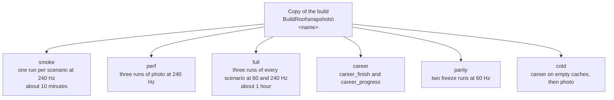

# FM4 end-to-end test harness

`e2e.py` launches the built game from a BuildRoot with the same arguments as `Build.ps1 -Action run`, drives the application-local diagnostic controller (`FM4_TEST_INPUT_FILE`; no desktop input is sent), and collects:

- GPU frame captures every 2 seconds (`FM4_CAPTURE_DIR`), converted to PNG; with `--env FM4_CAPTURE_STATS=1` also the mean luma of the frame and six cockpit patches of nearly every frame in `capture/stats.csv` ([cockpit brightness](../analysis/cockpit-brightness.md#swings-between-bright-and-dark-25-october-2026));
- a per-second performance trace (`REX_PERF_TRACE_FILE`, see [traces.md](traces.md));
- crash status and error counts from the runtime log;
- `summary.json` with median FPS and GPU-thread stall times.

With `--info` the game window shows the settings overlay of the run (render scale, quality, look, shadows, frame rate, shader A/B, ...; [`pipeline.py`](../../outputs/FM4-build/pipeline.py) `info_overlay`) from the start, and F2 toggles it in any run. The presenter draws it over the guest output, so the captures, OCR and `compare.py` never see it. It is off by default since 24 October 2026, as in the launcher: while it shows, the UI thread presents every frame, at most 120 presents a second on the main PC, which is not the players' present path ([d3d-hle-n4.md 17.22](../analysis/d3d-hle-n4.md#1722-host-presents-24-october-2026)).

Results go to `--out`, which must be outside this repository: captures and logs show game content. Use a directory under the BuildRoot, for example `<BuildRoot>\e2e\<name>`. `e2e.py` rejects an `--out` inside the repository. Never commit results.

Related pages:

- [architecture.md](architecture.md): how the harness and its game-side hooks are built, every Windows and D3D12 dependency, and a checklist for porting it to another platform or backend.
- [traces.md](traces.md): debug trace and diagnostic environment variables and what each writes.
- [experiments.md](experiments.md): A/B overrides, shader override diagnostics, FXC notes and other experiment-only switches.
- [frozen-frames.md](frozen-frames.md): the frozen-frame parity harness (the `freeze` scenario, `frame_diff.py`, `parity.py`) and its baseline variance.
- [setup.md](../setup.md): prerequisites, setup, generate, build and the BuildRoot layout.
- [running.md](../running.md): launcher options and look knobs.
- [status/current.md](../status/current.md): current state and what is verified on the latest build.

## Requirements

- A BuildRoot built by `Build.ps1` (the harness reads `local.json` and `build-result.json` from it).
- Disc 2 and the downloadable content that `local.json` names (`-Disc2`, `-Content`). `e2e.py`, and so `matrix.py` and `Build.ps1 -Action warmcache`, imports them into the BuildRoot profile before its first launch ([content import](#content-import)). A BuildRoot generated without `-Disc2` has no Disc 2: the Quick Race car asks for it, and the [race check](#race-check) fails the run.
- The mods that `local.json` names (`Build.ps1 -Action run -Mod`), if any: `e2e.py` plays them together from the mod Disc, as `run` does ([mods](../running-mods.md)). `-Mod none` runs Disc 1 as it is.
- A profile that has been played once up to the main menu ([a new profile](#a-new-profile)).
- Windows OCR with the en-US language: Windows installs it with the English (United States) language, which a Windows in another language may lack (Settings > Time & language > Language & region; `ocr-server.ps1` asks for `en-US`).
- Goal mode only: a TypeSafe API key in the `TYPESAFE_API_KEY` environment variable (user scope is read even when the shell started earlier). Each step sends the OCR text of the current screen, the goal/route description and the recent steps to `https://api.typesafe.ai` (endpoint `/v1/systemone`). No images, saves, user data or personal data are sent. A quickrace run makes roughly 40-50 requests.
- No packages beyond the Python standard library.

## Modes

### Fixed timeline (no network access)

```
python outputs\FM4-build\e2e\e2e.py --build-root D:\FM4-build --out D:\FM4-build\e2e\boot --scenario boot
```

### Goal-driven with Jev (TypeSafe System One)

```
python outputs\FM4-build\e2e\e2e.py --build-root D:\FM4-build --out D:\FM4-build\e2e\race --goal quickrace --tail 40 --measure 30
```

The `quickrace` goal starts the game, opens Free Play > Quick Race, accepts the default car and track, starts the race and holds the throttle. Add `--steps camera` to cycle the race cameras (Back every 6 s) once the race runs.

The run exits with code 1 when the game crashes, the goal is not reached in time, a step fails, or a run that should reach a race ends without one (the [race check](#race-check)). In the last three cases `goal_reached` is `false` in `summary.json`, and the last line of the output says why (`FAIL: ...`).

Without network access (Jev unreachable), `--scenario quickrace` drives the same route on a fixed timeline; it reaches the race reliably with the copied profile.

## e2e.py options

| Option | Default | Meaning |
| --- | --- | --- |
| `--build-root` | required | BuildRoot used by `Build.ps1` |
| `--game-build` | `game-build` | build directory under the BuildRoot, for example `game-build-prof` (see [traces.md](traces.md)) or `game-build-thinlto` (`pipeline.py --flavor`) |
| `--out` | required | result directory, outside the repository |
| `--scenario` | `boot` | fixed timeline: `boot`, `quickrace`, `photo`, `photo_view`, `career`, `career_finish`, `career_progress`, `career_season`, `quickrace_loop`, `dlc`, `freeze`, `menu_race` |
| `--profile` | none | copy a user-data root to `<out>\user-data` and run on it; `copy` means the BuildRoot's `user-data`, otherwise a path |
| `--fast-route` | off | reach the race of `quickrace`, `race`, `photo`, `freeze` or `career` through the title's screen events instead of fixed delays and OCR ([fast route](#fast-route)) |
| `--goal` | none | navigate with Jev instead of a timeline (`quickrace`) |
| `--goal-timeout` | 360 | seconds allowed for the goal |
| `--env NAME=value` | none | extra variable for the game process; repeatable |
| `--steps` | none | JSON list of steps, or the preset `camera`; overrides `--scenario`, and after `--goal` runs once the goal is reached |
| `--arg NAME=value` | none | extra or overriding `--cvar=value`; repeatable (`--arg=--readback_resolve=fast` also works) |
| `--look` | launcher's (`aces`, which has the mods of the earlier `pc` since 20 October 2026; `pc` is its alias) | look as `Build.ps1 -Look`, for example `original`, `aces,sharpen=0.6` or `aces,taa=0`; a look with TAA renders races in one tile without MSAA |
| `--msaa` | off | keep the tiles and MSAA of `--quality` with a look that has TAA, as `Build.ps1 -Msaa` |
| `--native` | off | the native path (`host_render_thread=true`), as `Build.ps1 -Native`: races in one pass with 2x MSAA (`FM4_TILING_SCENARIO=1`, `FM4_ONE_PASS_MSAA=2`, `native_one_pass_msaa=2`, `native_rt_surfaces=90`, 26 with `--entry0 k`; at a whole scale of 2 or more the launchers' plan, see [Render scale](#render-scale)) unless `--env FM4_TILING_SCENARIO`, `FM4_ONE_PASS_MSAA` or `--msaa` is given (`--msaa-samples 4`, or `--env FM4_TILING_SCENARIO=3 --env FM4_ONE_PASS_MSAA=4`, is one pass with 4x MSAA, `native_one_pass_msaa=4`; `--msaa-samples 0` is one tile); `--env FM4_TILING_SCENARIO=2` is one tile without MSAA (`-MsaaSamples 0`). Where `Build.ps1 -Native` falls back to the PM4 RTV path in tiles, `e2e.py` refuses a tiled run (`--msaa`, or a last `--env FM4_TILING_SCENARIO` other than 2 without `FM4_ONE_PASS_MSAA=2`) and `-Rov`, so a `--native` result is always the native path. A native run in one pass has 2x MSAA also with a look without TAA, where RTV and `-Rov` take the 4x tiles of `--quality high`; until one pass has 4x, its baselines on RTV and `-Rov` take `--env FM4_TILING_SCENARIO=1` (the 2x tiles), and in one tile both sides take `--env FM4_TILING_SCENARIO=2` (no TAA, no FXAA) |
| `--quality` | launcher's (`high`) | race render quality as `Build.ps1 -Quality`: `low`, `medium` (also `xbox`), `high`, `extrahigh` or `ultra`: its race settings and GTAO quality, and with `--native` `ultra`'s one pass with 4x MSAA unless `--msaa-samples`, a tiling `--env` or an `--arg` with a fractional scale, a logical size or upscaling says otherwise |
| `--ao` | off | the runtime's ambient occlusion pass (the GTAO post pass, `post_pass_path`), as `pipeline.py --ao` |
| `--race-seconds` | none | measure the race phase this long instead of the scenario's (30 s in `race`): the wait right after `phase:race`. For [in-run perf A/Bs](experiments.md#in-run-perf-ab), where the boot, menus and loading of a run cost the same whatever the race's length |
| `--location` | the profile's (Bernese Alps) | with `--fast-route`, the Quick Race location by its name on the location select screen, for example `"Maple Valley"` ([race location](#race-location)) |
| `--camera` | the profile's (the cockpit) | the race camera: `hood`, `bumper`, `chase` or `chase_far`, by Back presses once the race runs ([race camera](#race-camera)); `chase` for every look test. `matrix.py --camera` passes it to every cell |
| `--tail` | 10 | seconds to keep running after the last step |
| `--seasons` | 1 | `career_season`: stop once this many World Tour seasons are complete ([career season](#career-season-and-soak)) |
| `--min-hours` | 0 | `career_season`: after the seasons, keep playing the next events until the run is this many hours old; `quickrace_loop`: after two passes, start another pass until the run is this old |
| `--max-hours` | 3 | `career_season` and `quickrace_loop`: the cap; the run stops there, within an event or a race too, and passes when at least one event or race finished |
| `--qr-pairs` | none | `quickrace_loop`: the pairs as JSON, `[["Acura", "Bernese Alps"], ...]`, found by name. A pair may be `[manufacturer, location, manufacturer presses, location presses, car, layout]`: presses of `0` seek the names from the first entry (the location select does not wrap, so the default presses can skip a location before the target), and the car is found on the car select as part of its name, with alternatives separated by `|`, for example `"Zonda R|Zonda"`, and an alternative of parts joined by `+` needs every part, for example `"908+(FM3)"` for the mod car rather than FM4's own: the first match in the select's order wins, and at the end of the list the last car stays; the layout is found on the track select the same way (for example `"Bugatti"` for the Bugatti Circuit at Le Mans); without it the first pass picks them ([Quick Race loop](#quick-race-loop)) |
| `--qr-count` | 11 | `quickrace_loop`: pairs in a pass |
| `--qr-step` | 3 | `quickrace_loop`: Right presses between two manufacturers of the first pass (the locations move by 2) |
| `--qr-race-seconds` | 180 | `quickrace_loop`: seconds of each race before QUIT RACE (a race the AI finishes sooner goes on from its post-race menu) |
| `--soak` | off | record the soak telemetry (`soak.jsonl` and `guest-mem.jsonl`, [career season](#career-season-and-soak)) in any scenario; `career_season` and `quickrace_loop` always record it |
| `--soak-interval` | 30 | seconds between two soak samples |
| `--keep-ppm` | off | keep the full-resolution PPM captures next to the PNG files |
| `--info` | off | show the settings overlay from the start (`FM4_INFO_SHOW=1`); it moves the host presents to the UI thread |
| `--measure` | 0 | summarize only the last N perf seconds |
| `--repeat` | 1 | run N times into `<out>\run1..runN` and aggregate into `<out>\summary.json` |
| `--resummarize` | off | recompute `summary.json` of existing runs in `--out` from their `perf.jsonl` |
| `--affinity` | off | confine the game process to these logical processors, a mask such as `0xC3` (`cpu_power.py`: set after the launch and again each second where the runtime reset it), as a proxy for a smaller CPU; `summary.json` records `affinity` with the mask and how often it was set. On a CPU with efficient cores, Windows parks cores inside a mask of them, so only masks of performance cores are valid ([d3d-hle-n4.md 17.19](../analysis/d3d-hle-n4.md)) |
| `--cold-cache` | off | start with empty shader caches, as a fresh install: `cache_root` (the shader and pipeline storage and the title's cache partition) and `shader_override_cache_path` in `<out>\cache`, emptied before each run; `summary.json` records `cache` and the run's `shader_work` ([d3d-hle-n6.md 19.3.4](../analysis/d3d-hle-n6.md#1934-increments-and-gates)) |
| `--cache-from` | none | start with a copy of the `<out>\cache` of an earlier `--cold-cache` or `--cache-from` run: a later session of a fresh install, for example a new track |
| `--offline-pass` | off | before the title, run the game's executable with `shader_offline_pass=true` on the run's caches: the offline shader pass, whose first stage adds the title's pixel shaders from the disc and the installed content to the shader storage. Its progress lines are in `<out>\offline-pass.jsonl`, its log in `<out>\offline-pass.log`, and `summary.json` records `offline_pass` (the exit code, the seconds and the last line of each stage; [d3d-hle-n6.md 19.3.10](../analysis/d3d-hle-n6.md#19310-increment-13-the-games-pixel-shaders-from-the-disc-28-october-2026)) |
| `--cache-copy` | off | start with a private copy of the BuildRoot's warm caches (`cache_root`, with the shader and pipeline storage, the title's cache partition and the files the game writes there, and the override cache) in `<out>\cache`, about 0.85 GB, so the run can share the machine with another game ([concurrent cells](#concurrent-cells)) |
| `--min-free-gb` | 15 | refuse to start a run with less free space on the drive of `--out` (logs, perf trace, captures and the profile copy); `matrix.py` checks the same once before its first cell. Both also import Disc 2 and the content packages of `local.json` that are not imported yet ([content import](#content-import)), then refuse when a content package that an import marker of the BuildRoot profile names (`<user-data>\<package>.import-complete`) is missing or empty under `<user-data>\0000000000000000\4D530910\00000002`, and `e2e.py` warns when a build process (compiler, linker, ninja, CMake, MSBuild) runs beside the run |

The harness passes `--cvar` values from `pipeline.launch_cvars`, the look (`pipeline.look_cvars`) and `pipeline.ao_cvars`, then the `--arg` items, so an `--arg` overrides them.

## Gameplay scenarios

Fixed timelines with screen checks, no network access:

| Scenario | What it does |
| --- | --- |
| `photo` | Quick Race, 10 s of driving, then a 30 s measured race phase, pause > PHOTO MODE, take a photo, save it as a new file; checks SAVE SUCCESSFUL. |
| `menu_race` | the main menu for 30 s measured (phase `menu`; it renders the selected car in 3D), then the race of `race` (phase `race`): the menus' frame rate, host presents and power next to the race's ([d3d-hle-n4.md 17.22](../analysis/d3d-hle-n4.md#1722-host-presents-24-october-2026)). |
| `photo_view` | a new process opens Career > MY PROFILE > MEDIA > MY PHOTOS and loads the saved photo; checks that it replaces the menus without an error (OCR reads its watermark only sometimes; see `final.png`). |
| `career` | Career > GO RACE > WORLD TOUR, the profile's next event (Tsukuba Short Circuit with the Ford Ka for the BuildRoot profile), 40 s of driving, QUIT RACE, 30 s of the replay, CONTINUE to the event. |
| `career_finish` | the same event to the end, driven by the title's AI (`engageaionstart`, needed): it wins the 3 laps in about 3 minutes; CONTINUE, then A every 6 s through YOU PLACED (Total), the driver and Ford affinity level 2 rewards (a gift car: the default) up to EVENT COMPLETE, after the save. |
| `career_season` | World Tour event after event in one process, driven by screen events and OCR, until `--seasons` seasons are complete and `--min-hours` have passed, at most `--max-hours`; records every event in `season.jsonl` and the soak telemetry in `soak.jsonl` ([career season](#career-season-and-soak)). Needs `engageaionstart`. |
| `quickrace_loop` | Quick Race on a fixed list of (manufacturer, location) pairs, pass after pass in one process: the soak that revisits tracks and cars ([Quick Race loop](#quick-race-loop)). Needs `engageaionstart`. |
| `career_progress` | a new process on that profile: WORLD TOUR shows the next event (the TopGear challenge) with the driver at level 2 and credits other than the 8,610 CR before the race. The title opens a CHALLENGE EVENT box over the event's car screen; the scenario waits for it, closes it with A once its CONTINUE shows, and reads the level on the event screen behind it. |
| `camera_race` | Quick Race, then a race phase that cycles the race cameras (cockpit, hood, bumper, chase near, chase far, back to the cockpit) with Back every 6 s while holding the throttle; for the edges of every camera at a logical size ([D3D-level HLE, 18.24](../analysis/d3d-hle-n5.md#1824-increment-2s-close-gate-25-october-2026)). Has a fast route. |
| `freeze` | Quick Race, rewound from race frame 720 (session updates; Y pulsed on the guest's pad polls) to the oldest frame the rewind keeps, then 20 s of that frozen frame (phase `freeze`). Pins the look `original,taa=0`, the occlusion reports and 2x, and keeps the PPM captures; see [frozen-frames.md](frozen-frames.md). |
| `dlc` | downloadable content: Free Play > Quick Race with a Porsche Expansion Pack car (Porsche, 1970 914/6) on the Launch Track Pack's Test Track Benchmark (Speedway), then 20 s of racing (phase `race`). Checks the Porsche manufacturer, the car, the environment, the layout and the race HUD. Needs both packs imported into the BuildRoot profile with `Build.ps1 -Content`. |

They write saves, so run them on a copy of the profile:

```
e2e.py ... --out <BuildRoot>\e2e\photo --scenario photo --profile copy
e2e.py ... --out <BuildRoot>\e2e\view --scenario photo_view --profile <BuildRoot>\e2e\photo\user-data
e2e.py ... --out <BuildRoot>\e2e\career --scenario career --profile copy
e2e.py ... --out <BuildRoot>\e2e\finish --scenario career_finish --profile copy --env FM4_GAME_CMDLINE=engageaionstart
e2e.py ... --out <BuildRoot>\e2e\progress --scenario career_progress --profile <BuildRoot>\e2e\finish\user-data
e2e.py ... --out <BuildRoot>\e2e\season --scenario career_season --profile copy --env FM4_GAME_CMDLINE=engageaionstart
e2e.py ... --out <BuildRoot>\e2e\dlc --scenario dlc --profile copy
```

`--profile copy` copies a user-data root (`copy` means `<BuildRoot>\user-data`) to `<out>\user-data` and runs on it. The installed content packages (`user-data\0000000000000000`) are linked with a directory junction, not copied, and the BuildRoot's own packages are never deleted through the copy. With `--repeat`, each run gets its own copy. Without the AI driver the career race only holds the throttle (the Ford Ka ends up at a wall); `career_finish` needs `engageaionstart`.

Every scenario except `boot` starts with one A per splash video read on screen (Microsoft Studios, Dolby), which skips it: the main menu shows after about 30 s instead of 47. A at a fixed rate is not used, because it also skips the short title screen and selects PLAY CAREER in the main menu.

`e2e.py` runs the game with `headless=true`: XAM prompts such as the keyboard for a photo name answer with their default text (nobody can type into the host dialog). Rendering is not affected.

### Race camera

The BuildRoot profile races in the cockpit camera. `--camera` presses Back once the race runs, which cycles the title's race cameras in its order: cockpit, hood (1 press), bumper (2), chase near (`chase`, 3) and chase far (`chase_far`, 4). The presses go before the race phase (`phase:race`), holding the throttle where the scenario holds it, and in `freeze` before the rewind's Y, 12 s after START RACE (the menu route) or after the countdown's placement (the fast route), in the race's first seconds, so the frozen frame shows that camera. The project owner asked on 29 October 2026 that the look tests run in the chase camera, not the cockpit: the look board's reference pairs are chase camera frames too, and the cockpit's dark interior and its windows weigh on every measure of a look. A look A/B is therefore `--scenario freeze --camera chase --look <look>` at 2x (the freeze pin), one run per look ([look presets](../analysis/look-presets-gt7-fm2023.md)).

### Race location

The Quick Race scenarios (`quickrace`, `race`, `photo`, `freeze`, `camera_race`) race on the profile's location, the Bernese Alps' Festival Circuit in the BuildRoot profile. With `--fast-route`, `--location <name>` presses Right on the location select screen until OCR reads the name (case-insensitive, part of a line, a retry every 2.5 s for up to 120 s), then the route's A opens the track select and takes its first layout. It is for look tests on the tracks that the look references show ([look presets](../analysis/look-presets-gt7-fm2023.md)).

### Race check

The scenarios that drive into a race (`quickrace`, `race`, `photo`, `menu_race`, `camera_race`, `freeze`, `career`, `career_finish`, `dlc`) and the `quickrace` goal reach their goal only when the title pushed a race render scenario: a `push <cars>_Race` line in the screen events (`events.txt`, written at the end of the 3-2-1). The menu route presses through the Quick Race menus with fixed delays and checks no screen after the main menu, so before this check a run that stopped at a prompt passed: on a BuildRoot without Disc 2 the car select opened the INSERT DISC 2 prompt and `quickrace` reported its goal reached (25 October 2026). A timeline that ends before the push (a cold shader cache slows the countdown down) waits up to 60 s more for it, and stops waiting at the Disc 2 prompt. `--steps` without `--goal` has no race check; a binary that writes no screen events gets a warning instead (the check cannot run).

A failed run's `failed_step` also says what the screen events show about where it stopped:

| Screen event | `failed_step` says |
| --- | --- |
| `scene <id> 031_LOAD_DISC_2` (any scene with `DISC` in its name) | the title asks for Disc 2: it is not imported into the BuildRoot profile; generate again with `-Disc2` when `local.json` names none |
| `scene <id> 830_GAMMA_ADJUST` or `1_C_INI_IE_LOADING` | a new profile: play once first ([a new profile](#a-new-profile)) |

`summary.json` records `race_check` (whether the run had it) and `race_started_s` (seconds from the launch to the first race push).

### Content import

`Build.ps1 -Action run` and the GUI launcher import Disc 2 and the downloadable content packages into `<BuildRoot>\user-data` at their launch (`FM4_CONTENT_MANIFEST`, [`fm4-content-installer.cpp`](../../work/fm4-rex/src/fm4-content-installer.cpp)). `e2e.py` does the same before its first launch of a BuildRoot: when a package that `local.json` names (`disc2`, `content`) has no import marker (`<user-data>\<package>.import-complete` with the package's size) or no directory under `<user-data>\0000000000000000\4D530910\00000002`, it starts the game once in its import mode (`FM4_CONTENT_MANIFEST` with `FM4_CONTENT_INSTALL_ONLY=1`, `headless=true`), which installs the packages and exits before the title starts (about 15 s for Disc 2 and eight DLC packages). `matrix.py` does it once before its first cell, and `Build.ps1 -Action warmcache` through `e2e.py`. The import goes into the BuildRoot profile, where a `--profile` copy links the packages from; the logs are `<BuildRoot>\logs\e2e-import.log` and `e2e-import-stderr.log`. When the import fails, the run stops with a message before the launch. When `local.json` names no Disc 2, `e2e.py` prints a note: races on Disc 2's cars and tracks stop at its prompt.

### A new profile

The timelines start from a profile that has been played once up to the main menu. The first start of a new profile plays the game's long intro video, then the gamma adjustment (`830_GAMMA_ADJUST`) and the intro race (`1_C_INI_IE_LOADING`), and only then the main menu. The timelines do not drive that: the intro race is a whole race with screens after it, not a step or two, so a timeline change cannot cover it. On a new BuildRoot, `warmcache` and the scenarios therefore stop at "PLAY CAREER timed out" (seen on 25 October 2026), and `failed_step` says to play once first: start the game with `Build.ps1 -Action run` (or the GUI launcher) and play up to the main menu, then run the harness. The scenarios that write saves run on `--profile copy` of that profile.

### Scenario steps

A step is `[timeout, action, hold, text(, retry)]`. It repeats the action until one of the `|`-separated texts shows in a capture taken after it, and fails the run (`goal_reached` false, `failed_step` in `summary.json`) otherwise.

- `?action` skips the action when the text already shows.
- A text starting with `@` is a regular expression on the title's screen events (`events.txt`, [architecture](architecture.md#screen-events-fm4_test_events_file)) instead of OCR: the step passes when a matching event is written after its press, or for `wait` after the run's last press. `?action` then skips the action when one was written since the last press. Events are read every 50 ms, against OCR's capture every 2 s.
- `=TEXT` must be a whole OCR line. A leading `!` passes when none of the texts shows.
- Give a step whose screen loads (taking a photo, a race loading) a retry longer than the load: a repeated A would act on the next screen.
- `select:<label>` moves the menu highlight to an OCR'd label. The highlighted entry of a vertical menu is the one with red lines above and below it (`ocr-server.ps1` `red_above`/`red_below`) and a dark band (`bg`); of a horizontal menu, the red-framed tile. It moves only when two clear readings in a row agree, since menus slide and sway (the pause menu at 120 Hz most of all). `ocr-server.ps1` averages a capture taller than 720 lines down to 720 lines first (each pixel over the source pixels it covers, so 1920x1080 at the scale 3/2 as well as the whole scales), so the boxes and these rectangles are in 720p pixels at any render scale.
- Menus that act on their own when idle are not selected but driven with fixed presses as soon as they show: the career and GO RACE menus hide (Up shows them again), and the post-race menu starts the race replay. The career menu hides about 9 s after the last press at 60, 120 and 240 Hz alike (a wall-clock timer; see [status/current.md](../status/current.md)), so a capture every 2 s can miss a menu that shows only briefly.
- `wait` waits without touching the controller.
- `phase:<name>` ... `phase:end` marks a measured phase. `summary.json` `phases` has the perf statistics per phase (photo: race, photo; career: race, replay).
- `defines:NAME=VALUE NAME=VALUE ...` writes `shader_mod_defines.txt` into the run's `shader_mod_path` without touching the controller. With hot reload (`--shader-dev`, or `--arg shader_mod_hot_reload=true` and `shader_mod_live_knobs=true` for another directory) the runtime applies it at once: live knobs in the next frame, other defines through a recompile. Lines left out of a later step keep their value, so give every knob that changes in each step. The file is restored (or removed) after the run. With a frozen scene (rewind, Y) or a held camera stick, one run compares several knob values in the same frame; match the captures to the steps by the `shader_mod_defines.txt changed` lines in `runtime.log`.
- `steps.jsonl` records what each check and select saw.

FM4 menus ignore the first press after some screens open, and the career and GO RACE menus hide after a few idle seconds (the next press only shows them again), so the scenarios press until the expected screen shows rather than counting.

## Career season and soak

`career_season` plays the World Tour in one game process ([`career_season.py`](../../outputs/FM4-build/e2e/career_season.py)). The steps take the boot and the career menus to the World Tour screen (scene `200_WORLD_TOUR`). Then the driver takes over: it reacts to the screen events and reads by OCR only what it must judge.

- **The stop.** At each stop the globe zooms in (about 10 to 17 s), and the title may open a CHALLENGE EVENT box (`201_SPECIAL_EVENT_DIALOG`, closed with A once CONTINUE shows). The stop's events then show in a row. For each event the driver reads the name, track, bonus and RESTRICTIONS box (X opens it, B closes it). It takes the first event whose make and model rules the car meets, and opens it (`204_C_RACE_INFO`). The title judges the performance index and the body rules itself.
- **The event's screen.** The driver reads the car, the driver level and the credits from the footer. It opens SEASON STATUS (`203_SEASON_STATUS`: the season's name and the state of each event; the box shows five rows), then starts the race. Some event screens have tilted artwork (the Inline Four Showcase's banner), which makes Windows OCR deskew the whole image and misread the menu: when START RACE does not read, the driver presses A on it (the screen opens with it focused) and takes the credits from the World Tour row.
- **The races.** For every race of the event:
  - the pre-race menu (`4_C_INI_PRERACE`, with its heat);
  - the race itself (the push and pop of `<cars>_Race`; the title's AI drives);
  - the post-race menu (`924_POST_RACE`): the driver presses CONTINUE at once.

  A championship runs its heats in turn.
- **After the races.** The earnings (`920`, with the place under YOU PLACED and the total), the level progress (`909`), the level and affinity rewards (`910`, one page each, with their credits), a championship's result (`911`) and a gift car (`108`, `114`, then YES; A keeps the default), up to the next World Tour screen.
- **The season's end.** The title shows `208_SEASON_END`, which moves on by itself, and on the World Tour screen the season list (`207_SEASON_LIST_DIALOG`, "You now qualify for next year's CLUBMAN DIVISION."), which A closes. The driver marks the season complete on the end screen, and the next event as the first of the season the list names.
- **Unknown screens** are recorded in `season-state.json` with their text and a capture. They get an A only where they show CONTINUE, OK or YES.
- **No car changes.** The driver neither changes nor buys a car yet. A stop where the player's car fits no event ends the run at the title's refusal.

The BuildRoot profile is two events into season 1, the AMATEUR DIVISION, which has five events:

1. Ladera Short (complete).
2. Road Atlanta Club (complete).
3. Tsukuba Short: the Class F Asian Tour, with the Inline Four Showcase and the Economy Car Open beside it.
4. TopGear Loop: two TopGear bowling challenges.
5. Hockenheim Short: the Class F World Championship, a qualifier and heats.

A profile copy therefore plays three events of season 1. `--min-hours` keeps the run going into the next seasons, for a soak of that length. The first such run (30 October 2026, `--seasons 1 --min-hours 2`, 2x and 240 Hz on the native path) played 19 events in 2.04 hours: the rest of the Amateur Division, the seven events of the Clubman Division, and nine of the Sportsman Series ([career season soak](../analysis/career-season-soak.md)).

Results in `--out`:

| File | Contents |
| --- | --- |
| `season.jsonl` | one record per finished event: the stop's events with their restrictions; the event, its track and bonus; the car and the driver level; the credits before (its screen) and after (the next event's screen); SEASON STATUS; every race (place, seconds, earnings total); the rewards and their credits; the gift cars; the season's end and the season list; the start, end and length. An event the cap or a failure cut short is written too, with `unfinished` |
| `season-state.json` | the driver's state after every step (the event, the phase, the screens noted, a failure or the cap), for a stopped run |
| `events/` | PNG captures of each event's season status, post-race menu and earnings, of a season's end and list, of noted screens and of a failure. The run keeps 240 captures (the first 8 minutes, `FM4_CAPTURE_ARCHIVE_LIMIT`), then only the newest. A 2-hour run takes about 0.4 GB in all |
| `soak.jsonl` | every 30 s: the process's private bytes, working set, page file use, and handle, thread, GDI and USER object counts; its dedicated, shared and committed GPU memory (the "GPU Process Memory" performance counters of its process id, summed over its adapters); and the driver's phase |
| `summary.json` `season` | the events, the seasons completed, a failure or the cap, and the credits check: per event, the credits after less those before, against the earnings plus the rewards' credits |

`soak_report.py <run>` analyses the soak:

- Everything up to the end of the first race is the warm-up.
- For each metric it reports the slope per hour after the warm-up.
- For each metric it also reports the lowest value of each race cycle, from the end of one race to the end of the next. Memory that rises with every race and never comes back shows as floors that only climb.
- It gives the frame time percentiles per minute and per race.
- It lists the kernel and XAM stubs called, from `runtime.log` and its rotated parts (`runtime.1.log` and on; the runtime rotates at 5 MB).
- For a run with passes (`quickrace_loop`), it reports per pass the slope per hour, each pair's floor and the floors' rise, and each pair's floor against the same pair's in the pass before: a cache stays level on a repeat, a leak keeps rising.
- It counts the process's handles by object type (`soak.jsonl`'s `handle_types`), first sample against last.
- From `guest-mem.jsonl` ([guest memory](traces.md#guest-memory-rex_guest_mem_trace)), the guest's committed physical memory: its peak, with the driver's phase and pair at that time, its range per pass, the virtual heaps' peaks, and the physical allocations of 1 MB or more by caller.

Its verdict uses the thresholds proposed for the season soak (29 October 2026):

- private bytes grow by at most 50 MB an hour;
- the process's dedicated GPU memory grows by at most 25 MB an hour;
- handles grow by at most 100 and threads by at most 5 an hour;
- the races' p50 and p99 frame times in the last third of the races are at most 10% above those of the first third.

A run with more than one pass is judged on its last pass's slopes, where a cache has stopped filling and a leak still rises; the verdict shows the whole run's slopes beside them (`judged_on`, `whole_run_slope_per_hour`).

`season_perf.py <run>` turns the same run into a performance survey. It splits the run into phases by its screen events:

- `menus`;
- `loading`: the event's loading, the unloading after it, and the loading screens;
- `pre_race`;
- `countdown`: from the cars' placement to the race;
- `race`;
- `finish`: a race's last seconds after the finish line, which the title runs at 30 fps until the race scenario ends (the race's last perf windows with a median frame of 30 ms or more);
- `rewards`: from the post-race menu to the gift car.

The driver presses CONTINUE at once, so the run has no replay phase. For each event and phase, the survey summarises the perf trace:

- frame times, frames over 16, 33 and 50 ms, and hitches (frames over twice the phase's median and over 34 ms, so a 30 fps screen's 33.3 ms frames are none);
- the GPU time a frame, split into the post passes, the swap and the scene;
- the host render thread's and the submit thread's busy time;
- the shaders and pipelines made in play.

It lists every frame over 50 ms with its time and phase, and ranks the event and phase pairs by p99 and by hitches a minute.

The season soak holds the GPU queue in class `perf` for its whole length.

## Quick Race loop

`quickrace_loop` ([`quickrace_loop.py`](../../outputs/FM4-build/e2e/quickrace_loop.py)) answers what a career soak cannot: whether memory that grows while new tracks and cars load keeps growing when the same tracks and cars come back. After the boot to the main menu, the driver plays Quick Races on `--qr-count` pairs of manufacturer and location, then the same pairs in the same order again, pass after pass. A cycle, driven by the screen events and OCR:

1. Free Play's QUICK RACE, the manufacturer select (`115_C_BUY_MFRSELECT`) to the pair's manufacturer, its first car (`108`), the paint and the difficulty (`114`, `838`), the location select (`122_F_TRK_LOCSELECT`) to the pair's location, and its first track layout (`123_F_TRK_TRACKSELECT`).
2. The loading, the pre-race menu, and the race: the title's AI drives it for `--qr-race-seconds` on the title's 12-car grid.
3. The pause menu's QUIT RACE, its dialog, the post-race menu's CONTINUE (straight to it when the AI finished first), the unloading, then B back to Free Play.

Both selects open on their first entry from Free Play, so the first pass takes pair `i` at `i * --qr-step` Right presses on the manufacturer select and `2 * i` on the location select (every second of the 26 locations, so 11 pairs reach the large tracks), or the names of `--qr-pairs`. It records the names it read; the later passes check them and press on until the name matches. The run stops after at least two passes once it is `--min-hours` old, at `--max-hours` within a race, or on a failure. The soak sampler's label is `pass <p> pair <i>: <phase>`.

| File | Contents |
| --- | --- |
| `qrloop.jsonl` | one record per cycle: the pass, the pair's index, the manufacturer, car, location and track read, the race's start, its finish when the AI finished it, and the cycle's end |
| `qrloop-state.json` | the pairs, the cycle and its phase after every step, and a failure or the cap |
| `soak.jsonl`, `guest-mem.jsonl` | the soak telemetry and the guest's memory, as in `career_season` |

`soak_report.py <run>` judges the run on its last pass. The first run (30 October 2026, 11 pairs, 2.83 h, 3 passes) is in the [career season soak, section 10](../analysis/career-season-soak.md#10-the-soak-that-revisits-tracks-and-cars-30-october-2026).

## Fast route

`--fast-route` reaches the race of `quickrace`, `race`, `photo`, `freeze`, `menu_race` and `career` through the title's screen events (`events.txt`, [architecture](architecture.md#screen-events-fm4_test_events_file)) instead of the fixed delays and OCR checks of the menu route. It needs a binary with the events writer (`fm4-test-events.cpp`, 22 October 2026). The steps after the race starts are those of the menu route. In `quickrace`, `race`, `photo` and `freeze` the race is the same Quick Race: the same screens accept the same defaults (Abarth, 1980 131 Abarth, its default paint, the default difficulty, Bernese Alps, Festival Circuit), so the render scenario, the tiling and the quality are those of the menu route, and `FM4_FIXED_SEED` pins the opponents and the grid as it does there. `menu_race` waits for PLAY CAREER after the boot, measures its menu phase, then takes the steps of `race`.

| Part | Menu route | Fast route |
| --- | --- | --- |
| Boot | waits for the Microsoft Studios video in OCR, then A per splash screen | A every 2.5 s until the title scene (`120_P_PRE_SPLASH`) is created, then, 2.5 s later, A on the title until the main menu's render scenario (`UI_Homespace`) is pushed (`?a`: skipped when the push already came, see below) |
| Main menu to GO RACE | three Rights and eight A presses 5 s to 8 s apart | three Rights, a `select:FREE PLAY` check, then A on each screen 1.5 s after the scene before it, repeated when the next scene does not follow (`115_C_BUY_MFRSELECT`, `108_C_BUY_CARSELECT`, `114_C_BUY_BUYCAR_COLOR`, `838_I_PRO_OPTIONS_SET_DIFFICULTY`, `122_F_TRK_LOCSELECT`, `123_F_TRK_TRACKSELECT`, then the race event controller `17_DYNAMIC_LOADING_FREEPLAY`) |
| Loading to START RACE | a fixed 40 s wait after GO RACE, then A, Down, Up, A | the pre-race menu's scene (`4_C_INI_PRERACE`), 3 s for it to slide in, then Down, Up, A until START RACE creates the HUD |
| Race phase | starts 19 s after START RACE, 9.1 s to 9.2 s after the race scenario (`12-Car_Race`) is pushed | starts about 9.3 s after that push |

The title can take the boot's last A as it creates the title scene (the A came up to 0.06 s before the scene) and then pushes `UI_Homespace` about 0.9 s later, during the 2.5 s wait, where a later A would select PLAY CAREER. The title's A is therefore `?a`: it is skipped when the push came after the last press. Before 25 October 2026 it was pressed on the main menu and the step timed out (six runs, for example `gp2s-240-photo` and `n6z-nat1x-240-photo`); in the other runs the push comes about 3.4 s after the title scene, after the title's A.

Measured on 22 October 2026 at 1x and 240 Hz with `FM4_FIXED_SEED=1` ([direct race launch](../analysis/direct-race-launch.md#the-fast-route-22-october-2026)): five `photo` runs of the fast route all reached their goal, in 191.6 s to 193.9 s against 249.9 s to 252.5 s for the menu route, about 57 s less per run. GO RACE comes at 49.7 s instead of 79.5 s and the race at 81.1 s instead of 138.0 s; one `race` run took 137.1 s against 193.4 s, and one `freeze` run 150.5 s against 207.6 s, with `parity.py` passing against the menu route's frozen frame. The race phase matched the menu route's three seeded runs: 1,914 to 1,968 draws per frame against 1,902 to 1,956, 212.8 to 220.7 fps against 211.7 to 219.6, the same GPU time per frame and no new error key. The boot to the main menu (24 s, splash videos that A skips only in their last part) and the loading (17 s) stay as they are.

`career` takes the same boot, then A on PLAY CAREER (the main menu's default) until the career home's scene (`102_H_CAR_HOME`), GO RACE > WORLD TOUR until `200_WORLD_TOUR`, A every 3 s until the event's screen (`204_C_RACE_INFO`; the globe that zooms to the event for about 10 s ignores A), `select:START RACE` and A until the event loads (`19_DYNAMIC_LOADING_WORLDTOUR`), then the pre-race menu as in a Quick Race. Its race phase starts 5.1 s after the race scenario (`8-Car_Race`) is pushed, where the menu route's OCR of LAPS put it. The career menus were already driven by OCR, so it saves less: three runs on 23 October 2026 reached their goal in 203.3 s to 209.9 s, against 206.5 s to 215.1 s for the menu route's `career` runs at 1x and 240 Hz of 21 to 23 October 2026, and started the race phase at 83.8 s to 84.6 s instead of 86.2 s to 92.4 s.

`matrix.py --fast-route` passes `--fast-route` to the cells that have a fast route (`photo`, `career`, `freeze`) and leaves the others (`photo_view`, `career_finish`, `career_progress`) on their menus.

## Goal mode

Code owns the workflow; Jev supplies judgments:

1. `ocr-server.ps1` reads each new capture with the Windows OCR engine (en-US) and reports text lines, their positions and how much FM4 selection red surrounds them. `e2e.py` marks the highlighted item from that.
2. One Jev request per step asks, in parallel: which screen is shown, which on-screen item the route needs activated next, and whether a race is running.
3. `e2e.py` turns the judgments into one controller action: move the highlight toward the target, press A, wait during loading, press B on screens the goal does not need (for example Autovista), and nudge menus that ignore A until their focus has moved once.

`nav.jsonl` records every step: frame, judgments, confidences and the action.

## Gates and tiers



`matrix.py` runs a set of cells on a snapshot of the game build (`<BuildRoot>\snapshots\<name>`, checked against `build-result.json`), so `Build.ps1 -Action build` can rebuild `game-build` while a gate runs. Cells still run one at a time, because performance numbers need the machine to themselves. The harness runs RTV unless `--native` is given (`matrix.py --native` passes it to every cell), while the launchers run the native path by default: gates of the players' default need `--native`. Pick the tier by what a change can break:

| Tier | Cells | Runs per cell | Use |
| --- | --- | --- | --- |
| `smoke` | `photo`, `photo_view`, `career` at 240 Hz | 1 (about 10 min) | every change, before measuring anything |
| `perf` | `photo` at 240 Hz | 3 | performance work, against a baseline gate of the same tier: its race phase (12 cars, 30 s) and photo mode |
| `full` | `photo`, `photo_view`, `career` at 60 and 240 Hz | 3 (about 1 hour) | the full gate at the end of a level of the native port; `--hz 60,120,240` adds 120 Hz |
| `career` | `career_finish` and `career_progress` at 240 Hz | 1 (about 8 min) | a career race to its rewards and the progress after a restart |
| `parity` | `freeze` at 60 Hz | 2 (about 8 min) | image, draw and predication parity of a frozen frame with `parity.py` against a baseline ([frozen-frames.md](frozen-frames.md)) |
| `cold` | `career`, then `photo`, at 240 Hz | 1 (about 9 min) | a fresh install's shader caches: `career` on empty caches (`--cold-cache`), `photo` on the caches `career` left (`--cache-from`, a new track in the second session); the stalls of shader compiles in play ([d3d-hle-n6.md 19.3.4](../analysis/d3d-hle-n6.md#1934-increments-and-gates)) |

```
python outputs\FM4-build\e2e\matrix.py --build-root <BuildRoot> --name <name> --tier smoke --baseline <older name>
```

Which cells a change gets follows the project's gate rule ([gate tiers](../analysis/d3d-hle.md#gate-tiers-the-main-sessions-decision-of-22-october-2026)): since 29 October 2026, during a level of the native port, an increment lands after one short check of 15 to 20 minutes (the build and its snapshot, the offline shader pass on a cold copy, and one `career` race at 3/2 on the native path), and one full gate runs at the end of the level. RTV and `-Rov` are out of the gates since 27 and 28 October 2026; the image proof is the native path against the previous main's native path, with a capture compared at 1:1.

Options: `--build-root` and `--name` are required. `--tier` defaults to `smoke`. `--scenarios`, `--hz` and `--repeat` override the tier. `--baseline` compares each cell with the cell of the same Hz and scenario of that gate. `--game-build` (default `game-build`) names the build to snapshot, `--no-snapshot` runs the build directory itself, `--human` keeps the harness throttle, `--look` gives every cell a look as `Build.ps1 -Look` (for example `pc,taa=0` for a baseline without TAA, or `pc,taa_point=1`), `--quality` a race quality as `Build.ps1 -Quality` (for example `ultra`), `--native` the native path (`e2e.py --native`), `--fast-route` runs the cells that have a [fast route](#fast-route) on it, `--cold-cache` runs any tier's cells on cold caches as the `cold` tier does, `--cache-copy` runs each cell on a private copy of the warm caches ([concurrent cells](#concurrent-cells)), `--offline-pass` runs the offline shader pass before each cell (`e2e.py --offline-pass`), and `--env` and `--arg` pass to every cell.

Cells go to `<BuildRoot>\e2e\<name>-<hz>-<scenario>`, and `<BuildRoot>\e2e\<name>.log` keeps one line per cell. Every cell passes its render scale explicitly: 1, and 2 for `freeze` (the scenario's pin), unless `--arg draw_resolution_scale_x=` and `_y=` set it; `summary.json` records it as `draw_scale`. Each cell is compared with `compare.py` when `--baseline` is given. `matrix.py` exits with 1 when any cell's run fails (a crash or a goal not reached). The `compare.py` verdict, and for `freeze` cells the `parity.py` verdict, only go into the cell's line: a FAIL there does not change the exit code.

- In every race an AI driver drives the player's car (`FM4_GAME_CMDLINE=engageaionstart`), so each race follows the track instead of ending at a wall. A `FM4_GAME_CMDLINE` given in `--env` replaces this default, and `--human` drops it.
- `photo_view` runs on the profile that the `photo` cell of the same gate saved, and `career_progress` on the profile of `career_finish`. `matrix.py` refuses a gate that includes one of them without the other.
- On cold caches (the `cold` tier, `--cold-cache`) `photo` starts with the caches that the `career` cell of the same gate left, when the gate has one, and every other cell with empty caches. The cell's line in the gate log adds its shader work: the look mods compiled on the draw path and on the workers, the swaps, the frames over 50, 100 and 250 ms and those over 50 ms with a mod compile.
- For a tier at 2x, pass `--arg draw_resolution_scale_x=2 --arg draw_resolution_scale_y=2`. On the native path the cells then take the launchers' plan at that scale (see [Render scale](#render-scale)). `ocr-server.ps1` averages captures above 720p down to 1280x720 first, so the menu highlight checks keep their 720p pixel distances.
- Unlike the look and the race quality, `e2e.py` does not follow the launcher's `-Display`: it renders at 1x in a 1280x720 window unless `--arg` says otherwise, so the gates keep comparing with their baselines. The launcher's native resolution is 2x on 1080p, 1440p and 2560x1600 monitors and 3x on 4K ones.
- The photo race phase replaces the `quickrace` scenario in the gates; `quickrace` stays for comparisons with older results.
- The Japan/Asia and USA releases share one game build (see [release comparison](../analysis/releases.md)), so a BuildRoot made from one release checks the other with `--arg "game_data_root=<other Disc 1>"`, on the same binary and profile. The two releases perform the same; compare a cell with a baseline of the same release anyway, because the races differ from run to run.

### Concurrent cells

Cells that measure speed (smoke, perf, full, the race scenarios, in-run perf A/Bs, anything read for fps or ms) run alone, and no build runs beside them. Image-only cells may run two at a time: freeze parity, byte checks, perturbation runs and check-mode runs. The GPU queue of the side sessions gives them the `check` class.

- Run each concurrent cell with `--cache-copy` (`matrix.py --cache-copy` passes it to every cell). Without it, both games use the BuildRoot's `cache_root` and override cache, and the game writes files there at start-up.
- `e2e.py` copies every run's look mods and post passes into `<out>\look` and `<out>\passes`, not the BuildRoot's `look` and `passes`. The override cache keys on file contents, so it stays warm. Cells with different looks may therefore pair.
- Everything else a run writes is already under `<out>`: the log, the perf trace, the captures, the input and events files, and with `--profile copy` the profile and saves (the installed content packages are a read-only link to the BuildRoot's). Each game names its guest memory mapping after its start time, and the OCR process of each run talks to it through pipes.
- Give each concurrent cell its own `--out` and its own path for any trace you pass (`--env REX_...=<file>`, `FM4_N0_TRACE`), and start the second cell a few seconds after the first.
- The game's config file next to the executable (`fm4_rex.toml`) is read, never written, unless the settings overlay saves it.

Validation, 28 October 2026 (snapshot `perfab2`, the native path, the parity tier's freeze cell with `--cache-copy`, two runs each; RTX 5070 Ti Laptop GPU with 12 GB):

| Cells | Wall time | Parity | Peak VRAM |
| --- | --- | --- | --- |
| `pab4-solo` alone | 7:18 | PASS (run1 against run2) | 3.9 GB |
| `pab4-c1` and `pab4-c2` at once | 7:27 | PASS within each cell and against `pab4-solo` | 7.3 GB |
| `pab4-c3` and `pab4-c4` at once | 7:21 | PASS within each cell and against `pab4-solo` | 7.4 GB |

- All 10 runs reached their goal without a crash. The frozen frame's draws and predicated draws a frame stay within 0.1% of the solo cell's.
- A pair of cells takes the wall time of one cell, so it saves about 7 minutes per pair.
- The render thread's busy time a frame rises by about 8% beside another game, which is why speed cells still run alone.
- A byte check (`native_rt_resolve_layout_check=30`) beside a freeze cell found no differing word in 187 layouts, as alone (190 layouts).

## Frame rate and launcher settings

The harness uses the launcher environment (`pipeline.launch_env`):

- `FM4_HALF_RATE_MIRROR=1`: the rear-view mirror is drawn every other frame in every race. `--env FM4_HALF_RATE_MIRROR=0` renders it every frame, also in the 12 car Quick Race.
- `--env FM4_SHADOW_WORKAROUND=1` skips the shadow map outside the cockpit in races (`Build.ps1 -ShadowWorkaround`).
- The race render quality is the launcher's (`pipeline.py` `QUALITY_PRESETS`, `high` by default, passed through `FM4_RACE_SETTINGS`). `--quality low|medium|high|extrahigh|ultra` picks another (`xbox` is `medium`); with `--env FM4_TILING_SCENARIO=<n>` the preset keeps that tiling scenario.

Frame rates above 60 (`Build.ps1 -FrameRate <n>` sets both of these):

- `--arg=--video_mode_refresh_rate=<n>` changes the refresh rate reported to the game.
- `--env FM4_FRAME_RATE=<n>` replaces the FrameRate 60 of the race render scenarios. Replays and the 3-2-1 countdown follow the race frame rate since 20 October 2026 (`FM4_FULL_RATE=replay,countdown` from `pipeline.launch_env`; post-race and photo mode keep 30); `--env FM4_FULL_RATE=` gives the title's 30 for comparisons with older baselines.

The guest vblank then runs at 60 Hz, and at `<n>` Hz only while a race scenario sets the frame rate (`fm4-vblank-rate.cpp`). `--arg=--vblank_rate=<hz>` sets a fixed startup vblank rate (without `FM4_FRAME_RATE`). The vblank diagnostics are in [experiments.md](experiments.md).

At 240 Hz (`--arg=--video_mode_refresh_rate=240 --env FM4_FRAME_RATE=240`) the command processor, not the vblank, sets the frame rate.

### Render scale

`e2e.py` renders at 1x unless `--arg draw_resolution_scale_x=` and `_y=` set the scale (the freeze scenario pins 2x). On the native path in one pass with 2x MSAA, a whole scale of 2 or more takes the launchers' plan for a 16:9 screen at that scale (`pipeline.py`, since 28 October 2026): `native_draw_scale=<scale>`, `native_draw_scale_variant=true` and `native_rt_surfaces=122` (58 with `--entry0 k`), the scene's textures written from the render target (docs/analysis/d3d-hle-n6.md 19.7.6). Any of `native_draw_scale`, `native_draw_scale_variant`, `native_rt_surfaces`, `native_logical_width`, `native_logical_height` or `native_scene_input_scale` given through `--arg` keeps the earlier plain whole scale and the other settings as given. A run compared with a 2x native baseline from before 28 October 2026 passes `--arg native_rt_surfaces=90` without the variant to run that baseline's plan. 1x keeps 90, and one pass with 4x MSAA, RTV and `-Rov` do not change.

## Host presents

What the perf trace and the gates measure is the guest side: its frames, their times and the host work behind them. What reaches the screen is the host's presents (`host_presents` in the perf trace, `host_presents_per_s` in `summary.json`), which can be fewer ([d3d-hle-n4.md 17.22](../analysis/d3d-hle-n4.md#1722-host-presents-24-october-2026)):

- `e2e.py` sets `present_skip_superseded=true`: a frame presented from the submit thread is skipped while a newer one is not submitted yet, as every gate before 24 October 2026 did. With it, `e2e.py` also presents from the UI thread (`host_present_from_non_ui_thread=false`), as those gates did with the settings overlay: a present on the submit thread blocks it on the main PC, and RTV's resolve readbacks then wait (`readback_publish` 25 to 55 ms/s instead of about 1). Where the host presents slower than the guest renders, the guest keeps its throughput and the frames between are not shown. On the main PC the host presents at most about 120 times a second at 240 Hz (a property of the hybrid laptop), so its 240 Hz races show about half of their frames.
- `--arg present_skip_superseded=false` runs the players' path: every frame is presented, and the guest follows the display's pacing. A close gate adds one such cell, a race at 1x: its presents equal its guest frames, and on the main PC it runs at about 120 fps with a p99 of about 12.7 ms, which the paired presents at a 60 Hz rhythm set (display limited, not a regression).
- The settings overlay (`--info`) moves the presents to the UI thread.

## Comparing runs

Single runs vary by about 10-20% in FPS, and a hot laptop drifts: the same binary measured 53.4 and then 48.8 fps (3 runs each) half an hour apart. Bracket a candidate with baseline runs before and after it. Measure each configuration with `--repeat 3`: runs go to `<out>\run1..run3`, and `<out>\summary.json` aggregates them (median of medians, minimum of minimums, union of errors). A/B a cvar on the same binary with `--arg`, for example `--arg=--readback_resolve=fast`. For a perf question about one runtime switch on one binary, an [in-run perf A/B](experiments.md#in-run-perf-ab) (`ab_cvar`, one race of `--race-seconds 90`, read with `perf_ab.py`) answers more tightly than 3+3 separate races in about a quarter of the wall time; switches that need a restart and binary-against-binary comparisons still need separate runs. Then:

```
python outputs\FM4-build\e2e\compare.py <BuildRoot>\e2e\baseline-v2 <BuildRoot>\e2e\candidate
```

`compare.py` prints the differences and a verdict. It exits 1 on FAIL and 2 on bad input. FAIL means any of:

- the candidate crashed, or its goal was not reached;
- FPS (overall or of a phase) down more than 10%, using `fps_mean` (or `fps_median` when `fps_mean` is missing);
- `frame_ms_p99` up more than 20%;
- an error key that the baseline does not have;
- more photo mode captures showing the clear color (`clear_gray_photo_frames`), or a last capture (`final.png`, `clear_gray_final`) showing it where the baseline's does not: photo mode lost its scene (26 October 2026);
- a candidate on cold caches (`--cold-cache`, `--cache-from`) with a look mod compiled on the draw path (`shader_work` `mod_compiles`), or with a frame over 50 ms that has one ([d3d-hle-n6.md 19.3.4](../analysis/d3d-hle-n6.md#1934-increments-and-gates)).

A wait cause up more than 20% and more than 5 ms/s, or different capture statistics (luma, black and saturated share, luma histogram), only WARN. So does a rise in `clear_gray_frames` (the other phases) or `washed_out_frames`, and with both sides on cold caches more translations, pipelines or mod cache loads over 4 ms on the draw path, or more frames over 100 ms. Races are not deterministic, so check captures by eye.

For image, draw and predication parity of one scene, use the `freeze` scenario and `parity.py` ([frozen-frames.md](frozen-frames.md)); a stage of the native port runs both gates.

## Output layout

Each run writes to its `--out` directory:

```
<out>\
  summary.json        statistics of the run (see below)
  final.png           the last capture
  capture\            frame-NNN.png (and frame-NNN.ppm with --keep-ppm), captures.txt
  perf.jsonl          per-second performance trace (REX_PERF_TRACE_FILE)
  perf.jsonl.resolves.json   resolve destinations, written with the perf trace (see traces.md)
  cpu_power.jsonl     each second: the game process's CPU time and the CPU package's and cores' power
  runtime.log         runtime log; error counts come from here
  stderr.log          standard error of the game process
  steps.jsonl         what each check and select saw
  nav.jsonl           goal mode: every step with its judgments
  input.txt           the diagnostic controller's input file (FM4_TEST_INPUT_FILE)
  events.txt          the title's screen events (FM4_TEST_EVENTS_FILE): UI scenes, render scenarios, countdown
  user-data\          the copied profile, with --profile
  run1..runN\         the runs of --repeat, each with the same files
```

`captures.txt` holds the steady-clock time of each capture, to match frames in the runtime traces. Starting a run deletes the old `capture` files and the `perf.jsonl`, `runtime.log`, `nav.jsonl`, `steps.jsonl` and `events.txt` of that directory.

## Reading summary.json

The statistics come from the steady part of the perf trace: without `--measure`, the last two thirds of the per-second windows (the first third is dropped as warm-up when there are more than six windows); with `--measure N`, the last N seconds.

| Field | Meaning |
| --- | --- |
| `crashed` | `null`, or the exit or harness error text |
| `goal`, `scenario` | the goal, or the scenario (`null` when `--steps` was given) |
| `goal_reached` | `null` when there is no goal or check; `true` once a check or goal passed; `false` when a step failed or the goal was not reached |
| `failed_step` | the step that timed out, with its text, or `no race: ...` from the [race check](#race-check); followed by what the screen events say about where the run stopped (the Disc 2 prompt, a new profile) |
| `race_check`, `race_started_s` | whether the run had the race check, and the seconds from the launch to the first race push (`null` without one) |
| `args`, `profile`, `look` | the `--arg` items, the `--profile` given and the look that ran |
| `binary` | path, SHA-256 and file time of the `fm4_rex.exe` that ran |
| `seconds`, `timeline` | wall time, and the time and action of each step |
| `route`, `events` | `fast` with `--fast-route`, otherwise `menus`; the title's screen events as `[seconds from the launch, text]` |
| `frames_captured`, `perf_windows` | number of captures and of per-second perf windows |
| `fps_median`, `fps_min` | per-second guest swap rate: median and lowest window |
| `fps_mean` | frames over time across all measured windows (1000 divided by the mean frame time); steadier than the median of per-second FPS, which jumps between 20, 24 and 30 as frames snap to vblanks |
| `frame_ms_p50`, `frame_ms_p95`, `frame_ms_p99` | frame time percentiles, in ms |
| `hitch_50ms_per_min`, `hitch_100ms_per_min` | frames longer than 50 ms and 100 ms, per minute |
| `wait_ms_per_s_median` | time per second the command-processor thread waited, per cause (see [traces.md](traces.md)) |
| `cp_busy_ms_per_s_median` | window time minus all waits: wall time the command-processor thread works |
| `readbacks_per_s_median`, `draws_per_s_median` | resolve readbacks and draws per second |
| `draws_per_frame_mean` | draws over all measured frames |
| `gpu_passes_ms_median`, `host_paint_gpu_ms_median` | GPU time a frame of the post pass groups, the swap's passes and the rest of the frame (`scene`), and of a presenter paint ([d3d-hle-n4.md 17.24](../analysis/d3d-hle-n4.md#1724-gpu-time-per-pass-24-october-2026)) |
| `host_presents_per_s`, `host_presents_per_frame` | the host's presents per second over the measured windows (`new_frames`, `repeats`, `ui_thread`, from the trace's `host_presents`), and all presents per guest frame ([d3d-hle-n4.md 17.22](../analysis/d3d-hle-n4.md#1722-host-presents-24-october-2026)) |
| `render_thread_busy_ms_per_frame_median`, `render_thread_source`, `guest_render_thread_ms_per_frame_median`, `queue_depth_median`, `queue_depth_max` | backend-neutral thread and queue metrics; on the PM4 path the render thread is the command processor (`render_thread_source` `cp`); the others only when the trace has them ([frozen-frames.md](frozen-frames.md#backend-neutral-fields)) |
| `cpu_ms_per_s_median` | command-processor time per zone, per second |
| `occlusion_samples_median` | mean passing samples per occlusion interval, unawaited and awaited |
| `submit_thread_ms_per_s_median`, `submit_thread_counts_per_s_median`, `submit_flush_wait_ms_per_frame_median` | submit thread time (`busy_ms`, `record_ms`, `execute_ms`) and the swap's drain of it (`flush_wait_ms`) per second, its counts per second, and the drain per frame (see [traces.md](traces.md)) |
| `gpu_frame_ms_median`, `gpu_resolve_ms_median`, `gpu_span_ms_median` | GPU time per frame from timestamps: busy time, resolves, and the first-to-last span |
| `gpu_detail_ms_median`, `gpu_resolve_full_parts_ms_median`, `gpu_resolve_host_writes_median` | GPU time per frame of the full-screen resolves, all texture loads and the full-screen ones, the transfers between host targets (and into depth targets) and the readback copies, of the full-screen resolves' parts (`transfers`, `dump`, `guest_layout`, `host_textures`, `clear`), and the host texture writes of all resolves by class as [GPU ms, writes] (`scene_sampled`, `scene_unsampled`, `whole_sampled`, `whole_unsampled`; [traces.md](traces.md#performance-trace-rex_perf_trace_file)) |
| `counts_per_s_median`, `counts_per_frame_median`, `counts_per_frame_mean` | event counts per second, per frame (median of the windows) and over all measured frames (see [traces.md](traces.md)) |
| `phases` | the statistics above per phase, for the phases the scenario marks |
| `phase_windows`, `phase_frames` | the perf windows and the captures of each phase |
| `cache` | the shader caches the run started with: `cold` (`--cold-cache` or `--cache-from`) and `from` (the run whose caches it copied) |
| `offline_pass` | with `--offline-pass`: the pass's exit code, its seconds and the last progress line of each stage (`inventory`: the pixel shaders found, those the storage held and those appended), else null |
| `shader_work` | the perf trace's `shader_work` and `long_frames` ([traces.md](traces.md#performance-trace-rex_perf_trace_file)) for the whole run (`run`) and by segment (`segments`): each phase, `start` before the first phase (the menus and loads) and `after_<phase>` from a phase's end to the next phase or the run's end (in `photo`, `after_race` is the way into photo mode). Each has `seconds`, `frames`, `longest_frame_ms`, `frames_over_ms` (over 50, 100 and 250 ms), `ms_in_frames_over_50ms`, `frames_over_50ms_mod_compile`, `frames_over_50ms_pass_compile`, `frames_over_50ms_shader_work_4ms`, `mods_pending_max`, and `work`: per kind its `count`, `ms`, `max_ms` and `over_4ms` |
| `phase_steady_ms`, `n0_trace`, `n0_trace_offset` | each phase on the steady clock (ms), and the `FM4_N0_TRACE` file of the run and where its lines start in it, whose seconds give the phases `guest_render_thread_ms_per_frame_median` ([frozen-frames.md](frozen-frames.md#backend-neutral-fields)) |
| `final_capture` | `luma_mean`, `black_pct` (luma below 8), `saturated_pct` (luma 248 and above) and `luma_hist16` (16 bins) of the last capture |
| `clear_gray_frames` | captures in which the FM4 clear color (102,102,102), or a neutral gray of 96 to 108 that a look's tonemapping moves it to (101 with `aces`), covers at least 1% more than the mean of the five neutral grays on each side of it do, i.e. geometry such as the road surface was not drawn; asphalt smoothed by TAA spreads over those grays and is not counted. `clear_gray_photo_frames` are those of the photo phase, `clear_gray_final` whether the last capture is one |
| `washed_out_frames` | the race's captures with a horizontal band (a quarter of the height) washed out to white, with the bands (0 at the top): a luma mean of 240 or more with a standard deviation under 20; a build that lost the scene showed its upper half white ([d3d-hle-n4.md 17.15](../analysis/d3d-hle-n4.md#1715-the-close-gate-23-october-2026)). `e2e.py` prints a WARN line when there are any. Over 5,098 race captures of 478 earlier runs it flags only that build's |
| `cpu_power` | per phase, from its mark to the next (`cpu_power.py`): `seconds`; `process_cpu_ms_per_s`, the CPU time of all the game process's threads per second; `package_w` and `cores_w`, the mean power of the CPU package and of its cores, from the Windows "Energy Meter" counters (RAPL; `null` where Windows does not have them); `threads`, the twelve thread names with the most CPU time, as `[ms per second, threads of that name]`; and with `--affinity`, `affinity_mhz` and `affinity_busy_pct`, the masked processors' mean clock and busy share. A thread that spins shows CPU time without the work |
| `errors`, `top_errors` | runtime log lines that match an error marker, keyed by their text (first 90 characters, numbers replaced by `#`) with counts; `top_errors` lists the ten most frequent |

With `--repeat`, `summary.json` is an aggregate (`repeat`, `runs`, and the same keys): `fps_median` is the median of the runs' medians, `fps_min` the minimum of their minimums, `errors` the union with summed counts, `goal_reached` true only when every run reached it, and `final_captures`, `cpu_power` and `shader_work_runs` (each run's `shader_work` `run`) list each run's own. `--resummarize` recomputes these from the `perf.jsonl` files of finished runs, for example after the harness gained new fields.

## Helper scripts

All scripts live in [`outputs/FM4-build/e2e/`](../../outputs/FM4-build/e2e/).

| Script | Use |
| --- | --- |
| `e2e.py` | launch the game, drive it and collect a run |
| `matrix.py` | run a gate tier on a build snapshot |
| `compare.py <baseline> <candidate> [--json]` | compare two run directories and print a verdict |
| `frame_diff.py <a> <b> [--out DIR]` | pixel difference of two frozen frames (captures or runs), with 1:1 crops of the largest differences ([frozen-frames.md](frozen-frames.md)) |
| `parity.py <baseline> <candidate> [--out DIR]` | FAIL rules of a frozen-frame pair: draws and predicated packets per frame, image difference, new error keys ([frozen-frames.md](frozen-frames.md)) |
| `coverage.py <run> --functions <BuildRoot>\project\generated\default [--json]` | the PM4 writers of each phase and of the career menus: the `FM4_N0_TRACE` ring allocations by function and the identity check's ranges by writer ([traces.md](traces.md#identity-check-of-the-native-path-fm4_native_check-host_render_check)) |
| `thread_profile.py <run> <fm4_rex.map> [--phase P] [--min-ms N]` | what each thread does in a run's long frames, from `REX_THREAD_PROFILE` ([thread profiler](traces.md#thread-profiler-rex_thread_profile)) |
| `soak_report.py <run> [--json]` | the soak analysis of a run with `soak.jsonl`: slopes per hour after the first race, the floors per race, frame time percentiles per minute and per race, the verdict against the thresholds, and the kernel and XAM stubs of its `runtime.log` and the log's rotated parts; writes `soak-report.json` ([career season](#career-season-and-soak)) |
| `season_perf.py <run> [--top N] [--json]` | the performance survey of a `career_season` run: per event and phase (menus, loading, pre-race, countdown, race, finish, rewards) the fps, frame time percentiles, frames over 16, 33 and 50 ms, GPU time and its parts, render and submit thread time and the shader work in play; every frame over 50 ms with its time and phase; the slowest pairs ranked; writes `season-perf.json` and each event's `perf` in `season.jsonl` ([career season](#career-season-and-soak)) |
| `test_career_season.py` | offline tests of `career_season.py` (its OCR parsers, and the driver against a simulated World Tour), `soak_report.py` and `season_perf.py` |
| `test_e2e_tools.py` | offline tests of `frame_diff.py`, `parity.py`, `coverage.py`, `perf_ab.py` and the summary fields they read |
| `race_clock.py <run>` | race timer of the captures against wall time (1.0: real time); needs `--keep-ppm` captures |
| `cp_profile.py stacks.txt <BuildRoot>\game-build-prof [--function NAME]` | summarize the command-processor stack samples (see [traces.md](traces.md)) |
| `inventory.py --build-root <BuildRoot> a.json [b.json ...] [--json out.json]` | combine `REX_GPU_INVENTORY` files of several scenarios |
| `frame_graph.py --build-root <BuildRoot> trace.jsonl [--frame N \| --list]` | print one frame of a `REX_FRAME_GRAPH` trace |
| `pm4_writers.py <generated dir> <xenos.h> out.json` | static scan of the PM4 packet writers for `FM4_D3D_TRACE` |
| `override_fxc.py <override file or dir> <dump_shaders dir> [--mods ... --define ...]` | compile shader overrides like the runtime (see [experiments.md](experiments.md)) |
| `override_fxc.py --stub <dump_shaders dir> --mods <dir> [--define ...]` | compile the look mods against the real contracts of a run, without override files (see [experiments.md](experiments.md)) |
| `override_ab.py <run> --period-ms N [--diff out.png]` | list captures of a shader A/B run with their phase |
| `perf_ab.py <run> [--margin-ms 250] [--seconds N]` | read an in-run perf A/B (`ab_cvar`): each side's GPU ms, render thread busy ms, textures zone and draws a frame, and the median of the paired differences of consecutive periods with a 95% interval ([experiments.md](experiments.md#in-run-perf-ab)) |
| `perf_ab.py --runs <runs> --vs <runs>` | the same metrics over separate runs (or `--repeat` directories), the difference of the means with a 95% interval |
| `look_coverage.py --build-root <BuildRoot> [--dump <dir> ...] [--json out.json]` | offline list of the final combine, motion blur, car paint, glass, chrome and rim hashes per source and render scenario, with the look mods that cover them (see [look mod coverage](../analysis/look-mod-coverage.md)) |
| `ocr-server.ps1` | the Windows OCR process that reads each capture |
| `jev.py` | the Jev (TypeSafe System One) client for goal mode |

Typical calls:

```
python outputs\FM4-build\e2e\race_clock.py <BuildRoot>\e2e\<run>
python outputs\FM4-build\e2e\inventory.py --build-root <BuildRoot> a.json b.json
python outputs\FM4-build\e2e\pm4_writers.py <BuildRoot>\project\generated\default <BuildRoot>\runtime-source\include\rex\graphics\xenos.h out.json
python outputs\FM4-build\e2e\frame_graph.py --build-root <BuildRoot> trace.jsonl [--frame N | --list]
python outputs\FM4-build\e2e\override_fxc.py <override file or dir> <dump_shaders dir> [--mods work\fm4-rex\look --define FM4_LOOK_SHARPEN=0.5]
python outputs\FM4-build\e2e\override_fxc.py --stub <dump_shaders dir> --mods work\fm4-rex\look --define FM4_LOOK_GLASS=1.0
```

## Developer options

FM4 keeps its developer command line parameters, but the retail build never fills them (see [status/current.md](../status/current.md)). `--env FM4_GAME_CMDLINE="<option> <option>=<value>"` feeds them through the title's own parser after its defaults. The main one for the gates is `engageaionstart`, an AI driver for the player's car. The full list, the rebuilt options and the other experiment-only switches are in [experiments.md](experiments.md).

## Runtime development loop

The runtime (ReXGlue SDK fork) is [`work/runtime`](../../work/runtime/) in this repository:

1. Edit `work/runtime` directly.
2. `Build.ps1 -Action build -BuildRoot <BuildRoot>`: mirrors `work/runtime` to `<BuildRoot>\runtime-source`, rebuilds and installs the runtime incrementally, builds the game, copies the runtime DLLs, runs the instruction tests and writes `build-result.json`.
3. Add new runtime files to [`outputs/FM4-source-control/tracked-files.json`](../../outputs/FM4-source-control/tracked-files.json) (category `runtime-fork`) and run [`check-staged-content.py`](../../outputs/FM4-source-control/check-staged-content.py) before committing.

Never edit `<BuildRoot>\runtime-source`: the next build overwrites it. Verify a clean setup in a new BuildRoot at the end of each stage.

The integration code ([`work/fm4-rex`](../../work/fm4-rex/)) is copied to `<BuildRoot>\project` by `generate`, not by `build`, and only the files listed in `tracked-files.json`: after editing or adding one, run `generate` and then `build`. Build steps are in [setup.md](../setup.md).
