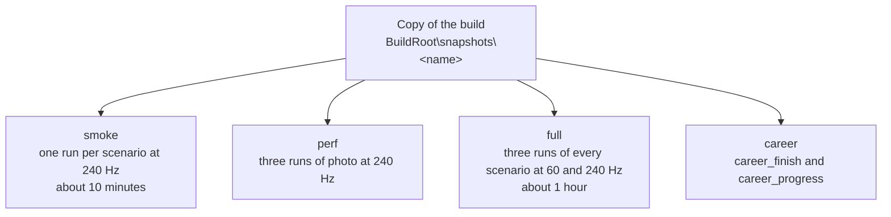

# FM4 end-to-end test harness

`e2e.py` launches the built game from a BuildRoot with the same arguments as `Build.ps1 -Action run`, drives the application-local diagnostic controller (`FM4_TEST_INPUT_FILE`; no desktop input is sent), and collects:

- GPU frame captures every 2 seconds (`FM4_CAPTURE_DIR`), converted to PNG;
- a per-second performance trace (`REX_PERF_TRACE_FILE`, see [traces.md](traces.md));
- crash status and error counts from the runtime log;
- `summary.json` with median FPS and GPU-thread stall times.

The game window shows the settings overlay of the run (render scale, quality, look, shadows, frame rate, shader A/B, ...; [`pipeline.py`](../../outputs/FM4-build/pipeline.py) `info_overlay`) from the start. The presenter draws it over the guest output, so the captures, OCR and `compare.py` never see it. `--env FM4_INFO_SHOW=0` hides it, and F2 toggles it.

Results go to `--out`, which must be outside this repository: captures and logs show game content. Use a directory under the BuildRoot, for example `<BuildRoot>\e2e\<name>`. `e2e.py` rejects an `--out` inside the repository. Never commit results.

Related pages:

- [architecture.md](architecture.md): how the harness and its game-side hooks are built, every Windows and D3D12 dependency, and a checklist for porting it to another platform or backend.
- [traces.md](traces.md): debug trace and diagnostic environment variables and what each writes.
- [experiments.md](experiments.md): A/B overrides, shader override diagnostics, FXC notes and other experiment-only switches.
- [frozen-frames.md](frozen-frames.md): the frozen-frame parity harness (the `freeze` scenario, `frame_diff.py`, `parity.py`) and its baseline variance.
- [setup.md](../setup.md): prerequisites, setup, generate, build and the BuildRoot layout.
- [running.md](../running.md): launcher options and look knobs.
- [status/current.md](../status/current.md): current state and what is verified on the latest build.

## Requirements

- A BuildRoot built by `Build.ps1` (the harness reads `local.json` and `build-result.json` from it).
- Windows OCR with the en-US language (built into Windows 10/11).
- Goal mode only: a TypeSafe API key in the `TYPESAFE_API_KEY` environment variable (user scope is read even when the shell started earlier). Each step sends the OCR text of the current screen, the goal/route description and the recent steps to `https://api.typesafe.ai` (endpoint `/v1/systemone`). No images, saves, user data or personal data are sent. A quickrace run makes roughly 40-50 requests.
- No packages beyond the Python standard library.

## Modes

### Fixed timeline (no network access)

```
python outputs\FM4-build\e2e\e2e.py --build-root D:\FM4-build --out D:\FM4-build\e2e\boot --scenario boot
```

### Goal-driven with Jev (TypeSafe System One)

```
python outputs\FM4-build\e2e\e2e.py --build-root D:\FM4-build --out D:\FM4-build\e2e\race --goal quickrace --tail 40 --measure 30
```

The `quickrace` goal starts the game, opens Free Play > Quick Race, accepts the default car and track, starts the race and holds the throttle. Add `--steps camera` to cycle the race cameras (Back every 6 s) once the race runs.

The run exits with code 1 when the game crashes, the goal is not reached in time, or a step fails. In the last two cases `goal_reached` is `false` in `summary.json`.

Without network access (Jev unreachable), `--scenario quickrace` drives the same route on a fixed timeline; it reaches the race reliably with the copied profile.

## e2e.py options

| Option | Default | Meaning |
| --- | --- | --- |
| `--build-root` | required | BuildRoot used by `Build.ps1` |
| `--game-build` | `game-build` | build directory under the BuildRoot, for example `game-build-prof` (see [traces.md](traces.md)) or `game-build-thinlto` (`pipeline.py --flavor`) |
| `--out` | required | result directory, outside the repository |
| `--scenario` | `boot` | fixed timeline: `boot`, `quickrace`, `photo`, `photo_view`, `career`, `career_finish`, `career_progress`, `dlc`, `freeze` |
| `--profile` | none | copy a user-data root to `<out>\user-data` and run on it; `copy` means the BuildRoot's `user-data`, otherwise a path |
| `--goal` | none | navigate with Jev instead of a timeline (`quickrace`) |
| `--goal-timeout` | 360 | seconds allowed for the goal |
| `--env NAME=value` | none | extra variable for the game process; repeatable |
| `--steps` | none | JSON list of steps, or the preset `camera`; overrides `--scenario`, and after `--goal` runs once the goal is reached |
| `--arg NAME=value` | none | extra or overriding `--cvar=value`; repeatable (`--arg=--readback_resolve=fast` also works) |
| `--look` | launcher's (`aces`, which has the mods of the earlier `pc` since 20 October 2026; `pc` is its alias) | look as `Build.ps1 -Look`, for example `original`, `aces,sharpen=0.6` or `aces,taa=0`; a look with TAA renders races in one tile without MSAA |
| `--msaa` | off | keep the tiles and MSAA of `--quality` with a look that has TAA, as `Build.ps1 -Msaa` |
| `--native` | off | stage N1 of the native path (`host_render_thread=true`), as `Build.ps1 -Native`. One tile only: where `Build.ps1 -Native` falls back to the PM4 RTV path in tiles, `e2e.py` refuses a tiled run (`--msaa`, a look without TAA, or a last `--env FM4_TILING_SCENARIO` other than 2) and `-Rov`, so a `--native` result is always the native path. The `freeze` scenario's look `original,taa=0` renders tiles, so a native `freeze` and its RTV baseline both take `--env FM4_TILING_SCENARIO=2` (one tile, no TAA, no FXAA) |
| `--quality` | launcher's (`high`) | race render quality as `Build.ps1 -Quality`: `xbox`, `high` or `ultra` |
| `--ao` | off | the runtime's ambient occlusion pass (the GTAO post pass, `post_pass_path`), as `pipeline.py --ao` |
| `--tail` | 10 | seconds to keep running after the last step |
| `--keep-ppm` | off | keep the full-resolution PPM captures next to the PNG files |
| `--measure` | 0 | summarize only the last N perf seconds |
| `--repeat` | 1 | run N times into `<out>\run1..runN` and aggregate into `<out>\summary.json` |
| `--resummarize` | off | recompute `summary.json` of existing runs in `--out` from their `perf.jsonl` |

The harness passes `--cvar` values from `pipeline.launch_cvars`, the look (`pipeline.look_cvars`) and `pipeline.ao_cvars`, then the `--arg` items, so an `--arg` overrides them.

## Gameplay scenarios

Fixed timelines with screen checks, no network access:

| Scenario | What it does |
| --- | --- |
| `photo` | Quick Race, 10 s of driving, then a 30 s measured race phase, pause > PHOTO MODE, take a photo, save it as a new file; checks SAVE SUCCESSFUL. |
| `photo_view` | a new process opens Career > MY PROFILE > MEDIA > MY PHOTOS and loads the saved photo; checks that it replaces the menus without an error (OCR reads its watermark only sometimes; see `final.png`). |
| `career` | Career > GO RACE > WORLD TOUR, the profile's next event (Tsukuba Short Circuit with the Ford Ka for the BuildRoot profile), 40 s of driving, QUIT RACE, 30 s of the replay, CONTINUE to the event. |
| `career_finish` | the same event to the end, driven by the title's AI (`engageaionstart`, needed): it wins the 3 laps in about 3 minutes; CONTINUE, then A every 6 s through YOU PLACED (Total), the driver and Ford affinity level 2 rewards (a gift car: the default) up to EVENT COMPLETE, after the save. |
| `career_progress` | a new process on that profile: WORLD TOUR shows the next event (the TopGear challenge) with the driver at level 2 and credits other than the 8,610 CR before the race. |
| `freeze` | Quick Race, rewound from race frame 720 (session updates; Y pulsed on the guest's pad polls) to the oldest frame the rewind keeps, then 20 s of that frozen frame (phase `freeze`). Pins the look `original,taa=0`, the occlusion reports and 2x, and keeps the PPM captures; see [frozen-frames.md](frozen-frames.md). |
| `dlc` | downloadable content: Free Play > Quick Race with a Porsche Expansion Pack car (Porsche, 1970 914/6) on the Launch Track Pack's Test Track Benchmark (Speedway), then 20 s of racing (phase `race`). Checks the Porsche manufacturer, the car, the environment, the layout and the race HUD. Needs both packs imported into the BuildRoot profile with `Build.ps1 -Content`. |

They write saves, so run them on a copy of the profile:

```
e2e.py ... --out <BuildRoot>\e2e\photo --scenario photo --profile copy
e2e.py ... --out <BuildRoot>\e2e\view --scenario photo_view --profile <BuildRoot>\e2e\photo\user-data
e2e.py ... --out <BuildRoot>\e2e\career --scenario career --profile copy
e2e.py ... --out <BuildRoot>\e2e\finish --scenario career_finish --profile copy --env FM4_GAME_CMDLINE=engageaionstart
e2e.py ... --out <BuildRoot>\e2e\progress --scenario career_progress --profile <BuildRoot>\e2e\finish\user-data
e2e.py ... --out <BuildRoot>\e2e\dlc --scenario dlc --profile copy
```

`--profile copy` copies a user-data root (`copy` means `<BuildRoot>\user-data`) to `<out>\user-data` and runs on it. The installed content packages (`user-data\0000000000000000`) are linked with a directory junction, not copied, and the BuildRoot's own packages are never deleted through the copy. With `--repeat`, each run gets its own copy. Without the AI driver the career race only holds the throttle (the Ford Ka ends up at a wall); `career_finish` needs `engageaionstart`.

Every scenario except `boot` starts with one A per splash video read on screen (Microsoft Studios, Dolby), which skips it: the main menu shows after about 30 s instead of 47. A at a fixed rate is not used, because it also skips the short title screen and selects PLAY CAREER in the main menu.

`e2e.py` runs the game with `headless=true`: XAM prompts such as the keyboard for a photo name answer with their default text (nobody can type into the host dialog). Rendering is not affected.

### Scenario steps

A step is `[timeout, action, hold, text(, retry)]`. It repeats the action until one of the `|`-separated texts shows in a capture taken after it, and fails the run (`goal_reached` false, `failed_step` in `summary.json`) otherwise.

- `?action` skips the action when the text already shows.
- `=TEXT` must be a whole OCR line. A leading `!` passes when none of the texts shows.
- Give a step whose screen loads (taking a photo, a race loading) a retry longer than the load: a repeated A would act on the next screen.
- `select:<label>` moves the menu highlight to an OCR'd label. The highlighted entry of a vertical menu is the one with red lines above and below it (`ocr-server.ps1` `red_above`/`red_below`) and a dark band (`bg`); of a horizontal menu, the red-framed tile. It moves only when two clear readings in a row agree, since menus slide and sway (the pause menu at 120 Hz most of all).
- Menus that act on their own when idle are not selected but driven with fixed presses as soon as they show: the career and GO RACE menus hide (Up shows them again), and the post-race menu starts the race replay. The career menu hides about 9 s after the last press at 60, 120 and 240 Hz alike (a wall-clock timer; see [status/current.md](../status/current.md)), so a capture every 2 s can miss a menu that shows only briefly.
- `wait` waits without touching the controller.
- `phase:<name>` ... `phase:end` marks a measured phase. `summary.json` `phases` has the perf statistics per phase (photo: race, photo; career: race, replay).
- `defines:NAME=VALUE NAME=VALUE ...` writes `shader_mod_defines.txt` into the run's `shader_mod_path` without touching the controller. With hot reload (`--shader-dev`, or `--arg shader_mod_hot_reload=true` and `shader_mod_live_knobs=true` for another directory) the runtime applies it at once: live knobs in the next frame, other defines through a recompile. Lines left out of a later step keep their value, so give every knob that changes in each step. The file is restored (or removed) after the run. With a frozen scene (rewind, Y) or a held camera stick, one run compares several knob values in the same frame; match the captures to the steps by the `shader_mod_defines.txt changed` lines in `runtime.log`.
- `steps.jsonl` records what each check and select saw.

FM4 menus ignore the first press after some screens open, and the career and GO RACE menus hide after a few idle seconds (the next press only shows them again), so the scenarios press until the expected screen shows rather than counting.

## Goal mode

Code owns the workflow; Jev supplies judgments:

1. `ocr-server.ps1` reads each new capture with the Windows OCR engine (en-US) and reports text lines, their positions and how much FM4 selection red surrounds them. `e2e.py` marks the highlighted item from that.
2. One Jev request per step asks, in parallel: which screen is shown, which on-screen item the route needs activated next, and whether a race is running.
3. `e2e.py` turns the judgments into one controller action: move the highlight toward the target, press A, wait during loading, press B on screens the goal does not need (for example Autovista), and nudge menus that ignore A until their focus has moved once.

`nav.jsonl` records every step: frame, judgments, confidences and the action.

## Gates and tiers



`matrix.py` runs a set of cells on a snapshot of the game build (`<BuildRoot>\snapshots\<name>`, checked against `build-result.json`), so `Build.ps1 -Action build` can rebuild `game-build` while a gate runs. Cells still run one at a time, because performance numbers need the machine to themselves. Pick the tier by what a change can break:

| Tier | Cells | Runs per cell | Use |
| --- | --- | --- | --- |
| `smoke` | `photo`, `photo_view`, `career` at 240 Hz | 1 (about 10 min) | every change, before measuring anything |
| `perf` | `photo` at 240 Hz | 3 | performance work, against a baseline gate of the same tier: its race phase (12 cars, 30 s) and photo mode |
| `full` | `photo`, `photo_view`, `career` at 60 and 240 Hz | 3 (about 1 hour) | before committing a stage; `--hz 60,120,240` adds 120 Hz |
| `career` | `career_finish` and `career_progress` at 240 Hz | 1 (about 8 min) | a career race to its rewards and the progress after a restart |
| `parity` | `freeze` at 60 Hz | 2 (about 8 min) | image, draw and predication parity of a frozen frame with `parity.py` against a baseline ([frozen-frames.md](frozen-frames.md)) |

```
python outputs\FM4-build\e2e\matrix.py --build-root <BuildRoot> --name <name> --tier smoke --baseline <older name>
```

Options: `--build-root` and `--name` are required. `--tier` defaults to `smoke`. `--scenarios`, `--hz` and `--repeat` override the tier. `--baseline` compares each cell with the cell of the same Hz and scenario of that gate. `--game-build` (default `game-build`) names the build to snapshot, `--no-snapshot` runs the build directory itself, `--human` keeps the harness throttle, `--look` gives every cell a look as `Build.ps1 -Look` (for example `pc,taa=0` for a baseline without TAA, or `pc,taa_point=1`), and `--env` and `--arg` pass to every cell.

Cells go to `<BuildRoot>\e2e\<name>-<hz>-<scenario>`, and `<BuildRoot>\e2e\<name>.log` keeps one line per cell. Each cell is compared with `compare.py` when `--baseline` is given. `matrix.py` exits with 1 when any cell's run fails (a crash or a goal not reached). The `compare.py` verdict, and for `freeze` cells the `parity.py` verdict, only go into the cell's line: a FAIL there does not change the exit code.

- In every race an AI driver drives the player's car (`FM4_GAME_CMDLINE=engageaionstart`), so each race follows the track instead of ending at a wall. A `FM4_GAME_CMDLINE` given in `--env` replaces this default, and `--human` drops it.
- `photo_view` runs on the profile that the `photo` cell of the same gate saved, and `career_progress` on the profile of `career_finish`. `matrix.py` refuses a gate that includes one of them without the other.
- For a tier at 2x, pass `--arg draw_resolution_scale_x=2 --arg draw_resolution_scale_y=2`. `ocr-server.ps1` averages captures above 720p down to 1280x720 first, so the menu highlight checks keep their 720p pixel distances.
- Unlike the look and the race quality, `e2e.py` does not follow the launcher's `-Display`: it renders at 1x in a 1280x720 window unless `--arg` says otherwise, so the gates keep comparing with their baselines. The launcher's native resolution is 2x on 1080p, 1440p and 2560x1600 monitors and 3x on 4K ones.
- The photo race phase replaces the `quickrace` scenario in the gates; `quickrace` stays for comparisons with older results.
- The Japan/Asia and USA releases share one game build (see [release comparison](../analysis/releases.md)), so a BuildRoot made from one release checks the other with `--arg "game_data_root=<other Disc 1>"`, on the same binary and profile. The two releases perform the same; compare a cell with a baseline of the same release anyway, because the races differ from run to run.

## Frame rate and launcher settings

The harness uses the launcher environment (`pipeline.launch_env`):

- `FM4_HALF_RATE_MIRROR=1`: the rear-view mirror is drawn every other frame in every race. `--env FM4_HALF_RATE_MIRROR=0` renders it every frame, also in the 12 car Quick Race.
- `--env FM4_SHADOW_WORKAROUND=1` skips the shadow map outside the cockpit in races (`Build.ps1 -ShadowWorkaround`).
- The race render quality is the launcher's (`pipeline.py` `QUALITY_PRESETS`, `high` by default, passed through `FM4_RACE_SETTINGS`). `--quality xbox|high|ultra` picks another; with `--env FM4_TILING_SCENARIO=<n>` the preset keeps that tiling scenario.

Frame rates above 60 (`Build.ps1 -FrameRate <n>` sets both of these):

- `--arg=--video_mode_refresh_rate=<n>` changes the refresh rate reported to the game.
- `--env FM4_FRAME_RATE=<n>` replaces the FrameRate 60 of the race render scenarios. Replays and the 3-2-1 countdown follow the race frame rate since 20 October 2026 (`FM4_FULL_RATE=replay,countdown` from `pipeline.launch_env`; post-race and photo mode keep 30); `--env FM4_FULL_RATE=` gives the title's 30 for comparisons with older baselines.

The guest vblank then runs at 60 Hz, and at `<n>` Hz only while a race scenario sets the frame rate (`fm4-vblank-rate.cpp`). `--arg=--vblank_rate=<hz>` sets a fixed startup vblank rate (without `FM4_FRAME_RATE`). The vblank diagnostics are in [experiments.md](experiments.md).

At 240 Hz (`--arg=--video_mode_refresh_rate=240 --env FM4_FRAME_RATE=240`) the command processor, not the vblank, sets the frame rate.

## Comparing runs

Single runs vary by about 10-20% in FPS, and a hot laptop drifts: the same binary measured 53.4 and then 48.8 fps (3 runs each) half an hour apart. Bracket a candidate with baseline runs before and after it. Measure each configuration with `--repeat 3`: runs go to `<out>\run1..run3`, and `<out>\summary.json` aggregates them (median of medians, minimum of minimums, union of errors). A/B a cvar on the same binary with `--arg`, for example `--arg=--readback_resolve=fast`. Then:

```
python outputs\FM4-build\e2e\compare.py <BuildRoot>\e2e\baseline-v2 <BuildRoot>\e2e\candidate
```

`compare.py` prints the differences and a verdict. It exits 1 on FAIL and 2 on bad input. FAIL means any of:

- the candidate crashed, or its goal was not reached;
- FPS (overall or of a phase) down more than 10%, using `fps_mean` (or `fps_median` when `fps_mean` is missing);
- `frame_ms_p99` up more than 20%;
- an error key that the baseline does not have.

A wait cause up more than 20% and more than 5 ms/s, or different capture statistics (luma, black and saturated share, luma histogram), only WARN. So does a rise in `clear_gray_frames`. Races are not deterministic, so check captures by eye.

For image, draw and predication parity of one scene, use the `freeze` scenario and `parity.py` ([frozen-frames.md](frozen-frames.md)); a stage of the native port runs both gates.

## Output layout

Each run writes to its `--out` directory:

```
<out>\
  summary.json        statistics of the run (see below)
  final.png           the last capture
  capture\            frame-NNN.png (and frame-NNN.ppm with --keep-ppm), captures.txt
  perf.jsonl          per-second performance trace (REX_PERF_TRACE_FILE)
  perf.jsonl.resolves.json   resolve destinations, written with the perf trace (see traces.md)
  runtime.log         runtime log; error counts come from here
  stderr.log          standard error of the game process
  steps.jsonl         what each check and select saw
  nav.jsonl           goal mode: every step with its judgments
  input.txt           the diagnostic controller's input file (FM4_TEST_INPUT_FILE)
  user-data\          the copied profile, with --profile
  run1..runN\         the runs of --repeat, each with the same files
```

`captures.txt` holds the steady-clock time of each capture, to match frames in the runtime traces. Starting a run deletes the old `capture` files and the `perf.jsonl`, `runtime.log`, `nav.jsonl` and `steps.jsonl` of that directory.

## Reading summary.json

The statistics come from the steady part of the perf trace: without `--measure`, the last two thirds of the per-second windows (the first third is dropped as warm-up when there are more than six windows); with `--measure N`, the last N seconds.

| Field | Meaning |
| --- | --- |
| `crashed` | `null`, or the exit or harness error text |
| `goal`, `scenario` | the goal, or the scenario (`null` when `--steps` was given) |
| `goal_reached` | `null` when there is no goal or check; `true` once a check or goal passed; `false` when a step failed or the goal was not reached |
| `failed_step` | the step that timed out, with its text |
| `args`, `profile`, `look` | the `--arg` items, the `--profile` given and the look that ran |
| `binary` | path, SHA-256 and file time of the `fm4_rex.exe` that ran |
| `seconds`, `timeline` | wall time, and the time and action of each step |
| `frames_captured`, `perf_windows` | number of captures and of per-second perf windows |
| `fps_median`, `fps_min` | per-second guest swap rate: median and lowest window |
| `fps_mean` | frames over time across all measured windows (1000 divided by the mean frame time); steadier than the median of per-second FPS, which jumps between 20, 24 and 30 as frames snap to vblanks |
| `frame_ms_p50`, `frame_ms_p95`, `frame_ms_p99` | frame time percentiles, in ms |
| `hitch_50ms_per_min`, `hitch_100ms_per_min` | frames longer than 50 ms and 100 ms, per minute |
| `wait_ms_per_s_median` | time per second the command-processor thread waited, per cause (see [traces.md](traces.md)) |
| `cp_busy_ms_per_s_median` | window time minus all waits: wall time the command-processor thread works |
| `readbacks_per_s_median`, `draws_per_s_median` | resolve readbacks and draws per second |
| `draws_per_frame_mean` | draws over all measured frames |
| `render_thread_busy_ms_per_frame_median`, `render_thread_source`, `guest_render_thread_ms_per_frame_median`, `queue_depth_median`, `queue_depth_max` | backend-neutral thread and queue metrics; on the PM4 path the render thread is the command processor (`render_thread_source` `cp`); the others only when the trace has them ([frozen-frames.md](frozen-frames.md#backend-neutral-fields)) |
| `cpu_ms_per_s_median` | command-processor time per zone, per second |
| `occlusion_samples_median` | mean passing samples per occlusion interval, unawaited and awaited |
| `submit_thread_ms_per_s_median`, `submit_thread_counts_per_s_median`, `submit_flush_wait_ms_per_frame_median` | submit thread time (`busy_ms`, `record_ms`, `execute_ms`) and the swap's drain of it (`flush_wait_ms`) per second, its counts per second, and the drain per frame (see [traces.md](traces.md)) |
| `gpu_frame_ms_median`, `gpu_resolve_ms_median`, `gpu_span_ms_median` | GPU time per frame from timestamps: busy time, resolves, and the first-to-last span |
| `counts_per_s_median`, `counts_per_frame_median`, `counts_per_frame_mean` | event counts per second, per frame (median of the windows) and over all measured frames (see [traces.md](traces.md)) |
| `phases` | the statistics above per phase, for the phases the scenario marks |
| `phase_windows`, `phase_frames` | the perf windows and the captures of each phase |
| `phase_steady_ms`, `n0_trace`, `n0_trace_offset` | each phase on the steady clock (ms), and the `FM4_N0_TRACE` file of the run and where its lines start in it, whose seconds give the phases `guest_render_thread_ms_per_frame_median` ([frozen-frames.md](frozen-frames.md#backend-neutral-fields)) |
| `final_capture` | `luma_mean`, `black_pct` (luma below 8), `saturated_pct` (luma 248 and above) and `luma_hist16` (16 bins) of the last capture |
| `clear_gray_frames` | captures in which the exact FM4 clear color (102,102,102) covers at least 1% more than the mean of the neutral grays 97-101 and 103-107 do, i.e. geometry such as the road surface was not drawn; asphalt smoothed by TAA spreads over those grays and is not counted |
| `errors`, `top_errors` | runtime log lines that match an error marker, keyed by their text (first 90 characters, numbers replaced by `#`) with counts; `top_errors` lists the ten most frequent |

With `--repeat`, `summary.json` is an aggregate (`repeat`, `runs`, and the same keys): `fps_median` is the median of the runs' medians, `fps_min` the minimum of their minimums, `errors` the union with summed counts, `goal_reached` true only when every run reached it, and `final_captures` lists each run's final statistics. `--resummarize` recomputes these from the `perf.jsonl` files of finished runs, for example after the harness gained new fields.

## Helper scripts

All scripts live in [`outputs/FM4-build/e2e/`](../../outputs/FM4-build/e2e/).

| Script | Use |
| --- | --- |
| `e2e.py` | launch the game, drive it and collect a run |
| `matrix.py` | run a gate tier on a build snapshot |
| `compare.py <baseline> <candidate> [--json]` | compare two run directories and print a verdict |
| `frame_diff.py <a> <b> [--out DIR]` | pixel difference of two frozen frames (captures or runs), with 1:1 crops of the largest differences ([frozen-frames.md](frozen-frames.md)) |
| `parity.py <baseline> <candidate> [--out DIR]` | FAIL rules of a frozen-frame pair: draws and predicated packets per frame, image difference, new error keys ([frozen-frames.md](frozen-frames.md)) |
| `coverage.py <run> --functions <BuildRoot>\project\generated\default [--json]` | the PM4 writers of each phase and of the career menus: the `FM4_N0_TRACE` ring allocations by function and the identity check's ranges by writer ([traces.md](traces.md#identity-check-of-the-native-path-fm4_native_check-host_render_check)) |
| `test_e2e_tools.py` | offline tests of `frame_diff.py`, `parity.py`, `coverage.py` and the summary fields they read |
| `race_clock.py <run>` | race timer of the captures against wall time (1.0: real time); needs `--keep-ppm` captures |
| `cp_profile.py stacks.txt <BuildRoot>\game-build-prof [--function NAME]` | summarize the command-processor stack samples (see [traces.md](traces.md)) |
| `inventory.py --build-root <BuildRoot> a.json [b.json ...] [--json out.json]` | combine `REX_GPU_INVENTORY` files of several scenarios |
| `frame_graph.py --build-root <BuildRoot> trace.jsonl [--frame N \| --list]` | print one frame of a `REX_FRAME_GRAPH` trace |
| `pm4_writers.py <generated dir> <xenos.h> out.json` | static scan of the PM4 packet writers for `FM4_D3D_TRACE` |
| `override_fxc.py <override file or dir> <dump_shaders dir> [--mods ... --define ...]` | compile shader overrides like the runtime (see [experiments.md](experiments.md)) |
| `override_fxc.py --stub <dump_shaders dir> --mods <dir> [--define ...]` | compile the look mods against the real contracts of a run, without override files (see [experiments.md](experiments.md)) |
| `override_ab.py <run> --period-ms N [--diff out.png]` | list captures of a shader A/B run with their phase |
| `look_coverage.py --build-root <BuildRoot> [--dump <dir> ...] [--json out.json]` | offline list of the final combine, motion blur, car paint, glass, chrome and rim hashes per source and render scenario, with the look mods that cover them (see [look mod coverage](../analysis/look-mod-coverage.md)) |
| `ocr-server.ps1` | the Windows OCR process that reads each capture |
| `jev.py` | the Jev (TypeSafe System One) client for goal mode |

Typical calls:

```
python outputs\FM4-build\e2e\race_clock.py <BuildRoot>\e2e\<run>
python outputs\FM4-build\e2e\inventory.py --build-root <BuildRoot> a.json b.json
python outputs\FM4-build\e2e\pm4_writers.py <BuildRoot>\project\generated\default <BuildRoot>\runtime-source\include\rex\graphics\xenos.h out.json
python outputs\FM4-build\e2e\frame_graph.py --build-root <BuildRoot> trace.jsonl [--frame N | --list]
python outputs\FM4-build\e2e\override_fxc.py <override file or dir> <dump_shaders dir> [--mods work\fm4-rex\look --define FM4_LOOK_SHARPEN=0.5]
python outputs\FM4-build\e2e\override_fxc.py --stub <dump_shaders dir> --mods work\fm4-rex\look --define FM4_LOOK_GLASS=1.0
```

## Developer options

FM4 keeps its developer command line parameters, but the retail build never fills them (see [status/current.md](../status/current.md)). `--env FM4_GAME_CMDLINE="<option> <option>=<value>"` feeds them through the title's own parser after its defaults. The main one for the gates is `engageaionstart`, an AI driver for the player's car. The full list, the rebuilt options and the other experiment-only switches are in [experiments.md](experiments.md).

## Runtime development loop

The runtime (ReXGlue SDK fork) is [`work/runtime`](../../work/runtime/) in this repository:

1. Edit `work/runtime` directly.
2. `Build.ps1 -Action build -BuildRoot <BuildRoot>`: mirrors `work/runtime` to `<BuildRoot>\runtime-source`, rebuilds and installs the runtime incrementally, builds the game, copies the runtime DLLs, runs the instruction tests and writes `build-result.json`.
3. Add new runtime files to [`outputs/FM4-source-control/tracked-files.json`](../../outputs/FM4-source-control/tracked-files.json) (category `runtime-fork`) and run [`check-staged-content.py`](../../outputs/FM4-source-control/check-staged-content.py) before committing.

Never edit `<BuildRoot>\runtime-source`: the next build overwrites it. Verify a clean setup in a new BuildRoot at the end of each stage.

The integration code ([`work/fm4-rex`](../../work/fm4-rex/)) is copied to `<BuildRoot>\project` by `generate`, not by `build`, and only the files listed in `tracked-files.json`: after editing or adding one, run `generate` and then `build`. Build steps are in [setup.md](../setup.md).
