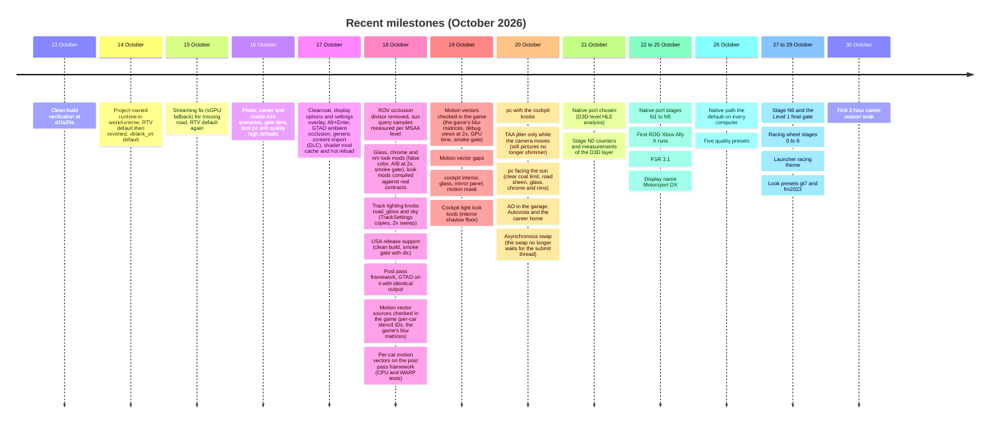

# Status history

This file is the dated record of Motorsport DX (FM4-PC until 25 October 2026): the clean-build verification, the historical gameplay results, the dated end-to-end (e2e) results, the settings and decisions that were later superseded, and the summaries that left [current status](current.md) when newer ones replaced them (sections 7 and 8). The results that current status listed from 16 to 28 October 2026 are in [results history](history-results.md). For the present state, the open gaps and the next validation steps, read [current status](current.md). Detailed performance measurements (frame rates, GPU and command processor timings) are in [performance history](history-performance.md).

How to read the dates:

- Historical gameplay results (13 October 2026 and earlier) were produced with earlier binaries, profiles and settings. They do not show that a feature works on the current binary. Features re-tested on the latest binary are listed in the e2e sections below.
- Where a later entry changes an earlier one, the later entry says so. Section 5 lists the changes in one table, and section 6 lists the corrections to earlier entries.
- The local analysis reports named below (for example `automated-race-candidate-results.json`) are kept on the development computer. They are not part of the repository and are not needed to build from a clone.
- Current settings are in [running](../running.md). The e2e harness, its gates and scenarios are in [e2e harness](../e2e/README.md). Trace environment variables are in [traces](../e2e/traces.md), and A/B overrides and shader override diagnostics are in [experiments](../e2e/experiments.md).
- Commit hashes are kept as they were recorded: `d1fa29a` (13 October verification), `bce784d` (regression binary of 16 October), `c6420dc` (the short-lived RTV default of 14 October), `f5337cdc` (ReXGlue resolve commit) and `48ed669` (GTAO and `-Look ao`, the latest code commit named in the status log).

## Timeline

| Date | Milestone |
|---|---|
| 13 October 2026 | Clean-build verification at `d1fa29a`. Sun and glare judged reasonable on the ROV path after `--rov_occlusion_awaited_report_divisor=2`. First Quick Race A/B results on the occlusion and readback settings. |
| 14 October 2026 | The project-owned runtime (`work/runtime`) replaces `sdk.patch` and `sdk-extra`. RTV is the launcher default for a short time, then reverted to ROV. The missing road segments on RTV are investigated. `vblank_vrr` becomes the default. |
| 15 October 2026 | The streaming fix (sGPU fallback) resolves the missing road segments, and RTV is the launcher default again. Command processor work: EDRAM transfers, upload removal, event-based wait and readback fixes. |
| 16 October 2026 | Photo, photo_view and career e2e scenarios, the regression and 240 Hz matrices, the dynamic vblank rate, the rebuilt developer AI driver and career race to rewards, the shader override and look knobs, the shadow workaround no longer default, and 16x anisotropic filtering. |
| 17 October 2026 | Clearcoat on the car paint, display and render scale options, the settings overlay, Alt+Enter, and GTAO ambient occlusion. The default launcher (look `pc` with clearcoat and AO) passes the smoke gate. The generic content installer (`-Content`) imports and mounts Disc 2 and eight DLC packages. The compiled look mods are cached, and shader mods hot reload with live knobs (`-ShaderDev`). |
| 18 October 2026 | The launcher no longer passes the ROV occlusion divisor of 2, so `-Rov` reports the counted samples. On ROV the sun query counts guest samples in proportion to the MSAA sample count, which explains the factor 2 of 13 October. Look mods and AO are RTV only by design. Look mods for the car glass, chrome and rims of the race, 16-car, split-screen and garage car shader sets (`-Look glass`, `chrome`, `rims`; in no preset): `fm4_shader_mod_tests`, `override_fxc.py --stub` (the look mods against the real contracts of earlier runs), false color and an A/B at 2x in the game, and a smoke gate. See [look mod coverage](../analysis/look-mod-coverage.md#glass-chrome-and-rims-18-october-2026). The look knobs `road_gloss` and `sky` edit copies of the track lighting files; after a 2x sweep on the Bernese Alps the `pc` preset gets `sky=0.7`, and `road_gloss` stays at 1 in no preset. Look mods for the track's sky dome, trees, tree cards, bushes and grass (`-Look sky_saturation`, `sky_contrast`, `sky_warmth`, `sky_horizon`, `foliage_hue`, `foliage_saturation`, `foliage_brightness`; in no preset): false color and an A/B at 2x on the Bernese Alps and Maple Valley, and a smoke gate. See [look mod coverage](../analysis/look-mod-coverage.md#sky-and-vegetation-18-october-2026). The USA release (media ID `26FF1101`) is supported: its discs differ from the Japan/Asia discs only in the executable headers, and a clean build from them passes the smoke gate with the `dlc` cell (see [release comparison](../analysis/releases.md)). The runtime's post pass framework runs screen passes from HLSL files and a manifest at the scene depth, scene color and final points, with the previous frame's scene color and depth; GTAO moved onto it (`work/fm4-rex/passes`) with output identical texel by texel in the game, the same GPU time, and a passing smoke gate (see [post pass framework](../analysis/post-pass-framework.md)). The motion vector sources were researched offline and then checked in four traced races: each car writes its own stencil ID in race frames, the game's motion blur matrices are the host's reprojection scaled by about 0.34, neither override switch turns that blur on in races, and `-SingleTile` keeps the scene depth resolve (see [motion vectors](../analysis/motion-vectors.md#7-validation-in-the-game-18-october-2026)). The post pass framework then gained per-car motion vectors from those sources: the car draws' stencil references and world matrices, a stencil input, a view space reprojection per object slot, and FM4's `motion_vectors` pass with debug views; the CPU and WARP tests pass, the in-game runs were deferred (see [motion vectors](../analysis/motion-vectors.md#8-implementation-18-october-2026)). |
| 19 October 2026 | Motion vectors checked in the game, TAA on the post pass framework, the cockpit light look knob, the cockpit windshield pass, and texture dumps and replacements. |
| 20 October 2026 | The default look becomes `aces` (`pc` its alias), one tile with TAA on RTV, TAA's history fixed, the asynchronous swap, AO in the garage, Autovista and the career home, `pc` facing the sun, and the GUI launcher with its export. |
| 21 October 2026 | The native port (D3D-level HLE) is chosen as the target; stage N0's counters and the host render thread of stage N1. |
| 22 October 2026 | Stage N1's identity check and dirty state records, N2's decoded replays, N3's readbacks on demand and resolves from the host render targets, N4's deferred constant buffers, and the e2e fast route. |
| 23 October 2026 | One pass with 2x MSAA (N3) and the draw back end on the replay side (N4). |
| 24 October 2026 | The first ROG Xbox Ally X runs from exports; the native path becomes the default with integrated GPUs only. |
| 25 October 2026 | Stage N5: the screen's own resolution and aspect (Hor+ and Vert+). AMD FSR 3.1 stages 0 to 3, the modern pad and keyboard options, the clean setup from a fresh clone, the display name Motorsport DX and the preview audit. |
| 26 October 2026 | The native path becomes the default on every computer. Five race quality presets, the cockpit sky fill, the auto exposure adaptation, TAAU, the menus and photo mode at the screen's scale, and the GUI launcher renamed `MotorsportDX.exe`. |
| 27 October 2026 | The plan of stage N6; no look mod compiles in play; the native shader contract, increments 1 to 4; the project's own code licensed under BSD-3-Clause; RTV out of the gates; the racing wheel design. |
| 28 October 2026 | The shader contract's increments 5 and 6; the game's pixel shaders from the disc and pipelines created ahead of the replay (N6 1.3 and 1.5); resolves without needless writes; RTV and `-Rov` out of all gates. |
| 29 October 2026 | The DXIL world by default where DXC is beside the game, and the pipeline library (N6 1.2 and 1.4); the Level 1 final gate; racing wheel stages 0 to 6 with the countdown lock fix; the launcher's racing theme (T1 to T6); the look presets `gt7` and `fm2023`. |
| 30 October 2026 | The `career_season` scenario and the first 2-hour soak with its performance survey. |

## 1. Clean-build verification (13-14 October 2026)

### 13 October 2026, commit `d1fa29a`

- Setup fetches the SDK at a pinned commit, applies the runtime and GPU patches, builds the eight SDK resolve shaders, and then builds and installs the SDK locally.
- Generate and build ran from a clean copy of the Git-tracked files, without the old recompilation folder. Generating and building again also succeeded.
- The main executable, the XMediaFacade and SpeechFacade DLLs, the runtime and the GPU plugin were built. All of this output stays local to BuildRoot.
- 271 switch tables were rebuilt from the user's executable and match the earlier configuration. The function registration sets match too: main 50,233, XMedia 3,212, Speech 6,715. This does not show that every function has run or that its behaviour is correct.
- Five script tests with synthetic data passed. The instruction check passed 295,650 of 295,650: 68,121 float16 checks and 227,529 vector checks.
- All four Disc 2 packages were imported into a new test profile.
- Startup shows the logo and the car intro video. The process stayed alive for 60 seconds and was closed at the tester's request with exit code 0. This is a startup test, not a race test.
- No FM4 original code or assets, recompiled code, game binary, save file or capture was committed to Git. Integration metadata and licensed SDK source are included; game content is read from the user's local data.
- The tests ran on the same Windows computer that was used for development, not on a second physical computer. Evidence: [verification.json](../../outputs/FM4-build/verification.json).
- Sunlight (visual test, 13 October 2026): the launcher halves only the awaited sun occlusion report, with `--rov_occlusion_awaited_report_divisor=2`. Whole-frame queries used for auto-exposure are not changed. Without the divisor, the sun query reported about twice the samples the game expects, and the glare was too bright. With the divisor, the sun appeared and the glare was reasonable on the rear and cockpit cameras. The factor 2 was set empirically; it was not measured from the Xenos hardware. The divisor only applies on the ROV path (`-Rov`). The default RTV path uses a host query, and it was not calibrated at that time.

### 14 October 2026, runtime

- The project runtime `work/runtime` (a fork of the ReXGlue SDK, D3D12 only) replaces `sdk.patch` and `sdk-extra`. A full setup, generate and build in a new BuildRoot passed. The runtime source is identical to the old BuildRoot except for line endings. Setup rejects an old BuildRoot that uses `sdk-source`.
- From 14 October, setup builds the project runtime (`work/runtime`) with third-party libraries from the upstream SDK.
- First quick race with camera cycling on the new runtime: three runs failed navigation. The profile was empty (default car and other pre-race screens), the harness did not recognize the race, and the game kept running. With the profile and shader cache copied, 6 of 6 runs reached the race with 0 frames of lost road.
- Alternating old and new runtime: fps values are in [performance history](history-performance.md).
- Sunlight on RTV (14 October 2026): the sun query (the awaited report) gave 0 samples along the quick race route and from the grid. It was seen once on ROV, when turning right at about lap time 00:31 (225-253 samples per frame after the divisor of 2), but the position of the auto driver could not be repeated. The RTV sun calibration needs a deterministic scene with the sun in view, for example a camera scenario.

## 2. Historical gameplay results (earlier development builds)

These results come from earlier development builds, with different binaries, profiles and settings. They are not re-tested unless a later section says so. The summary is taken from the local FM4-analysis reports, among others `automated-race-candidate-results.json`, `input-menu-recovery-results.json`, `automatic-disc2-speedway-results.json`, `automatic-autovista-results.json`, `photo-sync-clean-results.json`, `career-sync-rewind-results.json` and `resolve-layout-fix-results.json`. These reports and their captures are local.

- Menus and controls: the main menu, Free Play and Quick Race, the career menu and World Tour were opened. Throttle, brake, reverse, steering, camera switching and Pause responded.
- Career, Road Atlanta with the Ford Ka: finished. Continue worked, and the Amateur Division 3/5 progress and a balance of 1,775 CR were read after a restart.
- BMW M1 1981 from Disc 2: driven to the finish and Continue. An automated three-lap run at Sunset Peninsula Speedway also completed and returned to track selection. Race times include development pauses, so they are not performance benchmarks.
- Autovista Ferrari 458 Italia: viewing the car, opening the panel, entering and leaving the cockpit, changing the paint, opening photo mode and returning to the menu all worked.
- After the delete-on-close fix and with synchronous shader use, the first photo was saved, overwritten and loaded in colour in two new process sessions. The shader cache was not emptied during that test.
- Career at Tsukuba with synchronous shaders could be loaded. Rewind, Rewind Further, Resume, throttle and steering, and Pause were tested. That session did not finish the race.
- Texture integer and resolve fixes and the MSAA layout fix produced the real car shadow in certain tests, and removed a random pixel pattern caused by a mismatched layout. Full visual equivalence was not shown.
- Historical saves and progress loaded. Compatibility of all saves was not guaranteed.
- The automatic driver used during development could hit barriers, lose the minimap and fail to recover its heading, and the e2e harness only held the throttle. From 16 October the e2e races use the title's own AI driver (section 4). That AI driver is a test tool, not a player feature.

## 3. Investigation: missing road segments on the RTV path (14-15 October 2026)

On the RTV render target path, certain road pieces were sometimes not drawn. Most of the time they were on the start straight, about 4 to 14 seconds after the start. They showed as a flat clear colour, (102,102,102), while kerbs and other objects remained. On 14 October this was measured at about 6 of 28 RTV race runs, with every occlusion mode (all, previous, off) and every camera. It never happened in 75 ROV runs. The e2e harness detects these frames with `clear_gray_frames`.

### 14 October 2026: first analysis (superseded on 15 October)

- Ruled out at the time: timing and occlusion values (FM4's per-frame occlusion query contains one sun sprite per tile, with the same values on ROV and RTV), the depth EQUAL test (FM4 does not use it), and the pipeline cache. The cause was unknown.
- The ROV path (`--render_target_path_d3d12=rov --rov_occlusion_async=all`) was not affected.
- Classification from `REX_DRAW_LIST_TRACE`: in broken frames the game still sent every draw that was present in the normal frames around them, and the host issued them (outcome ok). The lines and arrows above the road were still drawn on top of the clear colour. The conclusion at that time was that this was not game culling, but lost draw colour in the RTV render target path. This was superseded on 15 October.
- Timing: with `vblank_vrr`, then the default, 0 of 25 RTV runs were affected (13 with trace, 12 without; 53-60 fps). With a fixed vblank, 8 of 36 runs were affected (2 of 8 now, 6 of 28 before), with p about 0.01. The cause was still hidden, not fixed, and RTV remained an option.
- Visual comparison of RTV and ROV (14 October): the main menu is identical (average difference 0.01 level per channel). The static Autovista Ferrari 458 is equivalent: 75% of pixels are identical, 24% differ by one level, and the maximum difference is 5 levels. The luminance distribution and saturated pixels of RTV race captures are within the ROV range. The earlier impression that RTV was darker came from races that were not deterministic.
- The whole-frame occlusion query on RTV reports about 1.5 times the ROV samples (the host query counts every sample that passes), with no visible effect.

### 15 October 2026: re-diagnosis

- The 14 October conclusion (lost colour in the render target path) was wrong. The frame graph of each frame shows no ownership transfer in the scene, and the claim range covers the full 1024 tiles.
- Per-draw pipeline statistics (`REX_DRAW_STATS`) and a census of draw packets in the command processor (`REX_BIN_TRACE`) show that in the start area the game sends far fewer road draws. Pairs 630d5385/8c08d24c have 16-25 packets per frame, against 66-71 normally. Pair 645fd4b2/89964d0 has 0, against 36-46. Pair ff6529eb/e3af5b04 has 5-7, against 16-27. No draw was skipped by bin predication, and everything that was sent was drawn correctly. A vertex shader run on the CPU with the same guest state gave the same clipping result as the GPU.
- Also excluded: CPU writes made after the command processor used the data, stale shared memory pages in the requested range, valid pages that were not watched, vertex pages written by the GPU, resolve readbacks that overwrite guest data, and speed (the bug also appears at 16 fps).
- The cause found so far is in the streaming track. `REX_FILE_READ_TRACE` shows that in normal runs the streamer reads one item, `Media\tracks\Alps\bin.zip`, from offset 0x4725000 to 0x4797000, in 32 KB chunks through two alternating buffers. In broken runs only the first 64 KB are read; then the streamer moves to the next item, and the rest of the item is never read. A 1 MB read at 0x4725000 also happens when no race starts. So the game itself leaves the track data of the start area unloaded; the renderer is not involved.
- Final cause (15 October, `REX_IO_TRACE` and the `FM4_STREAM_TRACE` loader hook): not I/O. The streamer's reads use overlapped events without APCs, and all of them completed and were decompressed without error. Each item request consists of a `.dat` section (0x110 bytes) and a `.gpu` section (1.5-1.8 MB, 4 KB aligned). Allocating the `.gpu` section from the game memory manager's "sGPU" heap failed. The loader marked the request as failed (flag +84, bit 4) and dropped it. When the sGPU allocation failed, 101.6 MB of 119.5 MB were in use (peak 119.3 MB). About 18 MB were free, but no block of 1.8 MB was available, because the first-fit allocator was fragmented by a spike during loading. The load order varied with host thread scheduling. The other GPU heaps in the race pool have fallbacks: nGPU (41 MB, full) and pGPU (front end) fall back to fGPU (118 MB, 33 MB free at that time). sGPU had no fallback. Retrying the allocation for one second did not help, because the memory did not come back.
- Fix (`work/fm4-rex/src/fm4-streaming-fixes.cpp`): when a loader section allocation in sGPU fails, sGPU gets the fGPU fallback (field +236 = 0x22, as nGPU has) and the allocation is retried once. `FM4_STREAMING_FALLBACK=0` disables it.
- Validation with RTV and a fixed vblank, the condition under which the bug was most frequent: 20 of 20 runs had no lost-road frames. Five runs used the fallback, and all of them succeeded (section 0x1C15A4 bytes). Frame rate was 59.7-60.0 fps, with no crash. Before the fix, about 15-25% of runs were affected.
- Consequence: RTV became the launcher and e2e default again on 15 October (section 5).

## 4. E2E gameplay results (16-18 October 2026)

### 16 October 2026: verified automatically on the latest binary

These runs use the default launcher (RTV, with the profile copied for each run):

- Quick Race at 60, 120 and 240 Hz: 60.0 / 118-120 / 224-235 fps.
- Save a photo from photo mode, then load that photo in a new process.
- Career World Tour: QUIT RACE, replay and CONTINUE back to the event.
- Career race to the finish with the rebuilt AI driver (`engageaionstart`, below): prize, driver level and EVENT COMPLETE, and progress read after a restart (240 Hz).

### 16 October 2026: scenarios and the keyboard bug fix

- `e2e.py` gained three scenarios with OCR screen checks and no network access (see [e2e harness](../e2e/README.md)):
  - `photo`: Quick Race, 20 seconds of racing, pause, PHOTO MODE, take a photo, save it as a new file, and check SAVE SUCCESSFUL. The gate later used a race phase of 30 seconds after 10 seconds of driving, which replaced the quickrace scenario in the gate.
  - `photo_view`: a new process opens Career > MY PROFILE > MEDIA > MY PHOTOS > LOAD and shows the photo from the photo run.
  - `career`: GO RACE > WORLD TOUR, the next event on the BuildRoot profile (Tsukuba Short Circuit, Ford Ka), 40 seconds of racing, QUIT RACE, 30 seconds of replay, and CONTINUE back to the event.
- Runs use a copy of the profile (`--profile copy`; the Disc 2 content packages are linked), so the BuildRoot profile does not change. `summary.json` records the measured phases (race, photo, replay) and any failed step. `compare.py` compares the phases.
- Runtime bug found and fixed: in headless mode, `XamShowKeyboardUI` returned its default text with the byte order reversed. `MappedPtr::value()` is a big-endian guest string, which was byte-swapped again when copied. FM4 names the photo folder from that text, so "Forza" became CJK characters and then "?????" (0x3F). `NtCreateFile` rejected that path without a log entry, and the game displayed FILE OPEN FAILED. The text is now loaded in host order before the copy, and `NtCreateFile` logs rejected paths. The ImGui keyboard dialog for players was already correct. `e2e.py` always uses `headless=true`, so the XAM prompt answers with its default; rendering is not affected.
- As of 16 October, the e2e harness did not yet cover: photo overwrite, photo with an empty shader cache, Autovista, the Disc 2 cars, and direct launch to a race. The open gaps are tracked in [current status](current.md).

### 16 October 2026: regression matrix, default launcher

Setup: RTV, `readback_resolve=fast`, submit thread and readback publish thread enabled; binary from `bce784d` plus the fixes above; 3 runs per cell.

| Scenario | 60 Hz | 120 Hz |
|---|---|---|
| quickrace | 3/3, 60.0 fps, p99 17.2 ms | 3/3, 119.9 fps, p99 8.8 ms |
| photo | 3/3; race 59.8 fps, p99 17.3; photo mode 30.0 fps | 3/3; race 118.0 fps, p99 16.6; photo mode 55.5 fps |
| photo_view | 3/3, photo shown in colour | 3/3 |
| career | 3/3; race 60.0 fps, p99 17.1; replay 30.0 fps | 3/3; race 119.7 fps, p99 9.0; replay 60.0 fps |

- Quick Race was compared with the phase B3 validation (v2-60 and v2-120): PASS, with equal fps and p99. The higher command processor busy time at 60 Hz comes only from different draw counts per run (cars facing a wall or the track); the cost per draw is the same. The race phase of photo starts at the start, so its p99 includes the start hitch.
- No crash, no clear-colour frames, and the error keys match the baseline.

### 16 October 2026: 240 Hz matrix, before the dynamic vblank fix

Same binary and default launcher, 3 runs per cell, with `--arg=--video_mode_refresh_rate=240 --env FM4_FRAME_RATE=240`. Quick Race used `--tail 40 --measure 30`, as in the 60 and 120 Hz baseline. The 240 Hz panel is the internal screen, driven through the iGPU (hybrid mode), with rendering on the RTX 5070 Ti Laptop.

- quickrace, 3/3: 223.6 fps (runs 217-230), p99 5.7-6.2 ms, no hitch, command processor busy 657-888 ms/s, GPU 2.0-2.2 ms.
- photo, 3/3: race 221-223 fps, p99 6.8-8.3 ms; photo mode 90-112 fps.
- photo_view, 3/3: photo shown in colour; menu 229 fps.
- career, 2/3: race 230 fps, p99 5.5 ms; replay 111-113 fps. Run 3 failed at GO RACE > WORLD TOUR: the menu was hidden between two-second captures, and OCR never read WORLD TOUR, although the game had reached the pre-race menu (START RACE). It was not a crash. The harness was not changed, because dynamic vblank would return the menu to 60 Hz.
- No crash, no clear-colour frames, and the error keys are the same as at 120 Hz.
- Races were not locked at 240 Hz (the budget is 4.17 ms per frame). Per frame in quickrace, the draw cost stayed at about 2.51 ms as at 120 Hz. Submit and swap rose from about 0.23 ms to 0.39 ms (submit 0.10 to 0.18 ms, swap 0.13 to 0.21 ms), and the command processor still waited 128 ms/s in `wait_reg_mem`.
- One 240 Hz Quick Race run recorded 213 fps during the phase B3 validation.

### 16 October 2026: why the dynamic vblank rate was needed

Before the fix, a refresh rate above 60 Hz also changed other modes. The menus were rendered one frame per vblank, because the UI scenarios have no FrameRate (photo_view ran at 120 fps at 120 Hz and at 229 fps at 240 Hz). `FM4_FRAME_RATE` replaced every FrameRate, so photo mode (55, or 90-112 fps), replay (60, or 112 fps) and post-race no longer ran at 30 fps. The idea that the menu hides faster because a timer counts frames was not proven; see the measurement below.

### 16 October 2026: dynamic vblank rate

- With `-FrameRate N` (N > 60), the game still sees an N Hz refresh (`video_mode_refresh_rate`), but the guest vblank runs at 60 Hz. N Hz applies only during race scenarios. `FM4_FRAME_RATE` now replaces only the FrameRate 60 of race scenarios; countdown, post-race, replay and photo mode keep 30 fps.
- Signal: the game keeps a stack of render scenarios and forwards each change to the render thread through `CRenderThreadLink` Push (sub_82442600, `TReference<CDynamicRenderSettings>`) and Pop (sub_82438A38), in LIFO order. `CDynamicRenderSettings` holds the name (MSVC `std::string`) at +8, and the FrameRate control at +44, with its value at +48 (60 when the scenario does not set it). `fm4-vblank-rate.cpp` mirrors that stack. The frame rate of the stack is the topmost scenario that sets FrameRate. The race phases are arranged by sub_826D9508 (race+372: 0 PreRace, 1/3 321_and_PostRace, 2 Race, 4 Replay, 5 PhotoMode on top of the race). All RenderScenarios files are read once at boot (`REX_FILE_READ_TRACE`), so that read is not a signal.
- Runtime: the cvar `vblank_rate` and `GraphicsSystem::SetVblankRate`. The vsync thread uses the new rate immediately, and runtime.log records "Guest vblank rate".
- Measured: the career menu hides about 9 seconds after the last press at 60 Hz (9.0), at 240 Hz dynamic (9.1) and at 240 Hz fixed (9.1). That is a real-time timer, not a frame count.
- Matrix of this binary (240 and 120 Hz, 3 runs per cell; 60 Hz smoke, 1 run):

| Scenario | 240 Hz | 120 Hz | 60 Hz |
|---|---|---|---|
| quickrace | 3/3, 224-235 fps, p99 5.3-6.2 ms | 3/3, 118-120 fps, p99 8.8-9.8 ms | 60.0 fps, p99 17.1 ms |
| photo | 3/3; race 220-228 fps, p99 5.4-5.8; photo mode 30.0 fps | 3/3; race 117-118 fps, p99 9.6-10.1; photo mode 30.0 fps | race 58.8 fps; photo mode 30.0 fps |
| photo_view | 3/3, menu 57 fps | 3/3, menu 57 fps | passed |
| career | 3/3; race 232 fps, p99 5.4 ms; replay 30.0 fps | 3/3; race 118-120 fps; replay 30.0 fps | race 60.0 fps; replay 30.0 fps |

- Career at 240 Hz is now 3/3. Previously it was 2/3, because the menu, at 240 fps, was hidden between captures.
- Menu input (the source gives no date; it was recorded with these measurements): FM4 ignores the first press after several screens have opened. The career menu and GO RACE hide about 9 seconds after the last press (real-time timer). So the e2e scenarios press until OCR reads the expected screen, instead of counting presses. With this, menu navigation is reliable.
- No crash, no clear-colour frames, and the error keys match the baseline. The log of the photo_view baseline was truncated by rotation, so it appeared to have no errors.
- `compare.py` FAILs only on total fps. Photo mode and replay return to their original 30 and 60 fps. The race phase is equal or better (240 Hz Quick Race 223.6 to 231 fps).
- Pacing at 120 Hz showed two patterns between runs, in both the baseline and this binary. Either the command processor waited on the guest for about 450 ms/s with a late vblank, or it waited for the vblank (`wait_reg_mem`) with guest_idle about 17 ms/s. The fps was the same in both.

### 16 October 2026: e2e gate tiers

- `e2e/matrix.py` runs these tiers:
  - smoke: photo, photo_view and career at 240 Hz, one run, about 10 minutes.
  - perf: photo at 240 Hz, three runs.
  - full: photo, photo_view and career at 60 and 240 Hz, three runs each, about 1 hour.
  - career: career_finish and career_progress (below).
- The matrix runs on a copy of the build in `<BuildRoot>\snapshots\<name>`, so the game build can be rebuilt while a gate runs. The race phase of photo (30 seconds after 10 seconds of driving) replaced the quickrace scenario in the gate.
- The boot sequence presses A once for each recognized video splash (Microsoft Studios, Dolby). The main menu now appears at about second 30 instead of second 47.
- The earlier matrix of three refresh rates, four scenarios and three runs took about 113 minutes.

### 16 October 2026: developer options and the career race to rewards

- Earlier attempt: the image still loads `CForzaCommandLineParameters` (singleton sub_8237D468, data 0x82DC4420) and its parser (vtable 0x8200ED8C, slots 2-5; `name=value`, with switches that have no value inverted). The options include launch, track, car, numaicars, engageaionstart, launchcarexperience, launchcareerphotomode, disablesplashintro, showframerate, forceEnableDebugMenus, camoverride and runperfpredautomation. Retail builds never fill them. The loader for `GAME:\cmdline.txt` is compiled out (there is no file read), and `ExLoadedCommandLine` is not imported, so the `cl` cvar never arrives. The options can be injected through the constructor hook sub_823E2338 and the default sub_823E7A10 (the default overwrites values from the constructor). However, the code that reads track, car, numaicars, engageaionstart, showframerate, forceEnableDebugMenus, camoverride and unlockframerate is absent. launch, launchcarexperience, disablesplashintro, noattractvideo, nohud and skiptutorials are only read as guards that skip certain screens. Tests of launch, launchcarexperience, disablesplashintro and noattractvideo left the boot, the video and the title screen unchanged. Direct launch to a race or an automatic race was not available from these options.
- Rebuilt (16 October): `FM4_GAME_CMDLINE` fills the parameter object through the game's own parser (`fm4-command-line.cpp`), and `fm4-dev-features.cpp` reads the options whose code is missing.
  - `engageaionstart`: the driver factory sub_82A93880 (slot, setup) creates a CHumanDriver when slot+104 = 0 (the player's car; opponents use 2), and AI drivers (CMetaAIDriver with CAIDrivatar, sub_82A935B8) for the other slots. The player's setup (+0 type 3, +360 filled, opponents 2 and 0) makes sub_82A935B8 set the Drivatar as belonging to the player (sub_82A96900, sub_82A992E8 with 104). That driver does not steer or press the throttle. Without throttle, the harness car stopped at the first fence; with throttle, it left the track (lap 1:25.5, position 8/8). The hook now marks the player's slot like an opponent (+104 = 2). Only while the drivers are being created, it makes the player's setup look like an opponent's, and then restores it.
  - Career race at Tsukuba Short Circuit (Ford Ka, 8 cars, 3 laps) with no input: laps 1:02.1 and 0:56.5, finished in position 1, 22.6 seconds ahead, and the YOU PLACED menu appeared. Pause, photo mode, saving a photo, QUIT RACE, replay and CONTINUE kept working (the first version passed smoke at 240 Hz, 3/3). `matrix.py` uses the AI driver by default (`--human` for the harness throttle). Holding the throttle did not change the result (still position 1). `e2e.py` no longer sends driving input while this option is active.
  - nohud (still read by retail, sub_8251DEB8): the HUD disappears entirely in Quick Race. Do not use it in scenarios that read the HUD through OCR; career waits for LAPS. camoverride and its fixed camera code are absent in retail.
  - Race loading path (`FM4_TRACE_RACE_SETUP`): main loop sub_826CFA68, then sub_82430C08, then the state sub_82403C60 (a new mode subsystem; race data from the global game object 0x82DC36FC), then sub_826DA8E0 (race initialisation), then sub_823D1BB0 (car), and so on to sub_82A93880. This is the basis for `launch` (direct race), which had not been built yet.
- Career tier (career_finish and career_progress, 240 Hz). The source gives no exact time for these runs; they were added after the matrices above. career_finish won at Tsukuba (race 219 fps, p99 6.9 ms). YOU PLACED showed a total of +5,170 CR, the driver and Ford affinity reached level 2 (car reward: 1994 Mazda MX-5 Miata, with a 2,000 CR bonus), and EVENT COMPLETE appeared. career_progress, in a new process, saw the next event (TopGear Bowling Challenge) with Ford Ka at LVL 2 and 15,740 CR (previously LVL 1 and 8,610 CR).

### 16 October 2026: shader overrides (phase B4), look and shadows

Shader overrides, phase B4 (research and design in [B4 shader research](../analysis/b4-shader-research.md); usage in [experiments](../e2e/experiments.md)):

- Step 1, per-hash HLSL override. `shader_override_path` replaces the DXBC translation of a pixel shader with HLSL that is compiled by FXC as ps_5_1 against the contract of that translation and the library `shader_override.hlsli`. The signatures are compared; on a mismatch the DXBC is kept. Without this cvar the path is unchanged. The FinalCombine_BloomTonemap pixel shader (E97AA211B556A9B3) was rewritten faithfully in BuildRoot. FXC took 120 ms in the game, and the PSO was accepted. A/B within one process (`shader_override_ab_ms=5000`, `override_ab.py`, photo scenario): in every static part of photo mode after a photo is taken, the override and DXBC captures are bit-identical in pairs (4 of 4, bracketed by identical in-phase pairs). The differing pairs fall on screen transitions (the SAVE PHOTO dialog and the save screen). With a +1 stop exposure variant, each override/DXBC pair in the same static part differs by the same figure (2.75 million bytes, average 29.2), and the variant looks brighter, so the shader is active there. One faithful run failed the OCR step for SAVE PHOTO although the dialog was in the capture. This was not a render problem.
- Step 2, HLSL backend. `HlslShaderTranslator` generates an HLSL override from the pixel shader ucode, operation by operation, as the DXBC translation does. In the photo scenario, 418 of 418 pixel shaders were generated and compiled by FXC without failure (median 136 ms per shader in the game). With `shader_override_generated` (every pixel shader uses the generated HLSL) and 5-second A/B, the override and DXBC captures in the static part of photo mode and on the boot screen are bit-identical. The differing pairs are only in screen transitions (photo LOADING, boot), with the same figures as the hand-written override run. The e2e run passed. Moving race parts cannot be compared with A/B.
- Step 3, look mod. `-Look "sharpen=..,bloom=..,exposure=..,contrast=..,saturation=..,vignette=..,motion_blur=.."` uses the mods in `work/fm4-rex/look`, which is project code: hooks on the generated HLSL for all four FinalCombine variants and for motion blur (details in the B4 research document). Photo scenario, 5-second A/B: with neutral knobs, the mod and DXBC captures are bit-identical in the static parts. With sharpen 0.6, bloom 0.7, contrast 0.25, saturation 1.1, vignette 0.3 and motion blur 0.3, the asphalt and the car look sharper, the bloom glow is smaller, and the motion blur on the kerbs is reduced. The preset values were not yet chosen.
- Step 4, tone curve. `-Look tonemap=gt|aces|neutral` replaces the game's filmic curve before the track LUT grading (details in the B4 research document). The filmic curve is inverted from the LUT coordinates. Mid-grey stays where the game curve puts it. The LUT, the colour matrix, the vignette and the auto exposure stay as they are. Photo scenario, 5-second A/B for each curve: all five mods compiled in the game (80-940 ms). In the static part of photo mode, the average per-byte difference from DXBC was 4.7 for ACES, 3.0 for GT and 3.5 for neutral, and 6.4 for ACES with saturation 1.1, bloom 0.7 and sharpen 0.4. ACES darkens the shadows (trees, tyres, asphalt) and leaves gradation in the snow. GT and neutral are closer to the original. The changes are subtle, because the game's curve is already filmic.

Default look (16 October):

- The launcher and `e2e.py` use the preset `pc` (tonemap=aces, saturation=1.1, bloom=0.7, sharpen=0.4). The presets aces, gt, neutral and original (no mods; the original FM4 look) remain. Knobs given after a preset override it, for example `-Look "pc,sharpen=0.6"`.
- Gate smoke at 240 Hz with `pc` (run lookpc, compared with vrr30): 3/3, race 227-228 fps, p99 5.6-5.9 ms, photo mode 30 fps, replay 30 fps. All five mods compiled in every cell, no clear-colour frames. `compare` gave only WARN on capture statistics.

Shadows and anisotropic filtering (16 October, new default launcher):

- The shadow workaround (`SkipShadowMapUnlessCockpit` in race scenarios, xenia-canary/game-patches#398) is no longer the default. `Build.ps1 -ShadowWorkaround` turns it on. The game itself uses it only in split screen. In the Quick Race frame graph with camera cycling, the shadow map (a depth pass with pitch 560 and 70-160 draws, resolved to 512x512, then a 16_16 MSAA 4x pass to 512x512) exists only for the cockpit camera with the workaround. Without it, on every camera, the GPU spends about 0.2-0.4 ms per frame more. Captures from the cockpit, hood, bumper and chase cameras show no square shadows (the Xenia symptom that motivated the workaround). The car now gets self-shadowing and crisp shadows on the asphalt, including between cars. The flag is read when the scenario is pushed (`CDynamicRenderSettings`: bit 4 of the second mask at +40, byte value at +380), so it cannot be A/B-tested in the middle of a race. Photo mode shows the scene buffer, so scene-level changes are not visible in photo-mode A/B tests.
- `anisotropic_override=5` (16x). The runtime default forced 4x. Sampler census (photo scenario): about 19 of 31 million sampler binds are mipmapped linear-filtered textures affected by the override. The game itself requests no anisotropic filtering for most of them, and 2x to 16x for a few. GPU time of the race frame: 2.28 ms versus 2.29 ms.
- Gate smoke at 240 Hz (run sh, compared with b4o): 3/3, race 230 fps, p99 5.3 ms, career 225 fps, replay 30 fps, no clear-colour frames. compare FAILed only on an XAM `app=FE` message, which also appears in the baseline with different argument addresses.
- Smoke at 2x (run sh2x, the smoke tier with `draw_resolution_scale` 2): 3/3, after `ocr-server.ps1` averages captures above 720p down to 1280x720 first (menu highlight detection uses 720p pixel distances). Race 202-206 fps, GPU 4.1-4.2 ms. Photo mode 30 fps, GPU 7.5 ms, and the photo load passed. Career replay ran at 23.5 fps (30 fps at 1x), because the command processor waited for guest commands for about 880 ms/s. The cause and fix are in the next item.
- Replay at 2x, 23.5 fps (16 October): the load was not caused by the scale, but by `vblank_vrr`. Replay starts at 30 fps on the 60 Hz grid (the command processor waits on the swap flag for about 920 ms/s). Then one long frame (a hitch of about 200 ms, several seconds after replay starts) moves the game into VRR mode, which never returned. Per second: 0 vblanks on the grid, 23 late, 23 forced, and a frame of about 43 ms, which is two intervals plus about 10 ms until the swap. A 30 fps scenario uses two vblanks per frame, and the guest render thread waits for that vblank on the CPU itself, not through `PM4_WAIT_REG_MEM`. The vsync thread only sees the command processor waiting. So after a late vblank (the swap arrives late), the next vblank is held until it is forced two intervals later, while the command processor sits idle waiting for the guest (guest_idle 880 ms/s). The 1x run did not hit this hitch, but the trap does not depend on the scale. Evidence: at 2x with `vblank_vrr=false`, replay ran at 30.0 fps, with `wait_reg_mem` at 831 ms/s and all vblanks on the grid. The GPU time was 8.3 ms, and the readback per frame was the same as at 1x. Fix: `GraphicsSystem::SetVblankVrrPaused` holds VRR to the fixed grid, and `fm4-vblank-rate.cpp` (which now always follows the render scenario stack) uses it while a scenario's frame rate is below 60 (countdown, post-race, replay and photo mode). Races and menus keep VRR. `FM4_VRR_HALF_RATE=1` restores VRR in the 30 fps scenarios, for comparison. Reproduced at 2x: the same 207 ms hitch occurred, replay immediately returned to the grid, and it ran at 30.0 fps (average 29.98), with `wait_reg_mem` at 830 ms/s. Gate smoke at 240 Hz: 1x (run vrr30, compared with sh), 3/3, race 216-223 fps, photo mode 30 fps, replay 30.0 fps p99 34.0 ms. 2x (run vrr30x2, compared with sh2x), 3/3, race 213-214 fps GPU 4.1-4.4 ms, photo mode 30 fps GPU 6.8 ms, replay 29.97 fps p99 33.9 ms GPU 8.6 ms. compare FAILed on vrr30-240-photo only with the XAM `app=FE` message, which is identical in the baseline log. No clear-colour frames.

### 16 October 2026: race quality presets

- `Build.ps1 -Quality xbox|high|ultra` (default `high`) applies race settings through `FM4_RACE_SETTINGS`. It overrides the controls of the N-Car, Autocross and Bowling render scenarios (not split screen), in `fm4-render-overrides.cpp`.
- `high` makes races match replay and photo mode: TilingScenario 0 (the game's 4x MSAA tiling scenario, three tiles) instead of 1 (2x MSAA, two tiles); SoftParticles; CollidableShadows; CarMinWheelLOD 0; CarLODTransDist 30/50/100 m (original 15/25/50); and it cancels the 16-car race trimming (`shaders_16car`, no damage, EnvMapFrequencyScale 0, HalfRateBloom, CollidablesInMirror 0).
- `ultra` adds CarKeepLOD0, a mirror every frame, and MaxCarsInMirror 11.
- Frame graph of `high`: the scene passes are 4x MSAA at offsets 0/-256/-512 (`xbox`: 2x at 0/-512). The gondola cable seen from the cockpit is no longer jagged like a staircase.
- Photo race phase at 240 Hz, with no other GPU process running:
  - `xbox`: 224, 220 and 219 fps; p99 5.9-6.4 ms; GPU 2.3 ms; predicated_run about 5,200 per frame.
  - `high`: 214, 187 and 225 fps, and 178 fps in the gate smoke (average 201); GPU 2.8 ms; predicated_run 4,500-8,300 per frame, depending on the car position (three tiles).
  - `ultra`: median 144.8 fps (-34%); p99 8.58 ms; GPU 3.09 ms; CP busy 974 ms/s.
- Camera cycle at 60 Hz: all three presets 60.0 fps; GPU 2.4, 2.7 and 3.1 ms.
- Gate smoke with `high` (run qhigh, compared with lookpc): 3/3, career race 216 fps, replay 30 fps, photo mode 30 fps, photo load passed, no clear-colour frames.

### 17 October 2026: clearcoat, display, overlay, Alt+Enter and ambient occlusion

Clearcoat on the car paint (17 October):

- The car body paint shader mod B85EF04779ABD438 (see [material atlas](../analysis/material-atlas.md), verified with a false-colour run) lives in `work/fm4-rex/look/fm4-paint.hlsli`. It adds a GGX sun highlight with a soft edge, a cube-map environment reflection at grazing angles (Schlick, F0 0.04) and metallic flakes. It is applied inside the paint's own shadow and before the game's fog.
- Knobs: `-Look clearcoat`, `clearcoat_roughness`, `clearcoat_glint`, `flakes`, `flake_scale`. The presets pc, aces, gt and neutral use setting A (clearcoat=1, roughness 0.3, glint 4). The original look keeps no mod. Setting A was chosen from three race A/B runs. Setting B (roughness 0.25, glint 8) produced white blobs on the roof. Setting C (roughness 0.35, glint 2) was hardly visible.
- The scene was frozen with rewind (Y) for same-frame A/B tests. The sky reflection shows on the roof and boot (chase camera) and on the fender edge (hood camera).
- Flakes are not used in any preset. Debug runs (fade, cells and glint shown as colours) show that flake cells are smaller than a pixel at the chase camera (they fade out completely), and only 3-5 pixels at the hood camera. No flake enters the narrow lobe (roughness 0.1, maximum tilt 19 degrees). A flake model needs LOD per cell by footprint, and many flakes per cell, before it is useful.
- The mod compiles in the game in 2.4 seconds (FXC warning X4000 from `xe_cube`). Gate smoke at 240 Hz (run paintpc, compared with qhigh): 3/3, race photo 214 fps, career 213 fps, race phase GPU 2.72-2.79 ms (qhigh 2.83-2.88 ms). Replay and photo mode 30 fps, no clear-colour frames. compare gave only WARN on capture statistics.

Display and render scale (17 October):

- `Build.ps1 -Display native|720p|1080p|1440p|4k` (default `native`: borderless fullscreen on the primary monitor), `-Fullscreen`, `-Supersample` and `-ResolutionScale 1-4`.
- The render scale is the smallest whole multiple of 1280x720 that covers the 16:9 picture on that screen: 720p 1x, 1080p, 1440p and 2560x1600 2x, 4k 3x. `-Supersample` raises it by one step. The window size accounts for Windows display scaling.
- When the render is larger than the window, the presenter uses the new shader `guest_output_area.ps.hlsl` (`present_area_downscale`, on by default). It averages all texels that fall on each screen pixel in linear light (gamma 2.2), instead of taking one bilinear tap. Verified with a 1920x1080 window at 2x on a frozen rewind scene: it matches the area simulation (average difference 0.12-0.13 of 255) and not bilinear (0.71-4.02). The bridge fence rail stays evenly thick, while bilinear broke it into dashes.
- Fullscreen 2560x1600 at 2x: a 2560x1440 image at 1:1, with 80-pixel bars at the top and bottom.
- Gate smoke at 240 Hz with `high` and clearcoat (compared with vrr30x2, which used the xbox quality, so compare FAILs only on fps): all cells passed. Replay and photo mode ran at 30 fps, and there were no clear-colour frames. Race at 1x: 213 fps (GPU 2.7 ms); 2x: 177 fps (5.4 ms); 3x: 109 fps (8.9 ms); 4x: 63-65 fps (15 ms, p99 21 ms; replay GPU 25.6 ms). 4x is only suitable for 60 fps, with more GPU headroom than this computer has.

Settings overlay (17 October):

- A small panel in the top-left corner shows the screen and render scale, quality, look and its knobs, shadows, anisotropic filtering, frame rate and race pacing, mirror, render target path, the shader A/B when it is active, the window size, and the game's fps (the number of guest output refreshes counted by the presenter, `GetGuestOutputRefreshCount`).
- It is built by `pipeline.py` (`info_overlay`, `FM4_INFO`) from the cvars and environment that are actually sent. The presenter draws it (ImGui, `fm4-info-overlay.h`), so it does not appear in e2e captures.
- `e2e.py` shows it from the start. The launcher shows it with `-Info`. F2 toggles it.

Alt+Enter (17 October):

- Alt+Enter toggles between borderless fullscreen and a window, in every run (`bind_fullscreen` in `rex_app.cpp`).
- Runtime keybinds now accept modifier prefixes (Alt+, Ctrl+, Shift+). The keyboard driver (mnk) ignores keys that are pressed together with Alt, because it received Enter before the keybind, and Enter is Start.
- Tested with real keys in Quick Race in a 1920x1080 window at 2x render: 1920x1080, then 2560x1600, then 1920x1080. OCR afterwards only saw the race HUD (timer running, no pause menu).

GTAO ambient occlusion (17 October; design and results in [GTAO design](../analysis/gtao-design.md)):

- The runtime runs the GTAO pass (`post_ao`) on the scene depth texture that the game resolves itself, right after the resolve of the last depth tile. The camera is taken from the car paint and road vertex shader constants. The FinalCombine mods read the result through `xe_post_ao` and darken the scene before tonemapping, more weakly on bright pixels.
- `-Look ao=<strength>` enables the pass and applies it. The presets pc, aces, gt and neutral use ao=0.6 with a radius of 0.75 m (chosen from a 2x grid on a frozen frame). The original look has no AO.
- Earlier in the work: depth and camera were matched to the scene edges on all six cameras (offset 0 at 1x and 2x). An old runtime defect was also fixed: duplicate rows and columns at the scene tile boundaries at 2x and 3x. The half-pixel fill of the resolve now applies only to 1x MSAA surfaces.
- New tests that do not need the game: `fm4_post_ao_camera_tests`, `fm4_post_ao_shader_tests` (on WARP) and `fm4_shader_mod_tests` (all look mods compiled with FXC).
- The 240 Hz gate ran in a separate BuildRoot, with the pc look without AO, compared with look pc. Smoke at 1x: 3/3 (photo_view and career PASS, photo WARN on capture statistics). Replay and photo mode 30 fps, no clear-colour frames.
- Performance, 3 runs of the race phase: at 1x, GPU 2.82 to 3.01 ms and 196 to 200 fps (limited by the command processor). At 2x, GPU 5.32 to 6.09 ms and 174 to 162 fps (limited by the GPU). A 2x 60 Hz run with the launcher gave 60.0 fps.
- AO is visible at contacts and under the car, in the lamp recesses, the bumper creases and the wall bases. Open asphalt and sky are unchanged, and AO also applies in replay and photo mode.
- Not yet: the cockpit interior (its depth range is compressed by the implementation itself), and the garage and showroom (no camera vertex shader).

Shader mod iteration (17 October; design and results in [shader-mod-iteration.md](../analysis/shader-mod-iteration.md)):

- The compiled DXBC of the overrides and mods is cached in `BuildRoot\cache\shader-overrides` (the launcher turns it on). Translating the shader storage at the start drops from about 5.4 s to 16 to 19 ms with the `pc` look.
- `-ShaderDev` reloads the look mods when a file is saved, and makes every knob live (`shader_mod_set` in the console, or `shader_mod_defines.txt`).
- Smoke gate against the build before the change, in a separate BuildRoot: 3/3 cells passed. `photo` FAIL on fps from a different race (sixth place, 55% more draws per frame), `career` race within 2% at the same GPU time. The `perf` tier (three `photo` runs per build) passed 6 of 6 runs, `compare` WARN on capture statistics only, race median 203.2 against 189.2 fps. Details in [current status](history-results.md#automated-gates-17-october-2026).

### 18 October 2026: sun occlusion query and MSAA

- Superseded open issue (as of 17 October): the sun query returned 0 samples along the Quick Race route and on the grid, on both ROV and RTV; the four vertices of the sun sprite measured so far sat at one position; the one sighting on ROV (lap time 00:31, looking right) gave 225-253 samples per frame after the divisor of 2 and could not be repeated.
- The launcher no longer passes `rov_occlusion_awaited_report_divisor=2`; the runtime default 1 keeps the counted samples.
- Quick Race with the camera cycle, `--quality xbox`, ROV, `REX_OCCLUSION_SEGMENT_TRACE`, three runs with `FM4_TILING_SCENARIO` 2, 1 and 0: the sun shows for about 3 seconds at about 82 to 86 s of each run. The sun sprite's samples (passed plus depth-failed) reach at most 338 at 1x MSAA, 675 at 2x and 1,355 at 4x; passed samples at most 6, 21 and 26 (the AI driver does not repeat the exact frames). The ROV counter adds the popcount of the covered sample mask, so it counts samples.
- The same race on RTV at 2x: the host query passes 2 to 10 samples in 15 frames at about 82.8 to 83.0 s.
- Fixed counts on RTV (`rtv_occlusion_debug=fake`, `query_occlusion_fake_sample_count` 0, 85, 170, 340, 680, 1,360 and 4,000 at 1x MSAA; 0, 85, 340, 1,360 and 4,000 at 4x), captures 84 to 87 (lap time about 37 to 41 s, chase and cockpit cameras): at 1x the glare starts at 340 (a small star) and washes out the screen at 4,000; at 4x the same count gives a weaker glare (none at 340, a star at 1,360), but not four times weaker. Captures of different runs differ by up to 0.3 s. With a fixed count the glare shows through the cockpit roof, where the real query sees the sun as depth-failed.

- The `sun` look knob (`sun=2` in the presets): RTV awaited reports as guest pixels times the strength, soft limit 1,200 pixels. Fixed counts with `sun=2`: 340 at 1x and 1,360 at 4x report 607 pixels each and give the same medium star (without the knob a small star and a large one); 4,000 at 4x report 933; 8,000 at 1x report 1,161, a large star with haze and no washed-out screen. The first build read the MSAA from the surface at the report and reported 170 at 1x; the MSAA now comes from the draws of the query interval.

### 18 October 2026: track lighting knobs

- `road_gloss` and `sky` (`FM4_TRACK_SETTINGS`) edit copies of the track lighting files, which the runtime opens through file-level symbolic links (`VirtualFileSystem::ResolveFileLink`).
- Superseded first look (BuildRoot `I:\FM4-build2`, frozen frames at 2x on the Bernese Alps start straight, five cameras, the game's look against `pc` with `shader_override_ab_ms`): neither an overly glossy road nor a blown-out sky with either look. Views into the sun were not in those frames. The later grid captures found the bright sheet on sunlit asphalt toward the sun (see [current status](current.md#display)).
- A run with `road_gloss=0` and `sky=0.5` mounted the copies and darkened the sky visibly. The road could not be compared, because two rewind freezes never show the same frame.
- Superseded road result of the grid captures (looks `pc` and `original`, `road_gloss` 0.25 to 1; the current reading of the sheet is in [look mod coverage](../analysis/look-mod-coverage.md#the-bright-sheet)):
  - Road: looking toward the sun, the sunlit asphalt next to the shaded grandstand is a near-white sheet. In a 640x300 crop, 51.6% of the pixels are 230 or more with `road_gloss=1`. `road_gloss=0.25` leaves it nearly the same (47.0%, patch mean 230 instead of 232) and only removes the sparkle of the aggregate, so the sheet does not come from `RoadSpecular` or `RoadSpecular2`. `pc` keeps the sheet below clipping (0.2% at 250 or more), while the game's own curve with `road_gloss=0.5` clips it (37.4%). In the normal hood view, the sparkle at `road_gloss=1` reads better than the slightly milky 0.25, so the knob stays at 1. The auto-exposure range (`CameraExposureRange`) is a lead for the sheet that has not been tried.

### 18 October 2026: road surface look mods, first A/B

- Superseded Display item of the current status, from the first A/B (the Bernese Alps grid and five race cameras): "`road_specular=0` removes it (51.7% of the crop at 230 or more to 0%) [...] `road_specular=0,road_sheen=1` puts a GGX glare with Fresnel in its place (5.4%), but also drops the soft glare at moderate sun angles; views away from the sun do not change. [...] the A/B at 2x one track at one time of day." Its next validation step was to compare `pc` with `road_specular=0,road_sheen=1` and `road_specular=0.5,road_sheen=1` on another track facing the sun.
- That comparison on Top Gear (2x, AI driver, five frozen race cameras): facing the sun, `road_specular=0,road_sheen=1` replaced the game's grainy glint with an even, milky haze, and the aggregate and the skid marks mostly disappeared (cockpit patch mean luma 162.8 to 181.2, hood patch luma standard deviation 41.0 to 35.4); `road_specular=0.5,road_sheen=1` looked almost the same. The views away from the sun did not change. The `pc` preset stayed unchanged, and the sheen got its grain the same day (see [current status](current.md#display)).

### 18 October 2026: motion vector sources

- Offline research first ([motion vectors](../analysis/motion-vectors.md), commit `aa5c440`): the game's motion blur `4746CAD32EF168CF` reprojects each pixel with one of 17 matrices chosen by the scene stencil, and runs only with cinematic cameras. Superseded state of the current status page: "That race frames give each car its own stencil ID is not yet verified in the game", with the next validation step "Verify the motion vector sources" (one traced run for the stencil references, the game's matrices in the start sequence, the two switches, and the depth resolve with `-SingleTile`).
- The same day the four checks ran in the game (`I:\FM4-build-usa`, runs `mvA` to `mvD`); the results replaced those statements in [current status](history-results.md#motion-vector-sources-18-october-2026).

### 18 October 2026: motion vectors

- The per-car route was built on the post pass framework ([motion vectors](../analysis/motion-vectors.md#8-implementation-18-october-2026)), on `I:\FM4-build-pass`. Superseded state of the current status page: "the motion vectors themselves are not written" and "the capture and the pass are not written", with the next validation step "Check the host motion vectors once they are built".
- The build and its CPU tests passed (camera math, the passes on WARP, the shader mods); the in-game runs were deferred. Superseded state of the current status page: "Not run in the game: the in-game runs were deferred on 18 October 2026. The check against the game's motion blur matrices, the debug views at 2x, the GPU time and a smoke gate are open", with the next validation step "Check the motion vectors in the game".
- On 18 and 19 October 2026 the branch was merged into main `1fb4560`, built again into `I:\FM4-build-pass`, and checked in the game (runs `mvchk1x`, `mvdbg2x`, `mvcost1x`, `mvcost2x`, `mvoffsmoke`, `mvsmoke`). The results are in [current status](history-results.md#motion-vectors-18-and-19-october-2026).
- 19 October 2026, the gaps ([motion vectors](../analysis/motion-vectors.md#9-the-gaps-in-the-game-19-october-2026)). Superseded rows of the current status page, measured on the motion vectors before the gaps were handled:
  - **Debug views at 2x** (views 1, 3 and 4 in the cockpit, hood, bumper, chase near and chase far cameras, cars passing): the player's car is still in the chase and hood cameras and has its own color in the slot view; the world moves outward from the direction of travel; other cars carry their own motion. The cockpit interior gets a small, nearly uniform motion (0.3 to 5.5 px at 2x, larger at speed). The rear-view mirror panel of the hood and bumper cameras gets a large wrong motion (16 px or more).
  - **GPU time** (`REX_FRAME_GRAPH` every frame, the passes switched on and off every second in one race, at 240 Hz): the frame's last scene depth resolve, which runs the passes, takes 0.261 against 0.237 ms at 1x (+0.024 ms) and 0.917 against 0.813 ms at 2x (+0.104 ms), below the estimate of 0.1 ms and 0.2 to 0.3 ms.
  - **Smoke gate** `mvsmoke` against `mvoffsmoke` (the same binary with `post_pass_variants=MOTION_VECTORS=0`, run just before it):

    | Cell | Passes off | Motion vectors | `compare` |
    |---|---|---|---|
    | `photo` | race 196.0 fps, p99 7.2 ms (2,734 draws per frame); photo mode 29.95 fps | race 225.2 fps, p99 6.1 ms (1,978 draws per frame); photo mode 29.97 fps | WARN on capture statistics |
    | `photo_view` | 56.93 fps | 56.95 fps; the saved photo loads in color | WARN on capture statistics |
    | `career` | race 191.5 fps, p99 7.1 ms; replay 30.0 fps | race 210.7 fps, p99 6.7 ms; replay 29.97 fps | PASS |

    3 of 3 cells passed in both, with the same three error keys and no clear-gray frames. The race fps follow the draws per frame of each AI race.
  - The gap was "Not covered: wheel spin, particles, glass, the cockpit interior (a small wrong motion) and the rear-view mirror panel of the hood and bumper cameras (a large wrong motion), which need masks before TAA", with the next validation step "Finish the motion vector coverage before TAA".

### 19 October 2026: TAA

- TAA was built in seven steps on 19 October 2026; the dated results of each step are in [TAA, history](../analysis/taa.md#12-history).
- Superseded state of the current status page, before TAA reached `pc`: "Its first step, the sub-pixel jitter of the scene draws (`[jitter]`, 19 October 2026), works in the game: on frozen cameras at 2x the motion vectors stay free of it, no seam opens at the tile boundaries, only the scene draws move, and the command processor time per draw is unchanged at 240 Hz; FM4's passes do not turn it on until the TAA pass exists."
- Superseded next step 9 of the current status page, in its last form before TAA was documented as built: "Build TAA v1, then trace a replay and a 16-car grid", with the progress of steps 1 to 7 in one sentence; replays have since been traced for the camera and the history reset ([TAA, the scene camera](../analysis/taa.md#4-the-scene-camera)).

### 19 October 2026: cockpit interior brightness

- The near-black cockpit interior on the Bernese Alps was traced to the game's lighting ([cockpit brightness](../analysis/cockpit-brightness.md)), and the shadow floor knob `cockpit_light` was built the same day. Superseded part of the Display gap of the current status page: "A shadow floor look knob is proposed and not built; a cockpit exposure of +2 stops blows out the windows."

### 20 October 2026: pc with the cockpit knobs

Superseded on 26 October 2026, when the presets set the sky fill `cockpit_fill=1` instead of `cockpit_light=0.5` ([current status](history-results.md#cockpit-sky-fill-26-october-2026)). The verification of that day, moved from the current status page:

`pc` gained `cockpit_light=0.5` and `windshield=1` at the project owner's request (`-Look "pc,cockpit_light=0,windshield=0"` is the earlier `pc`). BuildRoot `I:\FM4-build-pass` (game build of 19 October 2026, 22:45, with `cockpit_light`; the glass is a pass file).

- A/B at 2x on top of `pc` (`pc2-cockpit-ab`: Quick Race on the Bernese Alps with the USA Disc 1 and profile, AI driver, nine cockpit freezes, the defines switched live): in four freezes the gauges go from 1 to 4 of 255 to 37 to 62 and the gloves from 2 to 8 to 7 to 48; in the other five the shaded faces turn away from the sun and change by less than 4. The glass lowers the road and sky patches by 1 to 5. No artifacts in the 1:1 crops.
- Smoke gate at 240 Hz and 1x, `pcnew2` (the new `pc`) against `pcold` (`--look "pc,cockpit_light=0,windshield=0"`), same binary: 3 of 3 cells. `career` PASS (race 192.4 against 204.3 fps, p99 7.69 against 7.70 ms, GPU 3.28 against 3.14 ms; replay 30.0 fps); `photo` WARN on capture statistics only (race 223.6 against 205.4 fps, photo mode 29.95 fps); `photo_view` WARN on capture statistics. The first gate of the new `pc` (`pcnew`) failed on fps (race 162.4 and 178.5 fps): its new defines compiled every mod with FXC during the races, which the warm DXBC cache of `pcnew2` no longer does.
- `test_pipeline.py` passes (15 tests).

### 20 October 2026: TAA jitter on still pictures

- The project owner saw the image shake outside the moving race. The measurement and the fix, the jitter only while the camera moves and at 45 fps or more, are in [TAA, the jitter gate](../analysis/taa.md#the-jitter-gate-20-october-2026).
- Superseded gap of the current status page: "Still pictures shimmer with TAA's jitter (20 October 2026): in menu scenes, the 3-2-1 countdown, pause, rewind, photo mode and replays the image shakes, while races in motion look right. Two captures of one frozen frame at 2x differ in 12.6 to 21.3% of the pixels by more than 4 of 255 with `pc`, and are byte-identical with `TAA_JITTER=0` or `TAA=0`; the glass and the motion blur play no part. Not fixed; see [TAA open items](../analysis/taa.md#11-open-items-and-later)."

- Superseded section "TAA jitter gate, 20 October 2026" of the current status page, replaced the same day by the still camera's accumulation and the history fix ([current status, one tile with TAA](history-results.md#one-tile-with-taa-the-presets-and-taas-history-20-october-2026)); its still-picture results ran while TAA had no history ([TAA, the history defect](../analysis/taa.md#the-history-defect-19-to-20-october-2026)):

  > Details in [TAA, the jitter gate](../analysis/taa.md#the-jitter-gate-20-october-2026). With `pc`, the image shook outside the moving race (menu scenes, the countdown, pause, rewind, photo mode, replays): the residue of TAA's eight jitter phases on still pictures. The jitter now runs only while the scene camera moves by at least `TAA_JITTER_MOTION` host pixels per frame (0.5, the static world at 10 m, held for 8 frames) and the frames come at `TAA_JITTER_RATE` fps or more (45); both params at 0 are the jitter of every frame. BuildRoot `I:\FM4-build-pass`, regenerated and rebuilt from this change.
  >
  > - Offline: `fm4_post_pass_camera_tests` (the camera's motion against the matrices, the gate's rules) and `fm4_post_pass_shader_tests` (once the jitter stops, the history settles and matches one that never saw the jitter, at both points) pass; `test_pipeline.py` passes (15 tests).
  > - In the game at 2x (USA Disc 1 and profile, `--shader-dev`, the old behavior switched live on the same binary; runs `jg-freeze`, Quick Race at 60 Hz, and `jg-career`, the career race at 240 Hz): consecutive captures of two rewind freezes and the photo mode live view are byte-identical with the gate, and identical to `TAA_JITTER=0`, where the jitter of every frame changes 8.7 to 21.6% of the pixels by more than 4 of 255 (maximum 90 to 196). The jitter stays on in every logged frame of moving races at 60 and 240 Hz, and is off in menus with a 3D scene, the intro, the countdown, pause, rewind, photo mode, post-race and replays. 1:1 crops of moving races show the same continuous wires as before.
  > - Smoke gate at 240 Hz and 1x, `jgnew` (the gate) against `jgold` (the same binary with the manifest of local main, the jitter of every frame): 3 of 3 cells in both. `career` PASS (race 194.7 against 165.2 fps, p99 8.72 against 9.83 ms; replay 29.98 fps), `photo_view` PASS, `photo` WARN on capture statistics only (race 182.1 against 185.6 fps; photo mode 29.95 fps). The same three error keys, no clear-gray frames.
  > - Not checked: 120 Hz and the scene_color point (`taa_point=1`) with the gate. The thresholds await the project owner's review in play.

### 20 October 2026: pc facing the sun, and AO outside races

- The glass, chrome and rim mods and the road candidate were checked with the camera turned toward the sun on the Bernese Alps grid, and the clear coat's limit was found too high ([look mod coverage, facing the sun](../analysis/look-mod-coverage.md#facing-the-sun-and-the-pc-preset-20-october-2026)); the project owner put all of it into `pc`. Superseded statements of the current status page:
  - Display gap: "The glass, chrome and rim mods (`-Look glass`, `chrome`, `rims`; 31 hashes of the race, 16-car, split-screen and garage car shader sets) are in no preset. The in-game A/B at 2x covered one track and time of day: a sun highlight on glass or chrome, the split-screen set and the chrome rims on screen were not seen."
  - Display gap: "The road surface mods (`-Look road_*`; 25 hashes ...) are in no preset. ... The candidate waits for the project owner's review of the crops."
  - Launcher defaults: "Glass, chrome and rims: Off in every preset (A/B at 2x on 18 October 2026; the sun highlights are not yet checked)", and the clear coat at `clearcoat_glint` 4.
  - Next validation steps 5 ("Choose the road look") and 6 ("Finish the glass, chrome and rim check"), apart from the split-screen set, which stays open.
- AO was found running in the garage's full-screen car views, Autovista and the career home since the camera fallback of 19 October 2026 ([GTAO design](../analysis/gtao-design.md#6-stages-and-verification)). Superseded statements: the Display gap "AO is not in the cockpit interior, garage or showroom" and the open issue "AO is missing in the cockpit interior (the depth range is compressed there) and in the garage and showroom (no camera vertex-shader constants)"; the cockpit interior part stays.

### 20 October 2026: asynchronous swap

- `d3d12_submit_thread_async_swap` sends the swap through the submit thread and orders the presenter's signal and presentation after it; the launcher turns it on ([current status, asynchronous swap](history-results.md#asynchronous-swap-20-october-2026)). Superseded statements of the current status page:
  - Current performance, 240 Hz: "Of the command processor frame, 0.35-0.6 ms is the swap waiting for the submit thread to replay the last frame body, while that thread is only about 25% busy."
  - Performance gap: "At 240 Hz, the race is limited by the command processor (pacing, swap synchronization with the submit thread, and cost per draw). The swap synchronization is a serialization of 0.35-0.6 ms per frame, not a saturated submit thread; removing it needs an asynchronous swap submission ordered before the presenter's commands. At 2x with AO, it is limited by the GPU (about 162 fps)."
  - Conclusion of "Submit thread at the swap": "Removing all of it (0.35-0.6 ms of a 5-6.5 ms command processor frame, up to about 10% fps where the race is command processor bound) needs the swap submission to go through the submit thread without the command processor waiting, with the presenter's guest output signal and its paint ordered after that submission on the queue."
  - Launcher defaults, submit thread: "`d3d12_submit_thread=true`" without the asynchronous swap.

### 21 October 2026: frozen-frame variance with presses on the wall clock

Superseded the same day by the press pinned to race frame 720 ([frozen frames, baseline variance](../e2e/frozen-frames.md#baseline-variance)). The `freeze` scenario then pressed Y from START RACE every capture until the rewind showed, and four times more.

Measured on 21 October 2026 on `I:\FM4-build-pass` (the Japan/Asia data), with the fixed seed build of 21 October 2026 (`snapshots\n0seed`, `fm4_rex.exe` SHA-256 `27f90c57c8...`), at 60 Hz with the pins of the `freeze` scenario and `FM4_FIXED_SEED=1`, the launcher defaults otherwise. The `fz2` runs used the scenario of that time (Y from START RACE, about every 2 s); `seed-a` and `seed-b`, an hour earlier, the first one (Y once `LAPS` or `PLACE` showed, about every 4 s).

| Pair | Rewind started at race time | Changed pixels above 4 | Mean difference | Draws per frame | Predicated run per frame | Predicated skipped per frame | Own freeze |
| --- | --- | --- | --- | --- | --- | --- | --- |
| RTV against RTV (`fz2-rtv-a`, `fz2-rtv-b`) | about 11 s in both | 25.47% | 11.1 | 3,270.47 against 3,270.92 (+0.01%) | 9,140.85 against 9,141.44 (+0.01%) | 9,930 against 9,930 | 0.00% in both |
| `-Rov` against `-Rov` (`fz2-rov-a`, `fz2-rov-b`) | about 11 s in both | 28.23% | 14.1 | 3,267.93 against 3,272.45 (+0.14%) | 9,125.95 against 9,138.32 (+0.14%) | 9,911 against 9,918 (+0.07%) | 0.00% in both |
| RTV against RTV (`seed-a`, `seed-b`) | after 12.4 s, after 10.3 s | 47.82% | 33.3 | 3,298.92 against 3,271.40 (-0.83%) | 9,179.44 against 9,142.06 (-0.41%) | 9,938 against 9,930 (-0.08%) | 0.00% in both |
| RTV against `-Rov` (`fz2-rtv-a`, `fz2-rov-a`) | about 11 s in both | 24.13% | 11.2 | 3,270.47 against 3,267.93 (-0.08%) | 9,140.85 against 9,125.95 (-0.16%) | 9,930 against 9,911 (-0.19%) | 0.00% in both |

The race times are the last race clock read before the rewind showed.

- Within a run the frozen frame is byte-identical from capture to capture on both paths: the rendering of a fixed scene is deterministic.
- With the seed the scene is the same: the same opponents, the same grid slot, the same stretch of the straight. The frozen moment is not: the oldest frame of the rewind moves with the press that started it, and with the cockpit camera that moves the whole picture. The image numbers above measure that moment, not the rendering, and they grow with the spread of the presses: 24 to 28% for the `fz2` runs, 47.82% for `seed-a` and `seed-b`, whose rewinds started about 2 s apart in race time (12.4 s and 10.3 s) where the `fz2` rewinds both started at about 11 s.
- The draws and the predicated packets of the frozen frame move with the moment too: up to 0.83% in draws and 0.41% in predicated run packets between seeded runs. RTV and `-Rov` at about the same moment agree within 0.2%. The limits of `parity.py` (2%) were about 2.4 times the largest difference.
- The image limit (1% above 4) was a target until the freeze would be pinned to a guest frame. The press pinned to race frame 720 the same day did not pin the moment, and the limits became 3% and 60% ([frozen frames](../e2e/frozen-frames.md#baseline-variance)).
- The same scene on the USA data (`I:\FM4-build-usa`, `snapshots\n0main`, local main of 21 October 2026, `34662eb1...`, run `fz-n0` with `FM4_N0_TRACE`): 3,270.94 draws and 9,141.46 predicated run packets per frame, 21.81% of the pixels against `fz2-rtv-a`. Its guest render thread took 16.0 ms per presented frame in the frozen phase at 60 fps, nearly the whole frame interval: at 60 Hz the zone measures the frame pacing more than the work.
- Without the seed (on the build of `snapshots\n0val` on `I:\FM4-build-usa`, `7e50a9fc...`) two RTV runs differed in 54.92% of the pixels and by 7.3% in draws per frame: other opponents and another grid slot.

### 21 October 2026: the N0 baseline at 240 Hz

Superseded the same day as the current 240 Hz baseline by the RTV perf gate of the host render thread (`n1rtvp2`, [current status](history-results.md#host-render-thread-stage-n1-21-october-2026)).

Three `photo` runs without counters (`n0-p1x`) on `I:\FM4-build-usa`, on build 3 of the N0 measurements (`8d987f5` with the counters, all off; [D3D-level HLE, 13.1](../analysis/d3d-hle.md#131-runs)), with the launcher defaults at 240 Hz and 1x: the race ran at 196.6 to 220.0 fps (median of the runs 217.5), p99 6.91 ms, command processor busy 803 ms/s and GPU 2.89 ms per frame (medians of the three runs), 1,546 to 2,065 draws per frame. The races of the smoke gates of 20 October 2026 (other binaries, one run each) had 217.5 to 225.9 fps. The later `n1rtvp2` runs, on another build at about the same draw load (1,517 to 1,981 draws per frame), ran at 226.5 to 237.5 fps; the difference between the two builds is not explained.

### 23 October 2026: RTV with N4's switches off, at increment 3

Superseded the same day by the close gate's bisect ([D3D-level HLE, 17.15](../analysis/d3d-hle-n4.md#1715-the-close-gate-23-october-2026)), which put RTV's command processor 1.1% above local main's build before step 2, at the edge of the noise.

With the cvar off, RTV's draw path cost the same as on local main (race at 1x, two runs each way: draw zone 2.65 ms at 1,800 draws on both), and 1x smokes with `-Look "original,taa=0"` on RTV and `-Rov` passed (6 of 6 cells).

### 23 October 2026: the close gate of one pass 2x

Superseded on 24 October 2026 by the close gate of stage N3 ([current status](history-results.md#one-pass-with-2x-msaa-stage-n3-23-october-2026), [D3D-level HLE, 16.18](../analysis/d3d-hle-n3.md#1618-the-close-gate-of-stage-n3-24-october-2026)).

| Close gate, 240 Hz, commit `2850567` | RTV tiled 2x | Native one pass 2x |
|---|---|---|
| perf 2x (`n4g2xp`, `n4g2xpn`), race | 148.7 fps, GPU 6.51 ms a frame | 179.9 fps, GPU 5.42 ms |
| perf 1x (`n4g1xp`, `n4g1xpn`), race | 197.8 fps, GPU 3.15 ms | 219.1 fps, GPU 2.32 ms |
| smoke 1x and 2x, races | `photo` 175.1 and 151.3, `career` 203.0 and 151.3 fps | 227.0 and 178.3, 225.6 and 177.8 fps |
| `parity.py` on `freeze`, 1x and 2x | | FAIL by design on draws and predicated packets; 31.3% and 25.4% of the image above 4, `-Rov` against RTV 37.1% and 26.0% |
| identity check with perturbation | | 12,847 ranges perturbed, 12,847 reported |
| grow stress with the resolve byte check | | 19,422 checks, 0 mismatches, 0 violations of the private depth |
| render target memory, `career` | 589.8 MB at 1x, 2,142.2 MB at 2x | 203.5 MB, 596.5 MB |

RTV's defaults (one tile) at 2x ran at 158.6 fps with 6.14 ms of GPU time a frame against 160.1 fps and 6.08 ms at the close of increment 3 (`n4g2xpd`, `n3c2xpr`), with no cvar of stage N4 on. The step gate of one pass 4x at 1x, then a development setting (`FM4_TILING_SCENARIO=3`, `FM4_ONE_PASS_MSAA=4`), ran the race at 219.3 fps with 2.37 ms of GPU time a frame, against 190.2 fps and 3.32 ms for RTV with the title's 4x tiles, and its career's 11,430 resolve byte checks showed no mismatch.

### 23 October 2026: `-Rov` output changed by the 4x fast copy fix

`-Rov`'s output changed on 23 October 2026, with the project owner's approval, through a fix of the emulation, not a title correction. Before it, the shared fast copy of 4x MSAA surfaces read the vertical sample (guest sample 1) instead of sample 0 in pixel columns 20 to 23 of every 40-pixel tile, at 1x and 3x resolution scale. This affected photo mode's 4x depth copies on `-Rov` and on RTV (`n3p-rov-b`: the band in 2,242 of 2,666 tile rows of one depth). FM4-PC's own fast copy computes each pixel's EDRAM address, and the band is gone (`n3f-rov-photo`: 0 rows) ([D3D-level HLE, 16.17](../analysis/d3d-hle-n3.md)).

### 26 October 2026: the auto exposure adaptation by the vblank rate

The first version of the look knob `adaptation`, by the guest vblank rate; replaced the same day by the version that follows the title's frame time ([current status](history-results.md#auto-exposure-adaptation-by-frame-time-26-october-2026)).

- The look knob `adaptation` ([running.md](../running.md#exposure-adaptation)), 0 by default and 1 in the presets `aces`, `gt` and `neutral` since 26 October 2026 (the project owner's decision; `original` and `-Rov` keep the title's): the auto exposure shader `CAF3881F7C4CDCAA` moves its adapted luminance by the share `c2.x` (0.045) of the difference in each frame, so above 60 fps it settles faster than the game; with 1 its mod uses `1 - (1 - c2.x)^(60 / rate)`. The rate is the guest vblank rate, which the runtime now gives shader overrides as a host value after the system constants (`xe_guest_vblank_rate`, written on the PM4 path and in the draw back end's replay; 16 bytes within the same 768-byte placement, the live knobs 16 bytes later). It follows the title's scenarios (60 Hz in the menus and the 30 fps screens, the race rate in races, twice the race rate in the full-rate countdown and replays). `-Rov` creates no shader overrides and is unchanged. The GUI launcher has a checkbox for it.
- Build: `I:\FM4-build-usa`, snapshot `ae1` from `00016f4` (not dirty, `REX_FSR` on); `fm4_shader_mod_tests` passes (the new mod changes the shader with its knob); `launcher_tests` passes 360 plans with `adaptation=1` cases (a launcher built from the worktree in a scratch folder); `test_pipeline` passes.
- Step response (1x, Quick Race on the Bernese Alps, AI driver, `FM4_FIXED_SEED=1`, rewind freeze, look `original,taa=0` with the mod, live knobs): a measurement copy of the mod multiplied the shader's luminance input by 0.25 and back, and the capture statistics read the final combine's exposure. Time from the step until the exposure made 90% of its rise (+0.16 to +0.97 stops), with the knob and without it in the same frozen frame:

| Run | Frame rate in the freeze | `adaptation=1` | `adaptation=0` |
|---|---|---|---|
| 60 Hz, RTV (tiles, 4x MSAA) | 59.8 fps | 1.38 s | 1.38 s |
| 240 Hz, native (one pass, 2x MSAA) | 229.3 fps | 1.40 s | 0.40 s |
| 240 Hz, RTV (tiles, 4x MSAA) | 158.8 fps | 2.32 s | 0.56 s |

- The title adapts per frame: at 240 Hz the knob gives the game's 60 Hz time when the race runs at its vblank rate, and below it the exposure adapts slower in proportion (159 of 240 fps: 2.3 s, about 1.38 s × 240 / 159).
- Laps with the exposure and the scene's luminance as gray probes (measurement copies, `taa=0`), the tunnel exit: from the scene's half change, the exposure made 50% and 90% of its change after 0.12 and 0.33 s at 60 Hz, 0.12 and 0.34 s at 120 Hz with the knob, 0.10 and 0.34 s at 240 Hz with it on RTV (223 fps) and 0.10 and 0.32 s on the native path (240 fps), and 0.06 and 0.27 s at 240 Hz without it. The scene texture that the final combine reads darkens at the exit too (it carries an exposure of its own), which shortens these lags; the tunnel entry varies with the lap (0.55 to 1.00 s at 50%) and is not used.
- No change where none is due: with only this mod and the knob at 60 Hz, `shader_override_ab_ms` showed the override drawing the same frozen frame as the DXBC translation (three on/off pairs identical). `freeze` at 2x and 60 Hz: `gp-s6` (`334fa62`) against `ae1` with `aces,taa=0` and `ae1` without against with the knob pass `parity.py` (draws +0.1% and +0.0%; 31.3% and 36.7% of the image above 4, the frozen moment's variance), and `-Rov` on both binaries passes (draws +0.0%, 26.1%), with no shader overrides on either.
- Smoke gate `aesm` (240 Hz, `aces,adaptation=1`, against `gp2s`): 3 of 3 cells reached their goal. Race 230.0 fps (p99 5.65 ms) against 230.5 fps on `gp-s6` (`gp3s`), photo mode 29.95 fps, the career race 211.9 fps and its replay 114.8 fps (214.3 and 115.0 in `gp2s`). The FAIL verdicts come from the error key `BaseHeap::Release failed because address is not a region start`, which `gp-s6`'s runs have too, and from the overall p99 that mixes the phases; `photo_view` warns on capture statistics (another photo).
- In the presets (snapshot `ae2` from `2faa20e`, against main `3f94833` as `mdx-main`, 240 Hz, 1x): `fm4_shader_mod_tests` passes with the presets' new defines and `launcher_tests` with 351 plans. Smoke gate `aes2` against `mdxs`: 3 of 3 cells reached their goal with the same error keys; the career race 212.4 against 217.6 fps and its replay 114.7 against 114.2 fps (PASS); `photo_view` warns on capture statistics (another photo). The first `photo` cell compiled the mods afresh (253 compiles for the new defines and contracts, against 105 on main) and raced at 200.4 against 217.3 fps; warm (`aes2w` against `mdxsw`) it raced at 225.3 against 218.9 fps (p99 6.04 against 5.81 ms, GPU 2.90 against 2.94 ms a frame).
- Not covered: races below their target frame rate (a correction from the frame rate reached needs the title's intended rate per scenario); the countdown and replays measured with the knob (only run in the smoke); 120 Hz in a frozen frame; the ROG Xbox Ally X; 2x.

### 27 October 2026: shader compiles with an empty cache

- Shader compiles measured with an empty `cache_root` and override cache on local main's build `595fd04` ([current status](history-results.md#shader-compiles-with-an-empty-cache-and-the-n6-plan-27-october-2026), [D3D-level HLE, 19.2](../analysis/d3d-hle-n6.md#192-measurements-27-october-2026)). Superseded statement of the current status page:
  - Current performance, shader cache: "with an empty cache, synchronous shaders add a little hitch on load (about 9 frames over 100 ms per run, worst 400-640 ms). Race fps is not reduced." It dates from 13 to 15 October 2026 ([performance history](history-performance.md#shader-cache-13-15-october)), before the look mods compiled with FXC in the game.
- Superseded the same day by N6's increment 1.1, which compiles the look mods on worker threads ([current status](history-results.md#no-look-mod-compiles-in-play-n6-increments-10-and-11-27-october-2026)). The current status said, of `595fd04` with empty caches:
  - "**A fresh install stalls for seconds.** The look mods' FXC compiles run on the host render thread where a draw first meets a modded pixel shader: 53 compiles and 20.3 s in the first career's menus and load (median 132 ms, longest 2.4 s), frames of up to 8.5 s, nine frames over 250 ms. A new track in the next session: 26 compiles, a 4.8 s frame in its load and one of 716 ms in the race. Pipelines (0.8 ms each with the driver's cache warm) and the translations without a mod do not show as stalls."
  - Current performance, shader cache: "with an empty cache (a fresh install) the look mods' FXC compiles stall the first sessions: 53 compiles and 20.3 s in the first career's menus and load, frames of up to 8.5 s, and on a new track one race frame of 716 ms; with a warm cache no race frame is over 25 ms."

### 28 October 2026: N6 item 5 steps (a) and (b)

The current status's entries for steps (a) and (b) of N6's item 5, replaced the same day by the item's closing entry ([current status](history-results.md#resolves-without-needless-writes-n6-item-5-28-october-2026), [D3D-level HLE, 19.7.6](../analysis/d3d-hle-n6.md#1976-step-c-bit-32-at-the-whole-scales-28-october-2026)):

#### Guest layout on demand, N6 item 5 step (b)

Step (b) of item 5 of stage N6 ([D3D-level HLE, 19.7.5](../analysis/d3d-hle-n6.md#1975-step-b-the-guest-layout-on-demand-28-october-2026)), on by default (`native_rt_resolve_layout=7`). Where the native path writes a resolve's textures straight from the host render target (`native_rt_surfaces` bit 32), a full-screen resolve at the scene's scale writes the guest's layout of its destination from the host texture it wrote, and with the readback on demand (on by default on the native path) defers that write until a texture load, another GPU request, the CPU's readback or an overlapping resolve reaches the range; the same resolve again replaces it. At a fractional scale the destinations box-filtered from a float color source keep the render target's write: from the texture, which holds values clamped before the box, up to 767 steps of 1023 differ in about 1.3% of their color channels (the main session's decision of 28 October 2026, made while the project owner was away). BuildRoot `I:\FM4-build-usa`, at 3/2 unless stated:

- **The same picture**: the in-run A/B on one binary (`native_rt_resolve_layout_ab_ms`), with deferred layouts given wrong bytes that their readers' writes must replace, is byte-identical in every pair of frozen captures with the look `original,taa=0` at 3/2, 1x and 2x (45, 45 and 28 pairs), and the check finds every layout it compares equal to the render target's. Photo mode defers nothing. The perturbation (the readers' writes dropped) fails the smoke's three cells on the check's error.
- **The saving**, race runs at 240 Hz on one binary: the GPU frame at 2x from 5.075 to 4.870 ms and at 1x from 2.232 to 2.187 ms (one run each), at 3/2 3.303 against 3.299 ms (three runs each). At 3/2 the one layout deferred is written every frame for a small resolve inside its range. Writing the box-filtered destinations from the texture too would give 3.197 ms at 3/2, with the guest layout's bytes changed as above; that setting (`native_rt_resolve_layout=3`) stays opt-in for measurement, to be reviewed from the ROG Xbox Ally X's numbers, and the small resolve's overlap is left as it is (the main session's decisions of 28 October 2026).
- **Against the previous main**: smoke at 3/2 3 of 3 cells, `career` PASS, `photo` and `photo_view` WARN on capture statistics only; freeze parity at 3/2 PASS. No cell had a texture load, GPU request or CPU readback read a deferred layout. Rebased onto increment 5 of the native shader contract (the build of `1612fb1`): smoke at 3/2 3 of 3 cells, freeze parity at 3/2 and `-Rov` freeze parity at 1x PASS.
- Not covered: the ROG Xbox Ally X, 60 and 120 Hz, and RTV, which has no host texture writes.

#### Fewer resolve texture writes, N6 item 5 step (a)

Step (a) of item 5 of stage N6 ([D3D-level HLE, 19.7.4](../analysis/d3d-hle-n6.md#1974-step-a-cheaper-host-texture-writes-27-october-2026)), on by default (`native_rt_resolve_skip=3`). Where the native path writes a resolve's textures straight from the host render target (`native_rt_surfaces` bit 32: a fractional scale such as 3/2, and the launchers' logical sizes), it leaves out two kinds of write: the post chain's 13 small textures at the whole scale, which load from the guest's layout instead, and the scene textures at the scene's scale that nothing sampled since their last write, which are copied from their `packed_mips` sibling when something samples them. The launchers' plain 1x writes no host textures and does not change. BuildRoot `I:\FM4-build-usa`, at 3/2 unless stated:

- **The same picture**: the in-run A/B on one binary (`native_rt_resolve_skip_ab_ms`), with the skipped textures given wrong bytes that their load or copy must replace, is byte-identical in every pair of frozen captures with the look `original,taa=0` at 3/2, 1x and 2x (45, 45 and 28 pairs), and in photo mode's still captures. Its perturbation (`native_rt_resolve_skip=15`) changes 6.21 million of 6.22 million bytes. The look `aces` differs by one step of 255 between frozen captures with or without the skips.
- **The saving**, three race runs with the skips off and three on, at 240 Hz on one binary: the GPU frame from 3.629 to 3.294 ms (−0.335 ms, −9.2%), the resolves from 0.853 to 0.606 ms, the host texture writes from 21 to 5 a frame, the loads from 0.076 to 0.111 ms; the race at 236.7 against 232.7 fps (the cap is 240). The bound sized before it was built was about 0.13 ms.
- **Against the previous main**: freeze parity at 3/2 and `-Rov`'s at 1x PASS; smoke at 3/2 3 of 3 cells, `career` PASS, `photo` and `photo_view` WARN on capture statistics only. The first build's smoke found a partial resolve (photo mode's start) that wrote a sibling before the skipped texture's copy; the fix copies first, and no cell has logged a missing sibling since. The final runs are on the branch rebased onto the shader contract's increment 3.
- Not covered: the ROG Xbox Ally X, 60 and 120 Hz, and RTV, which has no host texture writes.

### 29 October 2026: statements replaced by the Level 1 final gate

The [Level 1 final gate](current.md#level-1-final-gate-29-october-2026) retested a fresh install's first career on the latest build. Its row in the status by area read until then:

| Area | State | Evidence |
|---|---|---|
| Look mods on empty shader caches (a fresh install) | No compile where a draw meets a shader on the native path and RTV; the `cold` tier | [No look mod compiles in play](history-results.md#no-look-mod-compiles-in-play-n6-increments-10-and-11-27-october-2026), 27 October 2026 |

### 29 October 2026: racing wheel stages 0 to 5

Moved from [current](current.md) when the stage 6 close gate replaced them ([racing wheel](current.md#racing-wheel-stages-0-to-6-and-the-close-gate-29-october-2026)).

#### Racing wheel, stage 5

- Stage 5 of [native racing wheel support](../analysis/racing-wheels.md#stage-5-done-29-october-2026):
  - each car's steering lock comes from its road-wheel lock in the game (`CCarDynamics` +0x54: 42 degrees for most cars, 36 for GT racing cars, 30 for prototypes) at one steering ratio: `wheel_car_lock` 900 for a 42-degree car, so 771 and 643; `wheel_steer_lock` sets one lock for every car (0 now means each car's own) and the lock is never more than the wheel's rotation;
  - the steering is 1:1 up to the lock;
  - past the lock an end stop built from the force feedback (`wheel_end_stop`, 1) holds the wheel inside the cap;
  - the cockpit's drawn steering wheel turns 1:1 with the wheel up to the car's lock (the game's own turns 0.75 of a 900-degree wheel's angle and stops at 67.5 degrees);
  - new `-Wheel` knobs `car_lock` and `end_stop`, launcher rows Car steering lock, Fixed steering lock and End stop ([running.md](../running.md#racing-wheel-in-the-game)).
- Build: `I:\FM4-build-usa`, snapshots `whl10` (`04e4680`) and `whl12` (`7946238`), not dirty; `whl11` ran a first version of the drawn wheel, without the model's scale. `fm4_wheel_ffb_tests`, `fm4_wheel_mapping_tests`, `fm4_wheel_host_tests` and `fm4_pad_shaping_tests` pass. The launcher built from the same source passes its tests (531 plans), and `--screenshot` shows the new rows.
- Landing check: the career at 3/2 and 240 Hz, exit 0, main's four log errors.
  - `whl11` and `whl12` ran alone and pass against `whl9`;
  - `whl10` ran beside a wheel cell, and its replay was 17% below `whl9`'s.
- Virtual wheel sweeps (`whl10vk`, the Ford Ka with the car's 900-degree lock on a 1080-degree wheel; `whl10va`, the 131 Abarth with `car_lock=540`):
  - the steering equals the wheel's angle over half the lock to within 0.00002, and is full in every record past the lock;
  - the end stop is zero inside the lock and pushes back past it;
  - the force, spring, damper and vibrations stay within 0.250016, no rise exceeds the slew limit, and every row outside a driven race is zero.
- Drawn wheel (`whl12vd`, 2x, held angles up to 420 degrees and -270): the model turns 1:1 (at 360 degrees it matches 0).
- Not covered:
  - a real wheel ([checklist](../running.md#racing-wheel-test-checklist) steps 28 to 32), in particular the stop's firmness and whether it oscillates;
  - a 36- or 30-degree car in the game (the e2e cars all have 42; the unit tests cover them);
  - the hands in other cars.

#### Racing wheel, stage 4

- Stage 4 of [native racing wheel support](../analysis/racing-wheels.md#stage-4-done-29-october-2026): the game computes its steering torque once a frame (a write watch found its one writer, the torque model, after the car's physics steps); the runtime now runs that model after each physics step of the player's car (about 360 a second), restores its state, and the wheel host plays the values back about a frame behind, so the force has the same detail at 60, 120 and 240 Hz. Kerbs, grass and impacts come from the game's rumble inputs through its `<Wheel>` rumble table as firmware vibrations within a quarter of the cap. New `-Wheel` knobs `ffb_road` (0.25), `ffb_impact` (0.5), `ffb_physics` (1) and their launcher rows ([running.md](../running.md#racing-wheel-force-feedback)).
- Build: `I:\FM4-build-usa`, snapshots `whl8` (`1b4533d`) and `whl9` (`111adac`, the `<Wheel>` table's offset), not dirty; `fm4_wheel_ffb_tests`, `fm4_wheel_mapping_tests`, `fm4_wheel_host_tests` and `fm4_pad_shaping_tests` pass; the launcher rebased on the racing theme's Controls page passes its tests (531 plans).
- A career at 3/2 and 240 Hz with the defaults (`whl8`, `whl9`): exit 0, the same four log errors as main's, compare PASS against `whl6` (each beside a second cell).
- Recorded forces (`whl8v`, the virtual wheel's career with a crash, at 240, 120 and 60 Hz): the last physics step's torque equals the game's own in every car step; 305 to 361 points a second while driven, 90 to 92% of the driven rows driven by them, about 500 distinct force values a second at every rate (the frame force: 58 to 143); the sum of the force, spring, damper and effects within the cap (0.250016), no rise above the slew limit, zero outside a driven race; 83 to 276 impacts at the barrier, the road's vibration on the grass only. With the `<Wheel>` table (`whl9v`): the road's level up to 0.36 off the track, its vibration and the impacts at the share's 0.0625, the same bounds.
- Not covered: a real wheel (the owner's [checklist](../running.md#racing-wheel-test-checklist) steps 22 to 27), photo mode and the rewind with the points, and the frame rate alone.

#### Racing wheel, stage 3

- Stage 3 of [native racing wheel support](../analysis/racing-wheels.md#stage-3-done-29-october-2026): the game's steering torque, as its own force feedback block scales it (`ForceFeedbackScale` 1, so the force equals the torque), drives a constant force from the wheel host's 1,000 Hz thread, with the game's speed- and slip-dependent spring and its damper as firmware effects; only the first player's car, and only while the player drives it. The cap bounds the three together (the spring and damper take at most half of it). New `-Wheel` knobs `ffb_min_force`, `ffb_smoothing` (10 ms), `ffb_spring`, `ffb_damper` ([running.md](../running.md#racing-wheel-force-feedback)) and the launcher's Force feedback section (its sliders landed after the check: the launcher built from that source passes its tests, 531 plans).
- Build: `I:\FM4-build-usa`, snapshot `whl6` from `129989b` (not dirty); `fm4_wheel_ffb_tests`, `fm4_wheel_mapping_tests`, `fm4_wheel_host_tests` and `fm4_pad_shaping_tests` pass; the launcher's tests pass (531 plans). The pipeline's launcher step now builds from a worktree (`launcher-build-<folder>`).
- A career at 3/2 and 240 Hz with the defaults (`whl6`): exit 0, the same four log errors as main's, a sane capture. It ran beside a second cell (the check class), so its frame rate (race 133.04 fps) is not comparable with `whl4`'s 236.15 fps alone, and compare reports FAIL on the frame rate only.
- Recorded forces (`wheel_ffb_sink=record`, the virtual wheel's 16-second script, 240 Hz, cap 0.25, gain 1): in the career (`whl6v`), the photo scenario (`whl6p`) and the rewind (`whl6r`) the constant force plus the spring's and damper's saturations never exceeded 0.250015 (the cap and one 16-bit step), no step exceeded the slew limit, the force's sign matched the torque's in 14,801 of 14,816 rows with a torque above 0.05 (correlation 0.80 to 1.00, unclipped force/target 0.996 to 1.011), and the torque opposes the steering (correlation -0.46 at speed), so the force centres the wheel. Every row outside a driven race (9,842) has zero force, spring and damper; the pause menu, photo mode and the rewind stop the samples and the force reaches zero 50 to 81 ms after the last one, at the slew limit. A fast career with the AI driving the player's car (`whl5a`, the same game-side code) published 9,973 samples, none of them driven.
- Not covered: a real wheel (the owner's [checklist](../running.md#racing-wheel-test-checklist) steps 15 to 21: gain, feel, pause, Alt+Tab, the race end, the torque cap), a race finished by the player (the end of a race was covered by QUIT RACE and by the AI's car), and the force at 60 fps (every recording ran at 240 Hz).

#### Racing wheel, stage 2

- Stage 2 of [native racing wheel support](../analysis/racing-wheels.md#stage-2-done-29-october-2026): the wheel's steering, pedals and shift, clutch and handbrake buttons drive the first player's car at the wheel's resolution, merged with the pad as the game merges two bindings, through the game's 900-degree wheel filters (wheel mode 2) while the wheel steers; `-Wheel` knobs and the launcher's **Racing wheel** section with the pedals' calibration and button assignment from the wheel test ([running.md](../running.md#racing-wheel-in-the-game)); off by default. The anti-cheat threshold is scaled to the frame time for every device (the main session's decision).
- Build: `I:\FM4-build-usa`, snapshot `whl4` from `9dc64ae` (not dirty); `fm4_wheel_ffb_tests`, `fm4_wheel_mapping_tests`, `fm4_wheel_host_tests` and `fm4_pad_shaping_tests` pass; the launcher built from the same source passes its tests (531 plans).
- A career at 3/2 and 240 Hz with the defaults (`whl4`): exit 0, race 236.15 fps (p99 5.16 ms), the same four log errors as main's; against `whl2` FAIL on the whole run's frame p99 only (33.19 against 17.08 ms; `whl2`'s value is the outlier, `l1fs32` had 33.08), the race and replay phases unchanged.
- The same career driven by an SDL virtual wheel's script (`whl4v`): the wheel drove 10,866 records of the player's car, all in wheel mode 2, the steering in steps of one raw unit (0.00003, an 8-bit step is 0.0078), the throttle in steps of 0.000015, each shift press one record. The trace build `whl3` (`4c65e50`) measured the wheel modes (mode 2 linear and a full-lock step in 50 ms, the pad's mode 360 ms) and a `career_finish` at 240 Hz whose rewards were paid (+5,270 CR, driver and Ford affinity level 2), with the AI's steering counted 330 to 440 times a lap: the rule does not withhold a pad player's rewards at 240 Hz ([findings](../analysis/racing-wheels.md#stage-2-done-29-october-2026)).
- Not covered: a real wheel; the owner's [checklist](../running.md#racing-wheel-test-checklist) steps 9 to 14 cover driving with the MOZA set. Force feedback followed in stage 3.

#### Racing wheel, stages 0 and 1

- Stage 0 of [native racing wheel support](../analysis/racing-wheels.md#stage-0-done-29-october-2026): a wheel host shared by the runtime and the GUI launcher (SDL's joystick and haptic APIs, a 1,000 Hz force thread, the safety governor, stops on crash and exit, a recording backend), `wheel` and `wheel_ffb_*` cvars off by default, the launcher's wheel test without the game, and the owner's [checklist](../running.md#racing-wheel-test-checklist). The runtime's SDL is now built with haptics. Stage 1 traced the title's control path and its anti-cheat rule ([findings](../analysis/racing-wheels.md#stage-1-findings-29-october-2026)); the game gets no wheel input or force yet.
- Build: `I:\FM4-build-usa`, snapshot `whl2` from `782ba03` (not dirty); `fm4_wheel_ffb_tests`, `fm4_wheel_host_tests` (an SDL virtual wheel, no force device) and `fm4_pad_shaping_tests` pass; the launcher built from the same source passes its tests (504 plans).
- A career at 3/2 and 240 Hz with the defaults: exit 0, race 238.59 fps, the same four log errors as main's; against `l1fs32` WARN on `wait_reg_mem` only (435.40 to 532.20 ms/s), where the same code path at `a787079` (snapshot `whl1`) passed. With `wheel=true` on the recording sink: exit 0, the host started in the game, and the recording held zero force, blocked for focus.
- Not covered: a real wheel (this PC has none). The owner's checklist covers the device, the forces, focus loss and a killed process.

### 30 October 2026: statements replaced by the career season soak

The [career season soak](current.md#career-season-soak-30-october-2026) ran the first 2-hour soak and listed the career's stubs. Until then [current status](current.md) read:

- Stability and runtime: "A 2-hour soak test (memory, handles and VRAM) has never been run." and "The XAM and kernel stubs called across all scenarios have not been listed from `runtime.log`."
- Gameplay coverage, not validated: "one full career season".
- The status by area: "All cars and tracks, a full career season | Not validated | Status not verified; this does not mean they are broken".
- Next validation steps: "1. **Run the 2-hour soak test and the 60 vs 240 fps handling test.** The soak test watches memory, handles and VRAM. The handling test compares lap times and handling at both rates." and "4. **Inventory the stubs.** List every XAM and kernel stub called in `runtime.log` across all scenarios."

## 5. Superseded settings and decisions

Each row gives the date of the change, the setting that was replaced, and what happened later. The current values are in [running](../running.md) and [current status](current.md).

| Date | Decision or setting | Replaced | Later change |
|---|---|---|---|
| 13 Oct 2026 | Launcher combination `rov_occlusion_async=all` with `readback_resolve=fast`, adopted by the project owner before the full gate | `readback_resolve=full` (synchronous readback) and the earlier occlusion default | 14 Oct: RTV as default (short-lived). 15 Oct: RTV as default again |
| 13 Oct 2026 | `--rov_occlusion_awaited_report_divisor=2` for the awaited sun occlusion report | No divisor: the sun glare was too bright | Effective on the ROV path only. Removed from the launcher on 18 October 2026, so `-Rov` reports the counted samples again |
| 14 Oct 2026 | RTV path as the launcher default (commit `c6420dc`) | ROV with `rov_occlusion_async=all` | Reverted the same day because of missing road segments. RTV default again on 15 Oct |
| 14 Oct 2026 | `vblank_vrr=true` as the launcher default (`Build.ps1 -FixedVblank` restores the fixed 60 Hz grid) | Fixed 60 Hz vblank grid | 16 Oct: VRR is held to the fixed grid in scenarios below 60 fps (`FM4_VRR_HALF_RATE=1` restores VRR there) |
| 14 Oct 2026 | Predicated tiling 1 (2 tiles, 2x MSAA) stays the race default. `FM4_TILING_SCENARIO=2` (one tile, no MSAA, FXAA) was tested, not made default | Not applicable | 16 Oct: races at `-Quality high` use TilingScenario 0 (4x MSAA, three tiles) |
| 14 Oct 2026 | SDK ThinLTO and `-march=x86-64-v3` not adopted (no measurable gain) | Not applicable | None recorded |
| 14 Oct 2026 | Synchronous shader compilation stays the default | Asynchronous compilation (it discarded about 2,000 draws per run) | None recorded |
| 14 Oct 2026 | `--d3d12_submit_thread` available, default off | Not applicable | 15 Oct: enabled in the launcher |
| 15 Oct 2026 | Launcher: `clear_memory_page_state=false` | ReXGlue default `true` | None recorded |
| 15 Oct 2026 | Launcher: `d3d12_submit_thread=true` and `d3d12_readback_publish_thread=true` | Off | None recorded |
| 15 Oct 2026 | `--rtv_uniform_draws` on by default (`--rtv_uniform_draws=false` disables it) | Full EDRAM transfer for each clear | None recorded |
| 15 Oct 2026 | `execute_unclipped_draw_vs_on_cpu` true in the runtime | `false` in the ReXGlue SDK | None recorded |
| 15 Oct 2026 | Launcher and e2e: half-rate rear mirror (`FM4_HALF_RATE_MIRROR=1`). `-FullRateMirror` restores every frame | The title's own behaviour: every frame in 1-car and 8-car races (every other frame in 12-car and 16-car races) | None recorded |
| 15 Oct 2026 | `-FrameRate` no longer forces RTV | Earlier, `-FrameRate` forced RTV | None recorded |
| 15 Oct 2026 | `FM4_FRAME_RATE` (launcher `-FrameRate`) replaces the FrameRate of all render scenarios | Not applicable | 16 Oct: only the race FrameRate 60 is replaced. Countdown, post-race, replay and photo mode keep 30 fps |
| 15 Oct 2026 | `-ResolutionScale 2` or `3` available; the 1x render was the baseline | Not applicable | 17 Oct: `-Display` chooses the scale that covers the screen |
| 16 Oct 2026 | Shadow workaround (`SkipShadowMapUnlessCockpit`) no longer default. `-ShadowWorkaround` (`FM4_SHADOW_WORKAROUND=1`) turns it on | Workaround on by default | Shadow map on every race camera by default |
| 16 Oct 2026 | `anisotropic_override=5` (16x) | Runtime default that forced 4x | None recorded |
| 16 Oct 2026 | e2e and matrix races are driven by the title's AI driver (`engageaionstart`). `--human` selects the harness throttle | Harness held the throttle, and the car hit barriers | `--human` remains available |
| 16 Oct 2026 | Look preset `pc` as the default (tonemap aces, saturation 1.1, bloom 0.7, sharpen 0.4) | Not recorded in this log | 17 Oct: pc includes clearcoat (setting A) and AO (ao=0.6, radius 0.75 m). 20 Oct: its mods are those of `aces`, the default, and `pc` is an alias of it |
| 16 Oct 2026 | Race quality preset `high` as the default (`-Quality xbox`, `high` or `ultra`) | Race settings of the `xbox` preset (TilingScenario 1, 2x MSAA, two tiles) | None recorded; gate runs from 16 October use `high` |
| 16 Oct 2026 | Gate tiers smoke, perf, full and career. The matrix runs on a copy of the build in `<BuildRoot>\snapshots\<name>` | Matrix of three refresh rates, four scenarios and three runs (about 113 minutes) | None recorded |
| 17 Oct 2026 | `-Display native` default (borderless fullscreen on the primary monitor) | `-Display 720p` default: 1x in a 1280x720 window, as stated in the earlier build guide | None recorded |
| 17 Oct 2026 | Presenter area downscale (`guest_output_area.ps.hlsl`, `present_area_downscale`, on by default) | One bilinear tap per screen pixel | None recorded |
| 17 Oct 2026 | Clearcoat setting A in presets pc, aces, gt and neutral. Flakes are not used in any preset | No clearcoat (the original look) | The `flakes` knob remains, unused. 20 Oct: `pc` limits the highlight to `clearcoat_glint=1` |
| 17 Oct 2026 | GTAO `ao=0.6` (radius 0.75 m) in presets pc, aces, gt and neutral | No AO | The original look keeps no AO |
| 18 Oct 2026 | Launcher without `rov_occlusion_awaited_report_divisor` (runtime default 1) | Divisor 2 on the ROV path since 13 October | None recorded |
| 18 Oct 2026 | Look knob `sun=2` in presets pc, aces, gt and neutral (RTV sun glare per pixel, soft limit 1,200) | Counted host samples (glare grows with the MSAA level) | None recorded |
| 18 Oct 2026 | Track lighting knob `sky=0.7` in preset pc (`skyScale` of every race location times 0.7) | The game's sky (`sky=1`), as aces, gt and neutral keep | None recorded |
| 18 Oct 2026 | AO through `post_pass_path` (a copy of `work/fm4-rex/passes` in `BuildRoot\passes`); the camera vertex shaders and the 0.75 m radius are in `passes.toml` | `post_ao=true`, `post_ao_camera` and `post_ao_radius=0.75` | None recorded |
| 18 Oct 2026 | `generate` accepts the executables of the Japan/Asia or the USA release (`RELEASES` in `pipeline.py`) and records the release in `local.json` | The Japan/Asia executables only (`XEX_HASHES`) | None recorded |
| 19 Oct 2026 | `pc` without TAA; TAA opt-in with `-Look "pc,taa=1"`. The check before step 5 failed on Tsukuba Short Circuit: the scene camera's view came only from the road vertex shader, so on Tsukuba every frame was a history cut while the scene jittered (the step 4 G2 `career` cell ran in that state) | `pc` with `taa=1` and the `high` tiling, after the view sources of the car body and the fallback layout and the jitter armed only after a frame with a known view ([TAA progress, step 5](../analysis/taa.md#step-5-the-camera-on-every-track-and-pc-with-taa-19-october-2026)) | `-Look "pc,taa=0"` is the earlier `pc` |
| 20 Oct 2026 | `pc` with `clearcoat_glint=1`, `road_specular=0`, `road_sheen=0.4`, `glass=1`, `chrome=1` and `rims=1` | `clearcoat_glint` 4 (the hood a white blob toward the sun), the game's road highlight, no glass, chrome or rim mods | None recorded |
| 20 Oct 2026 | `cockpit_light=0.5` in `pc` (and from the same day in `aces`, `gt` and `neutral`): a floor of the sun's direct light for the shaded cockpit interior | The game's interior (`cockpit_light=0`) | 26 Oct: replaced by the sky fill `cockpit_fill=1`, because the floor followed the sun's direction against the car and lit the interior in tunnels, so it swung between lit and black ([cockpit brightness](../analysis/cockpit-brightness.md#the-cause-the-cockpit_light-floor-25-october-2026)) |
| 20 Oct 2026 | TAA's jitter armed only while the scene camera moves (`TAA_JITTER_MOTION` 0.5 host pixels per frame, held 8 frames) and at 45 fps or more (`TAA_JITTER_RATE`) | The jitter of every frame after one in which TAA ran with a known camera view | 20 Oct: a still camera is jittered again, with the accumulation of its phases (`TAA_STILL`) |
| 20 Oct 2026 | Presets `aces` (the default), `gt` and `neutral` with the mods of `pc` and their own tone curve; `original` the game's look with TAA and no shader mod; `pc` an alias of `aces` | `pc` the default with the mods; `aces`, `gt` and `neutral` only the tone curve, `clearcoat=1`, `ao=0.6` and `sun=2`; `original` without any mod or TAA | None recorded |
| 20 Oct 2026 | Races render one tile without MSAA whenever the look has TAA, at every `-Quality` (`-Msaa`, `-Rov` and a look without TAA keep the tiles) | The tiling of `-Quality`: three tiles with 4x MSAA at `high` | None recorded |
| 20 Oct 2026 | A still camera jittered, its still pixels accumulating the phases (`TAA_STILL` 1, `TAA_STILL_FRAMES` 256); draws after the frame's final combine never jittered | No jitter on a still camera; the pause menu's draws jittered with the scene | None recorded |
| 20 Oct 2026 | The rule for comparing RTV against `-Rov` (AGENTS.md): `-Look "original,taa=0"` | `-Look original` | None recorded |
| 20 Oct 2026 | A still camera's still pixels clipped to the 5x5's minimum and maximum (`TAA_STILL` 1) | The clip of a moving camera | 20 Oct: a pixel unchanged against the same phase a cycle ago keeps its history unclipped, its luma within that of its phases (`TAA_STILL_PHASES` 1) |
| 25 Oct 2026 | The project's display name Motorsport DX (README, docs, the GUI launcher's and the game's window titles, the notices) | FM4-PC | The program files, `FM4_*` variables, folders and the repository keep FM4 names until a second step |
| 26 Oct 2026 | The GUI launcher's program `MotorsportDX.exe` (the CMake target keeps `fm4_launcher`) | `fm4_launcher.exe` | `build` and `export` remove the old file; shortcuts point at the new one |
| 26 Oct 2026 | Five race quality tiers, `-Quality low\|medium\|high\|extrahigh\|ultra` (`high` the default): soft particles in every tier, the GTAO quality per tier, `ultra`'s 4x MSAA on the native path where the plan is a whole scale at 16:9; `xbox` an alias of `medium` ([quality presets](../analysis/quality-presets.md)) | `-Quality xbox\|high\|ultra` ([16 October 2026](#16-october-2026-race-quality-presets)); `xbox`, the title's own without soft particles, ran its races without the look's scene passes (GTAO, TAA, motion vectors, the windshield) on RTV and the native path | None recorded |

## 6. Corrections and qualifications of earlier entries

- 20 October: what still changed in the cockpit rewind freeze once the cockpit glass's light was accumulated (0.06% of the pixels by more than 4 of 255, `ck-ws`) was read as features thinner than a pixel, which the jitter hits in some phases only, and the HUD prompt. It was TAA's clip of every still pixel: also a color that one phase's 5x5 lacks (the gloves' red seams, the dashboard's trim, the hood's lit edge) was clipped in that phase and back in the others, and the clip moved the luma with it. With the phases of a still camera (`TAA_STILL_PHASES` 1) the same freeze changes in 0.00% of the pixels by at most 3 of 255, the HUD prompt included ([TAA, the phases of a still camera](../analysis/taa.md#the-phases-of-a-still-camera-20-october-2026)).
- 19 to 20 October: TAA had no history in the game at either point from step 7 (commit `2da1b1c`, 19 October 2026, 20:25) until the fix of 20 October 2026: the framework required two history textures that only the scene_color point writes ([TAA, the history defect](../analysis/taa.md#the-history-defect-19-to-20-october-2026)). The checks of steps 3 to 5 ran before it with a working history. The jitter gate's analysis of 20 October ran without one: the shimmer of still pictures was each jittered frame without any history, not only the clip's residue; and step 7 found no difference from `gtao_temporal` for the same reason.

- 14 October: the conclusion that the missing road segments came from lost colour in the RTV render target path was wrong. It was corrected on 15 October (section 3).
- 14 October: the 114.7 fps figure for 120 Hz Quick Race came from the last 20 seconds of a run, when the car (throttle held, no steering) faced a wall, with about 850 draws per frame. On the open track the figure is 70-75 fps (correction of 15 October; details in [performance history](history-performance.md)).
- 16 October: the hypothesis that the menu hides faster because a timer counts frames was not proven. The timer is real-time: about 9 seconds at 60 Hz, at 240 Hz dynamic and at 240 Hz fixed.
- 16 October: the first definition of the photo scenario (20 seconds of racing) was replaced in the gate by a race phase of 30 seconds after 10 seconds of driving.
- 13 October: the sun glare judgment applies to the ROV path only. On 14 October the RTV sun query still gave 0 samples on the quick race route.
- 18 October: the offline motion vector note read the shadow passes as inverting the whole stencil byte (255 - s). The game run of the same day showed single-bit inversions: write mask `80` turns the track's 0 into 128 under a shadow, and the car shadow's write mask `01` turns 128 into 129. Both stay at or above 126, so the conclusion (slot 0 for shadowed track pixels) holds.
- 18 October: the factor 2 of 13 October equalled the 2x MSAA sample count of the race tiling of that day (the ROV counter counts samples). With the sun in view (the camera cycle at about 82 s) the RTV sun query does return samples.

## 7. Status summaries replaced on 25 October 2026

The opening paragraph and the summary of [current status](current.md) as they stood on 25 October 2026, before the preview audit replaced them with the present state. The links to sections of current status still lead there; a few statements in it were already out of date then and are listed after it.

### The opening paragraph

As of 26 October 2026. Latest change: the presets' cockpit sky fill `cockpit_fill=1` in place of the shadow floor `cockpit_light=0.5`, which swung the cockpit interior between much too bright and much too dark with the sun's direction and lit it in tunnels; the fill scales the game's own hemispherical term of the interior, weighted by the surface's normal and lessened in the track's shade ([Cockpit sky fill](history-results.md#cockpit-sky-fill-26-october-2026)); before it, also the latest code change: the pad driver choice `gameinput`, SDL's GameInput driver built with GameInput API v3 from the MIT header and loader of Microsoft's GameInput package and a patch to SDL (setup fetches the package pinned; GameInput initialises on this PC, no pad tested through it yet), and the steering anti-deadzone mapped into the title's live steering range per guest user, since the game keeps its inner deadzone at 7,849 or more whatever the profile says ([Modern gamepads, stage 2](history-results.md#modern-gamepads-stage-2-25-october-2026)); before it the keyboard's steering and pedal model and a racing layout in the launchers (`-Keyboard` and the GUI launcher's Keyboard section: the steering, throttle and brake move at limited rates and are mapped into the game's own deadzones, read live from the game; Ctrl for precision; the runtime's defaults stay digital), checked in e2e runs with injected keys at 60 and 240 Hz, not on the laptop yet ([Keyboard controls, stage 2](history-results.md#keyboard-controls-stage-2-25-october-2026)); before it the modern gamepad options (`-Pad` and the GUI launcher's Controller section: the SDL pad driver, rumble strength, trigger rumble derived from the motors, an SDL input thread, stick and trigger shaping and the extra buttons, all off or unchanged by default but the launchers' rumble strength, 1.5 since the owner's test; the pads' rumble now stops when the game window closes), checked with the latency probe's virtual pad and on the owner's ROG Xbox Ally X, whose built-in pad rumbles but has no trigger rumble through XInput or RAWINPUT and gains nothing from the input thread at its race rate ([Modern gamepads, stage 2](history-results.md#modern-gamepads-stage-2-25-october-2026)); a missing `gamecontrollerdb.txt` under its default name is no longer a warning; before it FSR 3.1's checks in the game before the owner's A/B, and the perf trace's `fsr` group of GPU time ([FSR in the game](history-results.md#fsr-31-native-anti-aliasing-in-the-game-stage-2-25-october-2026)); before it, also the latest code change before that group: AMD FSR 3.1's native anti-aliasing at the scene_color point behind the look's `aa=fsr` on a runtime built with `-Fsr on` (the deferred list's callback, the FSR context, its inputs and output, the jitter of every frame, the reactive mark for shader mods), not run in the game yet ([FSR 3.1 native anti-aliasing](history-results.md#fsr-31-native-anti-aliasing-stage-1-25-october-2026)); before it AMD FSR 3.1 builds from the FidelityFX SDK source (v1.1.4, fetched pinned into the BuildRoot) and links into the runtime behind `REX_FSR`, off by default (`-Fsr on`), with nothing of it running yet ([FSR 3.1 build](history-results.md#fsr-31-build-stage-0-25-october-2026)); before it the native path renders the screen's aspect, Hor+ on screens wider than 16:9 (3440x1440 at 1720x720 logical) and Vert+ on narrower ones (2560x1600 at 1280x800), with the HUD in the centred 16:9, set by the launchers from the screen ([D3D-level HLE, 18.21 to 18.24](../analysis/d3d-hle-n5.md#1824-increment-2s-close-gate-25-october-2026)); before it the launchers render at the screen's own resolution on the native path in one pass with 2x MSAA (1080p at 3/2, 1440p at 2, 2160p at 3, 16:10 letterboxed), setting `native_draw_scale` and `native_rt_surfaces` together, with `-ResolutionScale panel` for integrated GPUs, which keep 1x by default (N5's increment 3, [D3D-level HLE, 18.19](../analysis/d3d-hle-n5.md#1819-increment-3-the-screens-own-resolution-in-the-launcher-25-october-2026)); before it step 5 of N5's native resolution, the box filter for the small destinations, 20/9 (2845x1600) and 3 (3840x2160), TAA's thresholds kept in host pixels, and photo mode left at the integer scale: at a fractional scale photo mode is not native resolution yet and runs without the look's scene passes ([D3D-level HLE, 18.17](../analysis/d3d-hle-n5.md#1817-increment-1-step-5-the-box-filter-photo-mode-taa-209-and-3-25-october-2026)); before it step 4c of N5's native resolution, the first frames at 3/2 (1920x1080) on the native path, with the scene depth, the post passes and the look mods at the scene's scale ([D3D-level HLE, 18.16](../analysis/d3d-hle-n5.md#1816-increment-1-step-4c-the-first-image-at-32-24-october-2026)); before it the native path by default with integrated GPUs only (stage N4; [draw back end](history-results.md#draw-back-end-stage-n4-23-october-2026)); before it a present thread for the asynchronous swap, and the second ROG Xbox Ally X run (stage N4; [draw back end](history-results.md#draw-back-end-stage-n4-23-october-2026)); before it render scale 1x with integrated GPUs only in the launchers (stage N4; [draw back end](history-results.md#draw-back-end-stage-n4-23-october-2026)); before it the GPU time per pass in the perf trace (stage N4; [draw back end](history-results.md#draw-back-end-stage-n4-23-october-2026)); before it step 1 of N5's native resolution, a fractional draw scale type and the `native_draw_scale` cvar with no consumer yet, TAA's size mismatch logged as an error, and the render scale passed explicitly in every e2e matrix cell ([D3D-level HLE, 18.10](../analysis/d3d-hle-n5.md#1810-increment-1-step-1-the-rational-type-24-october-2026)); before it the launchers' VSync option (stage N4; [draw back end](history-results.md#draw-back-end-stage-n4-23-october-2026)); before it host presents once a guest frame, also from the submit thread, and e2e without the settings overlay (stage N4; [draw back end](history-results.md#draw-back-end-stage-n4-23-october-2026)). Latest result: the cockpit sky fill keeps the gauges at 10 to 32 of 255 over a Bernese Alps lap (today's floor 1 to 93, the game 1 to 13), the parity of `original,taa=0` and `-Rov` passes, and the smoke gate at 240 Hz passes 3 of 3 cells ([Cockpit sky fill](history-results.md#cockpit-sky-fill-26-october-2026)). Before it: FSR 3.1 in the game on RTV and `-Native` at 1x, 3/2 and 2x, sharper than TAA at 2x without ghosting, 0.32 to 1.09 ms of GPU a race frame against TAA's 0.10 to 0.36 ([FSR in the game](history-results.md#fsr-31-native-anti-aliasing-in-the-game-stage-2-25-october-2026)). Before it: stage 1's gate of FSR 3.1: the synthetic scene's still edge, moving box and cut pass on the RTX 5070 Ti Laptop (WARP crashes in FSR's shading change pyramid pass, an open item), and with `aa=taa` the freeze parity passes on RTV and `-Rov` ([FSR 3.1 native anti-aliasing](history-results.md#fsr-31-native-anti-aliasing-stage-1-25-october-2026)). Before it: stage 0's gate of FSR 3.1: the runtime builds with `REX_FSR` on and off and the upscaler's shader permutations compile ([FSR 3.1 build](history-results.md#fsr-31-build-stage-0-25-october-2026)). Before it: the close gate of N5's increment 2, the aspect: every race camera fills 21:9 and 16:10 to the edges with the HUD centred, 16:9 unchanged, the checks clean, and a race frame at 3/2 takes 3.6 ms of GPU at 16:9, 3.8 ms at 16:10 and 4.3 ms at 21:9 ([D3D-level HLE, 18.24](../analysis/d3d-hle-n5.md#1824-increment-2s-close-gate-25-october-2026)). Before it: the front-end menus, the pre-race screens and photo mode render at the whole scale below a fractional one and are scaled up to the screen (at 3/2 they are 1280x720), because the title draws them with 4x MSAA in three tiles that are not private surfaces; the races, their HUD, the replays and the post-race screens render at the screen's scale. Native menus and photo mode are a later item, "entry 0 at s" ([D3D-level HLE, 18.20](../analysis/d3d-hle-n5.md#1820-the-front-end-menus-at-the-scenes-scale-the-diagnosis-25-october-2026)). Before it: the close gate of N5's increment 1, native resolution: the native path renders races at 3/2 and 20/9 with the byte checks and the identity check clean, GPU 2.24, 3.69, 5.07 and 6.59 ms a race frame at 1x, 3/2, 2x and 20/9 against RTV's 2.84 and 5.78 at 1x and 2x; the front-end menus and photo mode still render at the whole scale below a fractional one, scaled up to the screen ([D3D-level HLE, 18.18](../analysis/d3d-hle-n5.md#1818-increment-1s-close-gate-25-october-2026)). Before it: GPU time a race frame of 2.25, 3.78, 5.29, 6.76 and 9.36 ms at 1x, 3/2, 2x, 20/9 and 3 on this PC, with the byte checks at 2x, 3/2 and 20/9 without a mismatch ([D3D-level HLE, 18.17](../analysis/d3d-hle-n5.md#1817-increment-1-step-5-the-box-filter-photo-mode-taa-209-and-3-25-october-2026)). Before it: the first image at 3/2, at 1:1 between 1x and 2x, a still picture with TAA, the byte checks without a mismatch, and GPU time a race frame of 2.31, 3.74 and 5.35 ms at 1x, 3/2 and 2x on this PC ([D3D-level HLE, 18.16](../analysis/d3d-hle-n5.md#1816-increment-1-step-4c-the-first-image-at-32-24-october-2026)). Before it: the ROG Xbox Ally X runs of stage N4 ([draw back end](history-results.md#draw-back-end-stage-n4-23-october-2026)); before it: the close gate of stage N3 of the native port, which closes the stage ([one pass with 2x MSAA](history-results.md#one-pass-with-2x-msaa-stage-n3-23-october-2026)); before it `-MsaaSamples 4`, races in one pass with 4x MSAA under `-Native` in `Build.ps1`, `e2e.py` and the GUI launcher ([one pass with 2x MSAA](history-results.md#one-pass-with-2x-msaa-stage-n3-23-october-2026)); before it photo mode's 4x MSAA depth copies at 1x from the host render target under `-Native` ([one pass with 2x MSAA](history-results.md#one-pass-with-2x-msaa-stage-n3-23-october-2026)); before it fM4-PC's own fast copy of 4x MSAA surfaces, which no longer reads the vertical sample in four pixel columns of every tile and changes `-Rov`'s output with the project owner's approval ([one pass with 2x MSAA](history-results.md#one-pass-with-2x-msaa-stage-n3-23-october-2026)); before it one pass with 4x MSAA as a development setting of stage N3, off by default, with a private scene colour and depth ([one pass with 2x MSAA](history-results.md#one-pass-with-2x-msaa-stage-n3-23-october-2026)); before it the last items of stage N4 before the ROG Xbox Ally X runs: the GUI launcher's native path, performance trace and extra cvars, 1 ms timer resolution without power throttling, the process's CPU time in the perf trace, and the host render queue's wait (stage N4; [draw back end](history-results.md#draw-back-end-stage-n4-23-october-2026)); before it the title's ring index wait sleeping until the read pointer moves, on in the launcher for RTV and `-Native` (stage N4; [draw back end](history-results.md#draw-back-end-stage-n4-23-october-2026)); before it the close gate of stage N4 of the native port, which turns its three switches on in `-Native`, with the source of each build in `build-result.json` and a WARN for race captures washed out to white ([draw back end](history-results.md#draw-back-end-stage-n4-23-october-2026)); before it races in one pass with 2x MSAA under `-Native`, stage N3 of the native port, with `-MsaaSamples 0` for one tile ([one pass with 2x MSAA](history-results.md#one-pass-with-2x-msaa-stage-n3-23-october-2026)); before it the render target cache's update skipped at draws that would repeat it, for stage N4 of the native port, off by default ([draw back end](history-results.md#draw-back-end-stage-n4-23-october-2026)); before it texture bindings kept when their fetch constant is written again with the same dwords, off by default; before it the cheaper capture of the draw back end (increment 3: written registers marked per range, the fetch constants the shaders read), off by default; before it the draw back end on the thread that replays the deferred command list, with its capture, off by default; before it the e2e fast route, which reaches the race through the title's screen events instead of fixed delays and saves about 57 s per `photo` run ([e2e fast route](history-results.md#e2e-fast-route-22-october-2026)); before it the deferred constant buffers of stage N4 of the native port, off by default ([deferred constant buffers](history-results.md#deferred-constant-buffers-stage-n4-22-october-2026)); before it the resolves from the host render target of stage N3 of the native port, on with `-Native` and off by default otherwise ([resolves from the host render target](history-results.md#resolves-from-the-host-render-target-stage-n3-22-october-2026)); before it the resolve readbacks on demand of stage N3, on with `-Native` and off by default otherwise ([readback on demand](history-results.md#readback-on-demand-stage-n3-22-october-2026)), with the read trace that measured them; before it stage N2 of the native port, closed, with its op lists and binding reuse off by default ([decoded replays and binding reuse](history-results.md#decoded-replays-and-binding-reuse-stage-n2-22-october-2026)); before it the third increment of stage N1 of the native port, the dirty state writers as records applied at markers, on with `-Native` ([dirty state writers as records](history-results.md#dirty-state-writers-as-records-stage-n1-22-october-2026)); before it the second increment of stage N1 of the native port, the coverage of the PM4 writers by phase and the identity check of the host render thread, off by default ([identity check](history-results.md#identity-check-stage-n1-22-october-2026)); before it the first increment of stage N1 of the native port, a host render thread fed by a record queue in place of the command processor thread, behind `-Native` and off by default ([host render thread](history-results.md#host-render-thread-stage-n1-21-october-2026)); before it the measurements of stage N0 of the [native port](../analysis/d3d-hle.md#13-stage-n0-measurements-21-october-2026), with their counters (off by default) and one registry for the hooks of the D3D layer ([D3D layer counters](history-results.md#d3d-layer-counters-and-stage-n0-21-october-2026)); before it TAA compares each pixel of a still camera with the same jitter phase a cycle ago, so still pictures keep thin details and colored edges still and what moves blends as in motion ([TAA's phases on a still camera](history-results.md#taas-phases-on-a-still-camera-20-october-2026)); before it the [GUI launcher and export](history-results.md#gui-launcher-and-export-20-october-2026), a window with the options of `Build.ps1 -Action run` that runs the game without Python or Visual Studio, also from a folder copied to another computer; before it races in one tile without MSAA whenever the look has TAA, the presets `aces` (the default, the earlier `pc`, now its alias), `gt` and `neutral` with the same mods and `original` with TAA only, a still camera's jitter accumulated into a still picture, and the fix of TAA's history, which neither point had had since 19 October 2026 ([one tile with TAA](history-results.md#one-tile-with-taa-the-presets-and-taas-history-20-october-2026)); before it the asynchronous swap, on in the launcher, which removes the command processor's wait for the submit thread at every swap ([asynchronous swap](history-results.md#asynchronous-swap-20-october-2026)); before it `pc` with the clear coat's sun highlight limited to `clearcoat_glint=1`, the road sheen and the glass, chrome and rim mods, after an A/B toward the sun ([pc facing the sun](history-results.md#pc-facing-the-sun-20-october-2026)), and AO found running in the garage, Autovista and the career home ([AO outside races](history-results.md#ao-in-the-garage-autovista-and-the-career-home-20-october-2026)); before it replays and the 3-2-1 countdown at the race frame rate instead of 30 ([replay and countdown frame rate](history-results.md#replay-and-countdown-frame-rate-20-october-2026)); before it TAA's jitter only while the camera moves, so still pictures no longer shimmer ([TAA jitter gate](#20-october-2026-taa-jitter-on-still-pictures)); before it `cockpit_light=0.5` and `windshield=1` in the `pc` preset ([pc with the cockpit knobs](#20-october-2026-pc-with-the-cockpit-knobs)); before it the [cockpit glass](../analysis/windshield.md) post pass and the [`cockpit_light` look knob](../analysis/cockpit-brightness.md#the-cockpit_light-knob-19-october-2026), a shadow floor for the cockpit interior and the driver; before it the [motion vector gaps](../analysis/motion-vectors.md#9-the-gaps-in-the-game-19-october-2026) (the cockpit interior, the world through car glass, the mirror panel, and a motion mask) and four columns of `REX_DRAW_LIST_TRACE` (viewport Z, blend, color mask); before it the per-car [motion vectors](../analysis/motion-vectors.md#8-implementation-18-october-2026) on the runtime's [post pass framework](../analysis/post-pass-framework.md), the [grain of the road sheen](../analysis/look-mod-coverage.md#the-sheen-on-top-gear-and-its-grain-18-october-2026) (`road_sheen_grain`), the [road surface look mods](../analysis/look-mod-coverage.md#road-surface-18-october-2026) and 64 live knob slots, the stencil and shader constant columns of `REX_DRAW_LIST_TRACE` (diagnostics only, for the motion vector checks), and the post pass framework with GTAO on it. The dated chronology and earlier results are in [history](#status-history).

### The summary

The project is an experimental build. On the latest binary, the e2e harness checks that Quick Race, photo mode and career races run through to rewards. It is not yet a full port: the full feature set, visuals and stability have not been verified.
- The default launcher (`look pc` with clearcoat and ambient occlusion) passed the smoke gate on 17 October 2026, and again on 18 October 2026 with GTAO on the post pass framework.
- Screen passes run on the runtime's post pass framework since 18 October 2026 (HLSL files and a manifest; scene depth, scene color and final points; history). GTAO moved onto it with identical output, texel by texel in the game, and the same GPU time.
- Per-car motion vectors were added to the framework on 18 October 2026, from the scene stencil's car IDs and the cars' world matrices. In the game they match the game's own motion blur reprojection within one pixel. Since 19 October 2026 the cockpit interior, the world seen through car glass and the rear-view mirror panel are handled, with a mask of the pixels without known motion and the reactive ones; the passes cost 0.02 ms of GPU time at 1x and 0.1 ms at 2x and pass a smoke gate against main. No pass uses them yet.
- The USA release (media ID `26FF1101`) is supported beside the Japan/Asia release since 18 October 2026. A clean setup, generate and build from the USA discs and a smoke gate with the `dlc` cell passed.
- The latest full matrix (240, 120 and 60 Hz) ran on 16 October 2026. The 17 October changes were checked with smoke gates, plus a three-run race-phase measurement for ambient occlusion.
- The clean build was verified on 13 October 2026 (commit `d1fa29a`). The project-owned runtime was verified on 14 October 2026.
- The clean build test covered startup and the intro only. It was not a race test, and it did not cover full mode coverage or performance.
- All verification ran on the same Windows computer used for development. No second computer has been tested.
- No original FM4 code or assets, recompiled code, game binaries, saves or captures are in Git. The game content is read from the user's local data.

### Statements of current status superseded by then

- "No second computer has been tested" (summary) and "The clone and the full workflow have not been run on a second Windows computer, and neither has an export of the GUI launcher" (current gaps): the ROG Xbox Ally X ran exports from 24 October 2026 ([D3D-level HLE, 17.21 and 17.25](../analysis/d3d-hle-n4.md#1725-the-second-rog-xbox-ally-x-run-24-october-2026)); no second computer has built from a clone yet.
- "AMD and Intel GPUs ... have not been tested" (current gaps): the Ally X's AMD Radeon 890M ran those exports.
- "Widescreen and ultrawide need a FOV and projection hook, culling and HUD changes. The image is always 16:9, with bars on other screens" (current gaps): since 25 October 2026 the native path renders the screen's aspect, Hor+ and Vert+, with the HUD in the centred 16:9 ([D3D-level HLE, 18.24](../analysis/d3d-hle-n5.md#1824-increment-2s-close-gate-25-october-2026)); RTV and `-Rov` keep 16:9.
- "rain screen effects, screen-space reflections and temporal upscalers are not written yet" and "Not done: post-process anti-aliasing other than TAA" (current gaps): AMD FSR 3.1 runs as native anti-aliasing and as an upscaler since 25 October 2026 ([FSR plan](../analysis/fsr-plan.md)).
- "key rebinding ... not done" (current gaps): the GUI launcher sets the keyboard bindings (the runtime's `keybind_*` settings) since 20 October 2026.
- "The default launcher (`look pc` with clearcoat and ambient occlusion)" (summary): the default is `aces` since 20 October 2026, `pc` its alias.
- The defaults table's clear coat, glass, chrome, rim and road rows said these mods were in `pc` only, with `clearcoat_glint` 4 in `aces`, `gt` and `neutral`; since 20 October 2026 the three presets share the mods of `pc`, with `clearcoat_glint=1`.
- The clean build of 13 and 14 October 2026 ([section 1](#1-clean-build-verification-13-14-october-2026)) was the last one until the clean setup from a fresh clone of 25 October 2026.

## 8. Status summary replaced on 30 October 2026

The opening paragraph and the performance section of [current status](current.md) as they stood on 30 October 2026, before the documentation cleanup replaced them with the present state. Their links lead to [results history](history-results.md) and to current status.

### The opening paragraph of 30 October 2026

As of 30 October 2026. Latest result: the first 2-hour soak, a World Tour run of 19 events in one game process at 2x and 240 Hz on the native path: no failure, flat threads and race frame times, and memory, GPU memory and handles that grow while new tracks load, slower each hour; with it a performance survey per event and phase and the career's stub list ([Career season soak](current.md#career-season-soak-30-october-2026)). Latest change: two look presets, `gt7` (GT7 style: a port of Polyphony Digital's published GT7 tone mapping, MIT) and `fm2023` (FM2023 style: warmer and hazier, with the new knobs `haze`, `temperature` and `bloom_width`), and the e2e options `--camera chase` and `--location` for look tests ([Look presets after GT7 and FM2023](current.md#look-presets-after-gt7-and-fm2023-29-october-2026)); before it: the native path compiles its shaders with the DirectX Shader Compiler by default where its DLLs are beside the game, and the launcher runs the shader pass once after an install or an update and fetches the compiler first when it is missing (the launcher's download from the release URL checked on this PC; [D3D-level HLE, 19.3.9](../analysis/d3d-hle-n6.md#1939-increment-12-design-28-october-2026)); before it the start's pipeline creation threads, which it meant to add up to all logical processors but one and never added, are added, 6 to 9 ms off a warm start's creation ([D3D-level HLE, 19.3.11](../analysis/d3d-hle-n6.md#19311-increment-14-the-pipeline-manifest-and-library-29-october-2026)); before it N6 increment 1.4: on the native path the stored pipelines' states are kept in a D3D12 pipeline library under the cache, written by the offline pass and loaded at the title's start (3,458 states, 30 MB), so the start no longer depends on the driver's own cache; on this PC with that cache warm the start takes 112 against 76 ms, and the manifest stays the local pipeline storage, since a committed one reaches no first session ([D3D-level HLE, 19.3.11](../analysis/d3d-hle-n6.md#19311-increment-14-the-pipeline-manifest-and-library-29-october-2026)); before it N6 increment 1.2, the offline pass to DXIL with the DirectX Shader Compiler, behind `native_shader_dxil` (off by default): every native shader also through the generated HLSL and DXC, a pipeline in DXIL where both of its shaders have it, the pass in the game's executable before the title, and the launcher's Shaders page that fetches DXC on the user's computer ([D3D-level HLE, 19.3.9](../analysis/d3d-hle-n6.md#1939-increment-12-design-28-october-2026)); before it increment 1.3 of stage N6: the offline shader pass adds the game's 1,076 pixel shaders from the disc and the installed content to the shader storage, and the start translates them with predicted modifications (97% exact), so on a fresh install a new track's session compiles no look mod in play and draws no pixel shader untranslated, at no measurable cost to the start or the race ([The game's pixel shaders from the disc](history-results.md#the-games-pixel-shaders-from-the-disc-n6-increment-13-28-october-2026)); before it increment 1.5 of stage N6: on the native path the render thread queues a draw's new pipeline on the creation threads while new pipelines are likely, so with a cold driver cache the first career creates none of its 533 pipelines on the draw path where it spent 2.8 s and waits for 59 to 73 of them, 0.46 to 0.56 s, and a warm race pays nothing for it ([Pipelines created ahead of the replay](history-results.md#pipelines-created-ahead-of-the-replay-n6-increment-15-28-october-2026)); before it increment 6 of the native shader contract, still off by default: vertex shaders through the HLSL generator with hooks on their exports, proven by an in-run A/B of every vertex shader of a frame against its DXBC translation ([Native shader contract, increment 6](history-results.md#native-shader-contract-increment-6-28-october-2026)); before it item 5 of stage N6 closed with step (c): on the native path the launchers' whole 16:9 scales of 2 and more (2560x1440, 4K) take the scene draws' path, so their resolves write the scene's textures from the render target, 0.15 ms less GPU a race frame at 2x; with steps (a) and (b), on by default since the same day, a resolve leaves out the host texture writes that a load or a sibling gives and writes the guest's layout of a full-screen destination only when something reads it, 0.34 ms less GPU a race frame at 3/2, the same picture and the reference's guest memory ([Resolves without needless writes](history-results.md#resolves-without-needless-writes-n6-item-5-28-october-2026)); beside it increment 5 of the native shader contract, still off by default: replacement shaders that read the game shader's inputs by name, and the race's final combine as the project's own tone mapping, within 1 level of the game's picture ([Native shader contract, increment 5](history-results.md#native-shader-contract-increment-5-28-october-2026)); before them increment 3 of the native shader contract, still off by default: an entry reads the post passes' textures by name and PNG files of the look directory, and the race's final combine became an entry that reads the ambient occlusion by name ([Native shader contract, increment 3](history-results.md#native-shader-contract-increment-3-27-october-2026)); before it increment 4 of the native shader contract: nine car materials as manifest entries, and the project owner's decision to draw the mirrors as the scene, as on RTV ([Native shader contract, increment 4](history-results.md#native-shader-contract-increment-4-27-october-2026)); before it increment 2 of the native shader contract: an entry of `shaders.toml` is translated without the DXBC translator, the HLSL generator assigning the bindings as the DXBC translator does, so it can be cached per ucode hash; with an empty cache the DXBC translation draws until a worker compiles the entry ([Native shader contract, increment 2](history-results.md#native-shader-contract-increment-2-27-october-2026)); before it stage N6's increments 1.0 and 1.1: a look mod that the shader cache does not hold compiles on worker threads instead of where the draw meets it, and the shader shows the game's own look until its mod is swapped in; with it the perf trace's shader work and the e2e tier `cold` on empty caches ([No look mod compiles in play](history-results.md#no-look-mod-compiles-in-play-n6-increments-10-and-11-27-october-2026)); before it increment 1 of the native shader contract, off by default (`native_shader_contract`): on the native path a pixel shader listed in the look's `shaders.toml` takes the mod of its entry in the pass classes the entry names, with its knobs as constants, and the car windows' mod moved onto it with the same picture ([Native shader contract, increment 1](history-results.md#native-shader-contract-increment-1-27-october-2026)); before it the A/Bs of stage N5's float targets and linear blending: the `k_16_16` targets keep the divide by 32, which is bit-exact to the 360, and the scene keeps the game's own gamma-space blending, the project owner's decision ([Float targets and linear blending](history-results.md#float-targets-and-linear-blending-27-october-2026)); before it the plan of stage N6 of the native port, with the shader compiles of an empty cache and the ROG Xbox Ally X's resolves measured ([Shader compiles with an empty cache, and the N6 plan](history-results.md#shader-compiles-with-an-empty-cache-and-the-n6-plan-27-october-2026)); the latest code change before them: the final point's passes (TAA, the windshield) in the front-end screens with the 3D car on the native path, on a resolve of entry 0's private 4x pair, where they skipped about 125 frames a race setup ([D3D-level HLE, 18.29](../analysis/d3d-hle-n5.md#1829-the-final-point-on-entry-0s-multisampled-pair-27-october-2026)); before it the saved photo at a logical size, the centred 1280x720 of the logical picture instead of the whole picture squashed into 720 lines ([D3D-level HLE, 18.28](../analysis/d3d-hle-n5.md#1828-the-saved-photo-at-a-logical-size-27-october-2026)); before it photo mode's three tiles at the scene's scale on the native path, so its scene passes run at fractional scales and logical sizes, and its tiles fill a logical height without a seam; and `Build.ps1 -Action build` copies `work/fm4-rex`, whose absence left main's build of entry 0 at s without photo mode's hook ([D3D-level HLE, 18.27](../analysis/d3d-hle-n5.md#1827-photo-modes-tiles-at-the-scenes-scale-and-at-a-logical-size-26-october-2026)); before it the five race quality presets, `-Quality low|medium|high|extrahigh|ultra` with `xbox` as `medium`, with soft particles in every tier, so `xbox` races no longer run without the look's scene passes ([Five quality presets](history-results.md#five-quality-presets-26-october-2026)); before it entry 0 at s: the front-end menus, Autovista, the career home and photo mode at the screen's scale on the native path, photo mode in its three tiles in entry 0's private 4x pair, with `-Entry0 k` as the fallback ([D3D-level HLE, 18.26](../analysis/d3d-hle-n5.md#1826-entry-0-at-s-with-photo-mode-in-its-three-tiles-26-october-2026)); before it the windshield's analysis at the input scale while upscaling, its composition at the output scale (0.18 to 0.13 ms of GPU a race frame at 1080p from 720p on this PC; [FSR plan, 15](../analysis/fsr-plan.md#15-the-windshields-analysis-at-the-input-scale-26-october-2026)); before it the auto exposure adaptation (the look knob `adaptation`, in the presets) by the title's measured frame time, so a race below its target rate keeps the game's 60 fps speed ([Auto exposure adaptation by frame time](history-results.md#auto-exposure-adaptation-by-frame-time-26-october-2026)); before it TAAU, the project's TAA as the upscaler behind the look knob `aa=taau` with `-Upscale`, with FSR's sharpening ([FSR plan, 14](../analysis/fsr-plan.md#14-taau-the-projects-taa-as-the-upscaler-26-october-2026)); before it uniform draws (clears and full overwrites without an ownership transfer) at the fractional scales, at a logical size and while upscaling, for the draws that bind no private surface, and FSR's sharpening that follows the upscale ratio with the look knob `fsr_sharpen` to set it ([FSR plan, 13](../analysis/fsr-plan.md#13-uniform-draws-off-the-whole-scales-and-rcas-with-the-ratio-26-october-2026)); before it the look knob `adaptation`, which keeps the auto exposure at the game's 60 fps speed above 60 fps with the guest vblank rate that the runtime now passes to shader mods, in the presets `aces`, `gt` and `neutral` ([Auto exposure adaptation](#26-october-2026-the-auto-exposure-adaptation-by-the-vblank-rate)); before it the presets' cockpit sky fill `cockpit_fill=1` in place of the shadow floor `cockpit_light=0.5`, which swung the cockpit interior between much too bright and much too dark with the sun's direction and lit it in tunnels; the fill scales the game's own hemispherical term of the interior, weighted by the surface's normal and lessened in the track's shade ([Cockpit sky fill](history-results.md#cockpit-sky-fill-26-october-2026)). Latest code change before them: the pad driver choice `gameinput` (SDL's GameInput driver built with GameInput API v3 from the MIT header and loader of Microsoft's GameInput package and a patch to SDL; setup fetches the package pinned) and the steering anti-deadzone mapped into the title's live steering range per guest user ([Modern gamepads, stage 2](history-results.md#modern-gamepads-stage-2-25-october-2026)). Result before the soak: Level 1 of the native port passed its final gate on `4a5f02f` against main before Level 1: smoke at 3/2 and 2x, a cold first career after the shader pass with no look mod compiled where a draw meets it, the race at 3/2 (237.06 against 238.63 fps, GPU 3.28 against 3.31 ms), the freeze parity at 3/2 after a rerun, and the DXIL world drawing a frozen frame with 0 pixels apart from the DXBC world ([Level 1 final gate](current.md#level-1-final-gate-29-october-2026)). Before it: with a cold driver cache the first career's frames over 50, 100 and 250 ms went from 18, 8 and 5 to 8, 3 and 1 with early pipelines, and an in-run A/B at 3/2 measures 0.002 ms of render thread a race frame for them ([Pipelines created ahead of the replay](history-results.md#pipelines-created-ahead-of-the-replay-n6-increment-15-28-october-2026)). Before it: the texture binding resets cost 1.8% of the race's texture keys, and resetting only stale bindings saves 0.005 to 0.019 ms of a race frame; the default is unchanged ([Texture binding resets](history-results.md#texture-binding-resets-n6-item-4-steps-1-and-2-28-october-2026)). Before it: at 2x the launchers' new plan passes the byte checks with 0 mismatches and its perturbation is caught, smoke and freeze parity pass against the earlier plan, and the race runs at 4.815 against 4.966 ms of GPU a frame; at 1x bit 32 gains nothing ([Resolves without needless writes](history-results.md#resolves-without-needless-writes-n6-item-5-28-october-2026)). Before it: the final combine as a replacement differs from the game's picture in 1 pixel of a 2x frame by 1 level at the game's knob values, and a probe replacement draws byte for byte as a classic mod reading the same inputs by register ([Native shader contract, increment 5](history-results.md#native-shader-contract-increment-5-28-october-2026)). Before it: the final combine's entry, reading the occlusion by name, draws byte for byte as its classic mod, and a look file's test pattern reaches the screen byte for byte as the same values computed in the shader ([Native shader contract, increment 3](history-results.md#native-shader-contract-increment-3-27-october-2026)). Before it: the nine car material entries draw byte for byte as their classic mods, and at 2x the switch costs −0.007 ms of GPU a race frame ([Native shader contract, increment 4](history-results.md#native-shader-contract-increment-4-27-october-2026)). Before it: the bindings of all 568 pixel shaders of a career and a photo run match their DXBC translations, the contract's entry draws byte for byte as before, and on empty caches it compiles on a worker, not where a draw meets it ([Native shader contract, increment 2](history-results.md#native-shader-contract-increment-2-27-october-2026)). Before it: on empty caches no look mod compiles where a draw meets it and no frame over 50 ms holds a compile; the first career's longest frame went from 9.7 s to 744 ms, and the new track's race frame of 707 ms is gone ([No look mod compiles in play](history-results.md#no-look-mod-compiles-in-play-n6-increments-10-and-11-27-october-2026)). Before it: the final point skips no frame at 3/2 and 2 (the baseline 123 to 125), and the races, RTV and `-Rov` pass parity ([D3D-level HLE, 18.29](../analysis/d3d-hle-n5.md#1829-the-final-point-on-entry-0s-multisampled-pair-27-october-2026)). Before it: the saved photo at 2560x1600, 1920x1200 and 3440x1440 is the centred 16:9 part of the live view at scale 1.0 (it was squashed to 0.9), and the races are unchanged ([D3D-level HLE, 18.28](../analysis/d3d-hle-n5.md#1828-the-saved-photo-at-a-logical-size-27-october-2026)). Before it: photo mode runs GTAO and TAA at 3/2 (0.41 and 0.30 ms a frame), 1920x1200 and 2560x1600, its live view and saved photo are whole at 1x, 3/2, 1920x1200 and 2560x1600 at 240 Hz, and the native races, RTV and `-Rov` pass parity ([D3D-level HLE, 18.27](../analysis/d3d-hle-n5.md#1827-photo-modes-tiles-at-the-scenes-scale-and-at-a-logical-size-26-october-2026)). Before it: the smoke tier per quality tier on the native path reached its goals in 15 of 15 cells, the launch plans of RTV, `-Rov` and the native path are unchanged at the default, and on a discrete GPU the tiers differ by 1.6 ms of GPU a race frame at 2x ([Five quality presets](history-results.md#five-quality-presets-26-october-2026)); the same gates showed photo mode on the native path at 1x without its scene, a build without the title's hook of entry 0 at s ([D3D-level HLE, 18.27](../analysis/d3d-hle-n5.md#1827-photo-modes-tiles-at-the-scenes-scale-and-at-a-logical-size-26-october-2026)). Before it: at 3/2 the menus and photo mode are captured at 1920x1080 instead of 1280x720, Autovista and the career home run GTAO (0.43 to 0.49 ms a frame) where they ran none, the races, RTV and `-Rov` pass parity, the saved photo stays 1280x720, and the menus cost 0.7 to 1.5 ms of GPU a frame more ([D3D-level HLE, 18.26](../analysis/d3d-hle-n5.md#1826-entry-0-at-s-with-photo-mode-in-its-three-tiles-26-october-2026)). Before it: TAAU at 1080p from 720p costs 0.25 ms of GPU a race frame against FSR quality's 0.43 ms on this PC, with still pictures as sharp as native, and gets sharp about 5 frames after a cut (simulated); `aa=taa`, `aa=fsr`, RTV and `-Rov` unchanged ([FSR plan, 14](../analysis/fsr-plan.md#14-taau-the-projects-taa-as-the-upscaler-26-october-2026)). Before it: the transfers at 3/2, 9/4 and 1440p quality fall from 5,760 to 2,382 tiles a frame, the GPU time a race frame from 3.66 to 3.48 ms at 3/2 and from 6.98 to 6.17 ms at 9/4, with the frozen frame unchanged ([FSR plan, 13](../analysis/fsr-plan.md#13-uniform-draws-off-the-whole-scales-and-rcas-with-the-ratio-26-october-2026)). Before it: in a frozen frame the exposure makes 90% of a step in 1.38 s at 60 Hz and, with the knob, 1.40 s at 240 Hz on the native path (0.40 s without) ([Auto exposure adaptation](#26-october-2026-the-auto-exposure-adaptation-by-the-vblank-rate)); before it the cockpit sky fill keeps the gauges at 10 to 32 of 255 over a Bernese Alps lap (today's floor 1 to 93, the game 1 to 13), the parity of `original,taa=0` and `-Rov` passes, and the smoke gate at 240 Hz passes 3 of 3 cells ([Cockpit sky fill](history-results.md#cockpit-sky-fill-26-october-2026)). Before it: GameInput initialises on this PC, with no pad tested through it yet, and the owner's ROG Xbox Ally X test of the pad options: the built-in pad rumbles but has no trigger rumble through XInput or RAWINPUT, and the input thread gains nothing at its race rate, so the launchers' rumble strength is 1.5 ([Modern gamepads, stage 2](history-results.md#modern-gamepads-stage-2-25-october-2026)). The newest results come first under [Verified on the latest build](current.md#verified-on-the-latest-build), and [Status by area](current.md#status-by-area) sums them up; [known issues](../known-issues.md) says the same for players in plain terms. The chain of earlier changes and results that this paragraph listed until 25 October 2026 is in [history](#7-status-summaries-replaced-on-25-october-2026).

### The performance section

The "Current performance" section of current status until 30 October 2026, when it was replaced by the native path's numbers:

These numbers are baselines, not targets.

- **Quick Race**: 60.0 fps (p99 17.1 ms), 118-120 fps at 120 Hz (p99 8.8-9.8 ms), and 224-235 fps at 240 Hz (p99 5.3-6.2 ms). All three are from the 16 October 2026 matrix.
- **240 Hz**: three `photo` runs of 21 October 2026 with the launcher defaults (`n1rtvp2`, RTV on the build of the host render thread with it off) ran the race at 226.5 to 237.5 fps (median of the runs 229.4, p99 5.48 ms, 1,517 to 1,981 draws per frame, GPU 2.82 ms; [host render thread](history-results.md#host-render-thread-stage-n1-21-october-2026)). With one tile and TAA (the default since 20 October 2026) the race at 1x ran at 230.7 fps in `photo` (1,893 draws per frame) and 233.2 fps in `career` (1,711) with the asynchronous swap, GPU 2.85 to 2.87 ms per frame; the command processor was busy 745 to 774 ms/s and waited for the vblank most of the rest, so these races are close to the 240 Hz limit ([one tile with TAA](history-results.md#one-tile-with-taa-the-presets-and-taas-history-20-october-2026)). With the tiles of `high` (`-Msaa`) the same binary without the asynchronous swap ran at 200.5 to 218.1 fps on a saturated command processor (818 to 948 ms/s). GPU time with the tiles is about 2.8 ms per frame without AO and 3.01 ms with AO. With the asynchronous swap and the tiles the race ran at 184.7-203.1 fps in `photo` (2,456-2,953 draws per frame) and 197.3-201.7 fps in `career` (2,467-2,560); the swap takes 0.03-0.04 ms of the command processor frame instead of 0.4-0.9 ms ([asynchronous swap](history-results.md#asynchronous-swap-20-october-2026)). The race fps follows the draws per frame of each AI race.
- **2x with AO**: about 162 fps, limited by the GPU (6.09 ms per frame).
- **Track driving at 120 Hz**: the last track fps measurement (15 October 2026, before the final command processor changes that day) was 100-106 fps with 2,800-3,000 draws per frame. After those changes, command processor time per frame fell from 8.6-8.9 ms to 4.6 ms at 2,400-2,800 draws, but no track fps figure was recorded. The 16 October matrix measures Quick Race only, so 120 fps on track is not yet shown.
- **Refresh-rate scaling**: the race clock runs at 1.001 times the wall clock at high refresh rates. The game scales its time step, so it does not run faster.
- **Shader cache**: with an empty cache (a fresh install) the look mods compile on worker threads and no frame waits for them; the shaders show the game's own look for up to a few seconds after a load, and the pipelines created in play still make frames of up to about 450 ms in the loads, with the driver's cache cold. With a warm cache no race frame is over 25 ms ([No look mod compiles in play](history-results.md#no-look-mod-compiles-in-play-n6-increments-10-and-11-27-october-2026)).

### Statements of current status replaced on 30 October 2026

- Open issues: "**Look preset values**: the B4 step 3 note of 16 October 2026 says the preset values had not been chosen yet. The defaults in the table above were set later that day, and that note is superseded."
- Current gaps, performance: "On RTV at 240 Hz, the race is limited by the command processor (pacing and cost per draw, 1.8-1.9 us per draw at 2,500 draws per frame). The swap no longer waits for the submit thread ([asynchronous swap](history-results.md#asynchronous-swap-20-october-2026)). At 2x it is limited by the GPU (about 140 fps in the `photo` race at 7.0 ms per frame on 20 October 2026; about 162 fps at 6.09 ms in earlier measurements)."
- Platform and distribution: "the project's own code has no license yet"; it is licensed under the BSD 3-Clause License since 27 October 2026.
- Next validation steps: "6. **Re-run the gate tiers after each change.** Use `smoke` for quick checks, `perf` for performance, `full` before committing a stage, and `career` for the rewards path." and "7. **Check TAA in motion with one tile and its history.** One tile is the default since 20 October 2026, and TAA has its history again since the same day. Compare moving races at 2x against `-Msaa` in 1:1 crops and consecutive frames"; the gates follow the tiered rule since 29 October 2026, and the native path renders races in one pass with 2x MSAA.
